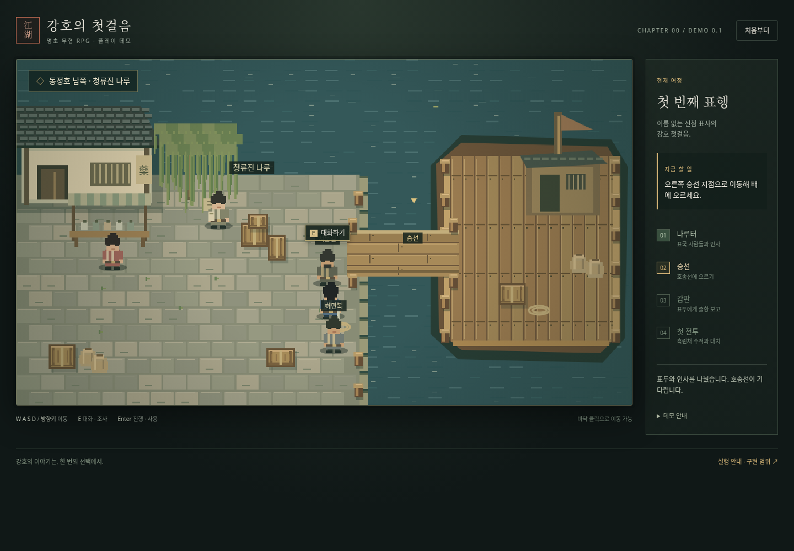
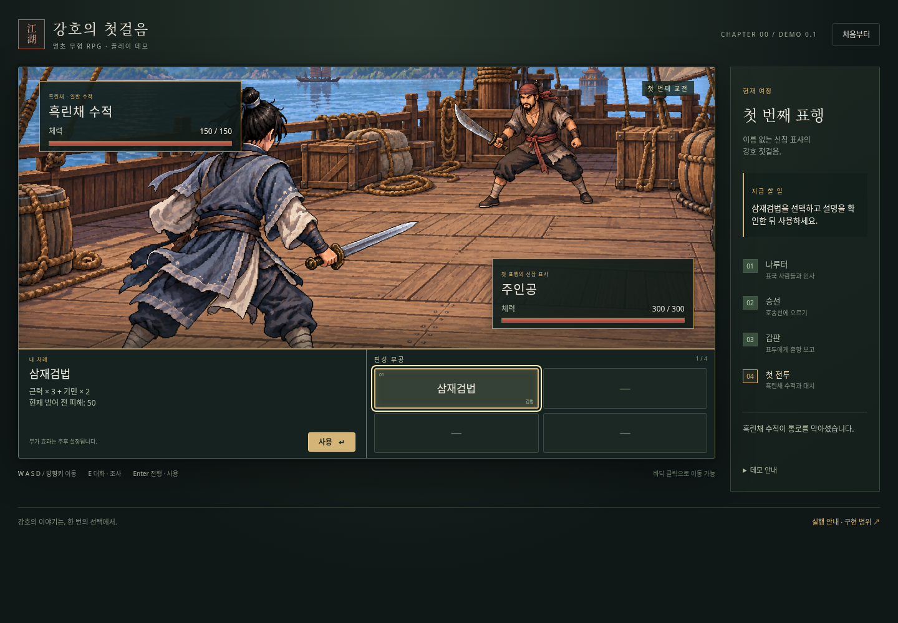

# 0장 「가라앉은 약속」 플레이 데모

출항 전 나루터부터 배 위의 첫 전투까지 플레이하는 작은 브라우저 데모입니다. 설치·빌드·외부 라이브러리·계정 연결 없이 실행됩니다. 탐험은 Canvas로 그린 임시 도트 맵이고, 전투에는 기존 시안을 바탕으로 제작한 별도의 배경 이미지를 사용합니다. 이전 웹 프로토타입으로 보관하며, 현재 개발 대상은 [Godot 본게임](../godot/README.md)입니다.

## 실제 실행 화면





## 실행

Windows PowerShell에서 저장소 폴더로 이동한 뒤:

```powershell
cd C:\Users\PC\murim-rpg
git pull
Start-Process .\demo\index.html
```

또는 파일 탐색기에서 `demo/index.html`을 더블클릭합니다. 저장소 전체를 내려받아 `demo/`와 `godot/assets/battle-deck.png`의 상대 경로를 유지해야 합니다. 전투 배경은 Godot 원본을 공유하므로 `demo/` 폴더만 분리하면 배경이 표시되지 않습니다. GitHub의 파일 미리보기는 게임을 실행하지 않습니다.

로컬 서버를 선호한다면 저장소 루트에서 `python -m http.server 8000`을 실행하고 `http://localhost:8000/demo/`를 엽니다. 서버는 필수가 아닙니다.

## 조작

| 동작 | 조작 |
| --- | --- |
| 이동 | WASD / 방향키 / 이동 가능한 바닥 클릭 |
| 대화·승선·보고 | 가까이에서 E 또는 Enter / 가까운 인물 클릭 |
| 다음 대사 | Enter / E / 대화창의 다음 버튼 |
| 무공 설명 | 오른쪽 삼재검법 클릭 |
| 무공 실행 | 왼쪽 사용 버튼 / 무공 선택 후 Enter |
| 터치 기기 | 화면 아래 방향 버튼과 대화·진행 버튼 |
| 재시작 | 우측 상단 처음부터 |

## 진행

1. **표행 시작**을 누르고 도입 대화를 넘깁니다.
2. 오른쪽 나루 끝의 **서문길** 가까이 이동해 대화합니다.
3. 오른쪽 **승선** 지점에서 배에 오릅니다. 다른 사람과의 대화는 선택 사항이며 보상 분기는 없습니다.
4. 갑판 오른쪽 위의 **서문길**에게 보고합니다.
5. 흑린채 습격 대화 뒤 별도 전투 화면에 들어갑니다.
6. **삼재검법**을 클릭해 설명을 확인하고 **사용**을 누릅니다. 상대는 자동으로 반격합니다.
7. 네 번째 공격으로 수적을 쓰러뜨리면 데모가 끝납니다.

타이틀의 **전투만 체험**을 선택하면 바로 전투를 확인할 수 있습니다. 진행은 저장하지 않으며 처음부터/새로고침으로 초기화됩니다.

## 확정 설정을 반영한 부분

- 1인 턴제 전투. 주인공은 왼쪽 아래 후면, 적은 오른쪽 위.
- 탐험 화면에 체력 HUD 없음. 매 전투 시작 시 체력 전부 회복.
- 초기 주인공: 근력·기민·근골·내공·오성 각10, 체력300.
- 삼재검법 방어 전 피해: `근력×3 + 기민×2 = 50`.
- 초기 적 기준안: 근골5, 체력150.
- 방어 공식: `max(0, 전체 피해 - 근골) × 100 / (100 + 근골)`.
- 사전 편성 무공 슬롯4개. 초기에는 삼재검법과 빈칸3개. 빈칸은 사용할 수 없음.
- 무공 클릭은 설명 미리보기이며 즉시 공격하거나 턴을 소비하지 않음.

## 데모를 위해 임시로 정한 부분

이 항목들은 구현을 위한 임시값이지, 전체 게임의 확정 규칙이 아닙니다. 전투용 값은 `game.js` 상단 `CONFIG`에서 확인할 수 있습니다.

- 적의 방어 전 공격 피해40 → 주인공 근골10 적용 후27.
- 피해의 소수점 버림 → 삼재검법은 적에게42 피해.
- 주인공 선공, 번갈아 한 번씩 행동, 명중 확정. 회피·치명타·내력 소모·부가 효과 없음.
- 네 번의 삼재검법과 세 번의 반격 후 적 체력0, 주인공 체력219.
- 별도 **사용** 버튼으로 실행 확정.
- 청류진이라는 나루 이름, 서문길·진소옥·허만복·육승이라는 임시 인물과 대사.
- 절차적으로 그린 임시 탐험 맵, 단순 이동 충돌, 임시 스프라이트. 캐릭터 생성·본격적인 무공 편성 메뉴 없음.

## 포함하지 않은 것

침몰·표국 해체·귀물 또는 사람 선택·수령인 방문·자유 탐험 본편·성장·저장·아이템·패배 처리·효과음·전체 문파 구현은 이번 범위에 포함하지 않았습니다. 네임드 인물에게 전투 수치를 부여하지 않았고 공개되지 않은 배후 설정을 노출하지 않았습니다.

## 파일

- `index.html`: 화면과 메뉴
- `style.css`: 반응형 UI
- `game.js`: 이동·대화·진행·전투
- `../godot/assets/battle-deck.png`: Godot 본게임과 공유하는 전투 배경 시안

배경 이미지를 포함한 모든 실행 자원은 로컬 파일입니다. CDN, 네트워크 호출, 외부 폰트 또는 패키지 설치가 필요하지 않습니다.

## 검증 기록

Chromium 자동 플레이로 나루터 대화 → 승선 → 갑판 보고 → 전투 진입 → 무공 미리보기 → 4회 공격 승리까지 확인했습니다. 중복 클릭 방지, 재전투 시 체력 회복, 공격 처리 중 재시작, 키보드 진행, 390px 모바일 화면의 가로 넘침 및 브라우저 오류도 확인했습니다.
