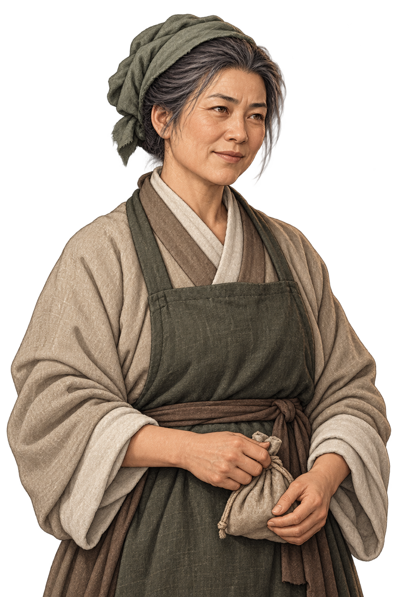
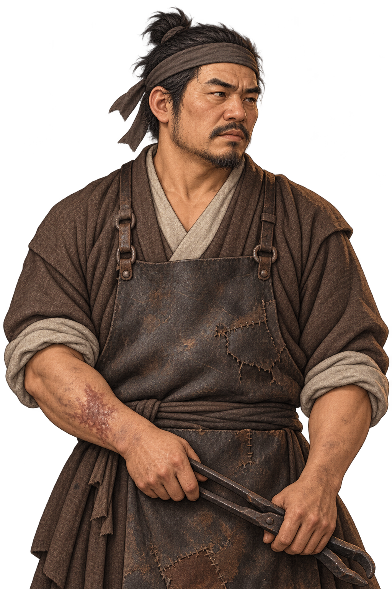
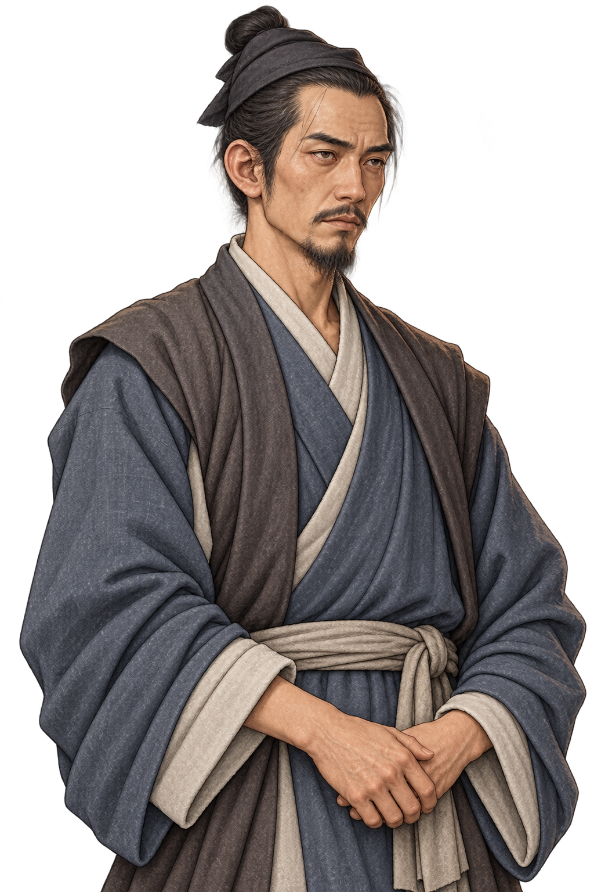
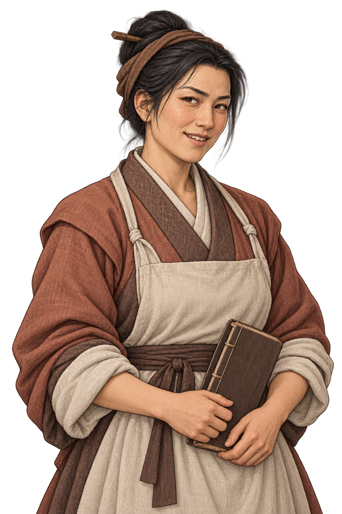
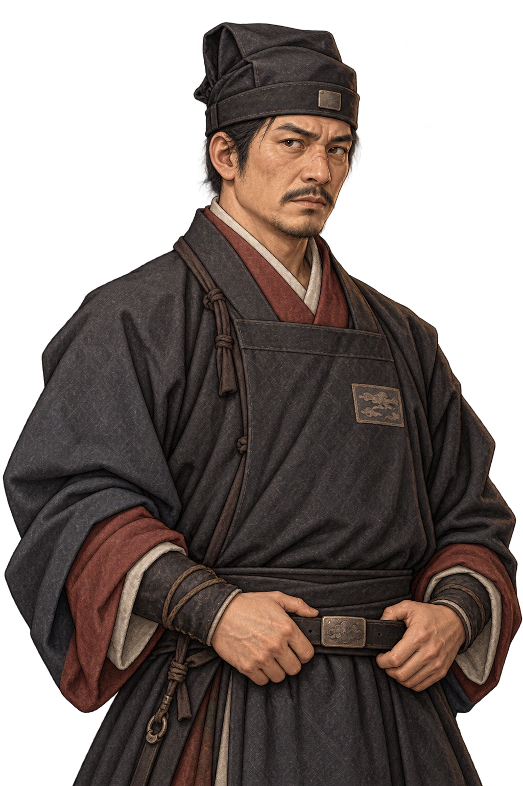
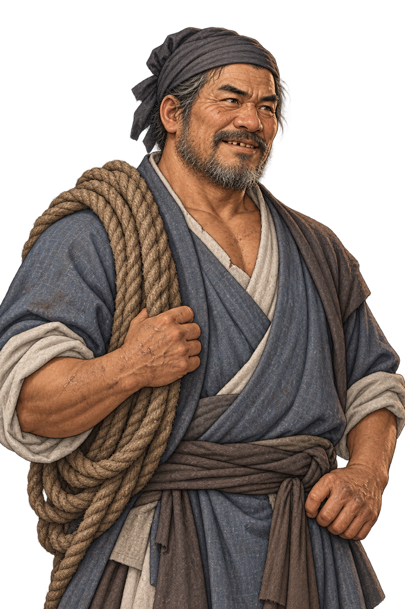
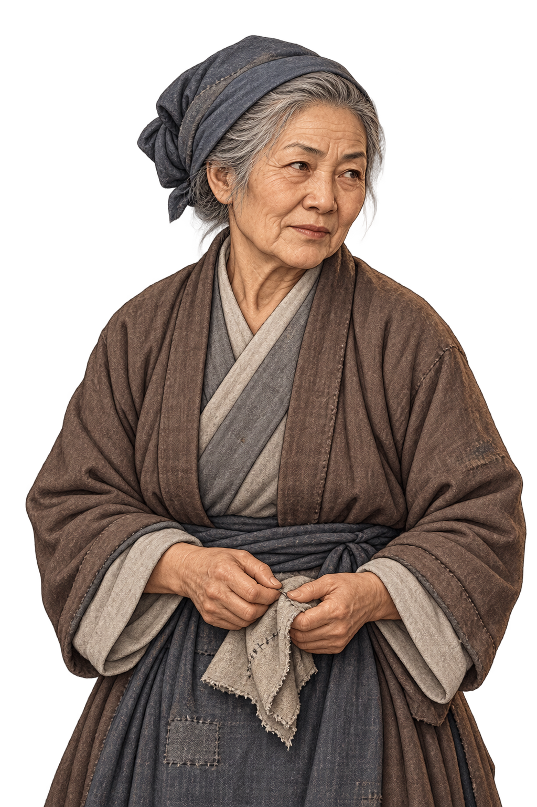
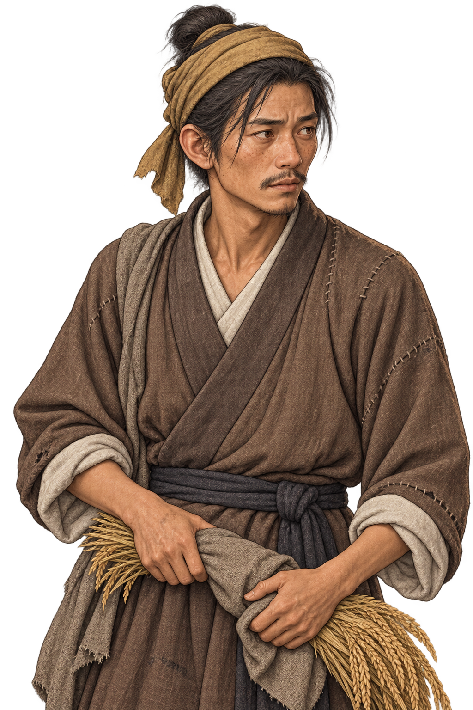

# 기본 NPC 초상화 18장

현재 게임의 공용 이미지 목록이다. 남성10장·여성8장. 이름은 처음 이미지를 사용한 무창 주민 또는 현재 의뢰 인물을 가리키며, 다른 일반 주민에게도 재사용한다. 주인공·전용 스토리 인물 그림은 포함하지 않는다. 이미지를 누르면 원본을 볼 수 있다.

| 이미지 | 이미지 | 이미지 |
| --- | --- | --- |
| **01. 남성 · 중년**  `male_middle` | **02. 남성 · 일반 A (구칠 사용)**  `male_common_a` | **03. 남성 · 일반 B**  `male_common_b` |
| **04. 남성 · 청년 (임소평 사용)**  `male_young` | **05. 남성 · 노인**  `male_elder` | **06. 여성 · 중년**  `female_middle` |
| **07. 여성 · 일반 A**  `female_common_a` | **08. 여성 · 일반 B**  `female_common_b` | **09. 여성 · 청년**  `female_young` |
| **10. 여성 · 노인**  `female_elder` | **11. 여성 · 약재상 (유백초)**  `female_herbalist` | **12. 남성 · 장인 (석대용)**  `male_blacksmith` |
| **13. 남성 · 교관 (임정산)**  `male_instructor` | **14. 여성 · 객잔 주인 (도삼랑)**  `female_innkeeper` | **15. 남성 · 포두 (육정호)**  `male_constable` |
| **16. 남성 · 하역반장 (오덕수)**  `male_dockworker` | **17. 여성 · 노년 주민 (정씨 할머니)**  `female_elder_seamstress` | **18. 남성 · 농부 (주계복)**  `male_farmer` |

**2026-10-25:** 04번 청년 남성과09번 청년 여성은 일반 주민에 맞춰 더 평범한 인상으로 교체했다. 같은 공용 그림을 쓰는 기존 인물에게도 적용된다.

기준: [게임의 기본 NPC 이미지 목록](../../godot/data/basic_npc_portraits.json).
