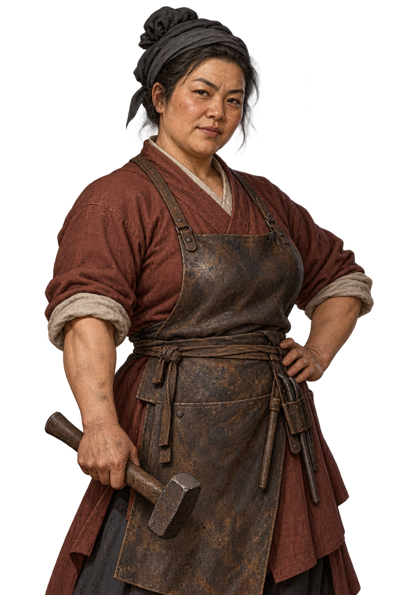
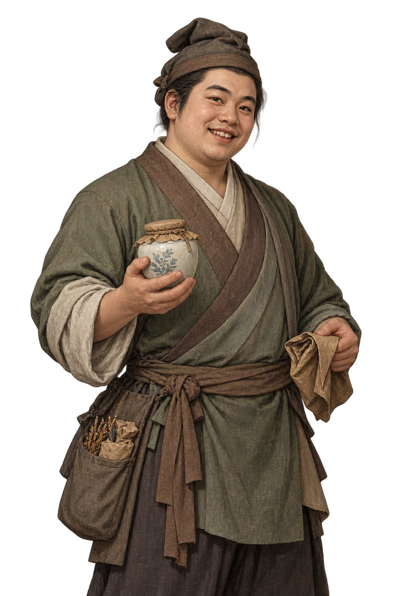
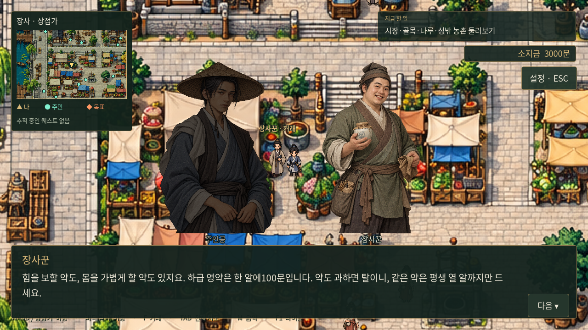
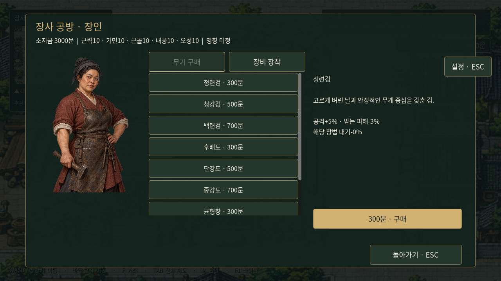

# 장사 거래 NPC 일러스트

기존 NPC의 성별·연령을 유지해 공용 초상화 대신 전용 일러스트를 연결했다. 인물명은 아직 직업 호칭을 사용한다.

| 장인 — 공방거리 | 교관 — 무관 앞 | 장사꾼 — 상점가 |
|---|---|---|
|  |  |  |
| 단단한 체격과 그을린 얼굴, 가죽 앞치마와 망치. 손에 맞는 무기를 권하는 실용적인 인물. | 마른 근육과 흉터, 단정한 남색 수련복. 엄격하지만 차분하게 조건을 설명하는 인물. | 둥근 얼굴과 붙임성 있는 미소, 약단지와 수수한 녹색 복식. 복용량을 챙기는 친근한 상인. |

## 인사 대사

**장인:** “검이든 도든 창이든 손에 맞아야지요. 삼백, 오백, 칠백문짜리가 있습니다. 날을 한번 살펴보고 고르세요.”

**교관:** “무공은 모두 삼백오십문에 가르치오. 다만 몸과 깨달음이 따라야 배울 수 있소. 배운 뒤에는 쓸 무공 세 가지를 미리 골라두시오.”

**장사꾼:** “힘을 보할 약도, 몸을 가볍게 할 약도 있지요. 하급 영약은 한 알에100문입니다. 약도 과하면 탈이니, 같은 약은 평생 열 알까지만 드세요.”

대화 후 [거래 창](../systems/city-trading.md)을 연다. 거래 후에는 구매/학습 결과를 각 NPC의 짧은 말로 안내한다.

