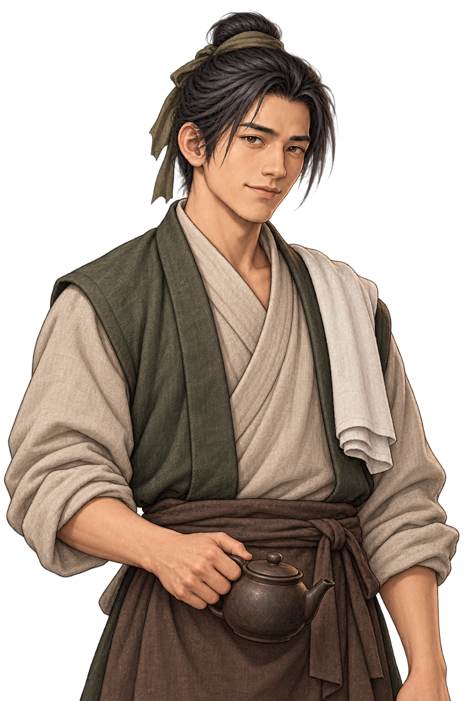

# 육소전 — 점소이로 신분을 감춘 하오문 연락 인물

26세 남성. 남경 객잔의 점소이이며 하오문에 속해 손님의 왕래와 민초들의 생활 변화를 살피는 연락 인물이다. 붙임성이 있고 손님의 끼니·짐·행선지를 기억하지만 동료의 이름이나 정보 출처를 함부로 밝히지 않는다. 능청스러운 미소와 관찰하는 눈빛을 함께 지닌다. 문주·고위 간부나 사건을 모두 아는 인물로 격상하지 않으며 전투 수치와 무공은 정하지 않는다.

올리브색 두건과 짧은 조끼, 베이지색 저고리, 갈색 앞치마, 어깨에 흰 수건과 작은 찻주전자를 특징으로 전용 초상화와 탐험용 단일 프레임 도트를 제작했다. 두 그림은 같은 복식과 인상을 공유한다. 배경은 투명하며 탐험 도트는 기존 주민 높이132에 맞춰 표시한다. 대화 초상화는 주인공 기준 눈높이·얼굴 비율·시선 반전을 적용한다.

[전용 탐험 도트](../../godot/assets/characters/lu-xiaozhuan.png) · [실제 대화](../../godot/screenshots/nanjing-lu-dialogue.png) · [객잔 앞 플레이](../../godot/screenshots/nanjing-inn-play.png)

`nanjing_characters.json`의 같은 `lu_xiaozhuan` 인물에 초상화와 도트를 연결했다. 새 NPC를 중복 배치하지 않는다. 공용 기본18장과 다른 주민의 이미지는 바꾸지 않는다. 이름표는 **육소전 · 점소이**이며 하오문 소속·직책·문양은 표시하지 않는다. 전수 선행 조건·조사 흐름·남궁 보상·마지막 부재 및 저장 복원은 유지한다.

원본 파일/해시는 `godot/assets/portraits/haomun/lu-xiaozhuan-art.json`에 기록했다. 이미지 픽셀은 후처리하지 않고 도트의 투명 여백을 런타임 AtlasTexture 영역으로 제외했다. `nanjing_relief.gd`에서 대화에 실제 선택되는 전용 초상화와 탐험 Sprite의 아틀라스 경로, 기존 의뢰의 실제 F 진행·부재/저장을 확인한다.
