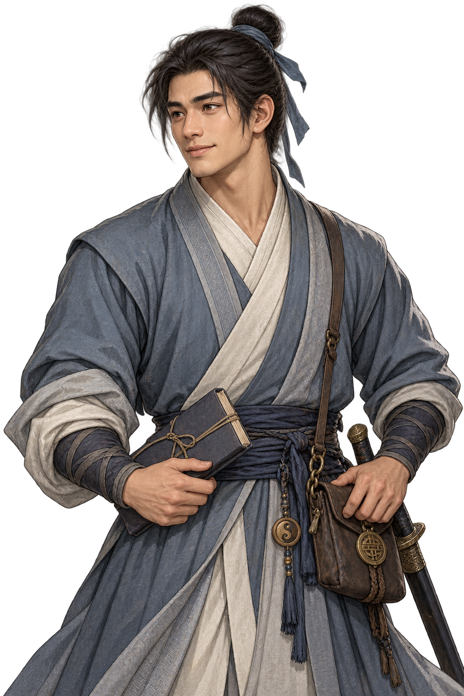

# 송지겸 · 무당 속가 출신 무림맹 무사

24세. 무당에서 속가의 가르침을 받은 무림맹 외무 무사다. 맹의 체면뿐 아니라 그 이름을 믿고 살아가는 민초들의 사정도 중요하게 여기며, 연락과 보고·현장 확인을 부지런히 맡는다. 장사에서 도원을 초대하고 정문에서 신원을 보증하며, 사칭 사건 해결 뒤에는 맹을 대표해 감사를 전한다. 상시 마을 주민으로 남기지 않는다.

## 전용 일러스트

- 청회색 무복과 흰 속깃, 남색 띠, 단정한 상투와 좁은 머리끈으로 무당 속가제자다운 절제된 인상을 살렸다. 도관의 정식 도사 복식이나 화려한 갑옷은 입히지 않았다.
- 허리의 작은 태극 장식은 배운 곳의 흔적이며, 서책·문서 가방·동제 업무 패찰은 무림맹 사절의 역할을 드러낸다. 칼은 뽑지 않고 검집에 둔다.
- 약간 햇볕을 탄 얼굴, 부드럽고 주의 깊은 눈빛과 옅은 미소로 민초에게도 다가가기 쉬운 성실한 청년을 표현했다. 복장은 해지지 않았으나 길을 다닌 주름과 생활감이 있다.
- 이미지 생성 도구로 제작한1024×1536 RGBA 원본을 그대로 저장했다. 픽셀 후처리 없이 공통 대화 셰이더에서 얼굴 크기·눈높이·좌우 시선을 맞춘다.

## 실제 적용

`dialogue_portraits.gd`의 `song_jigyeom` 한 곳에서 전용 파일을 지정한다. 초대/보증을 맡는 `alliance_story.gd`와 감사 사건의 `impostor_quest.gd`가 기본 청년 이미지로 덮어쓰던 등록을 제거했다. 기존 저장의 인물ID와 대사는 그대로이므로 다시 불러와도 전용 그림을 사용한다.

이 그림은 송지겸 전용이며 **기본 마을 NPC18장에는 추가하지 않는다**. 일반 청년 남성 그림과 주인공·다른 인물 그림은 유지한다. 전투 수치·퀘스트 보상·이야기 분기를 바꾸지 않았다. 탐험 도트는 기존 것을 사용한다.

[장사 초대 화면](../../godot/screenshots/song-portrait-invitation.png) · [정문 보증 화면](../../godot/screenshots/song-portrait-guarantee.png) · [무림맹 감사 화면](../../godot/screenshots/song-portrait-thanks.png)

`tests/dialogue.gd`로 전용 이미지 등록·프레이밍·시선·저장 호환을, `tests/basic_npc_portraits.gd`로 기본18장 유지를 확인한다. 기존 `alliance_story.gd`, `impostor_quest.gd` 검사로 실제 등장 흐름도 확인한다. `capture_song_portrait.gd`는 토벌/전수 완료 상태를 촬영 도구 안에서 구성해 세 장면을 재현한다.
