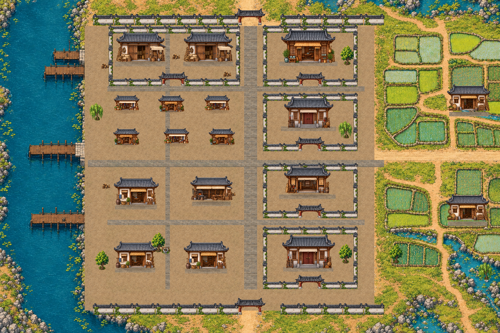

# 장사 · 소박한 생활 도시 미술

최신 외성/통로 배치는 [세 도시 성곽과 남경 북쪽 황궁](three-city-fortifications.md)을 따른다. 아래 그림은 성곽 교체 전의 미술 비교 기록이다.

2026-10-30. 남경 시장의 정면 시점·재질·비율 보존·접지 그림자를 기준으로 장사 전체의 주요 건물을 교체했다. 수도의 금장·주칠·화려한 누각 대신 목재·회벽·회색 기와·무명 천막·생활용품을 사용한다. 별도 데모가 아닌 기존2D 게임의 실제 장사 맵이다.

[전체 원본](../../godot/screenshots/changsha-painted-full.png) · [1440p 실제 화면](../../godot/screenshots/changsha-painted-1440p.png)

| 구역 | 표현 | 실제 플레이 |
| --- | --- | --- |
| 시장 | 채소·그릇·평범한 옷감의 잡화점과 작은 찻집을 번갈아 배치 | [시장](../../godot/screenshots/changsha-painted-market.png) |
| 공방 | 농기구·목재·작은 화로·작업대가 있는 열린 공방 | [공방](../../godot/screenshots/changsha-painted-workshops.png) |
| 하역·창고 | 넓은 목재 문, 밧줄·자루·나무통 | [창고](../../godot/screenshots/changsha-painted-harbor.png) |
| 주거 | 회벽·나무 덧문·물항아리·빨랫감 | [주거](../../godot/screenshots/changsha-painted-housing.png) |
| 관아·무관·객잔 | 절제된 작은 관아, 수련 기구와 열린 무관, 편안한 객잔 | [무관](../../godot/screenshots/changsha-painted-martial.png) |
| 농촌 | 장작·바구니·농기구가 붙은 농가, 기존 논밭 유지 | [농촌](../../godot/screenshots/changsha-painted-farm.png) |

## 원본과 구현

신규8종은 `assets/maps/changsha/painted/{living,town}.png`다. 남경 시장 원본을 참조로 생성하고 가공 없이 보관했다. 출처/해시는 같은 폴더의 `art-manifest.json`에 기록한다. 장사 전용 `painted/prefabs.json`을 분리해 다른 도시가 공유하는 기존 `layered/prefabs.json`을 바꾸지 않는다. 종횡비를 보존하고 발밑을 정렬하며 그림자는 공통 `city_scenery.gd`를 사용한다. 문·담장·나무·우물·짐 등의 기존 독립 오브젝트는 재사용한다.

바닥은 `changsha_painted_ground.gd`/`changsha_painted.gdshader`에서 남경 시장의 원본 재질을 월드 단위로 샘플링한다. 대부분은 다진 흙으로 두고 대로·좁은 보행축·건물 문턱에 포장을 사용한다. 기존 상강과 나루·논밭·수목 지형은 보존한다. 건물을 바닥에 굽지 않고 미니맵/전체 지도도 실제 건물의 최종 표시 사각형을 사용한다. 별도 지도용 바닥 캐시는 `painted/overview-floor.png`다.

세계 크기6144×4096, 기존 오브젝트/NPC/의뢰 대상ID·포탈·의뢰/거래/보상은 유지한다. 인물 그림과 이동 속도도 유지한다. 건물 비율 변경에 따른 주민 안전 배치는 기존 전신 겹침 방지와 저장 안전 위치 보정 경로를 사용한다.

## 확인

`layered_city.gd`는 발밑 정렬·실제 물리 충돌·문 중앙 통과/기둥 차단·주민 전신 겹침/접근과 새 건물의 동일X/Y 배율을 확인한다. `changsha.gd`, `changsha_residents.gd`, `onboarding_menus.gd`는 도시 이동·주민·시설 안내 연계/거래/I·K/저장을 검사한다. 기존 도시 검사의 과거 고정 카메라1.5 기대값은 실제 설정값 복원 검사로 수정했으며 카메라 동작은 변경하지 않았다.

검증 제한: 구형 `bandit_story.gd`는 적 체력180/240·주인공300과 이전 턴제 선택 함수를 가정하여 실패했고 후속 반복은 중단했다. 현재 격자 전투·공통 체력식과 맞지 않는 검사이며, 이번 미술 작업에서 전투 코드를 바꿔 맞추지 않았다. 현재 전투 입구/모달/저장 연계는 `grid_story_integration.gd`로 별도 확인한다. 이 작업으로 토벌 전체 전투 회귀 검사가 통과했다고 보고하지 않는다.

`capture_changsha_painted.gd`는 실제 게임 장면6곳과1440p, 별도 전체 지도·지도 바닥 캐시를 렌더한다. 전체 지도는 인물 없는 축소 렌더다. 분리된XDG 사용자 데이터와 Godot4.6.3/소프트웨어OpenGL을 사용한다. Windows GPU 성능 검사는 별도다.
