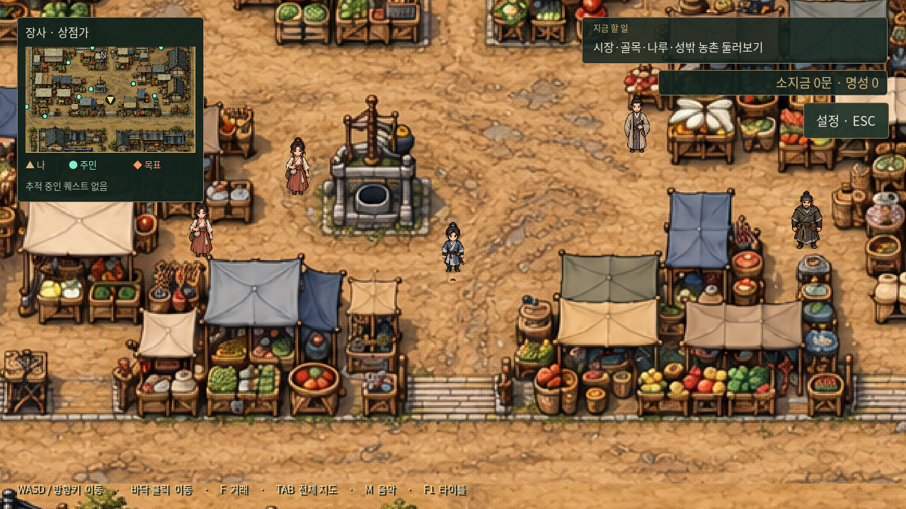

# 장사 거리 미술과 충돌 수정

명 초기 상강 수운 도시의 생활감을 살리기 위해 실제 탐험에 쓰는 세부 배경 4장을 수정했다. 규칙적으로 늘어선 가로수와 정원식 화단을 크게 줄이고, 시장·공방·주거 골목과 주요 도로는 다져진 황토·흙길로 바꿨다. 판석은 문턱·배수로·성문과 주요 건물 진입부에 제한적으로 남겼다. 회색 기와·낡은 목재·담백한 회벽과 채도를 낮춘 천막을 유지한다. 실제 명대 장사의 실측 복원도는 아니며 게임용 가상 배치다.

## 충돌과 주민

- 기존 건물·노점·지형 장애물의 범위를 보정하고 담장·나무·짐 더미·작업대·우물·연못·바위 등의 빠진 영역을 추가했다. 제거한 화단·나무의 장애물은 없앴다.
- 장애물은 Godot의 실제 사각 충돌체로 만든다. 통행 구역 외곽의 경계도 물리 충돌을 가진다. WASD와 클릭 이동 모두 같은 지형을 따른다.
- 주민 30명과 토벌 인물 2명에게 발밑 원형 충돌체를 추가했다. NPC 몸 전체가 건물·소품과 겹치지 않도록 여유를 두고, 길 중앙을 피하며 각 시설의 구역 안에서 배치를 조정했다. 현재 주민은 정지한 상태이며 배회 행동은 추가하지 않았다.
- NPC 배치 시 빈자리를 다시 확인하며, 경로 이동은 캐릭터의 발 반경과 NPC 충돌 영역을 고려한다. NPC를 클릭하면 몸 안이 아닌 대화 거리의 옆자리로 이동한다. 담장 너머에서는 상호작용하지 않는다.
- 객잔·관아의 문루는 지붕 표현과 충돌 범위를 분리했다. 기둥은 막고 문 사이 통로는 열어 마당 진입을 유지한다. 지붕은 발밑 깊이에 따라 인물을 가린다.
- 교관은 무관 안의 짐·가림막과 겹치던 곳에서 빈 마당으로 옮겼다. 장인·창고지기 등도 접근 가능한 자리로 조정했다. 이동한 주민은 미니맵·전체 지도·퀘스트 안내에 실제 좌표로 반영된다. 장부 조각의 기획상 안내 좌표도 장애물을 피하도록 수정했다.
- 이전 저장 위치가 추가된 장애물이나 NPC와 겹치면 불러올 때 가까운 빈자리로 이동시킨다. 진행·보상·인벤토리는 기존 저장값을 따른다.

## 데이터와 검증

`godot/assets/maps/changsha/layout.json`의 `blockers`는 기본 충돌 범위, `scenery_objects`는 종류와 ID를 가진 추가 장애물, `visual_occluders`는 통로가 열린 문루 등의 시각적 가림 범위다. 좌표는 기존 1536×1024 배치 기준이며 실제 월드는 6144×4096이다. 배경·NPC·충돌·미니맵은 동일한 좌표 변환을 사용한다. 세부 그림 교체 시에는 장애물과 통로도 함께 점검한다.

`city.png`는 초기 배치 참고 자료로 유지한다. 실제 화면·미니맵·전체 지도는 수정한 `detail/`의 4장을 표시한다.

검증은 `tests/changsha.gd`(지점·32명 접근·겹침·실제 이동), `tests/city_collision.gd`(건물·담장·나무·소품의 물리 충돌, NPC 충돌과 접근 경로, 충돌 경계에서 클릭 이동, 과거 저장 복원), `tests/quest_navigation.gd`, `tests/city_services.gd`, `tests/saves.gd`, `tests/prologue.gd`, `tests/bandit_story.gd`를 사용한다. NPC 목표의 도달 검사는 점유된 발 좌표까지 들어가는 대신 실제 대화 거리까지 접근하는 경로로 검사한다.

`tests/capture_city.gd`로 실제 플레이·미니맵·전체 지도·시설 화면을 캡처한다. 별도 배포 데모는 만들지 않는다.
