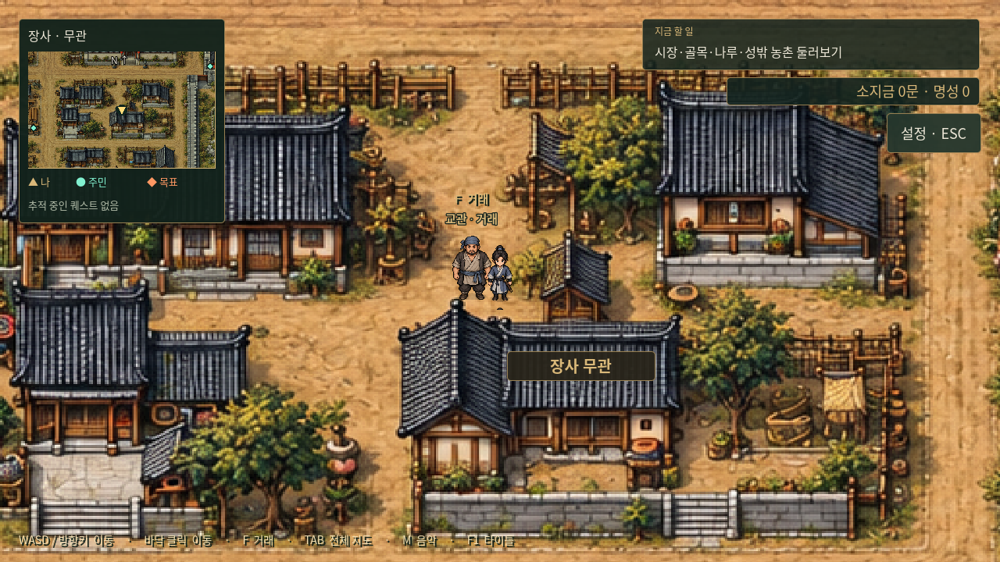
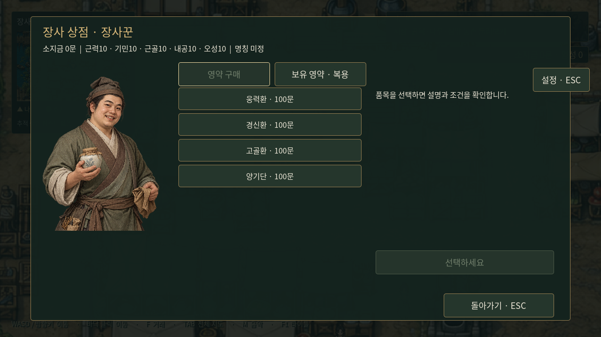

# 도시 공통 구성과 장사 적용

사용자 확정: 앞으로 만드는 모든 도시는 **상점가, 관아, 무관, 공방거리, 객잔, 주거구역**을 갖춘다. 추가 구역은 사용자가 별도로 지정하거나 해당 도시의 특성에 맞게 구성한다. 모든 도시를 같은 평면으로 복제하지 않고, 공통 시설을 각 도시의 규모·지형에 맞춰 배치한다.

| 공통 구역 | 기본 역할 | 이번에 연결한 시설 NPC |
|---|---|---|
| 상점가 | 물품 거래 | 장사꾼 |
| 관아 | 행정 구역 | 별도 지정 전 |
| 무관 | 수련·무공 관련 시설 | 무관 앞 교관 |
| 공방거리 | 장인의 작업과 의뢰 | 장인 |
| 객잔 | 숙박·왕래의 거점 | 별도 지정 전 |
| 주거구역 | 주민 생활 공간 | 별도 지정 전 |

공통 구역 목록은 `godot/data/city_standards.json`에, 도시별 구역·시설 NPC는 해당 도시의 `layout.json`에 저장한다. `category`가 공통 구역을 식별하며 한 종류의 주거구역이 여러 블록에 나뉠 수 있다. 관아·객잔 등의 구체 기능은 아직 정하지 않았다.

## 시설 NPC의 기본 이미지

앞으로 모든 도시에 상인·장인·교관을 배치한다. 각 직업은 **장사형/무창형2종 중1종**을 선택하고 해당 도시의 인물로 고정한다. 이름과 설정은 별도로 부여하며, 대화·거래창이 같은 그림을 사용한다. 원본 파일은 복제하지 않고 [직업별 공용 이미지 목록](../characters/service-npc-gallery.md)과 `godot/data/service_npc_portraits.json`을 참조한다. 현재 두 도시의 배치는 유지한다.

## 장사

최신 배경과 NPC 충돌·배치는 [장사 거리 미술과 충돌 수정](changsha-redesign.md)을 따른다. 아래 시설 좌표는 해당 수정 이후 배치다. 실제 거래 기능은 [거래 시스템](../systems/city-trading.md)에 정리했다.

기존 맵의 상점가·관아·객잔·공방거리·주거구역을 유지하고 남동쪽 기존 건물과 앞마당을 **장사 무관**으로 지정했다. 기존 사당·정원은 무관 남쪽 별도 구역으로 유지한다. 도시 특성 구역으로 상강 나루·하역장·창고거리, 동문 밖 농촌을 둔다. 새로운 건물 배경 그림을 생성한 것이 아니라 기존 도시의 건물 용도·구역 경계·지도 표기와 현판을 수정했다.

| 시설 NPC | NPC ID | 원본 맵 좌표 | 위치 |
|---|---|---|---|
| 장사꾼 | `city_merchant` | 396, 335 | 상점가 노점 앞 |
| 장인 | `city_artisan` | 630, 660 | 공방 작업장 앞 |
| 교관 | `city_instructor` | 950, 599 | 무관 앞마당 가장자리 |

새 인원을 길 가운데 추가하는 대신 생활 주민 3명을 해당 역할로 바꿨다. 총 30명과 의뢰 원고 관련 14명을 유지한다. 포목상·목수 등의 기존 의뢰 인물과 거래 시설 NPC를 구분한다. 공용 도트 캐릭터·초상화를 사용하며 고유 인물 설정이나 전투 능력치는 부여하지 않았다.

## 시설 이용 흐름

1. NPC 가까이 가면 `F 거래` 안내가 표시된다.
2. F키로 말을 걸면 주인공과 상대의 공용 초상화가 나타난다. 발언자 강조·듣는 인물 어둡게 처리 규칙을 따른다.
3. 대화를 넘기면 시설 창을 연다. 장사꾼은 구매/판매, 장인은 제작/수리, 교관은 수련/무공 전수 탭을 제공한다. 이 구분은 추후 내용을 넣기 위한 임시 UI다.
4. 돌아가기 버튼 또는 ESC로 닫으면 이동을 재개한다. 대화·시설 이용 중에는 이동을 멈추고, F1 초기화 시 창을 정리한다.

**사용자 지시에 따라 구체적인 상품·매입 품목·제작법·수리 조건·수련·전수 무공·가격·재화·능력치 효과는 비워 두었다.** 현재는 시설 진입과 빈 거래 창을 이용할 수 있으며 실제 구매·판매·제작·수련 결과는 발생하지 않는다. 세부 내용을 정할 때 상품 데이터와 실제 처리 로직을 추가한다. 퀘스트 수락·완료 기능도 이번에 임의 추가하지 않았다.

구현: `scripts/city_service.gd`, `scripts/main.gd`, `scripts/exploration.gd`. 검증: `tests/city_services.gd`에서 공통 6구역, 시설 3종의 올바른 구역 배치, 근거리 상호작용, 양측 초상화, 시설 탭, ESC 복귀와 초기화를 검사한다.

