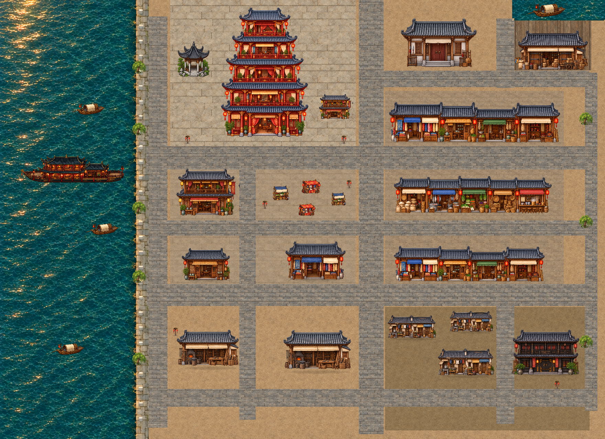
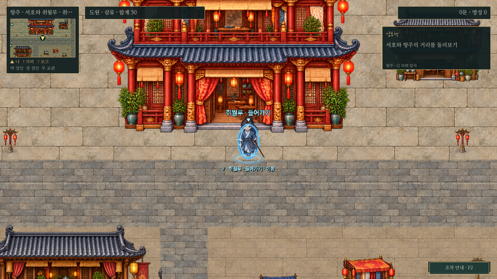
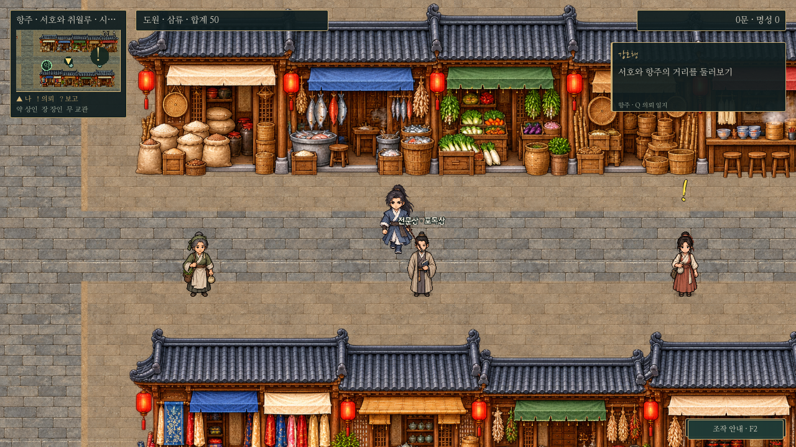
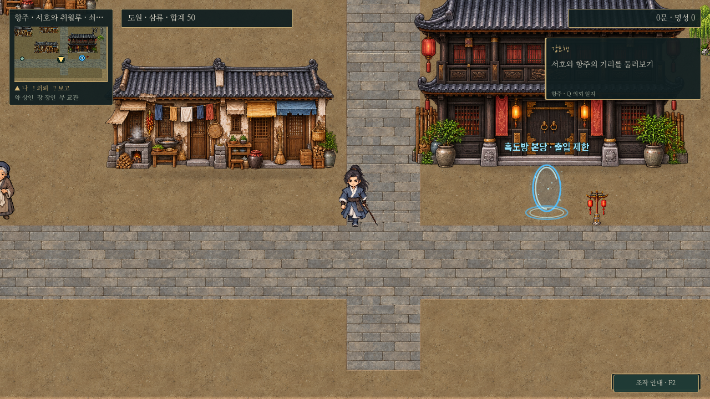
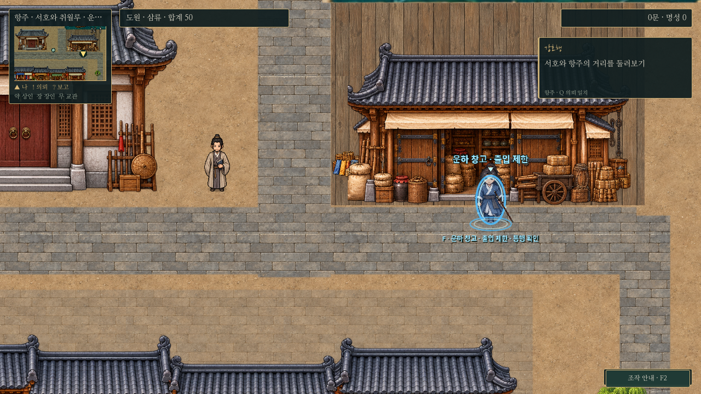
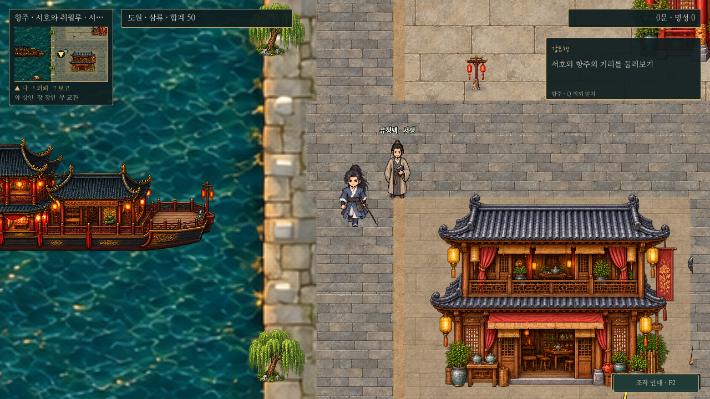
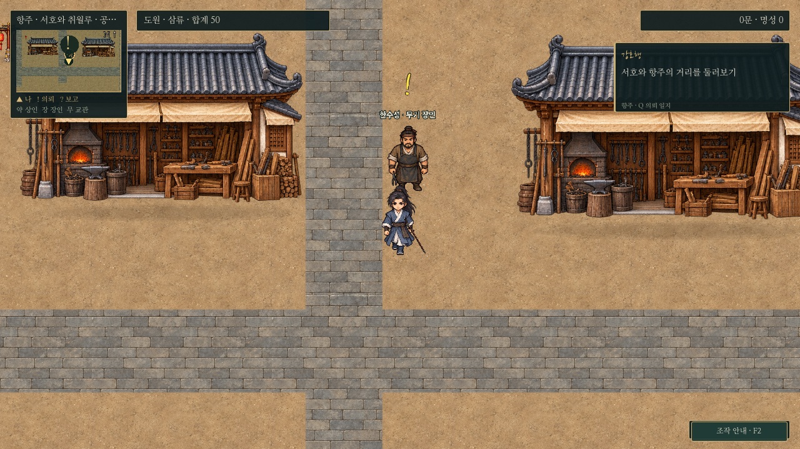

# 항주 · 등불과 물길, 번화가와 쇠락한 골목

남경·장사·무창·소주와 같은 정면 시점, 기와/목재 세부 묘사, 비율 보존과 접지 그림자를 적용했다.2026-10-30. 이전 원본과 취월루 실내는 보존한다.

[전체 크기](../../godot/screenshots/hangzhou-painted-full.png) · [변경 전 지도](../../godot/screenshots/hangzhou-full.png) · [1440p 실제 플레이](../../godot/screenshots/hangzhou-painted-1440p.png)

## 도시 구성

- 북서쪽5층 취월루: 주칠 기둥·금장 난간·층별 회랑/등불/비단 커튼의 새 전용 건물이다. 밝은 석재 마당과 객잔을 연결한다. 기존 F 정문과 단일 실내 연회장/주민은 유지한다.
- 동쪽 시장거리: 좁은 포목·차·약재·칠기 점포, 쌀·생선·채소·바구니·국수 점포가 붙어 있는 두 종류의 연속 점포열이다. 중앙 먹거리 마당은 기존 공동 노점 구성을 유지한다.
- 맞은편 남동쪽 골목: 낡은 회벽·덧댄 차양·빨랫줄·취사 도구의 낮은 주거와 무거운 검은 문/어두운 누각의 흑도방 외관을 대비시켰다. 집들은 앞뒤를 달리 배치하고, 동쪽 샛길은 지붕과 충돌을 피하도록 바깥으로 이동했다.
- 북동쪽 운하 하역장: 목재 마당·쌓인 자루와 상자·수레가 있는 창고와 운송 배를 배치했다. 기존 흑도방 후속이 쓰는 창고 입구도 이곳에 맞춘다.
- 서쪽 수면: 기존 큰 누각 유람선1척과 작은 배3척/버드나무·수변 정자를 유지한다. 큰 배는 경관이며 새 승선 기능을 추가한 것은 아니다.
- 관아·공방·일반 객잔·포목점도 남경/장사 계열의 승인된 미술로 맞췄다. 사용자 예외에 따라 무관/교관은 추가하지 않는다.

| 실제 게임 화면 | 캡처 |
| --- | --- |
| 취월루 입구·기존 도원 비율 |  |
| 시장·기존 주민 |  |
| 낡은 주거·흑도방 |  |
| 운하 창고 |  |
| 유람선 수변 |  |
| 공방 |  |

[취월루 구조 확인용 넓은 시야](../../godot/screenshots/hangzhou-painted-tower-wide.png)는0.45배 카메라와 위쪽 시선으로 촬영했다. 나머지는 실제 기본0.8배 카메라다. 플레이 카메라를 자동 축소한 변경은 아니다.

## 구현·기존 진행 보존

새 원본3장에 취월루1종·구역 건물4종·시장열2종이 들어 있다. `assets/maps/hangzhou/painted/art-manifest.json`에 원본 경로/해시와 참조를 기록했다. 이미지 생성 원본을 수정 없이 보관하고 아틀라스 영역은 각 실제 그림 경계에 맞췄다. 공유 프리팹을 덮어쓰지 않고 항주의 `layout.json`에서만 교체한다.

건물·물건은 독립 투명 오브젝트/충돌/Y정렬을 유지한다. 바닥만 `hangzhou_painted_ground.gd`와 셰이더에서 공통 재질로 마감하며 수면/돌 제방은 유지한다. 미니맵/전체 지도의 `painted/overview-floor.png`는 건물을 숨긴 바닥 캐시이며 건물 표시 사각형은 실제 비율 보존 결과와 같다.

세계5632×4096, 도시 주민10명·취월루6명, 기존 인물 외형/대사·일반5의뢰·취월루 사건·흑도방 후속·보상/전투/중급 영약 판매 조건은 유지한다. 새 NPC/실내/의뢰는 없다. 기존 건물 배치에 가려진 저장 좌표는 공통 안전 위치 보정으로 읽는다.

누락되기 쉬운 기능 요소로 관아/공방/거래처, 취월루 출입, 운하길 귀환, 흑도방 본당과 사건 창고를 확인했다. 안정적인 포탈ID는 유지하면서 출입·귀환 좌표를 창고[1610,218], 본당[1585,1125]로 함께 변경했다. Q/미니맵 추적은 이 포탈ID를 따라간다. 잠긴 본당/창고에 장사 토벌 통행 안내를 표시하던 공통 문구는 해당 건물의 출입 제한으로 수정했다.

## 확인

Godot4.6.3/분리된 XDG 저장에서 `hangzhou_map.gd`(도로/입구·거래·지도·저장·운하길 F 왕복), `hangzhou_residents.gd`(전신 겹침/모든 주민 접근·기존 실내), `hangzhou_quests.gd`(일반5의뢰 동시 진행·분기·보수·추적·구저장), `cuiyue_incident.gd`(승리/패배 중재), `blackguild_story.gd`(실전·두 합의 분기·본당 교섭/보상)를 점검한다. 새 미술과 문턱 접근은 `hangzhou_painted.gd`, 실제 캡처/바닥 캐시는 `capture_hangzhou_painted.gd`로 재현한다. 소프트웨어 OpenGL 캡처이며 Windows GPU 성능 측정은 아니다. 흑도방 검사 종료의 기존 리소스 해제 경고는 스토리 assertion 결과와 구분한다.
