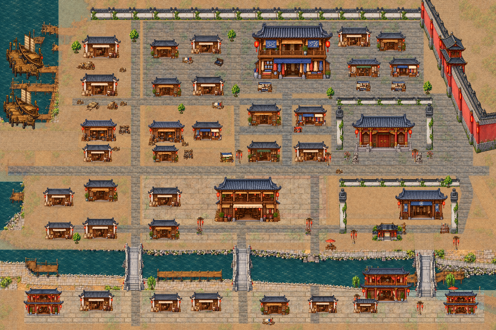
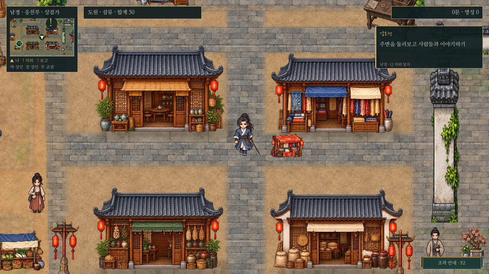
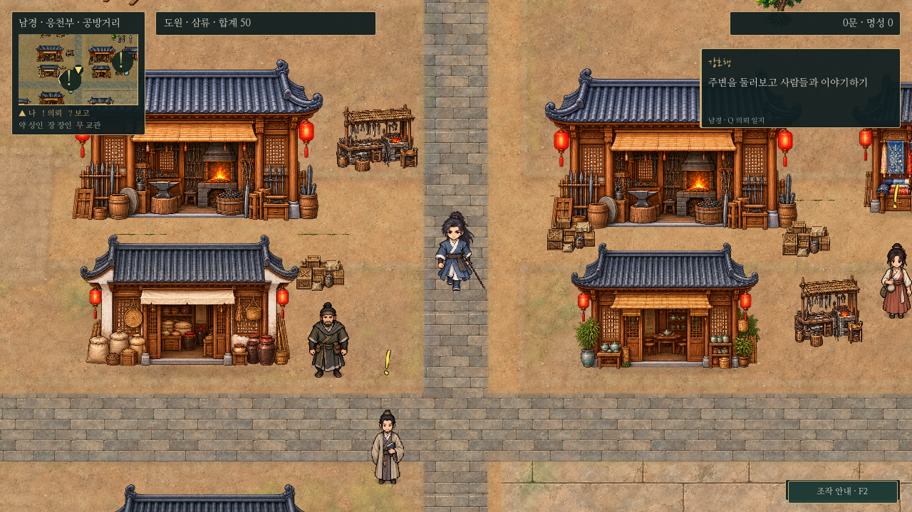
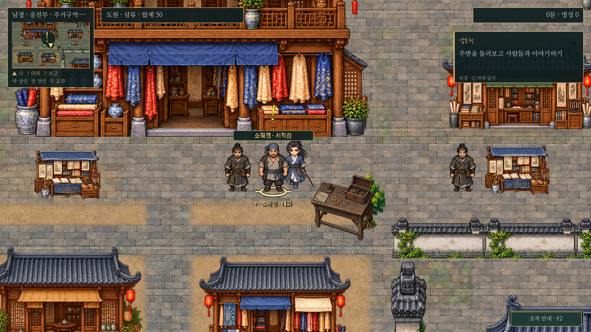
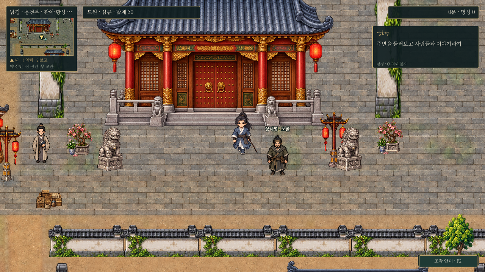
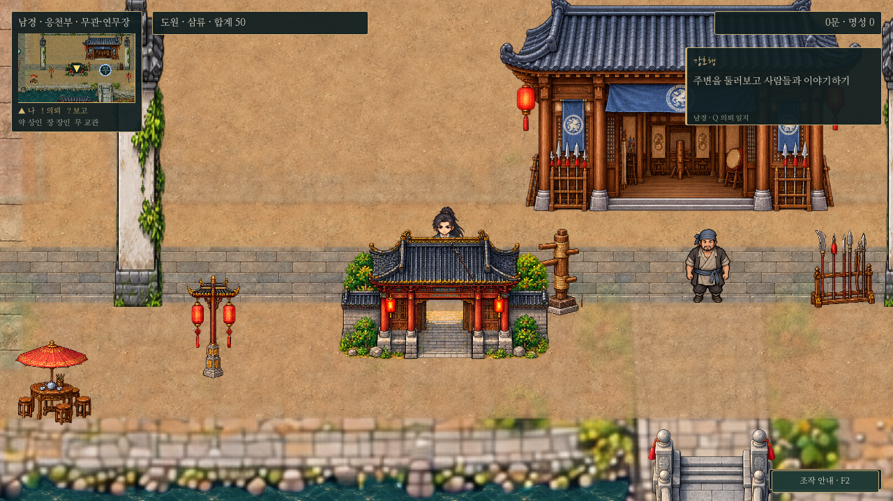
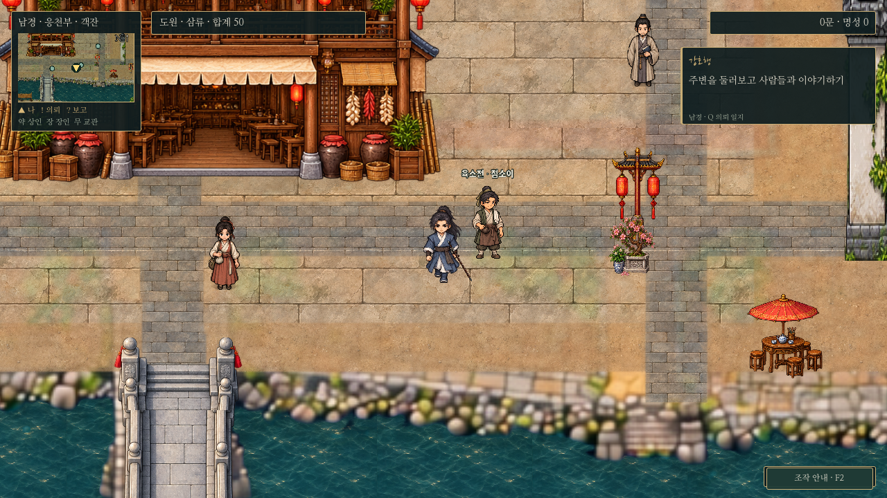
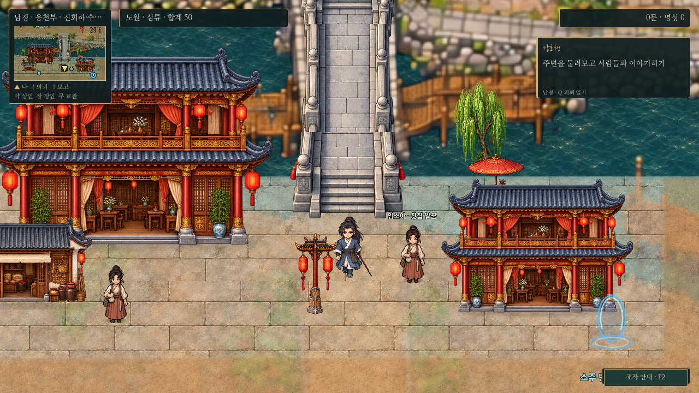

# 남경 전역 · 시장 미술 기준 확장

2026-10-30. 시장 파일럿의 회청 기와·따뜻한 목재·흙과 포장석을 남경 전역으로 확장했다. 모든 그림은 실제 Godot 장면에 적용했으며 건물/충돌/Y정렬은 바닥에서 분리한다. 도원과 공용 NPC 그림, 대화와 의뢰 보상은 변경하지 않았다.

[전체 원본](../../godot/screenshots/nanjing-capital-full.png) · [이전 전체 지도](../../godot/screenshots/nanjing-painted-full.png)

## 구역과 그림

- **시장·공방:** 승인된 점포4종을 유지하고 작업장이 보이는 대장간, 찻집·곡물·옷감 점포로 공방 외형을 구분했다. 남아 있던 반복 천막2줄은 제거했다.
- **북쪽 상가·서책거리:** 작은 건물이 반복되던 일부 부지를 합쳐 넓은2층 비단·도자기 상가를 만들었다. 서점은 종이·책·붓 진열, 인접 점포는 비단과 도자기로 구분한다. 큰 상가1동이 기존 소형 건물4개의 부지를 사용한다.
- **주거·하역:** 작은 부지에는 캐릭터와 문 크기가 맞는 저층 외형을 사용한다. 큰2층 그림을 작은 부지에 눌러 넣지 않는다. 나루와 배·다리의 통행은 유지한다.
- **관아·무관·객잔:** 전용 정면 그림으로 교체했다. 관아는 붉은 기둥/금장/석단, 무관은 병장기와 넓은 문, 객잔은 큰 출입구와 상층 회랑으로 구분한다.
- **수변:** 기존 음악 누각을 교체하고 서쪽/동쪽 물가에 누각2동을 더했다. 붉은 주칠·금장 난간·회랑·등롱으로 수도의 화려함을 표현한다. 동쪽 차 심부름꾼은 누각 앞 보행로로 옮겼다.
- **황성:** 연속된 기존 붉은 외벽과 꺾이는 부분·망루의 기하/충돌을 유지했다. 황성 원본을 새로 그렸다는 뜻은 아니다. 관아·무관 담장, 수목, 배와 다리 등 기존 독립 오브젝트도 재사용한다.

새 원본은 `assets/maps/nanjing/capital/{commerce,landmarks}.png`의8종이다. 이 중2층 주택은 작은 부지에 넣으면 문이 작아져 이번 배치에는 사용하지 않고 보관했다. 기존 시장4종과 같은 원본을 이미지 생성 참조로 제공했다. 생성 원본은 수정 없이 보존하고 실제 source 영역을 지정해 배치한다. 출처/해시는 같은 폴더의 `art-manifest.json`에 기록했다.

## 실제 플레이 화면

| 구역 | 화면 |
| --- | --- |
| 시장 |  |
| 공방 |  |
| 큰 상가·서책거리 |  |
| 관아 |  |
| 무관 |  |
| 객잔 |  |
| 수변 |  |

[1440p 실제 화면](../../godot/screenshots/nanjing-capital-1440p.png). 각 플레이 화면은 같은 기본 카메라 배율0.8로 촬영했다. 전체 지도는 별도 축소 렌더이며 NPC를 그리지 않는다.

바닥은 시장의 원본 재질을 월드 좌표로 샘플링하며, 대로·상가의 작은 포장, 흙 공방, 관아/객잔 마당과 밝은 수변 석재로 구별한다. 저해상도 바탕의 초록 얼룩을 새 포장 위로 다시 올리지 않는다. 기존 강 모양과 연안의 원본 미술은 일부 유지한다. 그림자는 공통 건물 접지 층을 사용하고 시장의 문턱/그림자 처리를 유지한다. 지도용 바닥 캐시도 재생성했다.

## 진행·저장·검사

세계 크기6144×4096, 배치 좌표계version2, 포탈 목적지·의뢰/시설 NPC ID를 유지한다. 새 건물이 막은 이전 저장 위치에는 기존 안전 위치 보정을 사용한다. 소형 건물3개를 제거하고 기존1개를 큰 상가로 바꿨으며, NPC 재배치는 동쪽 수변1명이다.

`nanjing_layout.gd`와 `nanjing_market_slice.gd`로 전체 주민/출구/다리 접근·같은 종횡비/회전 없음·시장 물리 보행·상인F 선택을 검사한다. `nanjing_relief.gd`는 실제F 진행·시설 거래·저장·보상/부재 복원을 확인한다. 일반 의뢰는 `silk_quest.gd`, `cart_quest.gd`, `book_quest.gd`, `levy_quest.gd`, `waterfront_quest.gd`로 점검한다. 분리된XDG 사용자 데이터를 사용한다.

캡처는 `capture_nanjing_capital.gd`, 지도 바닥은 `bake_nanjing_overview_floor.gd`로 재현한다. 검증 환경은 Godot4.6.3/소프트웨어OpenGL이며 Windows GPU 성능 측정은 별도다. 도원의 전면적인 도트 재제작은 이번에 하지 않았다.
