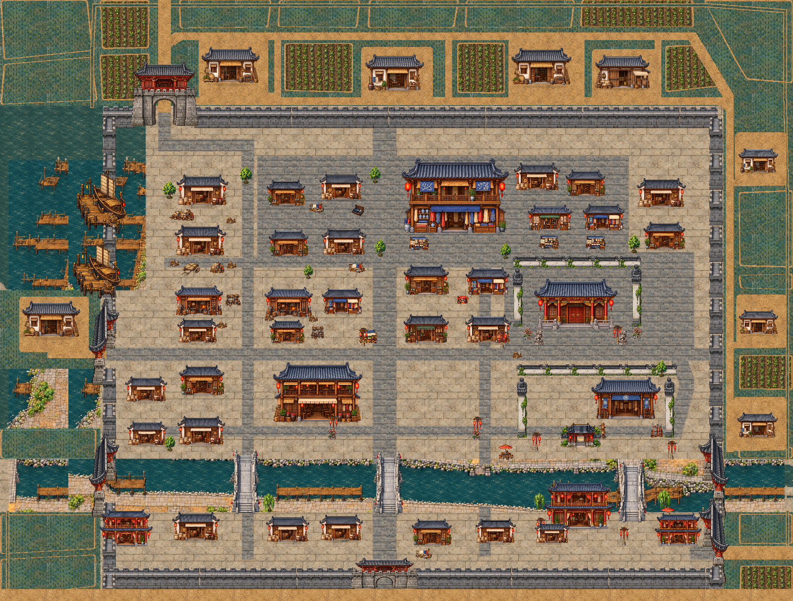

# 남경 · 황궁 철거와 성 밖 농촌

2026-10-31 후속 사용자 요청을 반영한 현재 배치다. 이전 [세 도시 성곽](three-city-fortifications.md)의 남경 황궁 부분을 대체한다. 장사·무창 성곽은 그대로다.

북쪽 궁전 지붕·궁성문·주칠 벽과 궁전 전용 충돌을 없애고, 북서 성문 동쪽부터 동북 모서리까지 회색 석조 성곽을 이어 붙였다. 중앙 대로는 북쪽 성벽 앞에서 끝난다. 북서쪽 남궁세가 방면 성문은 계속 드나들 수 있다.

후속 수정으로 성 밖은 흙길·농가 앞마당을 제외하고 수전과 밭 중심으로 재구성했다. 장사 외곽의 물을 머금은 논과 논둑 구획을 참조하되, 옛 장사 그림은 복사하지 않고 현재 남경 건물/바닥과 같은 화풍으로 새 재질을 제작했다. 강변/외곽 저지대는 작은 모와 얕은 물이 보이는 논, 농가와 길 가까운 곳은 채소밭이다. 명시적 논밭22구획과 나머지 이어지는 농지를 구성하고, 구획은 둥근 모서리와 두께 있는 흙 논둑으로 나눈다.

북서쪽 물가에서 북쪽 논으로, 동쪽 진회하에서 동쪽 논으로 이어지는 관개 수로를 그렸다. 강 건너 남서쪽에도 강물과 연결된 수로가 있다. 농가7동/창고1동은 기존 충돌과 위치를 유지하면서 마른 앞마당과 진입 흙길을 확보했다. 성벽 아래 관리용 흙길·성문 앞 흙길·동쪽 출구를 보존한다. 수로는 얕은 경관용이며 별도 깊은 물 충돌은 추가하지 않는다. 기존 강/운하 충돌은 유지한다.

성 안의 기존 흙바닥은 중앙 광장에 사용하던 밝은 판석으로 포장하고, 대로/골목 및 관아·주거 구역은 같은 계열의 회색 돌길로 연결했다. 기존 시장의 문턱, 건물 그림자와 접지·강·나루·다리는 유지한다. 바닥/그림·건물 충돌/Y정렬은 분리한다.

건물은 승인된 장사 `painted/living.png`를 비율 보존해 사용한다. 신규 논/채소/수로/흙 재질은 수정하지 않은 생성 원본 `capital/paddy-materials.png`이며 출처/해시는 `paddy-art-manifest.json`에 기록한다. 이전 `rural-materials.png`와 manifest는 작업 이력으로 보존하며 현재 바닥에는 쓰지 않는다. 장사 맵 자체는 이번 작업에서 변경하지 않았다.

| 확인 화면 | 링크 |
| --- | --- |
| 성곽과 농촌 전경 | [넓은 시야](../../godot/screenshots/nanjing-country-north-wide.png) |
| 실제 플레이 카메라 | [북쪽 농가](../../godot/screenshots/nanjing-country-north-farms.png) · [동쪽 논길](../../godot/screenshots/nanjing-country-east-farms.png) · [서쪽 농가](../../godot/screenshots/nanjing-country-west-farm.png) · [북쪽 성벽](../../godot/screenshots/nanjing-country-north-wall.png) · [성 안 포장](../../godot/screenshots/nanjing-country-city-paving.png) |

전경은 구조 확인용0.45배, 나머지는 기본0.8배 카메라다. 전체 지도/미니맵 바닥 캐시도 현재 지형으로 재생성한다. 위 전체 지도는 건물/바닥을 함께 렌더한 화면이며 NPC 위치도는 아니다.

## 동작과 검증

세계7424×5632·layout_version3·기존 중앙 대로·진회하 세 다리·출입 포탈/도착점은 유지한다. 기존 주민·의뢰·보상·거래·분기·저장 형식은 바꾸지 않는다. 새 NPC/의뢰/농가 내부는 추가하지 않는다. 구version2/1 저장의 기존 위치 이행도 유지한다.

이번 논밭/석재 포장 변경은 분리된 XDG 저장 폴더/Godot4.6.3에서 다음 검사3종을 통과했다. 이전 성곽 작업의 성문/저장 검사 기록은 앞선 문서를 참조한다.

- `nanjing_countryside.gd`: 황궁 오브젝트 제거, 새 농가8곳 앞 통행·경로, 북쪽 연속 벽 충돌, 외곽 흙길과 모든 포탈 접근.
- `nanjing_layout.gd`: 남경 다리/강·기존 주민 접근, 건물 비율/회전/부지, 지도 버전.
- `nanjing_market_slice.gd`: 기존 시장 건물·통행·거래와 재질 적용.

`capture_nanjing_countryside.gd`로 전체 지도와 실제 카메라/바닥 캐시를 재생성한다. 캐시를 Godot에서 다시 가져온 뒤 재촬영하면 미니맵도 현재 바닥을 표시한다. 일부 검사 종료 때 기존 ObjectDB/리소스 정리 경고가 남으나 위 기능 검사 실패는 없다. Windows GPU 성능을 측정한 결과는 아니다.
