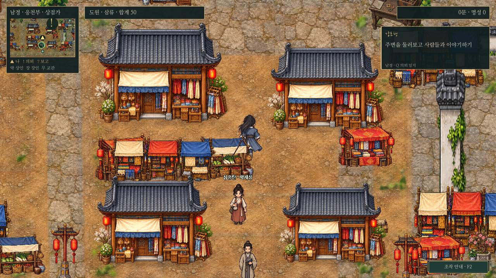
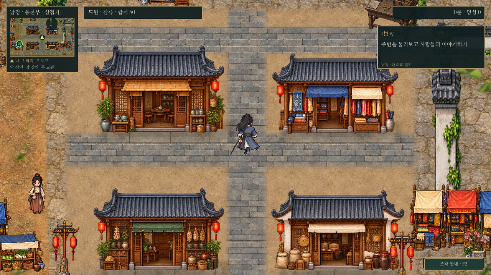
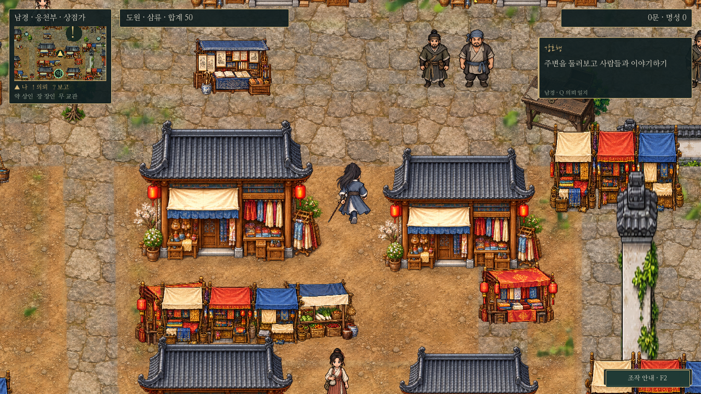
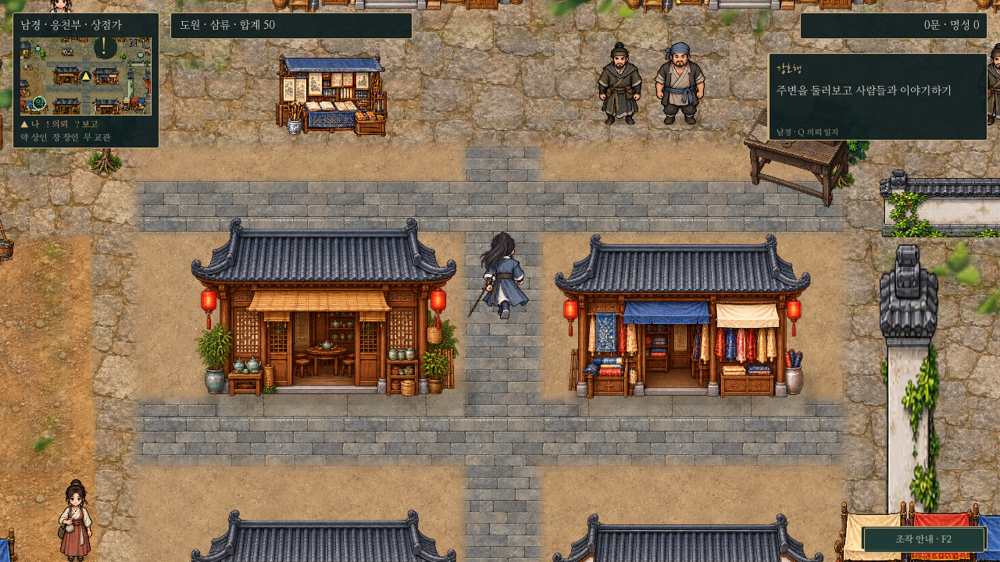

# 남경 시장·인접 골목 파일럿

2026-10-30. 남경 전체 확장 전 검토하는 **실제 플레이 구역**이다. 취월루 실내의 명료한 재질과 접지감을 참고하되, 실외는 회청 기와·목재·다진 흙·작은 회색 포장재로 구성했다. 다른 구역으로 아직 확대하지 않았다.

## 같은 플레이 카메라의 전후

도원 좌표 `(888,410)×4`, 카메라 배율0.8, 같은1280×720 창이다. 합성 시안이 아니라 실제 `main.tscn`을 실행한 화면이다. UI/인물 크기/기본 이동 속도는 유지한다.

| 변경 전 | 변경 후 |
| --- | --- |
|  |  |

[시장 변경 전 원본](../../godot/screenshots/nanjing-market-before-market-720.png) · [시장 변경 후 원본](../../godot/screenshots/nanjing-market-after-market-720.png)

| 골목 변경 전 | 골목 변경 후 |
| --- | --- |
|  |  |

[1440p 시장 전](../../godot/screenshots/nanjing-market-before-market-1440.png) · [1440p 시장 후](../../godot/screenshots/nanjing-market-after-market-1440.png) · [1440p 골목 후](../../godot/screenshots/nanjing-market-after-alley-1440.png) · [도원 앞모습](../../godot/screenshots/nanjing-market-after-front-720.png)

## 이번에 바꾼 것

- 같은 상점4개를 찻집·옷감점·약재상·곡물점의 전용4종으로 교체했다. 동일한 정면 시점과 비율 보존 배치를 쓰고, 문·기둥·지붕을 사선 회전하거나 따로 늘리지 않았다.
- 도원의 발을 가리던 중앙 천막 줄과 중복 진열6개를 제거했다. 상품은 점포 벽면과 처마 아래로 모아 가게의 용도를 보여준다. 약재상 심유란은 가게 앞 왼쪽, 행인은 동쪽 가장자리로 옮겨 입구와 중앙 보행축을 비웠다.
- 시장 구역의 바닥을 별도 재질로 구성하고 점포 문턱 아래의 석재, 골목의 작은 포장, 흙 마당, 건물 밑 그림자를 연결했다. 구역 경계에서는 기존 바닥으로 부드럽게 잇는다. 북쪽 횡단 길과 남쪽 대로 연결도 유지한다.
- 건물4개는 각각 실제 충돌·발밑 정렬을 유지한다. 바닥에 건물을 굽지 않았고, 인물의 앞뒤 가림은 기존Y정렬을 쓴다. 지도용 바닥 캐시도 다시 렌더했다.

범위는 도안 좌표 `[738,286,292,240]` 안의 시장 바닥과 기존 점포4개다. 그 외의 건물·소품, 도시 크기, 세계 연결, 대화, 의뢰, 보상, 캐릭터 그림은 유지한다. 배치 좌표계version2와 기존 안전 위치 보정을 사용한다. 전용 원본은 `assets/maps/nanjing/market-slice/`에 보관하며 생성 원본을 수정 없이 복사했다. 원본/해시는 같은 폴더의 `art-manifest.json`에 기록한다.

## 도원의 그림을 바꿔야 하는가

이번 화면에서는 **기존 도원을 유지하는 편을 권한다.** 청색 복식은 따뜻한 목재·흙과 구별되고 회청 지붕과 색 계열이 이어진다. 기존 인물의 윤곽과 중간SD 비율도 점포의 문과 함께 봤을 때 큰 충돌이 없다. 변경 전 어색함의 큰 원인은 작은 점포 문, 동일 점포 반복, 중앙 천막과 인물의 겹침이었다.

이 판단은 이번 시장 구역과 두 해상도의 정지/보행 점검 범위다. 전체 도시가 같은 수준으로 정리됐다는 뜻은 아니다. 주변 구역의 큰 돌 포장과 기존 노점은 파일럿 경계에서 보이며 아직 개선 전이다. 전면적인 인물 재제작보다 앞으로 다른 구역을 같은 비율로 맞춘 뒤 발밑 그림자·환경색 조화가 추가로 필요한지 보는 편이 좋다.

## 검증과 재현

- `nanjing_market_slice.gd`: 네 점포의 종횡비·회전 없음·개별 충돌, NPC 발과 건물 충돌 겹침 없음, 중앙/횡단 골목·문턱 접근, 전체 주민 접근, 실제 물리 보행, 이동한 상인의F 선택.
- `nanjing_layout.gd`: 남경 전체 주민/출구/다리 접근과 기존 배치 규칙.
- `nanjing_relief.gd`: 실제F 대화·시설3종 거래·의뢰 진행/동시 추적·보상/부재·저장 복원.
- `capture_nanjing_market_slice.gd`: 같은 좌표/카메라에서 시장·골목의720p/1440p와 도원 앞모습을 실제 렌더한다. `-- before`는 변경 전 코드를 사용하는 비교용 태그다. 현재 코드에서 이 태그를 지정한다고 이전 미술이 자동 복원되는 것은 아니다. 보관한 변경 전 캡처의 기준 커밋은 미술 명세에 기록했다.

Godot4.6.3, 별도XDG 사용자 데이터, 소프트웨어OpenGL에서 확인했다. 기존 종료 시 리소스 정리 경고는 남아 있으며 Windows GPU의 성능 측정 결과는 아니다. 다음 구역 확장은 이 화면을 검토한 뒤 진행한다.
