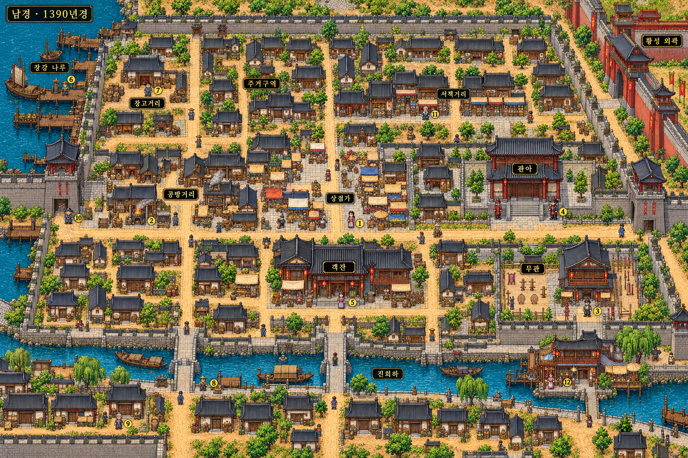

# 남경 도시·기본 NPC 이미지 시안

2026-10-26. 사용자 요청 범위는 **도시 이미지와 기본 NPC 배치 시안**, 하오문·남궁 관련 인물 **제안**이다. Godot 맵/씬/포탈/인물 등록/거래/의뢰/저장 코드를 수정하지 않는다.

## 시대와 도시 성격

1390년경 남경(응천부)은 명나라의 수도다. 북경으로 천도한 것은1421년이다. 이번 그림은 역사적 지리를 실측 복원한 지도가 아니라, 수도의 인상과 플레이 동선을 위해 구역을 압축한 게임용 도시 초안이다. 황성은 높은 외벽과 정문으로 존재감을 주며 내부 탐험은 이번 시안에 포함하지 않는다.

## 구역과 동선

- 서문: 무창·삼거리 산촌 쪽에서 도착. 노점→상점가→객잔을 자연스럽게 먼저 만난다.
- 공통6구역: 상점가·관아·무관·공방거리·객잔·주거구역.
- 수도의 특징: 북서쪽 장강 나루·창고, 남쪽 진회하 수변·돌다리·찻집·기루, 북동쪽 황성 외곽.
- 서책거리는 상업/주거 사이의 작은 구역이다. 도시를 크고 비어 있는 광장이나 같은 시설의 반복으로 채우지 않는다.
- 주거 골목은 흙길과 오래된 포장, 관청 앞 큰길은 닳은 판석을 섞는다. 가로수의 규칙적 반복과 전 구역 코블스톤은 사용하지 않는다.
- 주민은 건물 문 옆·작업장 가장자리·마당에 두고 길 가운데·건물 위·물 위를 피한다. 노란 번호1~12는 상호작용 NPC 후보를 식별한다. 번호 없는 작은 인물은 수도의 분위기를 보여주는 배경 군중 시안이며 실제 NPC 추가를 확정하는 표시는 아니다.

## 기본 NPC12명

이름/성격은 창작 초안이다. 대화용 얼굴은 기존 기본18장, 직업별2종, 기존 포졸 전용 그림에서 선정했다. 이번에는 새 초상화를 생성하지 않았다. 이미지 속 작은 도트 인물은 위치/직업을 표현하는 지도 시안이며 실제 게임 스프라이트를 등록한 것이 아니다.

| 번호 | 이름 제안 | 역할 | 위치 | 재사용 얼굴 |
| --- | --- | --- | --- | --- |
| 1 | 심유란 | 약재·영약 상인 | 상점가 약방 앞 | [merchant_b](../../godot/assets/portraits/wuchang/liu_baicao.png) |
| 2 | 유철생 | 병장기 장인 | 공방거리 대장간 앞 | [artisan_b](../../godot/assets/portraits/wuchang/shi_dayong.png) |
| 3 | 조원식 | 무관 교관 | 무관 입구 옆 | [instructor_a](../../godot/assets/portraits/services/instructor.png) |
| 4 | 장세평 | 포졸 | 관아 정문 옆 | [constable](../../godot/assets/portraits/story/constable-duty.png) |
| 5 | 하삼랑 | 객잔 주인 | 객잔 문 옆 | [female_innkeeper](../../godot/assets/portraits/wuchang/du_sanniang.png) |
| 6 | 곽만재 | 하역 인부 | 장강 나루 작업장 가장자리 | [male_dockworker](../../godot/assets/portraits/wuchang/wu_deshu.png) |
| 7 | 윤문식 | 창고 서리 | 창고 출입문 옆 | [male_common_b](../../godot/assets/portraits/extras/male_common_b.png) |
| 8 | 오강 | 뱃사공 | 진회하 작은 나루 | [male_middle](../../godot/assets/portraits/extras/male_middle.png) |
| 9 | 위씨 할머니 | 주민 | 남쪽 주거골목 집 앞 | [female_elder](../../godot/assets/portraits/extras/female_elder.png) |
| 10 | 정소복 | 노점상 | 서문 안쪽 길가 | [male_young](../../godot/assets/portraits/extras/male_young.png) |
| 11 | 소학겸 | 서적상 | 서책거리 점포 앞 | [male_elder](../../godot/assets/portraits/extras/male_elder.png) |
| 12 | 임소아 | 찻집 일꾼 | 진회하 동쪽 수변 찻집 앞(기루 인근) | [female_common_a](../../godot/assets/portraits/extras/female_common_a.png) |

배치 원안은 [검토용 JSON](designs/nanjing-npc-plan.json)에 보관한다. 상인/장인/교관은 기존 직업 이미지 후보에서 배정하며 실제 판매 목록·가격·전수 내용은 정하지 않는다. 기본 주민들에게 하오문 소속을 자동 부여하지 않는다.

## 하오문 인물 제안 — 아직 미배치

### 육소전 · 객잔 점소이 · 26세 남성

- 겉으로는 손님의 짐을 나르고 방을 안내하는 붙임성 좋은 점소이다.
- 하오문 하급 연락책이라는 창작 제안. 문주의 정체를 알거나 모든 정보를 가진 인물로 만들지 않는다.
- 손님의 이동·분실물·고용 현장에서 얻은 제한적인 정보를 연결한다. 동료가 위험해질 정보는 팔기 꺼린다.
- 장사/무창의 소문을 아는 도원에게 작은 확인 일을 맡기면서 첫 접점이 된다. 가입이나 충성을 즉시 요구하지 않는다.
- 말투 예시: “손님이 찾는 사람은 모르겠는데요. 그 사람이 묵었던 방은 알지요.”
- 이미지 후보: 기본 `male_common_a` 재사용. 새 전용 그림은 만들지 않는다.

### 진옥란 · 수변 기루의 살림·접객 담당 · 41세 여성

- 공연 일정과 물품·품삯·손님 응대를 관리하는 현실적인 인물로 제안한다. 루주/소유자라는 직책은 부여하지 않는다.
- 하오문과 정보를 주고받는 연락 창구 후보. 우선은 일하는 사람들의 안전과 고용 문제에 관여한다.
- 육소전보다 깊은 사정을 알지만 도원을 시험 없이 신뢰하지 않는다. 종사자들의 사생활을 함부로 넘기지 않는다.
- 말투 예시: “사람을 찾으러 왔다면 사연부터 들읍시다. 값을 치른다고 모든 이름을 들을 수 있는 곳은 아니에요.”
- 이미지 후보: 기본 `female_middle` 재사용. 문주로 확정하거나 문주의 정체를 암시하는 외형/지도 표식은 넣지 않는다.

기루 종사자 전원을 하오문 사람으로 설정하지 않는다. 문주와의 만남·정체 공개·구체 직제는 이번 제안에서 결정하지 않는다. 사용자와 앞서 정한 남경 거점을 바탕으로 접점을 제안하되 새 조직 거점이나 인물은 게임에 등록하지 않는다.

## 남궁세가 인물 제안 — 기존 인물 활용, 아직 미배치

### 우선 추천: 남궁도윤 · 차남 · 23세

[기존 인물 설정](../characters/namgung-family.md#3-남궁도윤--차남소가주의-남동생)을 유지한다. 외부 호송/현장 임무를 맡는 직계 무인이므로, 남경으로 들어오는 가문의 구휼 물자나 거래 물품을 호위하다가 객잔/창고 구역에서 만나는 구성이 자연스럽다.

호방하고 부상자를 먼저 챙기지만 경쟁심과 사파에 대한 성급한 판단도 남긴다. 도원과 빠르게 가까워질 수 있어도 무엇이든 동의하는 동료로 만들지는 않는다. 창천무애검법을 사용하고 제왕검법은 배정하지 않는다. 가문의 본거지는 기존대로 유지한다.

첫 접점 예시: 호송 물품과 장부가 맞지 않아 상단을 추궁하다가, 도원이 알게 된 현장 사정과 충돌한다. 하오문의 비공식 정보 이용 여부를 두고 의견 차이를 만들 수 있다.

### 함께 또는 후속 추천: 남궁연서 · 막내딸 · 20세

[기존 인물 설정](../characters/namgung-family.md#4-남궁연서--막내딸소가주의-여동생)을 유지한다. 구휼 물자와 장부를 살피는 역할로 남경에 머물며, 물자가 실제로 필요한 사람에게 갔는지 확인한다.

조용하고 세심하되 판단이 서면 완고하다. 박애와 가문의 예법/자부심, 배워온 사파에 대한 편견을 함께 유지한다. 처음부터 가문과 세상 모든 편견을 벗어난 인물로 만들지 않는다. 창천무애검법을 사용하며 기존 원본 초상화를 유지한다.

도윤은 현장의 행동, 연서는 기록과 수혜자 확인을 담당하게 하면 같은 가문의 인물이 다른 관점으로 사건을 보게 할 수 있다. 파티 합류나 무공 전수를 자동으로 붙이지 않는다.

가주 남궁정천과 소가주 남궁서진은 추후 큰 정파 사건에 쓰는 것을 추천한다. 초기 남경 생활 사건에 네 사람을 모두 배치하거나 가문의 본단을 남경으로 옮기지는 않는다.

## 이번 결과의 범위

도시 그림·검토용 NPC 배치·세력 인물 제안만 저장한다. 실행 가능한 남경, NPC 대화/거래/포탈/퀘스트는 구현하지 않았으며 본게임 동작도 변경하지 않는다. 런타임 코드 변경이 없어 게임 회귀 검사는 하지 않는다.

이미지 생성 도구로 제작한1536×1024 원본이며 픽셀 후처리는 하지 않았다. [시안 원본 식별·해시](designs/nanjing-preview-manifest.json)를 기록하고12개 번호/구역 이름/건물과 NPC의 배치를 육안 확인했다.

## 후속 이야기 검토

사용자 확정: 하오문 인물의 머리 위에는 소속을 표시하지 않고 육소전은 점소이, 진옥란은 접객 담당으로 표시한다. [남경 이야기 초안](../story/nanjing-outline.md)은 세 진입점에서 구휼 곡식 사건으로 들어가는 선택형 이야기 제안이며 게임에는 아직 구현하지 않았다.
