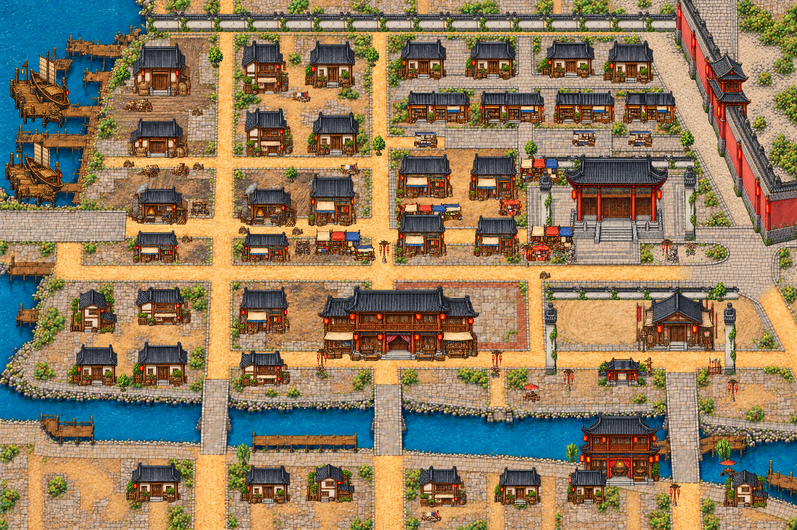
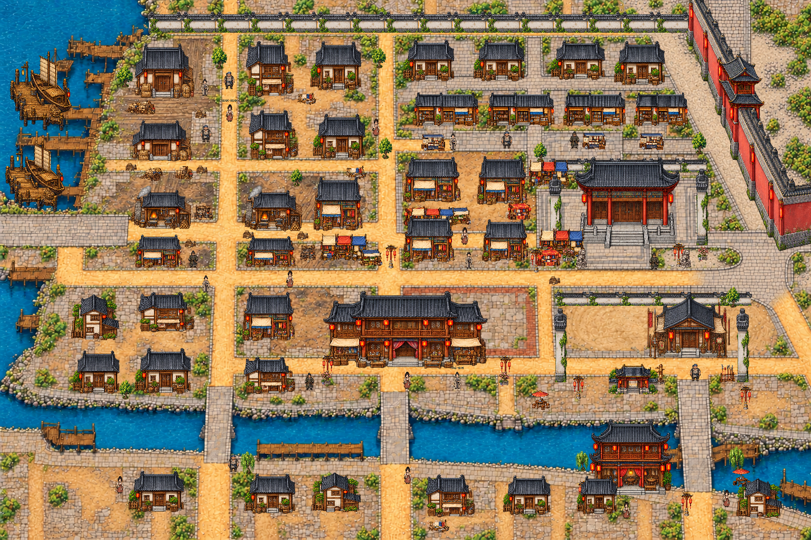

# 남경 — 처음 도시 시안에 맞춘 재구성

2026-10-26. 첫 구현이 원 시안의 건물 밀도·수도 규모·구역 배치를 충분히 반영하지 못했다는 사용자 피드백에 따라, [처음 제시한 그림](designs/nanjing-npc-preview.png)을 기준으로 실제 맵을 재구성했다. 단순 이미지 시안이 아닌 Godot 게임의 실제 지형/건물 렌더링이다.

## 원 시안에서 따르는 구성

- 서쪽 장강 나루와 열린 하역 입구, 북서쪽 창고거리.
- 북쪽 주거 골목과 동북쪽 서책거리, 중앙의 조밀한 상점·공방.
- 주인공이 드나드는 대로 남쪽에 크게 자리 잡은 객잔.
- 동쪽 관아와 무관의 독립 마당, 북동쪽으로 높게 솟은 붉은 황성 외벽.
- 남쪽을 가로지르는 진회하와 돌다리, 수변의 기루/찻집과 주거 골목.

새 건물 아틀라스12종(주택·층집·상점·창고·대장간·큰 객잔·관아·무관·수변 접객 건물·서점·측면 주택·사당)과 소품/성벽 아틀라스를 원 시안의 미감으로 만들었다. 실제 배치는 도로 통행 폭과 NPC 접근 공간을 확보하도록 조정했다. 원 그림의 번호·제목·군중은 게임 지형에 굽지 않는다. 원 시안과 픽셀 단위로 동일한 그림이 아니라, 같은 구역과 주요 경관을 독립 오브젝트로 옮긴 게임용 재구성이다.

## 게임 적용

월드6144×4096, 도안1536×1024, 배치버전2. 건물·담장·성문은 별도 투명 그림/발밑 충돌/Y정렬을 사용한다. 서쪽 나루에서 중앙 대로로 동서 통행이 가능하다. 진회하 물에는 들어갈 수 없고 세 다리를 통해 남북으로 이동한다. 황성 안쪽은 이번 이야기에서 통행하지 않는다.

기존 주민12명, 거래3종, 육소전·남궁연서·진옥란과 의뢰 사건 인물의 위치를 새 지형에 맞췄다. NPC는 건물 표시 영역에서 벗어나도록 검증하고, 의뢰의 각 조사 지점까지 접근 가능한 길을 확인한다. 원 시안의 검토용 번호와 NPC 위치를 기계적으로 겹쳐 놓지 않는다.

산촌 동쪽 포탈→남경 서쪽 나루 입구로 들어온다. 의뢰 내용·선행 중급 전수·500문/남궁 호의도+10·육소전 부재는 유지한다. [의뢰 진행](../quests/nanjing-relief.md).

구배치 남경 저장(version1)은 금전·보상·의뢰 진도를 그대로 복원하고 캐릭터만 새 서쪽 입구로 옮긴다. 새배치(version2)는 저장 위치를 그대로 읽되 기존 안전 위치 보정을 거친다.

- [원 시안](designs/nanjing-npc-preview.png)
- [현재 전체 맵](../../godot/screenshots/nanjing-full.png)
- [플레이 화면](../../godot/screenshots/nanjing-inn-play.png)
- [게임 전체 지도](../../godot/screenshots/nanjing-overview.png)

`nanjing_layout.gd`에서 세 다리/물 충돌·성문 통행/지붕 정렬·모든 주민 접근을 확인하고, `nanjing_relief.gd`에서 실제 F 진행·NPC 비겹침·단계별 저장·구배치 저장 이행·기존 보상을 확인한다. 공유 저장은 `saves.gd`로 회귀 확인한다. 검사/캡처는 플레이어 저장과 분리한 XDG 폴더를 사용한다.

## 수도의 생활감과 구역별 인상 보강

사용자는 원 시안과 완전히 같은 그림보다 수도의 번화함·화려함과 구역별 차이를 요청했다. 기존 건물과 주요 동선을 바탕으로 다음을 게임에 적용했다.

| 구역 | 바닥·소품·생활 장면 |
| --- | --- |
| 시장 | 답압된 황토길, 붉은 비단 차양과 채소 노점, 장을 보는 손님·심부름꾼 |
| 창고·나루 | 수레바퀴 자국이 있는 하역 마당, 곡물 수레·짐더미·밧줄, 하역 인부 |
| 공방 | 숯과 그을음이 묻은 작업 바닥, 모루·금속 작업대·화로 |
| 주거 골목 | 소박한 흙과 돌이 섞인 마당, 빨래·물항아리·이웃 주민 |
| 서책거리 | 정돈된 회색 포장, 남색 책 진열 차양과 두루마리, 책을 고르는 서생 |
| 관아·황성 | 반듯한 석재 마당, 대칭 석수와 화분, 붉은 성벽의 위계 |
| 객잔 | 벽돌 테두리의 포장 앞마당, 붉은 등롱·화분과 객잔 손님 |
| 무관 | 다져진 모래 연무장, 목인과 병장기 거치대 |
| 진회하 | 돌을 깐 수변 길, 등롱·붉은 파라솔 찻자리·분재, 나루 손님 |

기본 주민12명은 유지하고 일상 대화가 가능한 행인8명을 추가해 민간 인물20명이 되었다(거래3명 포함). 새 인물은 기본18장 초상화를 재사용하며 상시 이름표는 생략해 혼잡을 줄였다. F로 대화할 때 이름과 짧은 생활 대사를 보여 준다. 의뢰 인물은 별도로 기존과 같이 등장한다. 행인은 발밑 충돌 위치를 유지하며 미세한 대기 몸짓을 하고 등롱의 색이 천천히 변한다. 주민 이동 AI나 새 의뢰를 추가한 것은 아니다.

모든 소품은 독립 오브젝트/충돌/Y정렬로 배치한다. 장식 추가 후 막힌 진옥란 접근로를 수정하고 전체 주민 접근, NPC와 구조물 비겹침, 실제 의뢰의 F 진행·보상·저장 복원을 다시 확인했다. 새 소품 때문에 구 저장의 위치가 막히면 기존 안전 위치 보정을 사용하며 진도와 보상은 유지한다.

[시장 플레이](../../godot/screenshots/nanjing-market-play.png) · [공방 플레이](../../godot/screenshots/nanjing-craft-play.png) · [관아 플레이](../../godot/screenshots/nanjing-government-play.png) · [수변 플레이](../../godot/screenshots/nanjing-waterfront-play.png)

## 무관 겹침과 황성 외벽 마감

무관의 서쪽·북쪽 담장을 가로지르던 민가4동(`alley_house_6`~`alley_house_9`)을 제거해 연무장 공간으로 정리했다. 무관 본관·교관·훈련 도구·출입문은 유지한다. 황성 측면 외벽의 남단에는 같은 붉은 벽 계열의 가로벽을 연결해 동쪽 화면 경계 너머로 이어지게 했다. 새 벽도 독립 그림과 충돌을 사용하고, 기존 저장 위치에는 공통 안전 위치 보정이 적용된다. `nanjing_layout.gd`로 모든 주민 접근과 성문·다리 통행을 확인했다.

## 江岸 도성 입구와 황성의 구분

서쪽 성문에 황성용 측면 그림을 재사용하면서 남아 있던 붉은 벽을 바로잡았다. 서쪽 성문과 그 주변의 짧게 끊긴 회색 벽 조각들을 제거해 장강 나루에서 중앙 대로로 바로 이어지는 열린 하역 입구로 만들었다. 푸른 이동 포탈과 통행로는 유지한다. 붉은 황성 외벽과 동쪽 화면 밖으로 꺾이는 가로벽은 동쪽에만 존재한다. 나루·하역 창고→시장/객잔의 번화가→관아 앞 대로→황성 외곽이라는 공간 관계를 유지하며 황성 내부를 새로 개방하지 않는다. 이전 절의 서쪽 성문/지붕 가림 설명은 이 변경 이전 기록이다. 현재 검사는 성문 대신 열린 나루 입구의 왕복 통행과 포탈 접근을 확인한다.

## 황성 모서리와 도시 바닥 접합

각기 다른 높이·기와색·원근을 가진 두 외벽을 겹쳐 놓던 구성을 하나의 연속된 L자 외벽 그림으로 교체했다. 벽의 밑단은 대로보다 북쪽에서 끝나며, 성벽 앞에 유지관리 여유 공간과 석재 경계를 두었다. 관아 동쪽 담장을 안으로 물리고 기존 대로의 동쪽 끝을 남쪽 골목으로 이어지는 완만한 포장 회차 공간으로 수정했다. 황성 벽 아래로 길이 파고들거나 잘린 길이 성벽 뒤로 이어져 보이던 구성을 정리했다. 벽은 바닥에 굽지 않은 독립 충돌/Y정렬 오브젝트다.

`nanjing_layout.gd`에서 모든 주민과 나루 접근/세 다리·강물 충돌에 더해 모서리 앞 대로와 남쪽 회차 동선을 실제로 설 수 있는 좌표로 확인했다. [황성 모서리 플레이 화면](../../godot/screenshots/nanjing-palace-corner-play.png).
