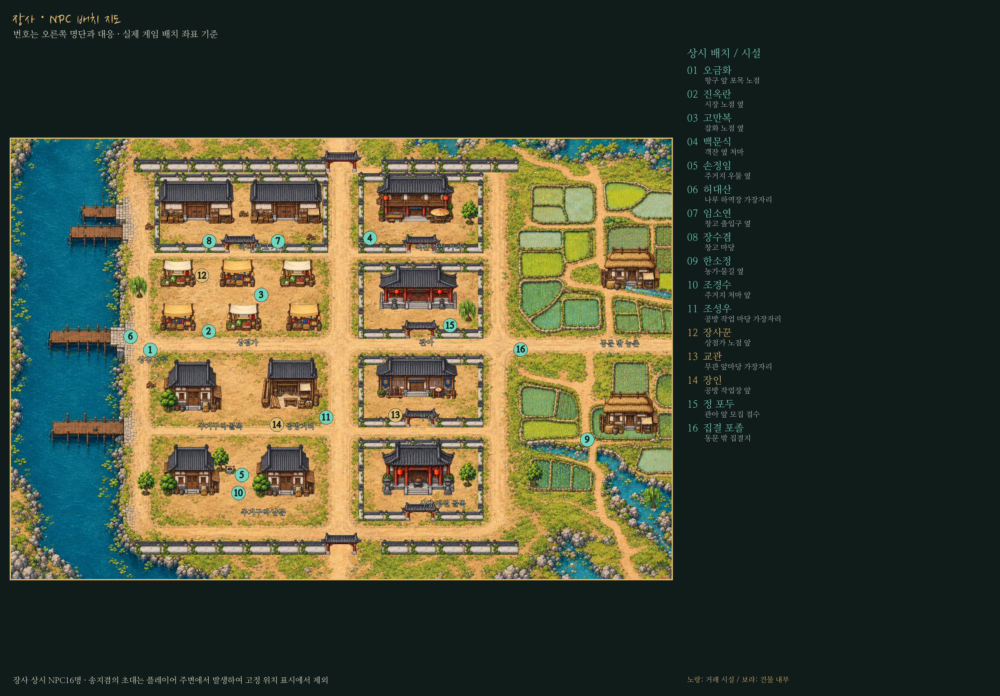
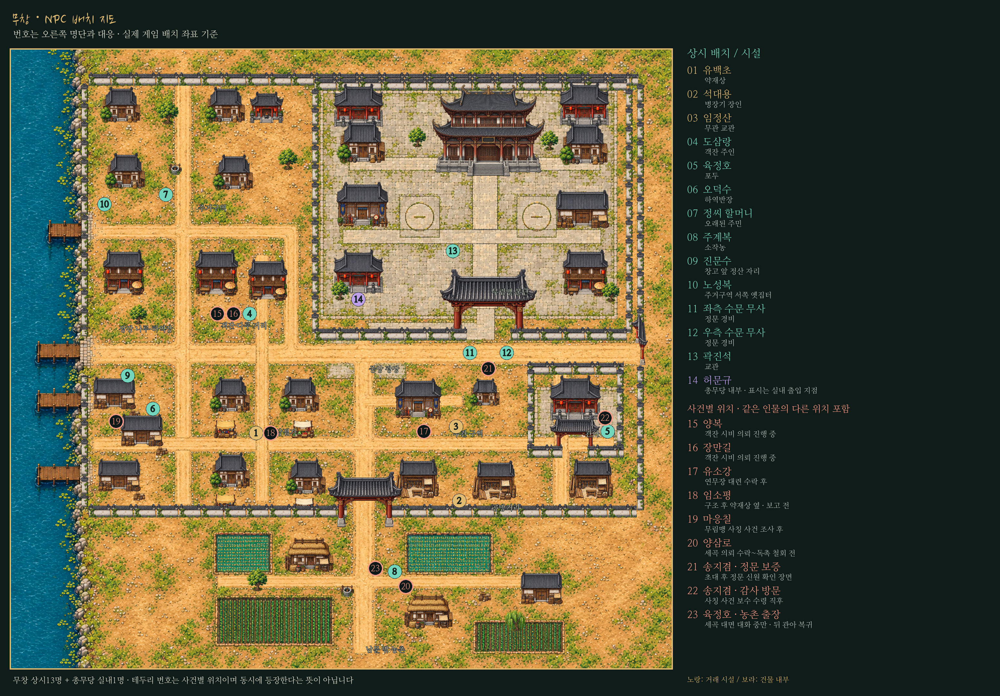

# 장사·무창 NPC 배치 지도

실제 실행 중인 `exploration.ambient_nodes`의 **배치 보정 후 발밑 좌표**로 번호를 찍었다. 지도는 본게임의 바닥과 건물·담장·지붕 레이어를 같은 위치에 렌더링했다. 컨셉 그림이나 예전 원본 좌표를 임의로 옮긴 지도가 아니다.

- 민트색: 상시 NPC. 노란색: 거래 시설 인물.
- 보라색: 실내 NPC가 있는 건물의 출입 지점. 허문규는 총무당 실내에 있으므로 도시 지도에서는 출입구에 표시한다.
- 테두리 번호: 사건별 위치. 일부는 같은 인물의 다른 등장 위치다. 여러 의뢰가 동시에 진행될 수 있지만 지도는 특정 한 시점의 동시 출현 화면을 뜻하지 않는다.
- 장사의 송지겸 초대는 플레이어 주변에서 발생하므로 고정 핀을 만들지 않고 지도 하단에 설명했다.

두 이미지는3100×2160 PNG이며 확대해서 번호와 명단을 볼 수 있다. 퀘스트 완료에 따라 없어지는 인물과 출장 인물은 별도 범례에 조건을 적었다.

## 장사

| 번호 | 인물 | 위치·등장 조건 |
| --- | --- | --- |
| 01 | 오금화 | 항구 앞 포목 노점 |
| 02 | 진옥란 | 시장 노점 옆 |
| 03 | 고만복 | 잡화 노점 옆 |
| 04 | 백문식 | 객잔 옆 처마 |
| 05 | 손정임 | 주거지 우물 옆 |
| 06 | 허대산 | 나루 하역장 가장자리 |
| 07 | 임소연 | 창고 출입구 옆 |
| 08 | 장수겸 | 창고 마당 |
| 09 | 한소정 | 농가·물길 옆 |
| 10 | 조경수 | 주거지 처마 앞 |
| 11 | 조성우 | 공방 작업 마당 가장자리 |
| 12 | 장사꾼 | 상점가 노점 앞 |
| 13 | 교관 | 무관 앞마당 가장자리 |
| 14 | 장인 | 공방 작업장 앞 |
| 15 | 정 포두 | 관아 앞 모집 접수 |
| 16 | 집결 포졸 | 동문 밖 집결지 |

장사 상시 NPC16명 · 송지겸의 초대는 플레이어 주변에서 발생하여 고정 위치 표시에서 제외。

## 무창

| 번호 | 인물 | 위치·등장 조건 |
| --- | --- | --- |
| 01 | 유백초 | 약재상 |
| 02 | 석대용 | 병장기 장인 |
| 03 | 임정산 | 무관 교관 |
| 04 | 도삼랑 | 객잔 주인 |
| 05 | 육정호 | 포두 |
| 06 | 오덕수 | 하역반장 |
| 07 | 정씨 할머니 | 오래된 주민 |
| 08 | 주계복 | 소작농 |
| 09 | 진문수 | 창고 앞 정산 자리 |
| 10 | 노성복 | 주거구역 서쪽 옛집터 |
| 11 | 좌측 수문 무사 | 정문 경비 |
| 12 | 우측 수문 무사 | 정문 경비 |
| 13 | 곽진석 | 교관 |
| 14 | 허문규 | 총무당 내부 · 표시는 실내 출입 지점 |
| 15 | 양복 | 객잔 시비 의뢰 진행 중 |
| 16 | 장만길 | 객잔 시비 의뢰 진행 중 |
| 17 | 유소강 | 연무장 대련 수락 후 |
| 18 | 임소평 | 구조 후 약재상 옆 · 보고 전 |
| 19 | 마응칠 | 무림맹 사칭 사건 조사 후 |
| 20 | 양삼로 | 세곡 의뢰 수락~독촉 철회 전 |
| 21 | 송지겸 · 정문 보증 | 초대 후 정문 신원 확인 장면 |
| 22 | 송지겸 · 감사 방문 | 사칭 사건 보수 수령 직후 |
| 23 | 육정호 · 농촌 출장 | 세곡 대면 대화 중만 · 뒤 관아 복귀 |

무창 상시13명 + 총무당 실내1명 · 테두리 번호는 사건별 위치이며 동시에 등장한다는 뜻이 아닙니다。

## 재생성과 검증

`godot/tests/capture_npc_maps.gd`가 실제 NPC 배치를 읽고 `npc_map_sheet.gd`에서 지도·명단을 함께 렌더링한다. 기본 배치는 장사16명, 무창 성내13명이다. 무창은 총무당 실내1명과 사건별 위치9곳을 추가 표시한다. 송지겸2곳과 육정호의 출장을 포함한 **23개 번호는23명의 별도 인물을 뜻하지 않는다**.

배치 좌표와 조건은 [npc-locations.json](npc-locations.json)에 함께 저장한다. 사건 단계는 출력 도구의 격리된 사용자 데이터에서만 구성하며 실제 플레이 저장을 바꾸지 않는다. 출력 도구는 각 NPC가 실제로 생성되었는지와 기본 배치 수를 확인한 뒤 해당 몸체 위치를 사용한다.

별도 데모 배포나 게임 내 이동 기능은 추가하지 않았다. 지도 배경은 현재 게임의 건물 배치이며, 모든 사건용 소품이 한꺼번에 존재하는 상태를 표현하지는 않는다.
