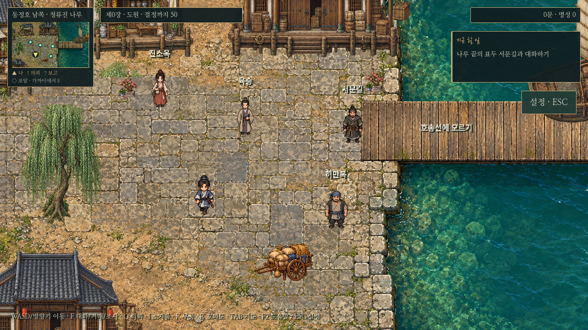
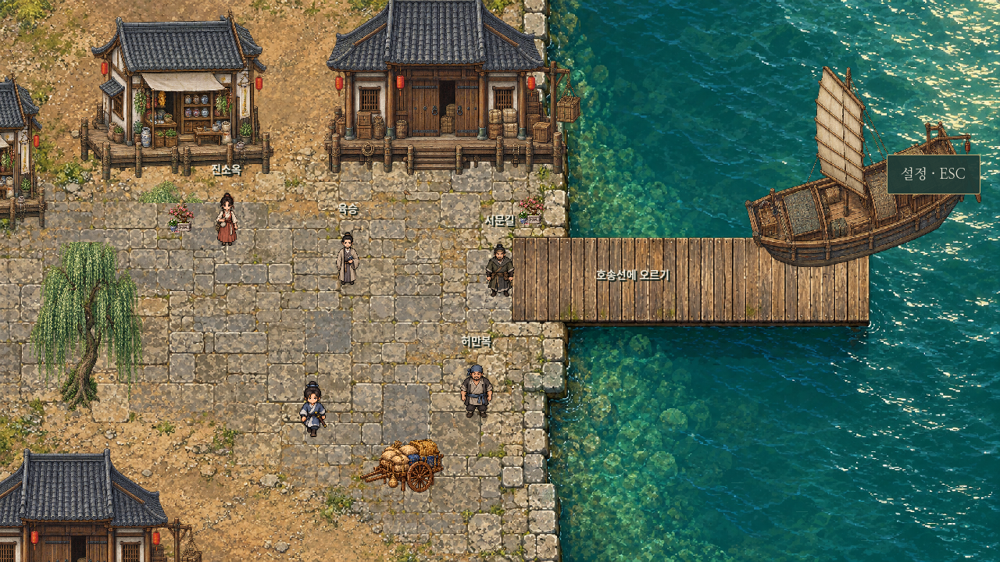

# 0장 청류진 나루 — 분리 미술 적용

출시 UI 시안의 회색 기와/목재/천막/청록 강물 색감을 실제0장 맵에 적용한 첫 구역이다. 생성된 한 장을 배경으로만 쓰지 않고, 바닥 그림과 별도 상점·창고·버드나무·호송선, 가장자리 건물·화물 소품9개를 구성했다. 기존 인물 초상화·도트와 플레이어 보행은 재사용하되 나루의 건물/문 높이에 맞춰 인물 표시 크기를 조정했으며 도시 전체 미술 교체나 새 UI 적용은 하지 않았다.

- 바닥: 새로 제작한 돌길/흙/강물/나무 부두. 작은 강물 반짝임은 별도 렌더링한다.
- 오브젝트: 투명 아틀라스, 발밑 충돌, 플레이어/NPC와 같은 Y정렬. 건물 뒤·나무 뒤 통행 시 그림이 캐릭터를 가린다. 지형과 충돌은 코드에서 별도로 정의한다.
- 기존4인(서문길·진소옥·허만복·육승)의 대화와0장 출항 흐름 유지. 승선 지점은 새 부두에 맞춰(810,415)→(810,365)로 보정했다.
- 물은 통행 불가, 부두는 보행 가능. 기존 저장의 나루 위치는 불러올 때 안전한 통행 위치로 보정한다. 게임패드·클릭 이동·UI 재설계·새 전투 수치는 추가하지 않았다.
- `prologue_dock_art.gd`의 오브젝트 배치와 `exploration.gd`의 지형 경계를 수정하면 후속 구역에도 같은 방식을 확장할 수 있다. 인물과 배경을 전면적으로 새 스타일로 맞춘 최종 미술은 아니며, 실제 보행/가림/상호작용을 검토하는 첫 플레이 구역이다.

## 실제 엔진 캡처

## 확인

- `dock_layered.gd`: 분리 오브젝트9개, Y정렬, 발밑 충돌, 건물 뒤 통로, 강물 차단/승선 부두 통행, 모든 NPC 접근, 저장/재방문.
- `prologue_f_input.gd`: 실제 WASD 경로 이동과 물리 F(한글 배열 포함),4명 대화, 승선, 갑판 대화, 첫 전투.
- `f_interaction.gd`: 기존 도시/포탈/메뉴의 입력 회귀.
- `saves.gd`: 저장 호환 회귀.
- `capture_dock_art.gd`: 실제 Godot 렌더링. 테스트 저장은 별도 XDG 폴더에서 실행했다.

원본은 `assets/maps/prologue-dock/ground.png`, `scenery.png`. 이미지 생성 원본을 편집하지 않고 복사했으며 런타임 아틀라스 영역으로 개별 오브젝트를 사용한다. 기존 `assets/dock.png`는 보존한다.
