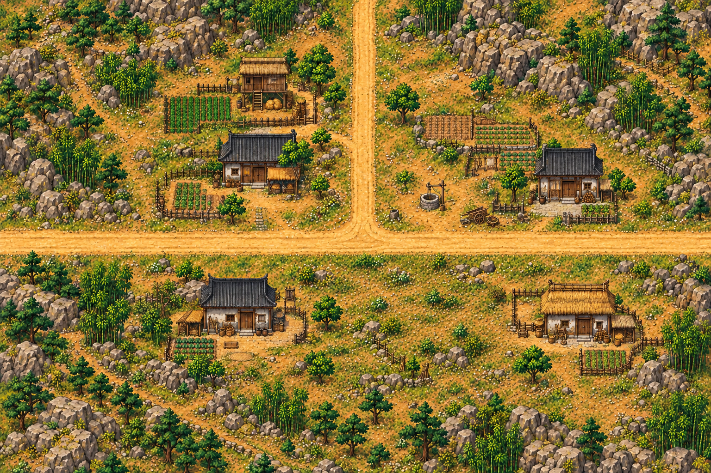
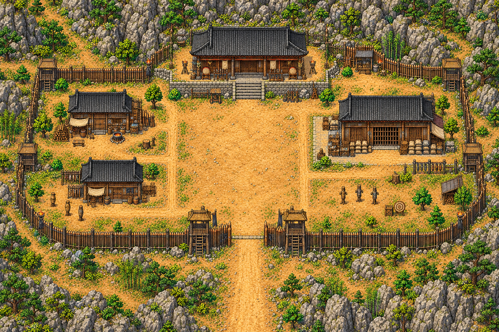

# 산촌 삼거리·청애채 맵 디자인

2026-10-26. 새 지역은 **산길과 산촌을 합친 맵1개 + 청애채 맵1개**, 총2개다. 이 문서와 그림은 전체 배치 디자인 시안이며 본게임 지역·이동·NPC·전투 구현과 구분한다. 동쪽 목적지는 앞서 정한 남경이며, 중간 구간을 생략한 게임용 연결이다. 남경 도시 맵 자체는 이번 범위에 포함하지 않는다.

## 산길·산촌



- 서쪽 무창 방면 / 동쪽 남경 방면 / 북쪽 청애채 방면의 **ㅗ자 삼거리**. 남쪽으로 이어지는 네 번째 통행로는 만들지 않는다.
- 작은 가옥4채, 공동 곡식 창고1채, 우물, 작은 밭, 생활 도구. 성벽·관아·상점가를 갖춘 도시가 아닌 통행로 곁의 작은 산촌이다.
- 가옥은 도로 밖에 모으고 출입구 앞에 이동 공간을 남긴다. 주민 대화/최초 충돌은 삼거리 옆 공터에서 벌어지며 동서 통행을 막지 않는다.
- 산적 방문은 북쪽 지선으로 연출한다. 플레이어는 사건을 받지 않고 동서로 지나갈 수 있다.
- 지나가기만 하면 자동 수락하지 않는다. 수탈당한 주민의 노란! → F 대화 → 돕기/보류 선택으로 시작한다. 실제 NPC 배치는 후속 구현이다. [산촌·청애채8인](../characters/qingya-cast.md)의 이름·기본 대사·재사용 그림은 등록했다.

```text
                       청애채
                         │
            창고·가옥    │    바위·비탈
                         │
무창 방면 ───────────────┴────────────── 남경 방면
              가옥·밭        대화 공터·가옥
```

## 청애채



- 남쪽 입구 하나로 산촌 북쪽 지선과 연결한다. 산비탈·바위와 거친 목책이 산채 외곽을 이룬다.
- 정문 → 검문 공간 → 중앙 마당 → 북쪽 채주 처소가 눈에 보이도록 배치한다.
- 한쪽에는 빼앗은 물자와 인질을 둔 창고, 반대쪽에는 산적 숙소와 취사 공간을 둔다. 과도한 궁전이나 도시 규모로 만들지 않는다.
- 인질 창고와 채주 처소는 이번 두 맵 안에서 조사/대화할 수 있게 설계한다. 별도 실내 맵을 필수로 추가하지 않는다.
- 중앙 마당은 산적 대면과 전투 진입용으로 여유를 둔다. NPC와 적의 실제 배치·강함·마운표의 결말은 별도로 구현한다.

## 산촌의 재방문 상태

평상시/폐허는 **같은 산촌 맵의 두 상태**다. 우물·길·밭·가옥 터 위치를 유지해 플레이어가 같은 마을임을 알아볼 수 있게 한다. 폐허에서는 주민이 떠나고 가옥·창고·울타리의 일부가 파괴되며 관련 NPC/의뢰 표식이 사라진다. 미토벌 경로에서는 기존 마을과 주민이 남고 수탈이 계속된다.

확정한 사건 결과:

- 토벌: 산촌 보고 마지막에200문 + 근력/기민/근골 중 선택한1종 +5(상한100), 한 번 지급.
- 미토벌: 마무리 대화 후 오성+5(상한100), 한 번 지급.
- 토벌 보상 후 다른 맵으로 떠났다가 산촌에 돌아오면 폐허 상태를 보며 도원이 자신의 공명심과 책임을 돌아본다. 이후 저장 복원에서도 결과가 유지되어야 한다.
- 폐허 발생의 직접 원인, 떠난 주민들의 행방, 마운표의 생사, 세력 호의도 변화는 아직 미정이다. 이번 맵 시안으로 확정하지 않는다.

## 실제 맵 제작 시 적용할 구조

시안 이미지는 구도/미감 참고용이다. 전체 시안을 바닥 PNG로 그대로 넣지 않는다. 기존 장사·무창처럼 **바닥 / 발밑 충돌을 가진 건물·목책·바위 / 문 위쪽과 지붕의 가림**을 분리하고 Y정렬한다. 문 가운데는 통행시키고 기둥은 막으며 미니맵/전체 지도는 같은 배치 데이터를 사용한다. 일반 주민 그림은 기본18장 중 재사용한다. 맵 디자인 당시에는 NPC나 이벤트를 생성하지 않았다. 이후 인물 자료8명을 등록했으며, 실제 맵 배치/이벤트는 아직 연결하지 않았다.

## 자산 확인

두 시안은 이미지 생성 도구로 제작한1536×1024 PNG 원본이다. 산촌은 남쪽 지선이 없는 ㅗ자 구도로 편집한 최종본을 사용한다. [원본 식별·해시](designs/manifest.json)를 기록했으며 두 이미지와 문서 링크를 확인했다. 런타임 코드 변경이 없어 게임 회귀 검사는 수행하지 않았다.
