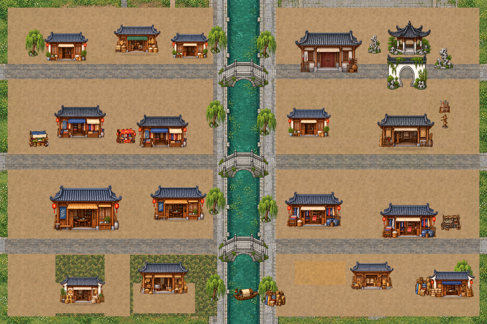
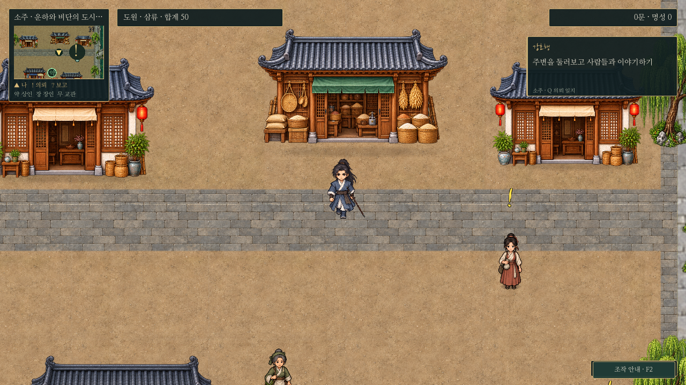
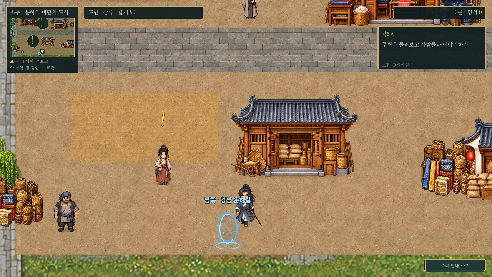
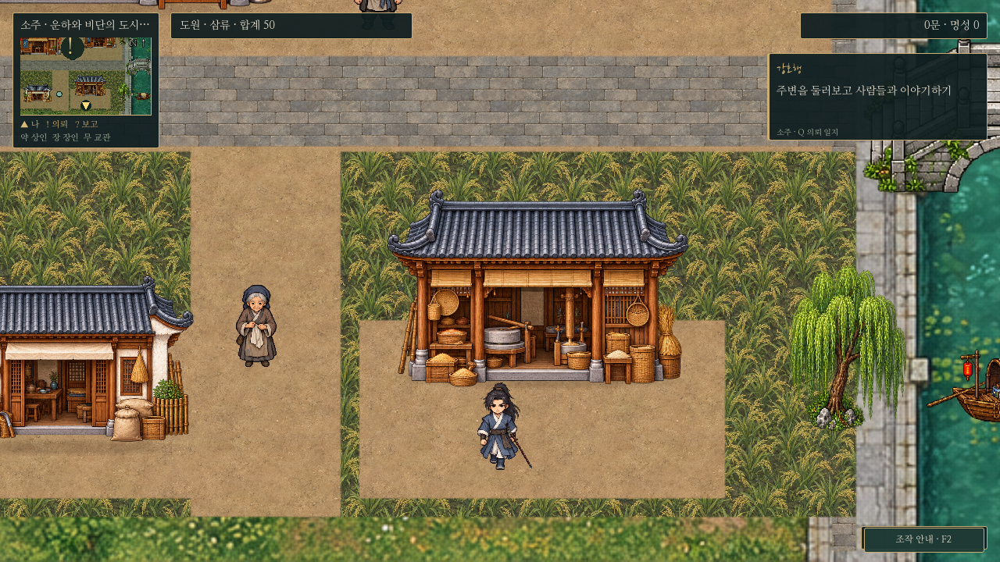
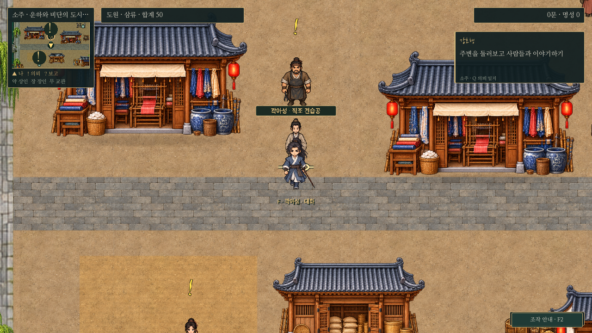
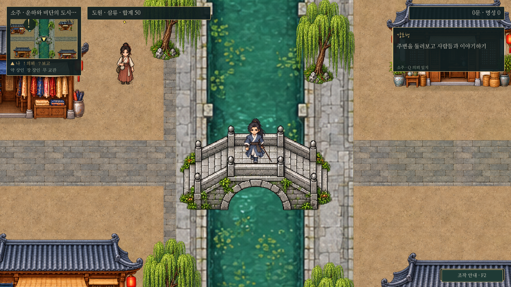

# 소주 · 곡물과 비단이 오가는 운하 도시

## 후속 배치 조정

건물이 같은 선에 반복되던 느낌을 줄이기 위해15동의 위치를 소폭 조정했다. 북쪽 주택·쌀가게, 시장 두 점포, 객잔·다루, 동쪽 주택/무관·공방과 농가/정미소/창고의 앞뒤 선·간격을 다르게 했다. 기존 건물 그림·크기·방향·그림자 방식은 유지하고, 농가/정미소의 앞마당만 새 위치에 맞췄다. 관아·정원의 정돈된 배치와 대로·운하·세 다리는 유지한다. 주민14명은 기존 좌표에서 접근 가능하며 주민 이동은 없었다.

[배치 변경 전 전체 지도](https://github.com/UTopia0525/-/blob/f0fed5f/godot/screenshots/suzhou-painted-full.png). 아래 전체 지도와 플레이 이미지는 조정 후 실제 렌더다. `suzhou_maps.gd`의 다리/구역/새 곡물 건물 문턱 접근, `suzhou_residents.gd`, `suzhou_quests.gd`를 다시 확인한다.

2026-10-30. 남경·장사·무창과 같은 정면 시점, 회청 기와, 따뜻한 목재, 비율 보존과 접지 그림자를 사용한다. 곡창지대의 정체성을 곡물 가공·보관·거래·운송의 외관으로 표현하고 기존 비단/염색/직조와 운하 성격을 함께 유지한다.

[전체 원본](../../godot/screenshots/suzhou-painted-full.png) · [1440p 실제 화면](../../godot/screenshots/suzhou-painted-1440p.png)

## 구역과 새 건물

- 북쪽 주거·상업 골목의 쌀가게: 저울과 되, 쌀 바구니, 곡식 꾸러미가 있는 낮은 점포.
- 서쪽 농가와 정미 작업장: 키·볏단·낫이 있는 농가, 맷돌과 목제 절구가 보이는 열린 작업장. 정미소1동을 추가하고 벼 재질과 작업장 앞 흙 마당을 연결한다.
- 동쪽 하역장: 단을 높여 곡식을 보관하는 창고1동과 곡물 운송·거래 건물1동을 추가했다. 자루·되·운송 수레·밧줄로 용도를 구분하고 기존 건조·하역 공간은 통행을 막지 않는 바닥 표현으로 둔다.
- 비단 상점·직조/염색 공방: 기존 역할과 인물은 유지하고 같은 화풍의 비단 점포/베틀·염색 항아리 외형으로 교체했다.
- 주거·객잔·찻집: 회벽·격자창·회색 기와를 사용한다. 관아/무관은 장사의 전용 미술을 재사용한다. 정원의 정자·월문, 운하 다리·나무·배·짐 등 기존 독립 소품은 유지한다.

| 실제 플레이 | 화면 |
| --- | --- |
| 쌀가게 |  |
| 곡물 창고·하역장 |  |
| 정미 작업장 |  |
| 비단 공방 |  |
| 운하 |  |

## 구현과 유지 범위

새 건물8종 원본은 `assets/maps/suzhou/painted/{grain,canal}.png`, 농지 재질은 `rice-field.png`다. 승인된 남경 시장 원본을 건물 생성 참조로 사용하고 생성 원본을 수정 없이 보관했다. 출처/해시는 `art-manifest.json`에 기록한다. 프리팹은 소주 `layout.json` 안에서만 재정의한다. 비단 점포는 남경 시장의 승인 그림을 재사용한다.

바닥은 `suzhou_painted_ground.gd`와 `suzhou_painted.gdshader`에서 공통 흙/포장 재질을 월드 좌표로 샘플링한다. 서쪽 농지는 새 벼 재질을 사용하고 작업장·농가 앞은 흙으로 비운다. 건물은 바닥과 분리한 충돌/Y정렬을 유지하며, 운하와 세 다리의 기존 통행·물 차단도 유지한다. 지도 바닥 캐시 `painted/overview-floor.png`를 다시 렌더해 미니맵과 전체 지도를 동기화한다.

세계4608×3072, 기존 주민14명/시설3종·의뢰 대상ID·보상·전투 수치·모용세가/남경 산길/항주 운하길 연결은 유지한다. 새 NPC/실내/의뢰를 추가한 것은 아니다. 기존 저장의 막힌 위치는 기존 안전 위치 보정으로 처리한다. 건물 그림에 보이는 작업 기구는 외형이며 새 생산 시스템이 아니다. 도원과 인물 그림은 유지한다.

## 검사

`suzhou_maps.gd`로 남경 산길 F 왕복·세 다리의 실제 물리 통과·운하 차단·구역 접근·지도·저장을 확인한다. `suzhou_residents.gd`로 주민/거래 접근·생활 대사·기존 인물 재사용을 확인하고, `suzhou_quests.gd`로 기존5의뢰의 동시 진행·대화·보고/저장 흐름을 점검한다. 캡처는 `capture_suzhou_painted.gd`의 실제 게임5곳/1440p와 인물 없는 전체 지도다.

분리된XDG 사용자 데이터, Godot4.6.3/소프트웨어OpenGL 환경에서 확인한다. Windows GPU 성능이나 모용세가 이야기 전체를 새로 검증했다는 뜻은 아니다.
