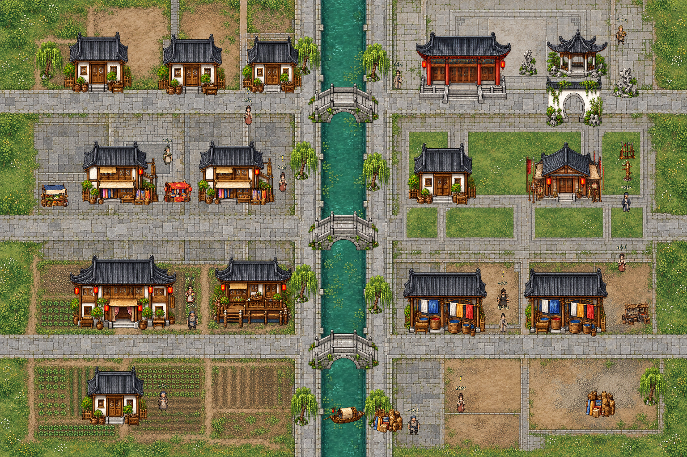
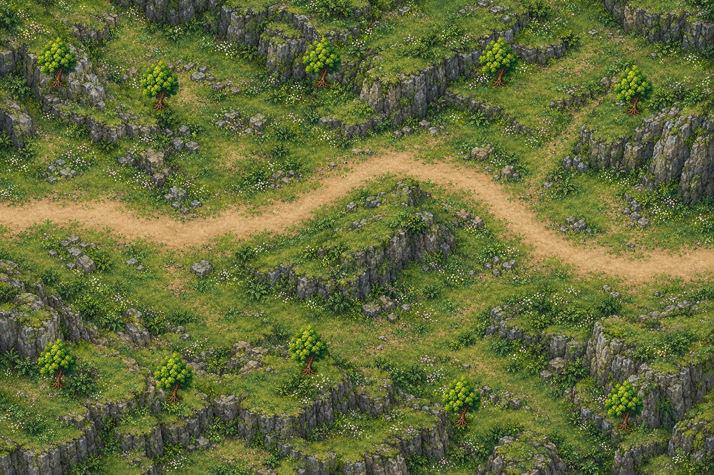

# 소주와 남경–소주 산길

소주에 일반 주민14명과 그중 영약·무기·무공 거래 담당3명을 배치했다. [주민 설정·대화·배치](../characters/suzhou-residents.md)를 따른다. 후속 승인으로 [일반 의뢰5종](../quests/suzhou.md)을 연결했으며 모용세가 인물은 추가하지 않았다. 기존 도시와 같은 WASD/방향키 이동, F 포탈 상호작용, 미니맵·TAB 전체 지도·설정 및 탐험 중 저장/불러오기를 사용한다. 건물 내부나 태호·모용세가 본가는 이번 범위에 포함하지 않는다.

## 소주

- 월드4608×3072, 도면1536×1024. 남경보다 작은 면적이며 기존 도시의 인물/건물 축척을 따른다.
- 중앙 운하와 북·중앙·남쪽의 세 돌다리. 물 위는 통행 불가, 다리 세 곳만 실제 충돌/길찾기로 연결된다.
- 서북 백벽 주거골목, 서쪽 비단 상점가, 서남 객잔·찻집과 농촌.
- 동북 관아와 정원/월동문, 동쪽 무관·연무장, 동남 염색·직조 공방과 운하 선착장.
- 흰 회벽·검은 기와·비단·버드나무·태호석·목선을 새 전용 투명 아틀라스로 제작했다. 관아/무관과 일부 생활 소품은 기존 공용 자산을 재사용한다.
- 바닥에는 지형/길/물만 담고, 건물·나무·월동문·다리는 별도 그림과 발밑 충돌을 사용한다. 다리는 상단을 Y정렬 기준으로 삼아 바닥보다 위, 인물보다 아래에 보인다. 다리 양쪽 난간은 실제 충돌이 있다.

[소주 실제 플레이 화면](../../godot/screenshots/suzhou-play.png)

## 산길

- 월드3840×2560, 도면1536×1024. 남경에서 동쪽으로 이어지는 강남의 낮은 구릉과 바위 고개.
- 서쪽 진입→중앙 낮은 고개를 북쪽으로 완만하게 우회→동쪽 소주 방면으로 이어지는 짧은 길이다. 전투·NPC·의뢰는 추가하지 않았다.
- 통행 가능 다각형을 지형의 흙길에 맞춰 구성하고, 가장자리는 실제 충돌/길찾기로 막는다. 별도 나무에도 발밑 충돌과 Y정렬이 있다.

[산길 실제 플레이 화면](../../godot/screenshots/nanjing_suzhou_road-play.png)

## 이동과 검증

남경 동남쪽 출구[1470,995] ↔ 산길 서쪽[35,460], 산길 동쪽[1500,570] ↔ 소주 서쪽[48,512]. 모두 파란 포탈에 접근해 F로 왕복한다. 남경 출구는 기존 집 뒤의 통행 가능한 남쪽 가장자리로 잡아 건물 위에 겹치지 않게 했다.

`tests/suzhou_maps.gd`: 네 방향 F 상호작용, 포탈 지점/산길 전체 연결, 산길NPC0명/소주14명, 물 차단/세 다리의 실제 통과, 구역 접근, 건물 충돌, TAB 지도, 두 맵 저장/불러오기 확인. 기존 `tests/saves.gd`, `tests/overland_travel.gd`로 저장과 기존 육로도 점검한다. `tests/capture_suzhou.gd`는 전체 맵과 실제 탐험 화면을 Godot에서 촬영한다.

주요 구현은 `scripts/suzhou_map.gd`, `assets/maps/suzhou/layout.json`, `assets/maps/nanjing-suzhou/layout.json`이다. 현재14명은 사용자 승인에 따라 기존 공용 초상화/도트를 재사용한다.

### 기존 검사와의 구분

새 맵 회귀 검사 `suzhou_maps.gd`는 실제 F키 이벤트로 네 방향 왕복·두 맵 저장 복원·물 차단·세 다리의 물리 통행·건물 충돌·구역 연결·전체 지도를 통과했다. 기존 `saves.gd`의 이전 전투 복원 기대값 검사와 `overland_travel.gd`의 포탈 강조/안내문구 검사는 이번 수정 전 HEAD(69b1767)의 스크립트로 분리한 기준 프로젝트에서도 같은 실패가 재현된다. 전자는 과거 전투 체력150 기대값을 포함한다. 해당 기존 검사의 기대값/표시 시점이나 전투 규칙은 이번 맵 작업에서 변경하지 않았다.
