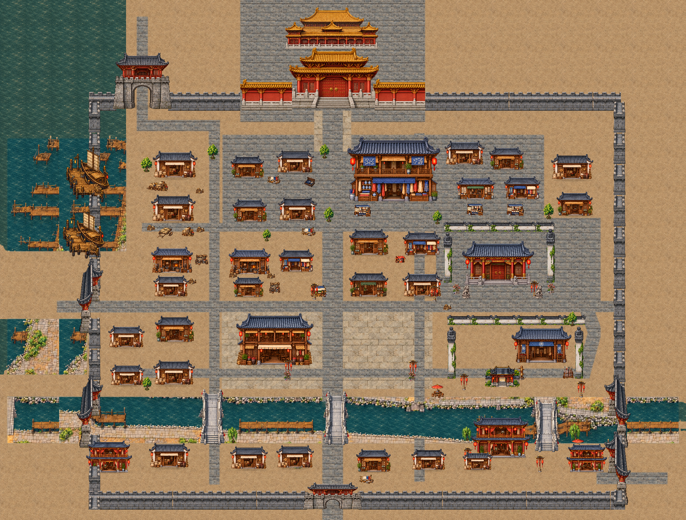

# 장사·무창·남경 성곽과 수도의 남북 대로

2026-10-31. 승인된 항주의 석조 성곽·성문 화풍을 공유하고, 기존 출입 방향에 맞춘 별도 측면 성문과 낮은 보조 문루를 제작했다. 관아/무관/무림맹의 안쪽 담장은 외성보다 가볍고 낮은 기존 외형을 유지한다.

| 도시 | 전체 지도 | 실제 플레이 |
| --- | --- | --- |
| 장사 | [전체 지도](../../godot/screenshots/changsha-fortified-full.png) | [동문](../../godot/screenshots/changsha-fortified-east-gate.png) · [나루 문](../../godot/screenshots/changsha-fortified-water-gate.png) |
| 무창 | [전체 지도](../../godot/screenshots/wuchang-fortified-full.png) | [남문](../../godot/screenshots/wuchang-fortified-south-gate.png) · [동문](../../godot/screenshots/wuchang-fortified-east-gate.png) |
| 남경 | [전체 지도](../../godot/screenshots/nanjing-fortified-full.png) | [궁성문](../../godot/screenshots/nanjing-fortified-palace.png) · [중앙 대로](../../godot/screenshots/nanjing-fortified-avenue.png) · [서문](../../godot/screenshots/nanjing-fortified-west-gate.png) · [동문](../../godot/screenshots/nanjing-fortified-east-gate.png) |

[장사 성문 구조 확인](../../godot/screenshots/changsha-fortified-gate-wide.png) · [무창 성문 구조 확인](../../godot/screenshots/wuchang-fortified-gate-wide.png) · [남경 황궁 구조 확인](../../godot/screenshots/nanjing-fortified-palace-wide.png)

위 구조 확인용 캡처는 장사/무창0.55배, 남경0.45배와 위쪽 시선으로 촬영했다. 나머지는 기본0.8배 실제 플레이 카메라다.

## 장사

도시6144×4096과 동쪽 농촌/포탈을 유지했다. 기존 북·남 외벽을 석조 성곽으로 바꾸고 동·서쪽도 연결했다. 동문은 농촌으로 향하는 가로 통로에 맞춘 측면 문루다. 북·남 보조문은 기존 좁은 부지에서도 지붕까지 들어가는 낮은 전용 문루를 사용한다. 서쪽 나루 세 통행 지점은 서향 문으로 맞췄고 북쪽 두 접안길 사이에 작은 공용 돌 나루를 연결해 양쪽 접근을 유지했다.

허대산은 새 문루와 겹치지 않는 길가[320,450], 집결 포졸은 동문 밖[1250,520]으로 조정했다. 인물ID·토벌 수락/전투·보수/출입 해금은 유지한다. 성벽 밖 농촌을 도시 안으로 편입하지 않았다.

## 무창

도시8192×7680과 남쪽 농촌을 유지했다. 외곽 북·서·동·남 벽을 같은 석조 모듈로 연결하고 남문은 정면 문루, 동문은 동서 통행용 측면 문으로 교체했다. 서쪽 나루도 서향 문으로 맞췄다. 무림맹 외원·내부 담장과 초대/확인/퇴장 후 폐쇄는 유지한다.

산촌 방면 포탈은 동문 밖[2015,945], 산촌에서 돌아오는 도착점은[2010,945]다. 동쪽 통행 범위만 넓혀 성문을 실제로 지나갈 공간을 확보했다. 남쪽 산길 포탈은 농촌 끝의 기존 위치다. 공방거리 지도 표시는 실제 접근 가능한 마당으로 조정했다. 주민/교관·총무당·의뢰 조건과 보수는 바꾸지 않는다.

## 남경 · 중앙 대로에서 북쪽 황궁으로

중앙X900의 넓은 남북 대로를 남쪽 보조문·진회하 중앙 다리·시내 교차로·황궁 앞마당으로 연결했다. 대로를 가로막던 큰 객잔은 서쪽으로 옮겼고 겹치는 작은 건물2동은 옛 동쪽 황성 부근의 주거 공간으로 옮겼다. 시장 점포4동과 골목은 함께 조정해 점포 사이 통행을 유지한다. 등롱1개와 상인·객잔 주변 인물은 새 길가로 맞췄다.

황궁 외곽은12시 방향의 주칠 벽·황금 기와·닫힌 궁성문과 뒤로 보이는 궁전 지붕으로 구성했다. 실제 궁 내부/새 NPC/궁성문 상호작용은 추가하지 않는다. 이전 바닥에 있던 동쪽 사선 황성은 바닥 재질에서 가리고 관련 충돌을 제거했다. 회색 외성은 궁성 양옆과 서·동·남쪽으로 이어진다. 서쪽 나루는 서향 성문, 소주 방면은 동향 성문, 남궁세가 방면은 북서쪽 정면 성문으로 드나든다. 진회하 세 다리와 수변 누각은 유지한다.

새 미술 지도1856×1408/세계7424×5632/layout_version3이다. 기존 시내는 기본적으로X+160/Y+300미술 단위로 옮겼고, 위의 객잔·점포·일부 주민/소품만 별도로 재배치했다. 모든 의뢰 대상·동적 등장 인물과 실내/지역 이동 포탈도 함께 맞췄다.

- 산촌 왕복: 서문 밖 포탈[170,830], 도착[180,830].
- 소주 산길 왕복: 동문 밖 포탈[1790,1295], 도착[1780,1295].
- 남궁세가 왕복: 북서문 밖 포탈[385,60], 도착[385,105].

좌표는 미술 지도 단위다. 기존version2 저장은 월드 위치에(640,1200)을 더한 뒤 안전 위치 검사를 한다. 기존version1은 새 서문 밖 안전 입구로 복원한다. 새version3을 다시 읽으면 위치를 더하지 않는다. 퀘스트 단계·인물ID·금전·스탯·보상·분기는 유지한다.

## 공통 구현과 미술

`fortification_layout.gd`는 도시별 `fortification_plan`을 독립 오브젝트/프리팹으로 만든다. 항주 원본 석재 모듈의 같은 월드 축척을 유지하고, 끝의 짧은 구간은 원본 영역을 잘라 이어 붙인다. 건물·문을 사선 회전하거나 가로세로 다르게 늘리지 않는다.

동문 전용 `fortifications/side-gate.png`는 북쪽/남쪽 기둥 사이로 가로 통행하는 새 측면 그림이다. 서문은 이를 좌우 반전하며 충돌도 같이 반전한다. 낮은 보조문은 `postern-gate.png`, 남경 황궁은 `capital/imperial-frontage.png`다. 생성 원본을 수정 없이 보관하고 출처/해시는 `fortifications/art-manifest.json`에 기록했다. 큰 남북 정면 문은 승인된 항주 원본을 재사용한다.

그림·충돌·Y정렬은 바닥과 분리했다. 미니맵/전체 지도도 동일한 최종 표시 영역과 반전 상태를 사용한다. 새 지도 바닥 캐시는 기존 각 도시 `painted/overview-floor.png`에 렌더한다. 비교용 이전 `*-painted-full`/`nanjing-capital-full` 캡처는 보존하며 현재 외성/배치는 위 `*-fortified-*` 화면을 기준으로 한다.

## 검증과 재현

`city_fortifications.gd`는 모든 주민/출입구 접근, 전신 겹침, 새 대로·기존 다리, 닫힌 궁성·무림맹 입장 상태, 실제 키보드 성문 통과와 남경version2/3 저장 이행을 검사한다. 기존 `changsha.gd`, `changsha_residents.gd`, `wuchang.gd`, `wuchang_residents.gd`, `nanjing_layout.gd`, `nanjing_market_slice.gd`로 탐험/물리/거래를 확인한다. 남경 구휼 및 일반5의뢰는 `nanjing_relief.gd`, `cart_quest.gd`, `book_quest.gd`, `silk_quest.gd`, `levy_quest.gd`, `waterfront_quest.gd`, 무림맹 진행은 `alliance_story.gd`, 공통 저장은 `saves.gd`로 확인한다.

위 기능 검사15종과 공통 변경의 항주 회귀 `hangzhou_fortifications.gd`까지16종이 모두 통과했다.

`capture_city_fortifications.gd`는 세 도시의 실제 플레이 화면·전체 지도와 바닥 캐시를 생성한다. 캐시 PNG를 다시 가져온 뒤 재촬영하면 미니맵도 최신 바닥을 사용한다. Godot4.6.3/분리된XDG 저장·소프트웨어 OpenGL에서 확인하며 Windows GPU 성능을 측정한 결과는 아니다.
