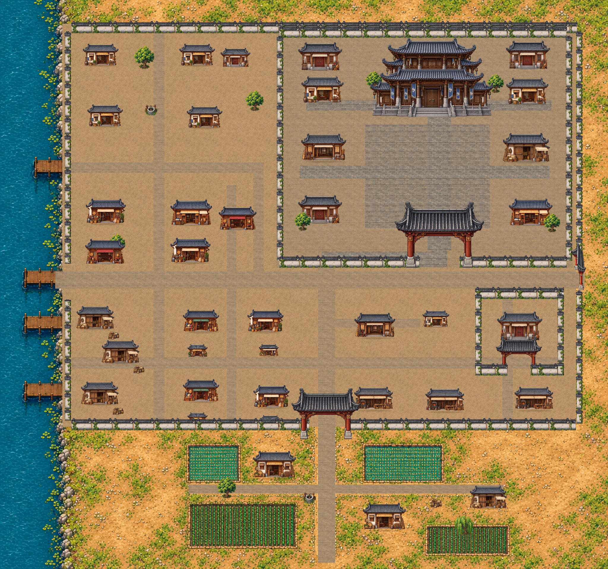
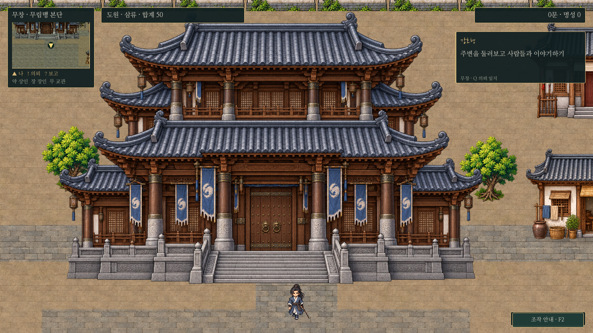

# 무창 · 무림맹을 중심으로 한 실용 도시

최신 외성/통로 배치는 [세 도시 성곽과 남경 북쪽 황궁](three-city-fortifications.md)을 따른다. 아래 그림은 성곽 교체 전의 미술 비교 기록이다.

2026-10-30. 남경 시장과 장사의 정면 시점·회청 기와·목재 재질·비율 보존·접지 그림자를 기준으로 무창 주요 건물과 바닥을 개선했다. 본단은 건축 규모로 위엄을 주고 시가지는 무림인·호송객의 숙식과 보급을 중심으로 구성했다.

[전체 원본](../../godot/screenshots/wuchang-painted-full.png) · [1440p 실제 화면](../../godot/screenshots/wuchang-painted-1440p.png)

## 무림맹과 거리

본부는 높은 겹지붕·굵은 목재·석주·넓은 석단·절제된 청색 깃발의 독립 전용 그림이다. 지붕과 기둥을 비틀거나 눌러서 높이지 않고 원본 비율을 유지한다. 본관 부지를 `[1245,85,420,320]`으로 조정해 기존보다 넓게 보이면서 양옆 부속동과 간격을 둔다. 문지기와 정문·총무당 포탈 위치는 유지한다.

위 본부 전체 구조 확인 화면만 촬영용 시야0.55와 위쪽 오프셋을 사용했다. 게임의 기본 시야를 바꾸지 않았으며 [기본0.8 플레이 화면](../../godot/screenshots/wuchang-painted-headquarters.png)도 따로 보관한다. 캡처는 격리된 테스트 게임에서 출입 허가 후 촬영했으며 실제 저장의 진도를 바꾸지 않는다.

| 구역 | 표현 | 실제 화면 |
| --- | --- | --- |
| 객잔·술집·다루 거리 | 여행짐·무명 차양의 숙박 객잔, 술항아리와 나무 술상, 실용적인 작은 다루 | [거리](../../godot/screenshots/wuchang-painted-inns.png) |
| 시장 | 침구·밧줄·식량·천을 다루는 무림인 보급 점포 | [시장](../../godot/screenshots/wuchang-painted-market.png) |
| 공방 | 기존 장사와 같은 재질의 열린 작업장·수리 공방 | [공방](../../godot/screenshots/wuchang-painted-workshops.png) |
| 무림맹 정문 | 기존 개방 통로·기둥·문지기 통제 유지 | [정문](../../godot/screenshots/wuchang-painted-gate.png) |

공개 객잔 거리에는 술집/숙박 건물2동을 추가했다. 기존3동도 서로 다른 외형으로 구분하며 본단 안의 객사도 유지한다. 새 건물에 별도 실내·거래 NPC나 의뢰를 추가한 것은 아니다. 관아·주택·창고·무관·공방은 장사의 전용 미술을 재사용해 도시 간 화풍을 맞춘다. 사치스러운 금장·공연 누각을 거리에 반복 배치하지 않는다.

바닥은 `wuchang_painted_ground.gd`/`wuchang_painted.gdshader`가 시장과 같은 원본 재질을 월드 단위로 그린다. 흙과 낡은 포장, 본단의 정돈된 석재 마당을 구분하고 기존 강·농촌 지형은 보존한다. 문·담장·나무·짐·우물은 기존 오브젝트를 재사용하며 모든 건물은 독립 충돌/Y정렬을 유지한다. 미니맵과 전체 지도는 새 바닥 캐시와 실제 건물 표시 사각형을 사용한다.

## 원본·호환·검사

새 원본은 `assets/maps/wuchang/painted/{alliance-hall,streets}.png`의 본부1종/거리4종이다. 승인된 남경 시장 원본을 참조로 생성하고 수정 없이 보관했다. 출처·해시는 `art-manifest.json`에 기록한다. 프리팹은 무창 `layout.json` 안에서만 재정의하며 다른 도시의 공용 원본을 덮어쓰지 않는다.

도시8192×7680·남쪽 농촌 진입·포탈·주민/의뢰ID·대화/보수·전투 수치는 유지한다. 출입 전 제지, 송지겸 보증, 총무당/교관 전수, 방문 종료 통제도 기존 시스템을 유지한다. 새 배치가 이전 저장 좌표를 막으면 기존 안전 위치 보정이 적용된다. 도원과 주민의 그림은 바꾸지 않았다.

`wuchang.gd`는 남쪽 진입·전체 랜드마크 경로·문 통과/기둥 충돌·본부의 웅장한 높이를 확인한다. `wuchang_residents.gd`는 주민/시설 접근·거래를, `alliance_visit.gd`는 정문 통제·콜백·저장 호환을 확인한다. `alliance_story.gd`는 초대→총무당→교관→5종 중1종 전수·편성·출입 종료를 검사한다. 이 검사의 옛 ‘상세 본문에 무공 이름 포함’ 기대값은 현재 K창의 별도 제목 표시 검사로 수정했으며 UI나 전수 동작을 바꾸지 않았다. `last_wuchang_quests.gd`로 비전투 일반 의뢰의 동시 진행·보수/저장을 점검한다.

`capture_wuchang_painted.gd`로 실제 플레이5곳·본부 넓은 시야·1440p와 인물 없는 전체 지도를 렌더하고 바닥 캐시를 재생성한다. Godot4.6.3/소프트웨어OpenGL·별도XDG 사용자 데이터 환경에서 검증한다. 모든 전투 분기나 Windows GPU 성능을 검사했다는 뜻은 아니다.
