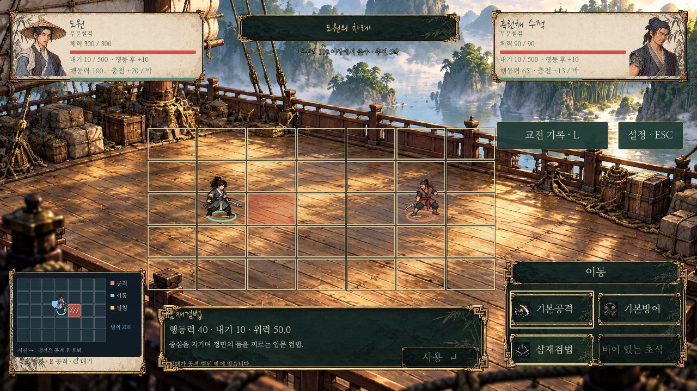
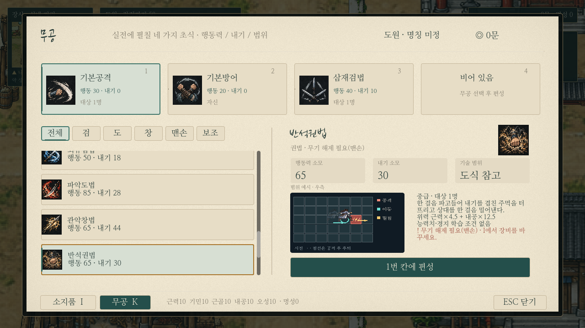
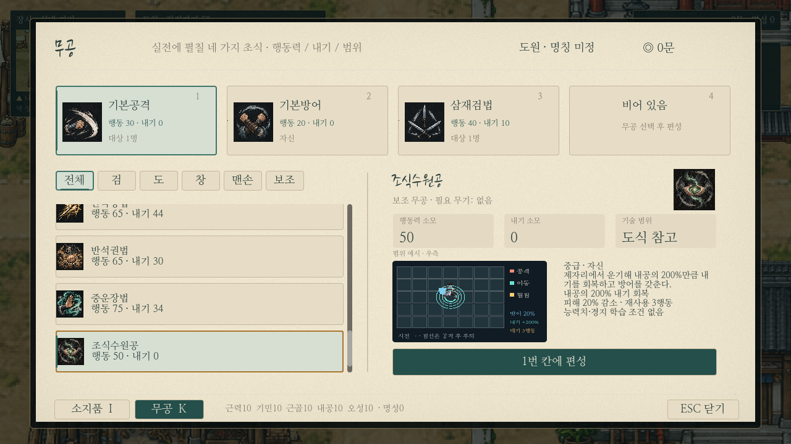
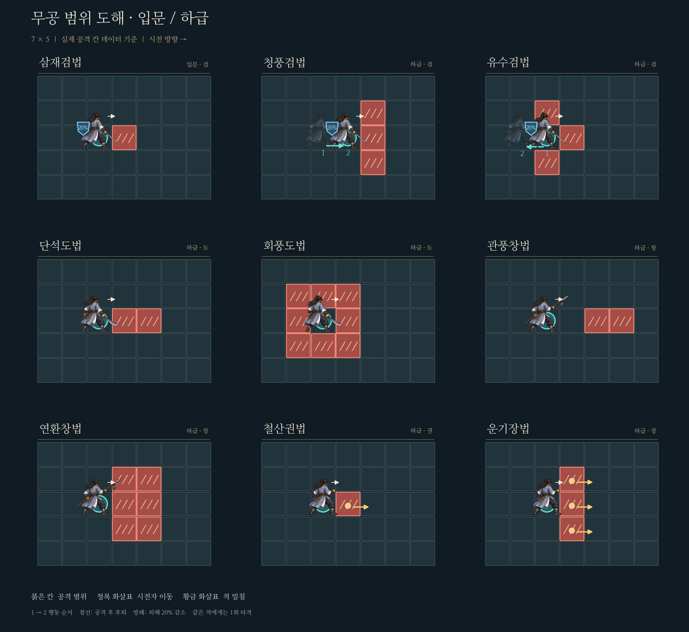
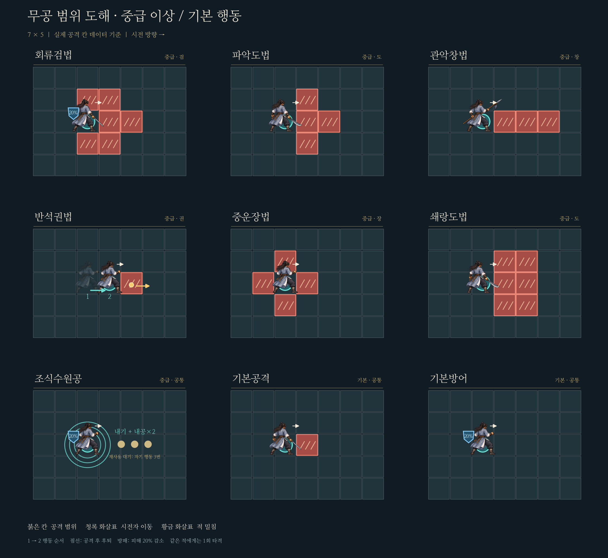

# 실제 무공 범위·효과 도해

## 게임 내 자동 그림

전투 왼쪽 하단과 K창은 `martial_range_preview.gd`의 같은 그림을 사용한다. 선택 무공마다 공격 칸·실제 무기별 도원·전진/후퇴 화살표·각 공격 칸의 밀침·방어·추가 내기 회복·재사용 대기를 데이터에서 자동 구성한다. 기술 설명/행동력/내기/위력과 출수 버튼은 유지한다. 탐험의 클릭 이동이나 전투 저장 규칙은 바꾸지 않는다.

새 무공의 `martial_tactics.json` 범위/변위와 카탈로그 효과 필드를 등록하면 두 화면에 별도 PNG 제작이나 개별 UI 수정 없이 그림이 생긴다. 문서용 큰 PNG는 아래 도구로 다시 생성한다. `tests/range_diagram_ui.gd`는 모든 무공과 두 화면의 선택 갱신/자원 무변경을 확인한다.

2026-10-28.16개 무공과 기본 행동2개의 그림이다. 현재 전투 장면을 새로 바꾼 스크린샷이 아니라, 이누야샤 웹게임처럼 공격 칸과 변위를 비교하기 위한 도해다. 기존 전투의 범위/연출/수치는 유지하며 기본공격 피해만 근력+내공으로 바꿨다.

- 붉은 칸: 공격 위치. 같은 적에게 한 번 적용한다.
- 청록 화살표: 시전자 전진/후퇴.1→2가 이동 순서이며 점선은 공격 후 후퇴다. 반투명 캐릭터는 이동 전 또는 이동 후 자리다.
- 황금 화살표: 피격한 적의 밀침. 각 화살표는 같은 효과를 받는 개별 공격 칸을 가리키며 추가 피해 칸이 아니다.
- 방패: 피해20% 감소. 다음 자기 실제 행동 시작까지 그사이 모든 공격에 적용한다.
- 조식수원공의 원: 내공×2 추가 내기 회복. 기존 모든 행동의 정상 회복은 별도다. 금색 점3개는 사용 후 다른 자기 행동3회 재사용 대기다.

그림은 오른쪽으로 출수하고 장애물이 없는7×5 예시다. 다른 방향은 그대로 회전하며 실제 이동/시야/충돌 판정은 기존 격자 모델이 처리한다. 건너갈 칸이 막힌 전진 기술은 사용할 수 없고, 후퇴/밀침만 막히면 그 이동을 생략한다.

`render.py`가 실제 `godot/data/martial_tactics.json`의 공격 오프셋·변위를 읽고 기존 도원 전투 자산으로 렌더한다. 공격 칸을 생성형 그림의 임의 배치로 대체하지 않는다. 재생성: 저장소 루트에서 `MPLCONFIGDIR=/tmp/murim-mpl python docs/martial-arts/range-diagrams/render.py`. matplotlib/Pillow가 필요하다.
