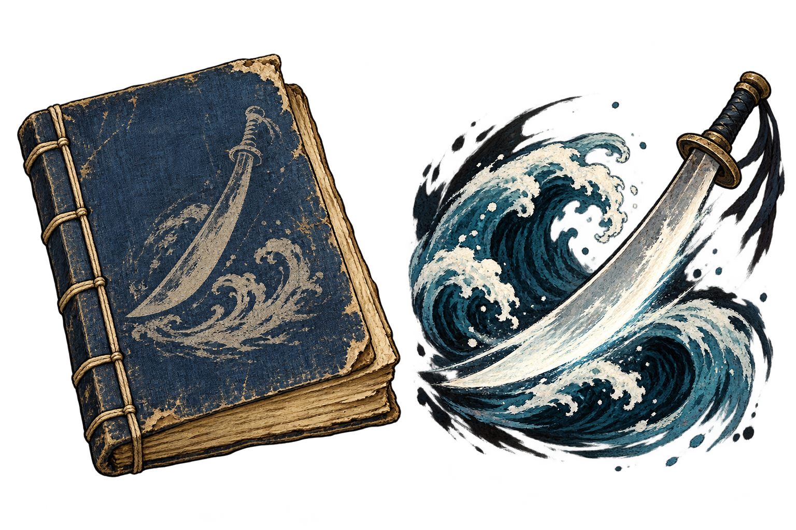

# 쇄랑도법 — 오래된 무공 서적 보상안

「빌려준 책, 돌아오지 않는 사람」의 금전150문 제안 대신, 소학겸이 오래 보관한 골동품 무공 서적 **쇄랑도결(碎浪刀訣)** 한 권을 주는 안이다. 사용자 채택 후 의뢰·소모성 서적·무공을 게임에 구현했다. [진행과 사용법](../quests/nanjing-book.md)을 따른다.

## 무공 제안

- 이름: 쇄랑도법(碎浪刀法), 중급 도법.
- 개성: 밀려오는 물결을 부수듯 무게 중심을 낮춰 도날에 체중과 근력을 싣는 간결한 도법. 특별한 방어/관통/고정 피해를 추가하지 않는다.
- 위력: **근력×8 + 기민×5 + 근골×2**, 고정 위력0.
- 내기 소모: **22**, 파악도법과 동일.
- 학습: 능력치/경지/선행 무공 제한 없음. 의뢰로 받은 서적을 사용해 습득한다.
- 실전 사용: **도 장착 필수**, 사용 내기 필요. 자동 무기 교체/자동 K 편성은 하지 않는다.
- 일반 교관 판매 목록에 추가하지 않는 의뢰 보상 전용이다. 서적은 일회 학습용이며 이미 습득했다면 소모하지 않는다.

현행 `alliance_martial_arts.json`의 파악도법은 근력×7+기민×5+근골×2, 내기22다. 쇄랑은 근력 계수만+1이므로 동급에서 소폭 우위인 보상이 된다. 장비·적 근골 보정 전 위력 비교:

| 모든 능력치 | 파악도법 | 쇄랑도법 | 관악창법 |
| --- | --- | --- | --- |
|20|280|300|480|
|50|700|750|660|
|100|1400|1500|960|

균형 능력치에서는 약7.1% 위력이 증가하고, 근력 비중이 큰 성장에서는 증가율이 조금 달라진다. 초반의 관악창법 우위와 다른 계열의 높은 후반 성장 계수라는 기존 방향을 유지한다. 표는 단일 출수의 원 위력이며 실제 전투 승률 비교를 뜻하지 않는다.

## 서적과 보상 대사

오래된 청람색 천 표지에 파도와 도날의 흐릿한 묵화가 남은 필사본. 모서리와 책장은 낡았지만 학습 내용은 완전하다. 신물이나 전설급 비급으로 설정하지 않는다. 무공을 찾는 손님이 드물어 오랫동안 가게에 남아 있었던 중급 서적으로 제안한다.

> 소학겸: “돈 대신 이 책을 받아 주겠소? 오래도록 내 가게에 있던 도법 필사본이오.”
>
> 도원: “이런 책까지 내주어도 되겠소?”
>
> 소학겸: “서가에 꽂혀 있기만 해서는 종이뭉치지. 그대가 펼쳐 쓴다면 내게 있는 것보다 나을 것이오.”

학명과 소학겸의 화해/필사 보완이라는 기존 결말은 유지한다. 보상만 서적으로 바꾸는 안이며 금전/능력치/명성/호의도를 덧붙이지 않는다.

