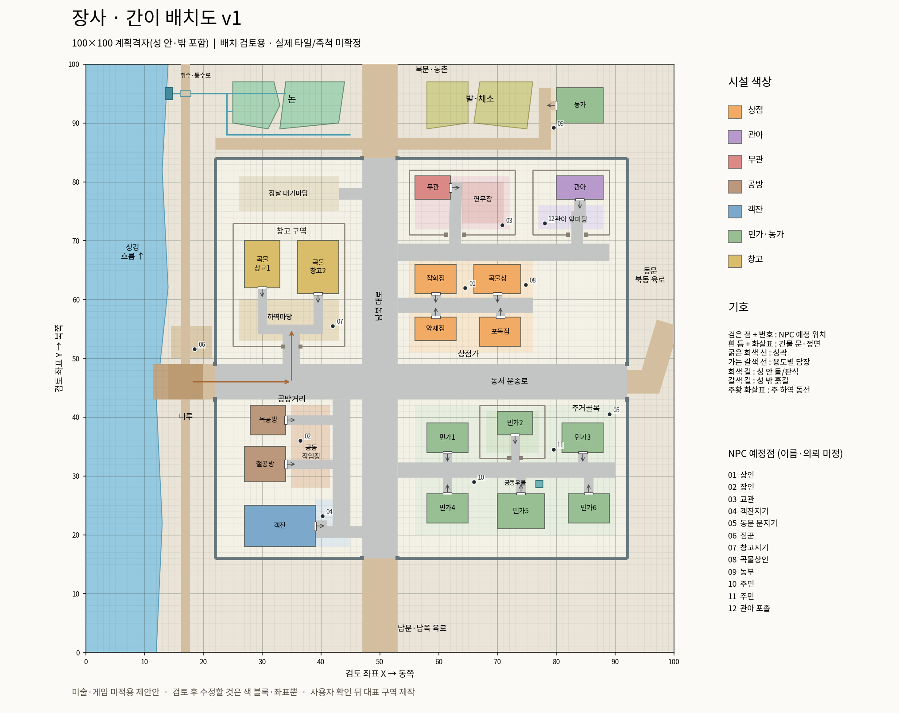

# 장사 간이 배치도 v1 — 사용자 검토 대기

[원본 PNG](layout.png) · [확대용 SVG](layout.svg) · [배치 좌표](plan.json) · [도면 검사 결과](checks.json)

새 미술을 만들기 전에 공간 구성만 검토하는 제안이다. 기존 장사 지도는 따르지 않았으며 게임 코드·맵·실제 NPC·저장 데이터를 수정하지 않았다.

## 읽는 방법

- 성 안팎을 포함한 **100×100 계획 격자**다. 실제 Godot 타일 크기나 최종 도시 축척을 정한 것은 아니다. 북쪽은 위, 좌표 원점은 왼쪽 아래다.
- 색 블록은 건물 바닥 점유 예정 범위, 흰 문 표시와 화살표는 출입구와 정면이다. 높이/지붕 가림은 표현하지 않았다.
- 검은 점12개는 역할별 NPC 예정 위치다. 실제 인물·새 의뢰를 만들거나 기존 인원을 삭제한 것이 아니다.
- 시설18동: 상점4·공방2·객잔1·관아1·무관1·창고2·성내 민가6·외곽 농가1.

## 배치 이유

1. 서쪽 상강 → 나루 → 서문 → 창고 하역마당 → 곡물상/시장으로 물자를 옮긴다. 하역 동선은 주거 골목을 가로지르지 않는다. 강변에는 통행·하역 여유를 두고 농가를 붙이지 않았다.
2. 공방은 운송로 가까운 열린 공동 작업장에 배치한다. 창고·관아·무관·민가1곳만 용도에 맞는 담장을 두며, 모든 건물에 독립 마당을 요구하지 않는다.
3. 남북 대로에서 시장·공방·주거 골목으로 갈라진다. 객잔은 남문 진입로 쪽에, 주거는 하역장 반대편에 둔다. 주민용 우물과 장날 대기 공간도 둔다.
4. 관아와 무관은 북쪽 공공 구역으로 묶되 담장과 문을 따로 둔다. 연무장은 건물과 구별한 열린 공간이다.
5. 외곽 북서쪽 논은 강에서 연결한 통수로로 급수하고, 북동쪽 밭·채소는 별도 덩어리로 둔다. 논과 밭을 한 줄씩 번갈아 나열하지 않는다. 이 지형과 취수 방식은 역사적 고증 확정이 아닌 게임용 제안이다.
6. 성 안 주요 길은 돌/판석, 성 밖 접근로는 흙길, 나루는 목재로 구분한다. 동문은 북동쪽 육로 연결을 고려한 제안이며 기존 게임 이동 연결을 바꾸지 않았다.

## 확인한 범위와 남은 검증

`python3 docs/plans/changsha-v1/draw.py`로 그림을 재생성한다. Python·NumPy·Matplotlib과 한국어 Noto CJK 글꼴이 필요하다. 게임 실행에 필요한 파일은 아니다.

도면 좌표에서 건물18동 사이 바닥 점유 겹침0건, 모든 건물 문 앞과 NPC12점의 길 연결을 검사했다. 이는 1칸 해상도의 도면 검사다. 실제 캐릭터 폭·건물 높이·시점·충돌·깊이 정렬·NPC 혼잡·성능·이동 시간·최종 축척은 아직 검증하지 않았다. 빈 부지는 추가 시설 확정이 아니라 여유/완충 공간이다.

배치 확인 후 처음 제작할 대표 구역은 **나루 일부→서문→창고 하역장→시장 진입로**를 권한다. 아이소메트릭 화면의 부피와 가림을 포함해 실제 통행 폭을 확인한 뒤 나머지 구역으로 확장한다. 이 문서만으로 미술 제작이나 전체 전환을 승인한 것으로 보지 않는다.
