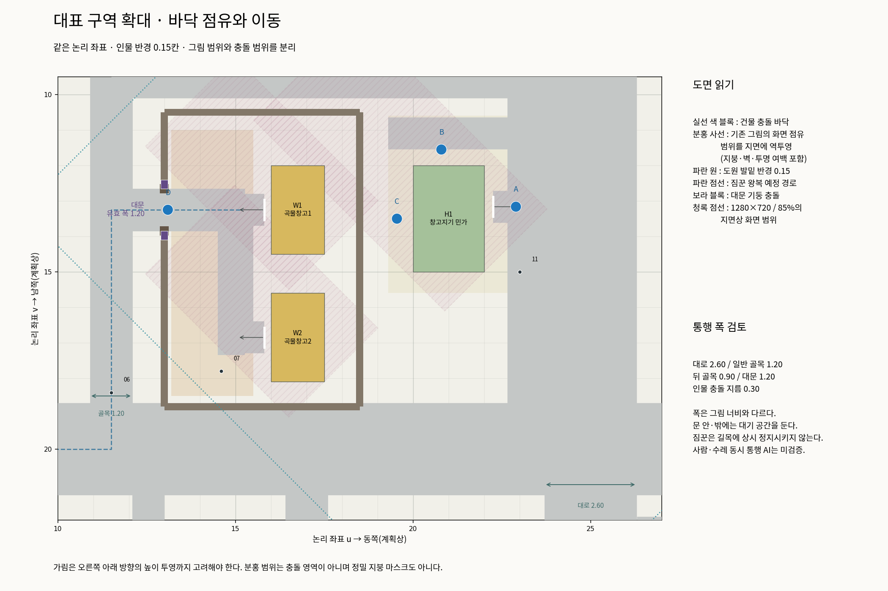
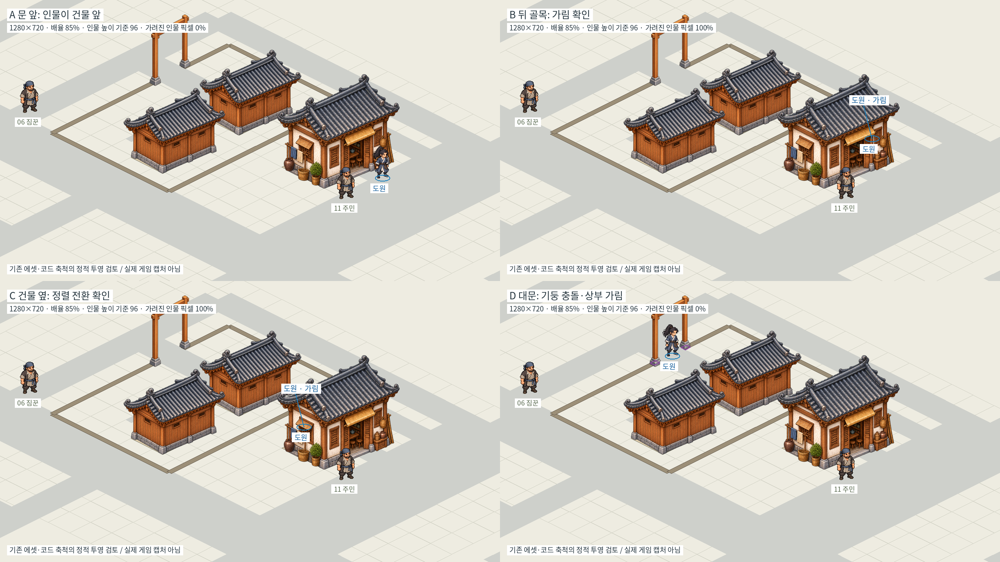

# 장사 논리 타일 배치 검토 v2 — 실제 제작 전 검토안

[전체도](overview.png) · [바닥·이동 확대도](detail.png) · [기존 에셋 가림 비교](occlusion.png) · [좌표](plan.json) · [기하 검사](checks.json) · [정적 가림 수치](projection-checks.json)

기존 장사의 위치를 답습하지 않고 필드 구성 원칙을 적용한 새 계획이다. **1칸은 기존 아이소메트릭 논리 타일 1개**이며 전체48×40칸이다. 좌표·그림 제작용 Python과 문서만 추가했다. 실제 게임 맵/인물/의뢰/저장·미술 원본은 수정하지 않았다. 이전100×100안은 관계 검토 이력으로 남기며, 다음 제작의 크기 기준으로 사용하지 않는다.

## 실제로 확인한 기존 축척

| 근거 파일 | 확인한 값과 적용 |
| --- | --- |
| `godot/prototypes/isometric/iso_space.gd` | `screen_x=64*(u-v)`, `screen_y=32*(u+v)`. 논리1칸의 다이아몬드는128×64 화면 단위. |
| `iso_actor.gd` | 발밑 반경0.15, 정렬용 사각형0.30×0.30, 캔버스 높이 기준96. 크기는 변경하지 않음. |
| `changsha-layout.json` | 민가2×3, 창고1.5×2.5, 나무0.7×0.7 등의 기존 점유 기준. |
| `assets/manifest.json`, `iso_prop.gd` | 실제 그림 crop/pivot, `ground_width`에 따른 균일 배율, 건물 문 위치와 문기둥 앵커. |
| `iso_world.gd`, `project.godot` | 기본 배율85%,1280×720. 아래 정적 비교에 동일하게 적용. |
| `iso_town_world.gd` | 생활 구역 이동 속도4.8 논리 타일/초. 본 제안은 변경하지 않음. |

평면 배치도에서 u는 오른쪽, v는 아래다. 지리상 동/남으로 대응시키는 계획안이며, 화면에서는 같은 좌표가 사선으로 투영된다. 전체도와 확대도는 같은 좌표를 쓰며 표시를 위해 시설을 늘리거나 위치를 옮기지 않았다. 그림 외형과 물리 충돌은 별개다. 기존 민가의 실제 그림 문턱은 바닥 사각형에서 약0.256칸 바깥에 있으므로 문을 블록 가장자리에 임의로 붙이지 않고 기존 문턱 오프셋을 적용했다.

## 크기와 구성

전체48×40(1,920칸), 성곽 중심선 내부35×28(980칸). 전체도는 외곽 농지·나루·진입로까지 포함한다. 기존24×20 시험 구역과 같은 단위를 사용하며 전체 면적은4배다. 도시 내부는 면적 기준 약2배여서 대표 구역을 반복 복제하지 않고 소규모 생활 도시를 구성할 여유를 둔다. 큰 역사 도시의 실측 재현은 아니다.

건물20동: 상점4·관아1·무관1·공방2·객잔1·민가/농가8·창고/나루관리소3. 관아3×2.8, 무관2.5×3.2, 객잔3×4와 점포 등은 **용도별 예정 바닥 범위**다. 전용 새 그림이 없는 시설8동의 높이·지붕 범위는 확정하지 않았다. 민가 그림을 관아 등으로 늘려 쓰는 뜻이 아니다.

기본 카메라의 지면상 범위를 확대도에 청록 점선으로 표시했다. 지붕·벽 높이까지 포함한 모든 화면 오브젝트의 범위는 아니다. 이동 시간은 시뮬레이션/실제 플레이로 측정하지 않았으며 총 크기만으로 탐험 재미를 보장하지 않는다.

## 공간 구성과 규칙 적용

- 서쪽 상강→목재 나루→서문→창고 대문→하역마당→서향 창고 문을 잇는다. 운반은 주민 사유 마당을 관통하지 않는다. 강변에는 제방 보행로·접안·대기 여유를 남기고 논·민가를 붙이지 않았다.
- 남북 대로2.6칸과 동서 운송로2.6칸을 주요 축으로 삼는다. 일반 골목1.2, 뒤 골목0.9, 출입 지선0.9, 주거 골목1.1칸으로 기능을 구별한다. 도로 폭은 포장 폭이며 캐릭터가 실제로 쓸 수 있는 중심 통행 폭은 발밑 반경만큼 줄어든다.
- 시장은 운송로 북쪽, 공방은 남쪽의 재료 반입 동선 옆, 객잔은 남문 접근 대로 옆이다. 주거지는 하역 반대편 동남쪽으로 분리했다. 작업 공간·손님 앞자리·우물·장날 대기를 빈 공간의 용도로 정했다.
- 창고·관아·무관·민가1곳에만 담장을 둔다. 각 경계는 소유 시설과 연결하고 대문·문기둥·열린 통로를 따로 표시한다. 담장 없는 점포·민가·공방도 실제 문 방향과 앞자리를 둔다.
- 공공시설 진입은 시장 쪽 골목으로 분리하고 관아/무관 사유 공간을 공공 지름길로 만들지 않았다. 건물 정면은 반드시 대로가 아니라 해당 이용자의 접근 경로를 향한다.
- 농경지는 성 밖 북쪽에 모은다. 서북의 논은 강과 연결한 통수로를 쓰고, 상대적으로 동쪽의 건조한 땅에는 밭을 묶는다. 수로의 제방 길 교차에는 통수 시설 표시를 둔다. 실제 수위/토목 고증과 고저 차는 아직 미검증인 게임 지형 제안이다.
- NPC12점은 이름/실제 의뢰가 확정된 배치가 아닌 역할별 예정점이다. 상인은 점포 정면 고객 자리, 장인은 작업 앞자리, 포졸·문지기는 통로 옆 대기 자리를 쓴다. 움직이는 짐꾼/주민만 의미 있는 운반·생활 왕복 경로를 표시한다.
- 성내 공용 길·생활 공간은 돌/판석, 외곽 길은 흙, 나루는 목재, 하역/작업장은 기능에 맞는 바닥으로 구별한다. 큰길 밖 흰 여백을 전부 흙길로 만들라는 뜻이 아니다.

## 확대도와 가림 비교를 읽는 방법

실선 블록은 물리 바닥 점유다. 분홍 사선은 기존 그림의 전체 화면 사각 범위를 지면 좌표로 역투영한 **보수적 시각 범위**로, 지붕/벽/투명 여백을 함께 포함한다. 정확한 지붕 세그먼트나 추가 충돌이 아니다. 도원은 반경0.15 원, 짐꾼은 점선 경로다. 창고 대문의 실제 기둥과1.2칸 열린 통로를 구분했다. 성문은3칸 개방 예정으로, 작은 민가 대문을 늘려 사용할 계획이 아니다.

기존 민가/창고/대문과 도원·NPC 그림을 재사용한 **정적 설계 합성**이다. 새로운 미술 생성도 실제 Godot 캡처도 아니다. 타일 투영·균일 축척·발밑 앵커와 기존 `Space.before`/대문 정렬 예외를 적용했다. 담장은 바닥 경계만 표시했고 높이/그림을 새로 만들지 않았다. 인물의 가림 표시도 기존 방식의 의도를 설명하는 합성 안내이며 새 게임 UI를 구현하지 않았다.

| 위치 | 정적 결과 | 배치에 반영할 점 |
| --- | --- | --- |
| A 민가 문 앞 | 도원 앞그림 유지, 겹침0% | 정면 접근·대화 대기는 이쪽에 확보. |
| B 뒤 골목 | 건물 그림에 도원100% 가림 | 충돌이 없어도 시각적으로 숨는다. 기존 발밑/이름 위치 안내를 유지하고, 상시 대화 NPC는 두지 않는다. |
| C 민가 옆 | 이 표본 위치도100% 가림 | 물리 여유만으로 가시성을 보장하지 않는다. 길 전체가 항상 안 가려지는 것으로 보고하지 않는다. |
| D 대문 중앙 | 이 위치에서는 인물과 대문 그림 겹침0% | 인물이 짧아 중앙 상부 아래로 보이는 결과. 기둥 근처/이동 중 가림이 모두 해결됐다는 검증은 아니다. |

가림률은 원본 인물의 알파>0.2 픽셀이 뒤에 그려지는 오브젝트의 알파>0.2에 덮이는 비율이다. 불투명도 가중 면적이나 실제 게임 가림 판정 샘플과 같은 지표는 아니다. 네 화면은 동일한 카메라 중심/배율이며, 안내 이름표만 맨 위에 합성했다. 실제 자동 NPC 동시 이동·양보·물리·보행·F 판정·깊이 전환 떨림은 게임 구현 단계에서 별도 확인해야 한다.

## 검증과 범위 제한

0.1칸 도면 격자에서 반경0.15 인물의 여유를 보수적인 확장 사각 장애물로 반영해 다음을 확인했다.

- 건물20동 상호 바닥 겹침0건.
- 모든 건물 접근점·NPC12점·왕복2경로가 남문 쪽 시작점에서 연결됨.
- 네 가림 표본의 물리적 도보 접근 가능.
- 기존 그림과 인물의 축척을 바꾸지 않고 네 위치의 정렬 그래프 구성 가능.

이는 연속 물리/고저 차/캐릭터 혼잡/실제 수레 통과/게임 카메라 제한/실제 입력 검증이 아니다. 격자 통과 결과로 전체 게임 성능이나 모든 NPC 가림을 보장하지 않는다. 관아 등 새 그림이 필요한8동과 성곽의 높이/그림은 후속 대표 구역의 미술 범위 확정 후 검증한다. 기존 게임 검사나 영상을 불필요하게 실행하지 않았다.

재생성: 저장소 루트에서 `python3 docs/plans/changsha-v2/build_plan.py`, 다음 `python3 docs/plans/changsha-v2/draw.py`. Python3·NumPy·Matplotlib·Pillow 및 Noto CJK 글꼴이 필요하다. 이 파일들은 Godot 실행용 맵이 아니다.

사용자 배치 검토 후 첫 실제 제작 범위는 나루 일부→서문→창고 하역장→민가 옆길로 제한하는 것을 권한다. 여기서 실제 이동/왕복/가림을 확인한 뒤 시장과 공방·주거로 확장한다. 이번 작업은 제작 승인이 아니며 새 씬을 만들지 않는다.
