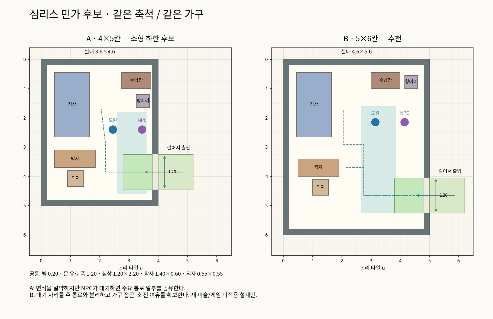
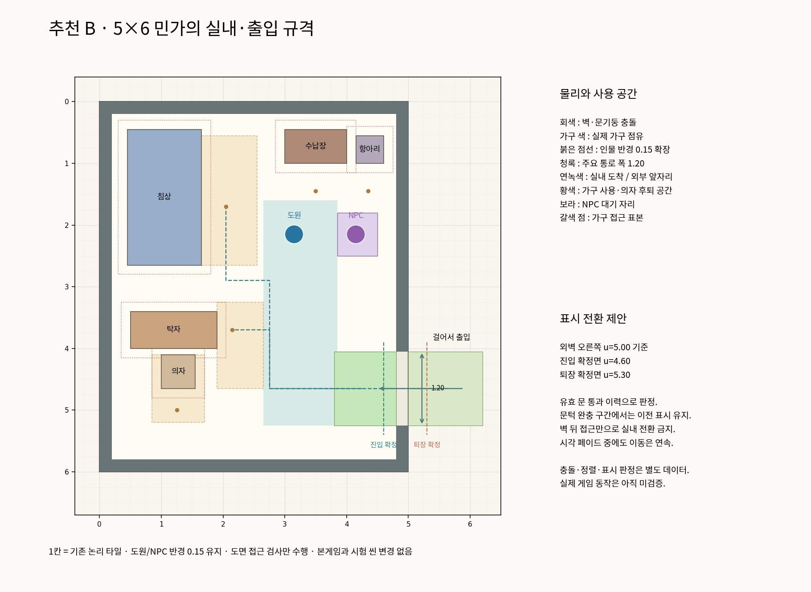
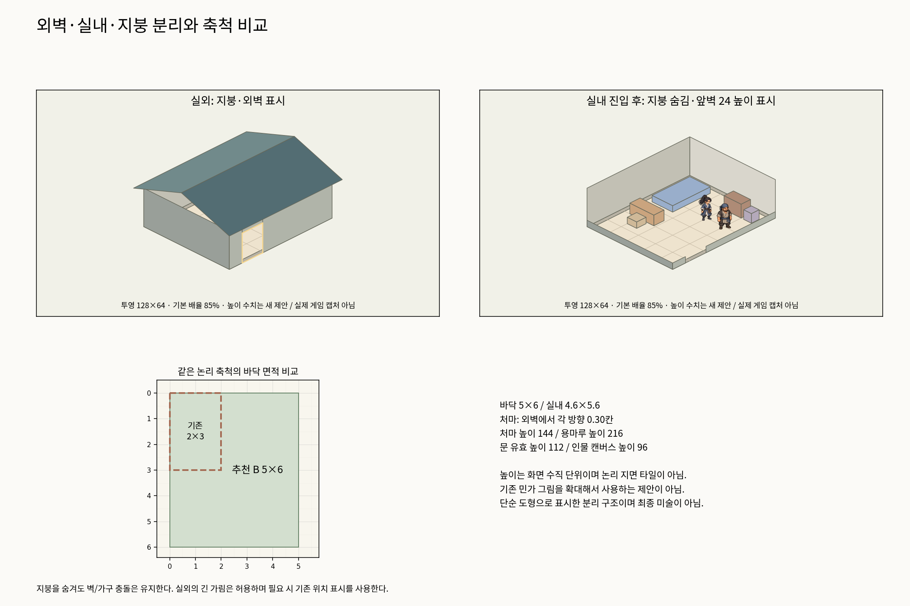
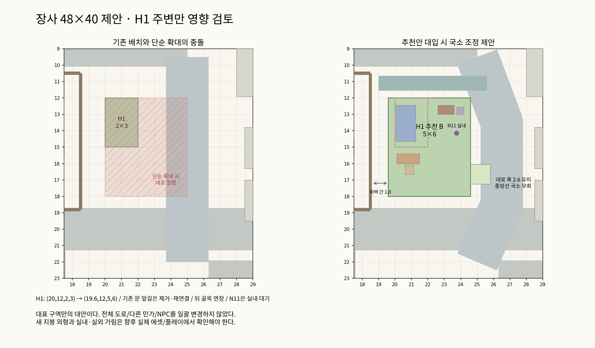

# 심리스 기본 민가 제작 규격 v1 — 검토용 제안

2026-11-02 한국 시간. **분석·수치 제안·간이 도면만 작성. 사용자 규격 검토 전이며 실제 제작/전환을 승인한 문서가 아니다.**

[후보 비교](candidates.png) · [추천안 확대](recommended-detail.png) · [컷어웨이·축척](cutaway-and-scale.png) · [장사 국소 영향](changsha-local-impact.png) · [수치/좌표](spec.json) · [도면 확인 결과](diagram-checks.json)

## 1. 확인 범위와 기존 근거

기준 커밋 `d3bdbeaadd1f470b3e5d9654dc6626be1c406365`. 루트/Godot AGENTS, [필드 원칙](../../cities/field-layout-principles.md), [건물 배치](../../cities/building-placement.md), [도시 제작 순서](../../cities/map-production-workflow.md)를 읽었다. 현재 원본 작업공간의 미완료 미술 변경은 건드리지 않았고 최신 main 기반 별도 문서 작업용 체크아웃에서 작성했다.

| 실제 확인한 소스 | 확인 사실 |
| --- | --- |
| `godot/prototypes/isometric/iso_space.gd` | 1칸=기존 논리 타일. 화면 변환은 `x=64(u-v)`, `y=32(u+v)`. 1칸 다이아몬드128×64 화면 단위. 고도는 기존 논리 투영에 포함되지 않음. |
| `iso_actor.gd` | 발밑 반경0.15의24각 충돌, 정렬용0.30×0.30 사각형. 인물 캔버스 높이96 기준 균일 배율. 실제 불투명 외형은 캔버스와 다를 수 있음. |
| `iso_world.gd`, `godot/project.godot` | 기본 카메라85%, 기본 viewport1280×720. |
| `iso_town_world.gd`, `iso_room_world.gd` | 현재 장사/실내 도원 속도4.8칸/초. NPC4.8. 12×12 비교 씬의 별도 속도 상수까지 일괄 변경하지 않음. |
| `changsha-layout.json`, `assets/manifest.json` | 민가 바닥2×3, 창고1.5×2.5. 기존 민가 그림 crop743×694, ground_width645, pivot(285,694). 실제 외형/도원 원본도 열어 확인함. |
| `iso_prop.gd` | 건물 하나의 바닥 사각형 전체를 기본 충돌로 사용. 그림 폭은 `64*(바닥 폭+깊이)`/ground_width로 맞춤. 이 방식을 그대로 큰 민가에 적용하면 기존 문·창·층까지 커지므로 사용하지 않음. |
| `room-layout.json`, `iso_room_world.gd` | 현재 별도 실내는8×6, 벽 두께0.16, 뒤쪽 벽 표시 높이120, 열린 문 통로1.15. 외부 민가의2×3 면적과 일치하지 않는 별도 시험장임. |
| `room-layout.json` | 생활 탁자1.4×0.6, 항아리0.45×0.45. 이번 두 후보에 같은 크기로 사용. 침상/의자/수납장은 새 설계 크기임. |
| `iso_interaction.gd` | 현재 NPC 대화 거리1.25. 도면의 도원/NPC 대기점 간 거리1.0으로 둠. 실제 F 가시성/레이 검사는 실행하지 않음. |

기존 민가의 실제 문턱은 바닥 끝보다 약0.256칸 바깥에 등록되어 있다. 이번 새 민가의 문 위치는 새 벽 구조에 맞춰 다시 등록하는 제안이며, 기존 그림의 문 오프셋을 그대로 복사하지 않는다.

이번 도면은 색 블록/기하 도식이며 새 건물·가구 미술을 생성하지 않았다. 컷어웨이 도식의 도원/NPC는 기존 원본을 같은96 높이 기준으로 재사용했다. Witchbrook 영상 전환을 직접 검증한 결과로 주장하지 않는다.

## 2. 같은 가구를 넣은 소형 후보 두 안

좌표는 로컬 u 오른쪽, v 아래이며 문은 +u 면에 둔다. 두 도면의 축척과 가구 점유 크기는 같다. 건물 크기는 **외벽 바깥면까지의 바닥 점유**다. 처마·앞자리는 별도다.

| 항목 | A — 작은 민가 하한 후보 | B — 추천 기본 민가 |
| --- | --- | --- |
| 외벽 바깥 크기 | 4×5칸 /20칸² | **5×6칸 /30칸²** |
| 벽 안쪽 실내 | 3.6×4.6 /16.56칸² | **4.6×5.6 /25.76칸²** |
| 벽 두께 | 0.20 | 0.20 |
| 문 순수 통행 폭 | 1.20 | 1.20 |
| 실내 도착 빈자리 | 깊이1.0×폭1.2 | 깊이1.0×폭1.2 |
| 외부 문 앞 빈자리 | 깊이1.2×폭1.2 | 깊이1.2×폭1.2 |
| 주요 통로 계획 폭 | 1.0, NPC가 일부 공유 | **1.2, NPC 대기 분리** |
| 가구 접근 공간 | 0.75 이상으로 계획 | 0.75~0.90으로 계획 |
| 도면 접근 검사 | 통과 | 통과 |
| 평가 | 작은 집으로 성립하나 인물 교행·가구 이용이 더 겹침 | 초행 조작·대화·출입과 향후 소품 배치에 여유 |

**B를 표준 민가로 추천한다.** A보다 바닥 면적은50% 크고, 벽 안쪽 면적은약55.6% 크다. 단순히 빈 바닥을 늘리는 목적이 아니라 생활/가구 사용 공간과 공용 이동·NPC 대기를 나누기 위한 크기다. B의 여유를 이유 없이 소품으로 채우지 않고 작업·가사·접객 동작 공간으로 남긴다. A는 승인 시 소형 주택 유형으로 둘 수 있지만, 출입 불가능한 표준 민가를 A보다 더 작게 만드는 편법으로 쓰지 않는다.

침상1.2×2.2, 탁자1.4×0.6, 의자0.55×0.55, 수납장1.0×0.55, 항아리0.45×0.45를 **두 후보 모두 축소 없이 동일하게** 배치했다. 의자는 바닥에 앉는 의자로 꾸밀 수도 있지만 이 검토에서는 작은 좌석 블록으로 표시했다. 수납·취사·침상 형태와 역사적 세부 미술은 아직 확정하지 않았다.

실내 면적은 가구를 넣기 전 벽 안쪽 면적이다. 모든 남은 면적이 보행 가능하다는 뜻이 아니다. 실제 보행은 가구·인물 충돌, 접근·의자 후퇴 공간까지 따로 검토해야 한다.

## 3. 추천 B의 치수와 생활 공간

| 기준 | 제안 수치 / 의미 |
| --- | --- |
| 인물 | 기존 반경0.15, 정렬 사각0.30, 캔버스96 유지. 작은 충돌 지름만으로 가구를 과밀 배치하지 않음. |
| 벽 | 기본0.20칸. 외벽과 충돌을 일치시키고 문 부분만 개방. 재질별 변경 시 내부 치수 재산정. |
| 문 | +u 면, v=4.05~5.25, 순수 통행1.20. 문틀·기둥·장식은 이 폭 바깥에 배치. |
| 문 높이 | 화면 수직112단위 제안. 인물 캔버스96보다16단위 여유. 기존 코드에서 확인한 문 높이는 아님. |
| 내부 도착 공간 | (3.8,4.05,1.0,1.2). 가구/NPC 대기를 두지 않음. |
| 외부 앞자리 | (5.0,4.05,1.2,1.2). 실제 길까지 연결하며 개인 전용 마당을 필수로 요구하지 않음. |
| 주요 통로 | (2.65,1.60,1.20,3.65). 문에서 연결되는 꺾이는 부분도1.2 폭을 유지할 여유 확보. |
| 침상 접근 | 침상 동쪽0.90 폭, 발치 접근 가능. |
| 탁자 접근 | 동쪽0.75 폭, 의자 뒤에는1.1 깊이의 사용/후퇴 공간 표시. |
| 대화 | NPC(4.15,2.15), 도원(3.15,2.15). 중심 간격1.0. NPC는 주요 통로와 문 도착 공간 밖. |
| 층/처마 높이 | 실내 바닥~천장/처마 기준144 화면 수직단위. 현재 실내 벽120을 참고한 새 제안으로 인물 높이의1.5배. |
| 지붕 | 처마 돌출 각 방향0.30칸, 용마루 추가높이72, 최대높이216 제안. 평면 범위5.6×6.6. |
| 실내 바닥 | 문 바닥과 동일한 z=0으로 설계. 기단의 외부 장식은 지면 아래/주변 표현이며 실제 계단·고도 시스템을 추가하지 않음. |

높이144/112/72는 **논리 지면 타일 수가 아닌 화면 수직 단위**다. 높이 픽셀과 타일을 섞어 면적을 계산하지 않는다. 기준 배율85%에서 인물 높이 기준은81.6, 문 높이는95.2 화면 픽셀에 해당한다. 실제 스프라이트의 불투명 높이/보행 변형에 따른 시각 여유는 구현 후 확인한다.

기존 속도4.8이면 실내 폭4.6칸을 직선으로 걷는 데 단순 계산 약0.96초가 걸린다. 이는 충돌/입력/동선을 반영한 플레이 측정이 아니며, 빠르게 느껴질 가능성은 있다. 속도·카메라·인물 크기를 이번 설계에 맞춰 임의로 바꾸지 않는다.

## 4. 심리스 출입과 컷어웨이 표시 규격

건물 외부와 실내는 **같은 논리 좌표·같은 실제 면적**을 공유한다. 한 건물의 물리 이동에 `change_scene`, 좌표 재배치, 순간 이동, F키 출입을 요구하지 않는다. 개별 건물을 별도 하위 씬으로 편집하는 것까지 금지하는 의미는 아니다.

| 서로 다른 데이터 | 역할 |
| --- | --- |
| 외곽/바닥·실내 영역 | 공간 소속과 바닥 표현. 바닥 사각형 전체가 장애물이 아님. |
| 벽 구간·문기둥·가구 충돌 | 실제 이동을 막는 형상. 보이지 않아도 유지. 문에는 장애물 없음. |
| 정렬용 점유/앵커 | 벽 조각·가구·인물별 앞뒤 관계. 건물 전체를 큰 스프라이트1개로 정렬하지 않음. |
| 문 통과 영역과 진입/퇴장 확정면 | 플레이어가 실제 등록된 문을 통과했는지 판정. |
| 지붕·앞벽 표시 그룹 | 실내 진입 시 숨길 미술. 충돌이나 지면 이동 판정과 분리. |

실내에서는 지붕을 숨기고 카메라 가까운 +u/+v 면 벽의 상부를 숨기며 아래24 높이 정도의 경계 표현만 남기는 안이다. 먼 -u/-v 벽은 기본144 높이를 유지하되 실제 가구·인물 시야 문제가 있다면 해당 벽의 표시 분할을 검토한다. 문틀 상부도 실내 시야를 가리면 같은 그룹으로 처리한다. 도식은 구성 설명이며 실제 깊이 정렬/가림 결과를 검증한 그림이 아니다.

**진입/퇴장 판정 제안:**

1. 문 유효 구간(v4.05~5.25)에서 인물 반경을 고려한 중심 통과 범위는 약4.20~5.10이다. 벽을 통과하는 판정 영역을 별도로 넓히지 않는다.
2. 출입 가능한 문을 연속 이동으로 통과한 이력을 확인한 후, 도원 중심이 u≤4.60인 실내 확정면에 도달하면 실내 표시로 바꾼다.
3. 실내에서 같은 문을 통과해 u≥5.30에 도달하면 실외 표시로 돌아간다.
4. 4.60<u<5.30 완충 구간에서는 직전 표시 상태를 유지한다. 단순한 지붕 그림 범위/큰 사각형 진입만으로 바꾸지 않는다. 건물 뒤 접근과 실내 출입을 구별한다.
5. 프레임 간 이동 선분으로 문 통과와 확정면 교차를 확인하는 방향을 제안한다. 현재 위치가 좁은 트리거에 닿았는지만 검사하면 빠른 이동/긴 프레임에서 놓칠 수 있다. 실제 구현과 검사는 후속 작업이다.
6. 표시 페이드 약0.15초를 후보로 두되 이동은 계속한다. 전환 중 되돌아가면 확정된 목표 표시 상태로 이어서 처리하고 시간 지연만으로 재출입을 잠그지 않는다.
7. NPC만 문을 지나갔다고 플레이어의 지붕 표시를 바꾸지 않는다. 플레이어가 실내에서 시작하는 향후 경우에는 소속 실내를 명시적으로 초기화하는 별도 검증이 필요하다.

**실외를 어둡게 처리하는 효과는 필수가 아니다.** 긴 건물 뒤 가림은 공간상 자연스러우면 허용한다. 그 상황은 실내 진입으로 오인하지 않고 기존 발밑·이름 등 위치 안내를 유지하는 방향이다. 가림 길이 때문에 건물·도로를 임의로 축소/확대하지 않는다.

필요 미술은 실내 바닥, 방향별 벽/문틀, 지붕, 가구의 독립 그림이다. 층수·방향에 맞는 그림을 제작해야 하며 단일 기존 민가 그림을 비균등 확대하거나 평면 회전해 해결하지 않는다. 밖에서는 지붕을 통해 실내 가구가 비치지 않도록 표시 그룹과 가림을 함께 검토해야 한다.

## 5. 출입 불가능한 민가와 더 큰 건물

**사용자 방향:** 같은 생활 수준의 민가는 출입 기능 유무로 축척을 달리하지 않는다. 건물 그림의 다양성과 도시별 특색을 유지한다. 다음 수치는 검토 제안이며 기존 모든 민가를 즉시 변경하는 규칙이 아니다.

- 표준 민가 B5×6을 중심으로 보통 민가의 외벽 바깥 크기는 **4.5×5.5~5.5×6.5칸**을 제안한다(면적 약24.75~35.75). 길쭉한 집 등은 기능·구조에 맞는 별도 비율로 검토한다.
- 문·층 높이·인물/가구 축척은 같은 계열로 유지하며, 출입 불가능한 집도 실내가 들어갈 법한 외관 면적과 문·창 위치를 갖춘다. 실제 실내 미술/가구 데이터를 모두 제작할 필요는 없다.
- A4×5는 더 작은 생활 수준/용도의 유형으로 명시할 때 선택할 수 있다. 작은 창고·문간채·부속채는 다른 용도이므로 민가와 같은 면적을 강제하지 않는다.
- 표준 민가를5×6 그림 하나로 복제하라는 뜻이 아니다. 장사·소주·항주 등의 재료·지붕 형태·입면·장식과 생활 공간을 다르게 설계한다. 같은 조립 부품 사용도 필수가 아니다.
- 방향을 바꿀 때 논리 좌표의 폭/깊이를 교환할 수 있지만, 실제 그림은 해당 방향의 앞·옆·뒷면을 제작한다. 한 이미지를 평면 회전하지 않는다.

| 유지할 공통 기준 | 건물 용도에 따라 달라질 것 |
| --- | --- |
| 논리 투영, 인물 크기/발밑, 문·가구의 인체 축척 | 바닥 면적·비율·방 수·층수·가구 수·건축 형태 |
| 벽/문/가구 충돌과 지붕 표시의 분리 | 벽 두께·문 수·복도 길이·지붕 분할과 높이 |
| 등록된 출입구 통과와 완충 판정의 원리 | 각 출입구 위치/방향·판정 좌표·접근 공간 |
| 현재 속도4.8·배율85% 유지라는 이번 검토 조건 | 추후 플레이 결과에 따른 별도 조작감 논의 |

5×6은 **최대치가 아니다.** 더 큰 민가·점포·공방은 면적을 늘리고 기존 문·가구 크기를 유지한다. 가구만 일괄 확대해 큰 건물을 채우지 않는다. 가구의 종류에 따라 더 큰 식탁이나 침상을 만드는 것은 가능하다.

건물/방/출입구/층/표시 그룹은 서로 식별 가능하게 설계할 필요가 있지만 이번에는 범용 스키마나 관리 시스템을 만들지 않았다. 여러 방에서 전체 지붕을 숨길지 현재 방만 숨길지, 다층에서 아래층/상층을 어떻게 표시할지, 여러 출입구의 상태 복원을 어떻게 할지는 **큰 건물을 만들기 전 추가 검증**이다. 크기를 키웠다는 이유만으로 이 설계가 다층까지 검증된 것은 아니다.

취월루·큰 본당·별도 지역은 기존 맵 전환 방식과 공존한다. 심리스 여부는 단순 면적 임계값이 아니라 실제 내외부 면적 일치 가능성·층수·콘텐츠 범위·성능을 보고 선택한다. 이미 있는 별도 실내 맵을 이번 규격 때문에 전환하지 않는다.

## 6. 장사48×40의 대표 구역 영향

원본 [장사 v2](../changsha-v2/README.md)의 H1은(20,12,2,3), 대로 중심 u25/폭2.6으로 서쪽 경계가 u23.7이다. 원점을 유지한5×6 집은 u20~25를 차지해 대로와 **폭1.3×깊이6=7.8칸²**가 겹친다. 이것은 원안 좌표의 기하 계산이지 실제 게임 충돌 재현이 아니다.

국소 조정 후보:

- H1 외벽(19.6,12,5,6). 기존 창고 담장 동쪽 실제 끝18.6과 H1 서쪽 사이의 통행 여유1.0을 남긴다. 긴 시각 가림을 없애려고 더 넓히는 안이 아니다.
- 대로 폭2.6은 유지하고 중심선을(25,9.5)→(26.5,13.5)→(26.5,18.5)→(25,22)로 국소 우회한다. 연결부 폭도 유지한다. 동쪽 시장 앞자리의 여유가 줄어드는 영향이 있으므로 다른 구역까지 적용할 때 전체 연결 재검토가 필요하다.
- 옛 문 앞길 u23.25와 기존 H1 문 접근선은 새 집 안에 들어가므로 제거 대상으로 표시한다. 새 문 앞 빈자리(24.6,16.05,1.2,1.2)를 길에 연결하며 보도와 이어지는 앞자리로 본다. 물자 적치·정지 NPC를 두지 않는다.
- 뒤 골목 v11.1을 국소 대로까지 연장한다. 뒤·옆 통로에 발생할 가림은 허용한다.
- 기존 외부 주민 예정점 N11(23,15)은 새 집 내부가 되므로 실내 대기점(23.75,14.15)으로 옮기는 제안이다. 실제 NPC 이동이나 새 인물 추가는 하지 않았다.
- 창고·다른 건물의 배치는 그대로 비교한다. 이 도면은 새 민가 한 동을 수용하는 후보이며 장사 전체의 확정안이 아니다.

도면의 도로는 논리 좌표상 실제 폭으로 표시했다. 이 국소 후보는 전체 도시 확대·기존 의뢰/NPC 연결·차량 회전·새 미술 가림을 검증하지 않았다. **다른 표준 민가도 비슷한 크기로 바꾸면 기존48×40 전체 배치가 그대로 유지된다고 보장할 수 없다.** 이번 규격 확인 뒤 다음 전체 배치 검토에서 부지와 밀도를 함께 재산정해야 한다.

## 7. 실행한 확인과 미확인

실행한 것은 도면 생성과 그 도면 좌표의 소규모 확인뿐이다. 두 후보에서 가구 동일 크기/실내 포함/가구끼리 겹침 없음을 확인하고, 0.05칸 격자에서 인물 반경0.15와 고정 NPC 위치를 반영해 문 밖→각 가구 접근점/대화점/도착점 연결을 확인했다. 기존 가구·벽을 반경만큼 확장한 보수적 사각형 검사이며 실제 물리 엔진의 원형 충돌과 동일하지 않다. 두 안 모두 오류0이다.

미확인: 실제 출입·지붕 페이드·문턱 왕복 깜빡임·고속 이동 누락·가구/벽의 깊이 정렬·가구 사용 애니메이션·NPC 양보/경로·카메라 체감·프레임 성능·다층·큰 건물·기존 의뢰/저장 연결. Godot를 실행하지 않았고 기존 게임 검사를 통과했다고 주장하지 않는다.

문서 도식 재생성은 저장소 루트에서 `python3 docs/plans/seamless-house-v1/draw.py`. Python3/NumPy/Matplotlib/Pillow, Noto CJK 글꼴 및 기존 프로토타입 원본이 필요하다. `spec.json`은 도면 입력이며 런타임이 읽는 건물 데이터가 아니다. 새 영상·생성 미술·게임 씬/코드는 없다.

다음 권장 단계는 사용자 규격 확인 후 민가1동만 독립 시험에서 벽/문/가구 충돌과 표시 전환을 검증하는 것이다. 다른 도시·본게임·대형 건물은 이번 작업에 포함하지 않는다.
