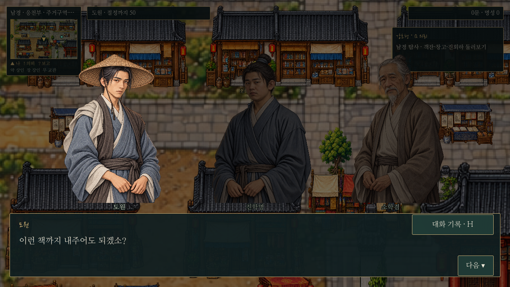
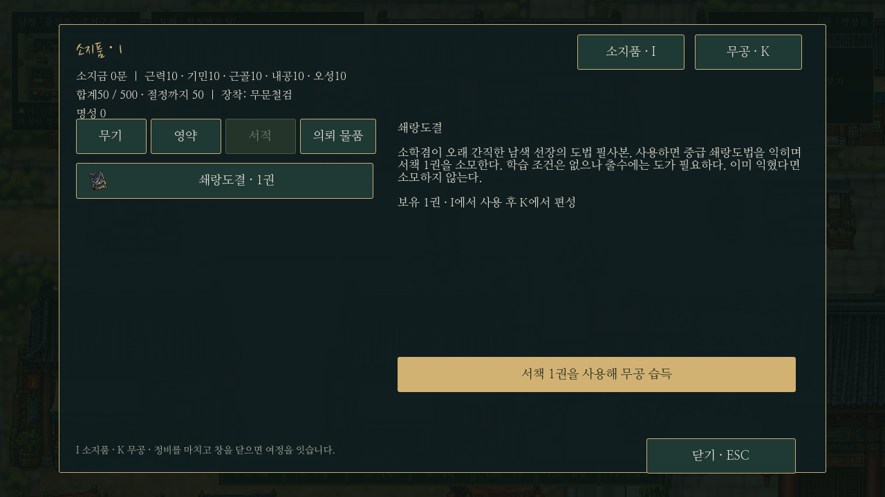
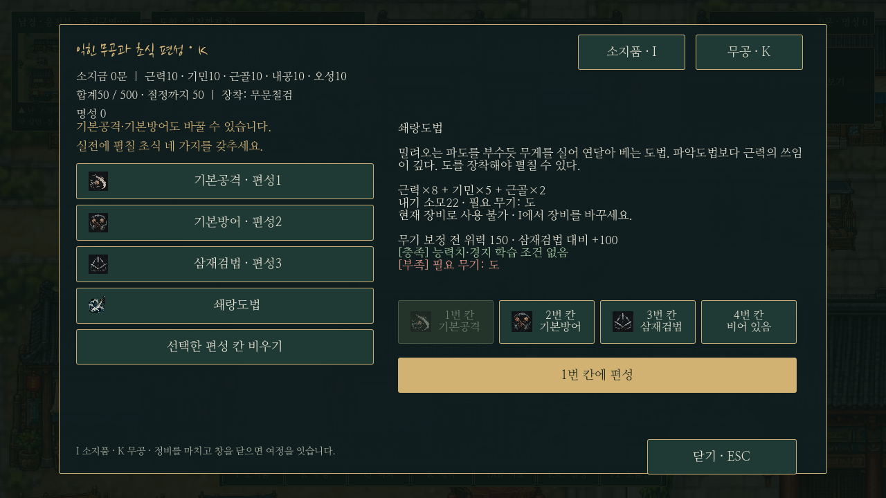

# 빌려준 책, 돌아오지 않는 사람

남경 서책거리의 **소학겸**에게 F로 대화하고 선택 수락하는 독립 일반 의뢰다. 선행 조건이 없으며 비단·수레·구휼 사건과 동시 진행한다.

## 진행

소학겸 수락 → 조원식에게 행방 확인 → 하삼랑에게 품팔이 사정 확인 → 객잔 뒤편 진학명과 대화 → 소학겸에게 젖은 책 전달 → 진학명에게 필사로 책임지는 방법 전하기 → 짧은 시간 경과 → 서책거리 소학겸에게 최종 보고.

진학명은 의뢰 수락 전부터 객잔 뒤편에 머문다. 수락하지 않고 먼저 만나도 단계를 건너뛰지 않는다. 필사에 동의한 뒤 서책거리로 돌아오며 저장·맵 재방문에도 위치를 복원한다. 소학겸은 책값을 없애 주는 대신 번진 장을 필사하고 정리하게 한다. 실제 날짜 대기나 별도 미니게임은 없다.

## 보상과 사용법

마지막 보고 대화가 끝나면 **쇄랑도결 1권**만 한 번 지급한다. 금전·능력치·명성·호의도 보상은 없다.

1. **I → 서적 → 쇄랑도결 → 서책 1권을 사용해 무공 습득**.
2. 서적 1권을 소모하고 **쇄랑도법**을 익힌다. 이미 배웠으면 소모하지 않는다.
3. **K**에서 전투 칸에 직접 편성하고, **I → 무기**에서 도를 장착한다.

쇄랑도법은 중급 도법이며 학습 능력치/경지 제한은 없다. 위력은 근력×8+기민×5+근골×2, 내기 소모22, 도 장착 필수다. 일반 교관의 판매 목록에는 들어가지 않는다. 서책은 별도 소모품 카탈로그이며 영약의 복용 한도와 분리한다. 배우기 전 보유량·습득 후 소모량·무공·편성은 저장된다. 이전 저장에는 서적 보유량0/의뢰 미수락을 기본값으로 적용한다.

교관에게는 의뢰 대화와 무공 거래를 고를 수 있다. 하삼랑에게 구휼 사건과 이 의뢰의 용건이 겹치면 대화 주제를 선택한다. 완료 잡담은 진행 중인 다른 의뢰를 가로막지 않는다. Q 추적과 지역 밖 출구 안내, 미니맵/전체 지도, 의뢰인 !/보고 ?를 연결했다.

## 구현 및 확인

- 데이터: `nanjing_book_quest.json`, `martial_manuals.json`, `quest_martial_arts.json`.
- 전용 서적/도법 그림을 `icon_manifest.json`에 연결해 I/K/전투의 공통 아이콘 경로에서 사용한다.
- `tests/book_quest.gd`: 실제 F 접근/선택 수락/단계별 저장·복원/교관 거래/동시 의뢰/서생 이동/보상 중복 방지/I 사용/K 편성/무기 조건/수치/구버전 저장을 검사한다.
- 화면 캡처는 `tests/capture_book.gd`, 공통 전투·전체 카탈로그는 `tests/combat_updates.gd`로 확인한다. 검사는 별도 XDG 사용자 폴더를 사용한다.
