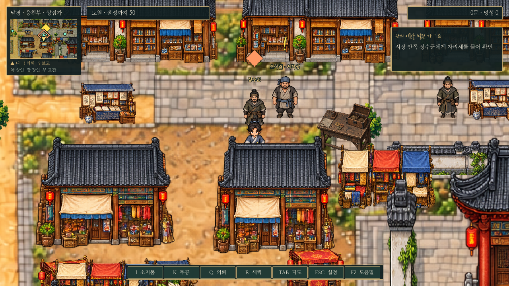
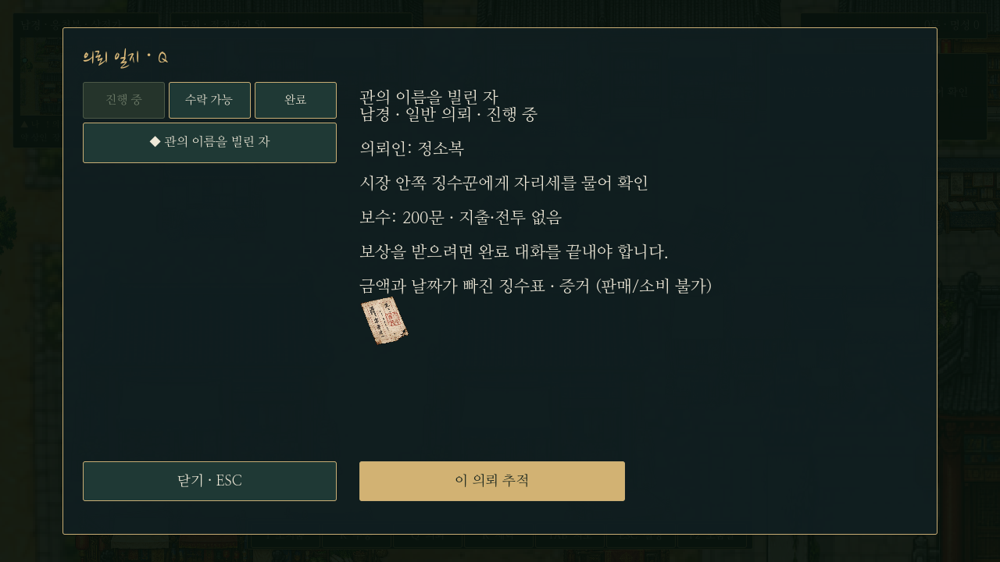
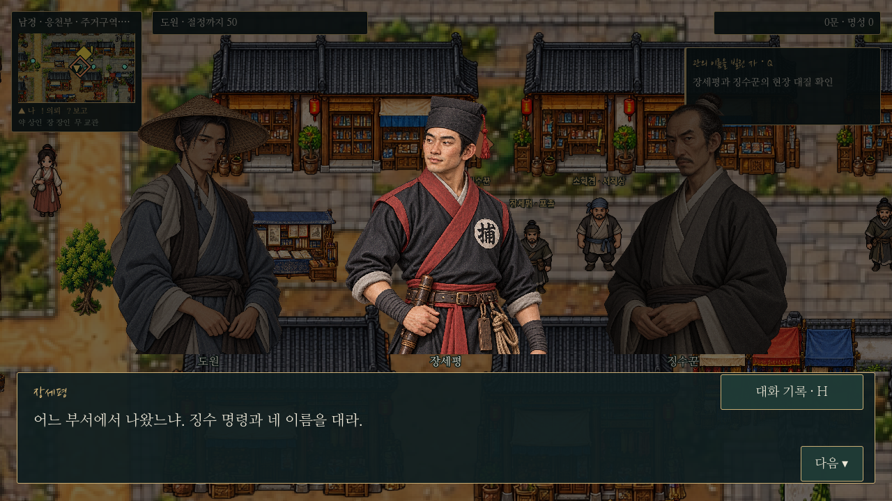

# 관의 이름을 빌린 자 — 남경 일반 의뢰4

정소복에게 F로 대화해 선택 수락한다. 선행 조건·전투·지출 없이 남경 주민 의뢰와 동시에 진행한다.

## 진행과 보상

정소복의 징수표 수령 → 관아 심부름꾼 장원에게 진위 확인 → 정소복에게 인상착의/위치 확인 → 시장 안쪽 징수꾼에게 직접 자리세 질문 → 장세평에게 위치와 발언 보고 → 짧은 현장 전환/비전투 체포 → 정소복에게 완료 보고.

마지막 보고 대화 끝에서 **200문만 한 번** 지급한다. 오성·명성·호의도는 올리지 않으며 피해 상인의 환급 처리와 도원의 보수를 분리한다. 징수꾼을 일찍 만나도 수락이나 단계를 건너뛰지 않는다. 정소복의 이름을 용의자에게 밝히거나 플레이어가 먼저 폭력을 쓰는 전개는 없다.

## 공통 기능

- 정소복은 비단 의뢰의 목표이기도 하므로 두 용건이 겹치면 선택창으로 연결한다. 완료 잡담은 다른 진행 대화를 막지 않는다.
- 징수꾼은 기존 공용 NPC 초상화를 재사용한다. 시장 책상은 투명 그림/발밑 충돌/Y정렬을 가진 독립 오브젝트이며 NPC 접근과 길찾기에 반영한다.
- 장세평은 체포 장면 동안 현장에 있고 끝나면 원래 위치로 돌아온다. 징수꾼/책상/돈궤는 체포 후 사라지며 지도 재방문·불러오기에도 유지한다.
- 전용 징수표 그림은 Q 일지 상세에 표시한다. 의뢰 증거로만 보유하며 판매/소비/추가 금전 지출은 없다.
- 노란 !/보고 ?/목표 ◆, 미니맵·전체 지도, Q 추적, 지역 밖 출구 안내, 단계별 저장/구버전 기본값을 지원한다.
- 대화·체포 전환 중 저장은 기존 공통 경로에서 차단한다.

## 화면

## 소스와 검사

`data/nanjing_levy_quest.json`, `scripts/levy_quest.gd`, `assets/icons/levy-quest.png`, `data/icon_manifest.json`. `tests/levy_quest.gd`는 실제 F 접근/수락·보류/비단과 용건 선택/동시 진도/단계별 저장/체포와 임시 오브젝트 제거/정확한 일회 보상/구버전 저장을 확인한다. `silk_quest.gd`, `nanjing_layout.gd`, `saves.gd`, `combat_updates.gd`로 기존 공통 기능을 함께 확인한다. 모든 저장 검사는 별도 XDG 폴더에서 실행한다.
