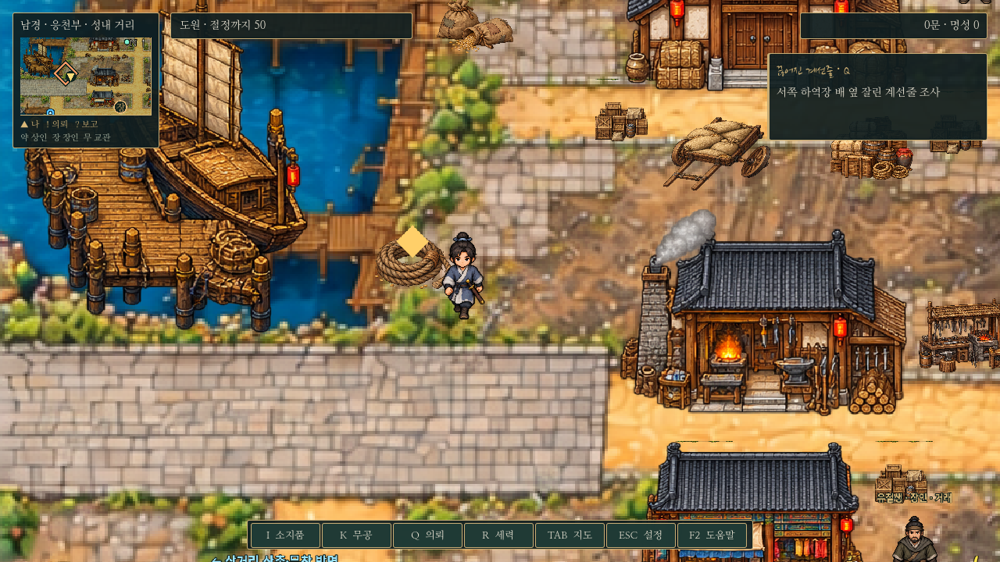
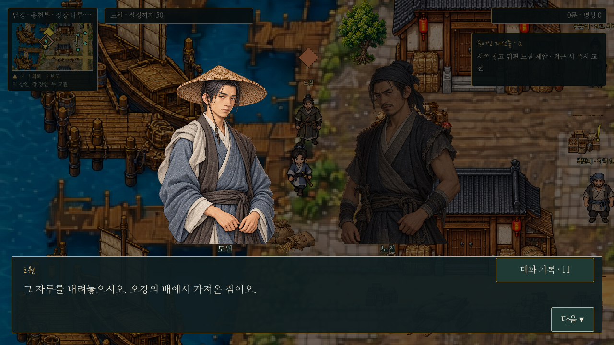
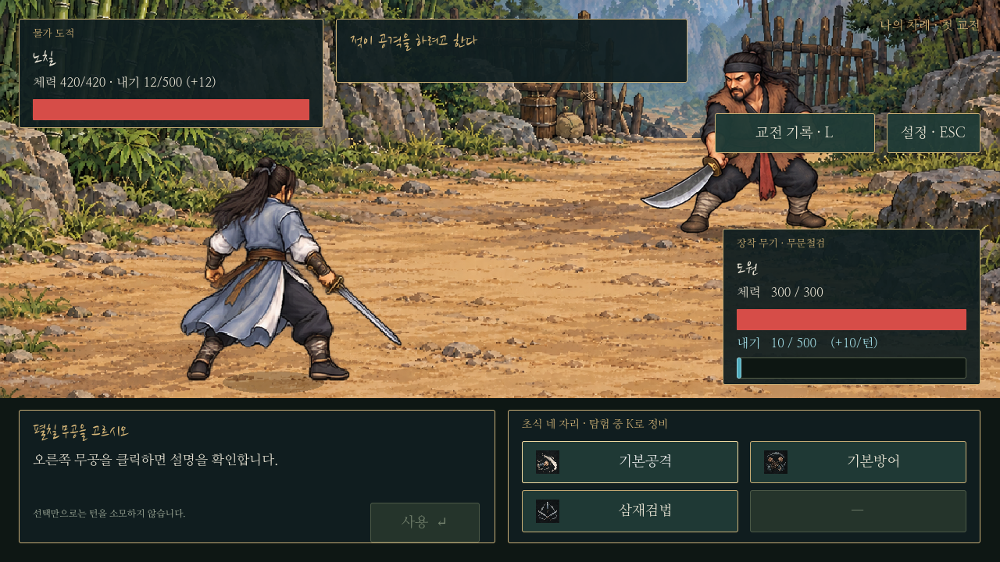
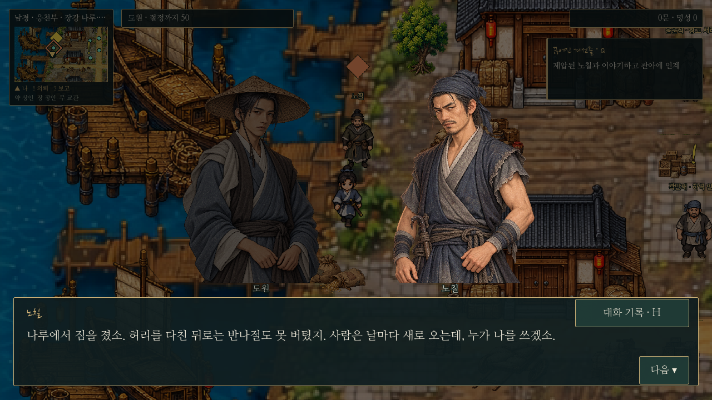

# 끊어진 계선줄 — 남경 일반 의뢰5

오강의 화물 도난을 조사하고 노칠을 제압하는 실전 의뢰다. 사건을 해결하되, 번화한 수도에서도 일감을 잃고 굶는 사람이 있다는 사실과 오강 역시 피해를 감당할 여유가 없다는 점을 남긴다. 노칠을 불쌍히 여겨 화물을 내주거나 보수를 포기하는 분기는 없다.

## 진행

오강 F 선택 수락 → 서쪽 하역장 배 옆 계선줄 F → 끌린 자루/곡식 F → 윤소영 F 목격담 → 서쪽 창고 뒤편 노칠에게 접근 → 짧은 대면 대화 끝에 바로 전투 → 승리 후 사정 청취 → 짧은 관아 인계 전환 → 오강에게 보고.

- 선행 조건 없이 다른 일반 의뢰와 동시 진행한다. 수락 창에서 실전 전투와 패배 시 사망을 안내한다.
- 줄은 배를 떠내려 보내려고 훼손한 것이 아니라, 훔친 짐을 묶어 끌려고 남은 부분을 잘랐다. 온전한 매듭/끌린 자루/흘린 곡식을 조사한다.
- 목격담 전에는 노칠이 등장하지 않는다. 이후 노칠과 월드 거리170 이내로 접근하면 자동으로 대면한다. F 대화로도 같은 대면에 연결하며 정비·철수 선택은 없다.
- 메뉴/지도/대화/설정 중에는 접근 전투가 발동하지 않는다. 같은 대면을 반복 발동하거나 적 예고를 재추첨하지 않는다.
- 승리는 노칠을 제압한 것으로 표현한다. 허리를 다쳐 일감을 잃었다는 사정은 승리 후 처음 드러난다. 도원은 화물을 돌려주고 노칠을 관아에 인계한다.
- 최종 보고 대화 마지막 줄 뒤 **250문만 한 번** 지급한다. 능력치·명성·호의도 추가 없음. 이후 노칠/화물은 재생성되지 않고 오강/윤소영의 후일담과 새 줄 확인 대사가 유지된다.

## 인물·배치·그림

기존 오강(`nj_boatman`)과 윤소영(`nj_crowd_quay_guest`)을 사용한다. 노칠은 기존 수적 초상화(`archetypes/water-bandit.png`)와 공용 도트를 재사용하며 새 전용 인물 그림은 만들지 않는다. 특정 세력 소속을 확정하지 않는다.

도안1536×1024 기준 줄은(165,385), 끌린 화물은(190,290), 노칠은(195,225)의 서쪽 선착장/창고 주변이다. 실제 NPC는 공통 전신 겹침 방지로 안전한 발 위치를 찾는다. 생성한 줄·곡식 그림은 독립 오브젝트로 배치하며 화물에는 발밑 충돌/Y정렬/길찾기를 적용한다. Q에는 판매·소비 물품 대신 조사 기록과 해당 그림을 표시한다.

## 전투

| 항목 | 노칠 |
| --- | --- |
| 체력 |420|
| 근력 / 기민 / 근골 / 내공 / 오성 |18 / 16 / 18 / 12 / 10|
| 장비 |후배도(`thickback_saber`)|
| 행동 |기본공격 / 기본방어 / 하급 쇄목도법|
| 내기 |12로 시작, 매 턴12 회복, 최대500. 무공 소모는 공통 계산|
| 예고 |공격 기세 또는 수세만 표시|
| 플레이어 패배 |사망 화면→확인 후 타이틀. 저장 삭제/자동 덮어쓰기/현장 재도전 없음|

적은 공통 `combat_actions.gd`와 `inner_qi.gd`를 사용한다. 일반 적을 제압하는 사건이며 문파 수장급 강적으로 설정하지 않는다.

모든 능력치20·체력300·종류별 하급 장비에서 하급10종/중급6종, 최소 학습 조건의 하급10종을 총42개 경우로 비교했다. 공격 위주 운용에서 중급은2~3턴, 하급은3~6턴에 승리한다. 중급6종은 예고에 보수적으로 방어하는 단순 전략도 승리하며 관악창법의 초반 우위를 유지한다. 최소 조건만 맞춘 성장이나 하급 무공으로 지나치게 방어하는 전략의 승리는 보장하지 않는다. 새로 시작한 무성장 캐릭터용 튜토리얼 전투는 아니다.

## 저장·표식·검사

Q 추적·조사 기록 그림·!/?/◆·미니맵/전체 지도·지역 밖 출구 안내를 연결했다. 완료·진행·인물/화물 제거는 저장·맵 재방문에도 유지한다. 구버전 저장은 미수락으로 읽고 새 전투ID/상태를 검증한다. 대화·인계 전환·전투·사망 중 수동 저장은 공통 경로에서 금지한다.

- `tests/waterfront_quest.gd`: 실제 F 조사/수락·보류/순서/단계별 저장/동시 의뢰/접근 자동 전투/메뉴 차단/실제 패배·기존 저장 보존/불러오기 후 실제 승리/인계/정확한 보상/맵 재방문.
- `tests/waterfront_balance.gd`:42개 성장·무공·전략 사례. 분리된 user 폴더에 비교 JSON을 쓴다.
- `saves.gd`, `levy_quest.gd`, `death_flow.gd`, `combat_updates.gd`:기존 기능 회귀 검사.
- `tests/capture_waterfront.gd`:실제 Godot 렌더링 화면. 모든 저장 검사는 별도 XDG 폴더에서 수행한다.

