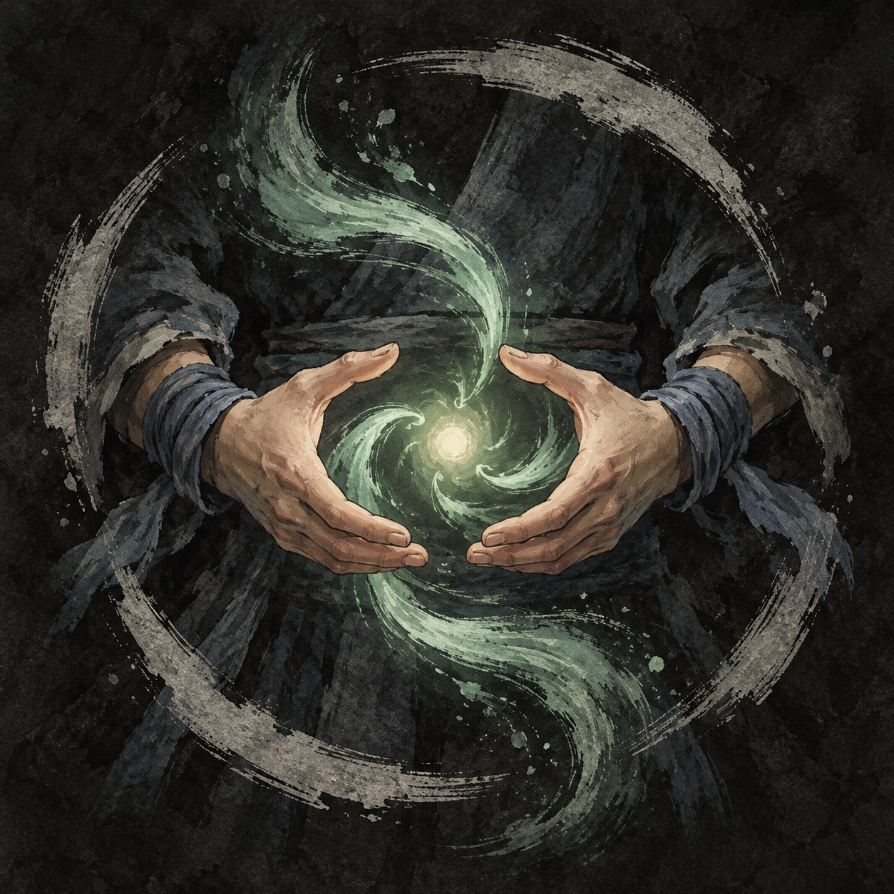

# 세 걸음의 대련 — 진행·대사·보상 구현

무창의 민간 교관 임정산이 주는 세 번째 일반 의뢰다. 사용자 후속 수정으로 장소 명칭은 **연무장**을 사용한다. 모든 일반 의뢰의 공통 규칙에 따라 별도 선행 의뢰를 요구하지 않는다.

## 진행

임정산에게 수락 → 무관 연무장 가장자리의 제자 유소강에게F로 대화 → 준비/보류 선택 → 대련1회 → 승패에 따른 짧은 대화 → 임정산에게 보고. 승패와 관계없이 끝까지 대련하고 보고하면 완료한다. 본게임의 수락·보류·준비·전투·보고·전수까지 연결했다.

유소강23세, 성실하고 승부욕이 강하며 실수 뒤 급히 만회하려 드는 도 사용자다. 평범한 집안 출신으로 무관의 잡일과 수련을 병행한다. 기존 기본18장 초상화를 재사용하고 임정산과 같은 대화에 겹치지 않는 그림을 배정한다. 대련 상대는 체력180, 근력10·기민10·근골10·내공8·오성12, 후배도와 기본공격/기본방어/거친 도질을 쓴다. 구칠보다 쉬우며 시작 능력치와 삼재검법으로도 승리하는 것을 검사했다. 특정 무기/무공/기본방어 사용을 완료 조건으로 강제하지 않는다.

사용자가 금전 대신 방어 무공 보상을 요청했으므로 기존100문 보수 제안은 폐기한다. 보상은 아래무공1종 전수이며 금전·오성·명성·능력치 보상은 없다.

## 보상 무공: 조식수원공(調息守元功)

|항목|설정|
|---|---|
|안정ID|josik_suwon|
|분류|초급 보조·방어 무공|
|무기 조건|검·도·창 등 모든 무기와 맨손에서 사용 가능|
|학습 조건|의뢰 완료 보고로 전수, 추가 능력치/경지 조건 없음|
|내기 소모|0|
|즉시 효과|현재 내기+40, 상한500|
|방어 효과|이 행동 뒤 이어지는 상대 행동에 받는 피해20% 감소|
|지속|그 상대 행동이 끝나면 해제, 상대가 수세면 방어를 다음 행동으로 이월하지 않음|
|제한|한 번 사용하면 다음 자기 차례3번 동안 사용 불가. 사용한 차례가T이면T+1/T+2/T+3에서 막고T+4부터 재사용 가능|
|공격/체력|피해를 주거나 체력을 회복하지 않음|

‘조식’은 호흡을 고르는 것, ‘수원’은 근본이 되는 기운을 지킨다는 뜻이다. 낮춘 자세로 상대의 힘을 흘리면서 흐트러진 내기를 모으는 공법이다.

사용자 수정 확정: **내기 회복은 고정40, 방어율20%, 사용 후3턴 재사용 불가**다. 내기 소모0과 무기 공통 사용 조건은 유지한다. 기본방어70%와 별도로, 일부 피해를 감수하면서 내기를 확보하는 보조 기술이다. 다른 초식 방어를 더하지 않고 해당 행동의20% 감소를 적용하며 기존 근골/장비 감소 계산은 유지한다.

내공10·내기10에서 사용하면 즉시50이 되고, 살아서 다음 차례를 맞으면 기존 턴 회복10이 더해져60이 된다. 기술 회복40은 내공/장비에 따라 커지지 않으며 상한500을 넘지 않는다.

재사용 예시:1번째 차례 사용 →2/3/4번째 차례 사용 불가 →5번째 차례부터 다시 사용 가능. 적 차례를 별도1턴으로 세지 않는다. 기술을 미리보거나 메뉴를 열고 닫는 것으로 대기 시간이 줄지 않으며 실제 플레이어 행동을 마친 차례로 계산한다. 다음 전투는 대기 시간을 초기화한다. 방어는 이번 상대 행동까지만 적용하며 재사용 대기3턴 내내 지속되지 않는다.

## 대화 원고

### 임정산 · 의뢰

- 임정산: 소협, 잠시 시간을 내줄 수 있겠소? 제자 하나와 손을 맞춰 주었으면 하오.
- 도원: 교관께서 직접 가르치시면 되지 않습니까?
- 임정산: 내 어깨가 움직이는 것만 보고도 다음 초식을 짐작하는 녀석이오. 오래 겨룬 상대에게 익숙해진 것을 제 실력으로 착각하고 있지.
- 도원: 낯선 상대가 필요하다는 말씀이군요.
- 임정산: 그렇소. 다른 병장기, 다른 보폭을 마주해 봐야 제 버릇도 드러나는 법이니.
- 도원: 제가 어느 정도까지 상대하면 되겠습니까?
- 임정산: 평소대로 하시오. 다만 목숨을 겨루는 자리는 아니오. 위험해지면 내가 멈추겠소.
- 임정산: 대련을 마치면 소협에게도 호흡을 다스리는 공법 하나를 전하겠소. 어느 병장기를 다루든 쓸모가 있을 거요.

선택: 한 차례 겨뤄 보겠습니다 / 다음에 시간을 내겠습니다.

수락: 임정산 ‘연무장의 유소강을 찾아가시오. 기세는 앞서도 심성이 나쁜 녀석은 아니오.’ → 도원 ‘가르치려 들기보다는 제대로 상대하겠습니다.’ → 임정산 ‘그거면 충분하오.’

### 유소강 · 대련 전

- 유소강: 도원 소협이십니까? 사부님께 말씀 들었습니다.
- 도원: 긴장한 모양이군.
- 유소강: 아닙니다. ……조금은 그렇습니다. 무관 밖의 분과 겨루는 건 처음이라서요.
- 도원: 나도 자네의 초식은 처음 보네. 서로 같은 처지 아닌가?
- 유소강: 그렇게 생각하니 조금 낫군요. 잘 부탁드립니다.

선택: 시작하세 / 잠시 준비하고 오겠네. 준비를 선택하면I/K 정비 후 돌아올 수 있다.

### 도원 승리

- 유소강: 제가 먼저 몰아붙이고 있다고 생각했는데…… 어느새 제 호흡만 흐트러졌군요.
- 도원: 한 번 빗나가니 다음 공격이 급해지더군.
- 유소강: 들켰습니까? 놓친 것을 바로 되찾으려 했습니다.
- 도원: 상대도 그 틈을 기다릴 수 있지.
- 유소강: 다음에는 한 번 물러설 여유부터 배워야겠습니다.

### 도원 패배

- 임정산: 거기까지. 더 겨루면 손에 힘이 지나치겠구나.
- 유소강: 예, 사부님! ……도원 소협, 다친 곳은 없으십니까?
- 도원: 괜찮네. 마지막에 자네 보폭을 잘못 읽었군.
- 유소강: 저도 앞선 초식에서는 몇 번이나 중심을 잃었습니다. 사부님께서 못 보셨으면 했는데…….
- 임정산: 보았다. 이겼다고 고쳐야 할 버릇까지 사라지는 건 아니지.
- 도원: 듣고 보니 내게도 하는 말 같군요.

### 임정산 · 보고/전수

승리 첫마디: ‘덕분에 소강이가 제 버릇을 똑똑히 보았소. 상대해 주어 고맙소.’
패배 첫마디: ‘끝까지 성실하게 상대해 주었소. 소강이에게도 배울 것이 많은 대련이었지.’

- 임정산: 약속한 공법을 전하겠소. 조식수원공이라 하오. 우선 병장기는 편하게 두고, 어깨의 힘부터 풀어 보시오.
- 도원: 자세를 낮추면 됩니까?
- 임정산: 무릎만 굽히지 말고 호흡도 가라앉히시오. 흩어진 내기가 제자리를 찾도록 서두르지 말고.
- 도원: ……힘을 더 주지 않았는데도 기운이 모이는군요.
- 임정산: 몸에 남은 기운을 추스르는 법이오. 급히 내기를 끌어 쓴 뒤에 도움이 될 거요.
- 도원: 그동안 상대가 파고들면 어찌합니까?
- 임정산: 시선을 놓지 마시오. 몸을 조금 틀어 힘을 흘리되, 상대의 공세를 전부 받아낼 생각은 삼가시오.
- 도원: 펼칠 때를 살펴야겠군요.
- 임정산: 그렇소. 그리고 운기를 거듭 억지로 돌리면 오히려 호흡이 엉키오. 한 번 기운을 모았으면 충분히 호흡을 안정시킨 뒤 다시 펼치시오.
- 도원: 어느 병장기를 들어도 같은 요령입니까?
- 임정산: 손에 쥔 것이 달라져도 숨을 쉬는 몸은 같소. 맨손일 때도 다르지 않지.
- 도원: 귀한 가르침, 기억하겠습니다.
- 임정산: 들어갈 걸음, 물러설 걸음, 멈춰 설 걸음. 오늘은 마지막 걸음의 쓰임을 익힌 셈이오.

전수 완료 알림: ‘조식수원공을 익혔다 · K에서 편성하세요.’ 효과와 사용 제한은 K/전투 설명에 표시한다. 금전/오성 보상을 더하지 않는다. 승패에 따라 전수 조건이나 효과가 달라지지 않는다.

완료 후 임정산: ‘숨 고르는 법은 몸에 익었소? 급할수록 펼칠 때를 살피시오. 소강이에게도 매일 하는 말이오.’

## 아이콘·구현·검증

기존 먹빛 화풍의 옥빛 호흡/방어 아이콘을 생성했다. `godot/assets/icons/josik-suwon.png`, 아이콘ID `josik_suwon`으로 `icon_manifest.json`에 연결했다. `support_martial_arts.json`에 등록했고 의뢰 완료 보고에서 습득한다. 일반 교관은 판매하지 않으며 K에서 네 행동 슬롯 중 하나에 편성해 쓴다. 무기별 조건·공격 보정·창의 내기 절감과 무관하게 내기0 소모/고정40 회복이다. 공통 `combat_actions.gd`/`inner_qi.gd`에서 회복·방어·재사용 계산을 수행하고 적도 같은 실행 경로를 사용한다.

`battle.ready_turns`에 재사용 가능 차례를 기록한다.1턴 사용 시5턴부터 다시 사용할 수 있다. 대기 중에도 설명을 읽을 수 있고 슬롯에 남은 턴을 표시하지만 실행은 막는다. 유효한 기술을 전부 뺀 편성에서 대기 시간이 생기면 기존 임시 기본공격을 제공한다. 재사용 대기는 새 교전 시작 시 초기화한다.

`duel_quest`는available/accepted/battle/ready/completed와win/loss 결과를 저장한다. 새 필드 없는 기존 저장은미수락으로 읽으며 기존schema1~3을 보존한다. 전투 중 새 저장 금지는 유지하고, 호환 전투 스냅샷의재사용 차례와 확정 적 행동도 복원해 불러오기로 회복/대기를 초기화하지 않는다. 학생은 수락 후에만 연무장에 등장하고 완료 후 제거한다. 기존 주민/다른 의뢰 진행은 유지하며 임정산의 무공 거래는 별도 용건으로 계속 이용할 수 있다.

- `tests/duel_quest.gd`: 실제F 수락/보류/정비, 초상화·전신 배치/동선, 시작 능력치 승리와 패배 양쪽, 보고 끝의 단일 전수·금전/스탯 불변, 세 의뢰 동시 진행, 저장 복원, K 아이콘/설명/편성.
- `tests/josik_suwon.gd`: 모든 무기/맨손, 고정40·상한500·자연 회복,20%감소,1턴사용→2/3/4턴차단→5턴재사용, 미리보기/연속클릭 무효, 호환 전투 저장/복원, 새 교전 초기화와 임시 기본공격.
- 회귀: martial_arts / combat_updates(기존110전투) / wuchang_residents / saves / quest_navigation / artisan_quest / herbalist_quest / save_restrictions / inner_qi. 분리한XDG 사용자 경로에서 실행한다.

플레이 캡처: [수락](../../godot/screenshots/duel-quest-offer.png), [연무장 제자](../../godot/screenshots/duel-quest-student.png), [대련](../../godot/screenshots/duel-quest-battle.png), [전수](../../godot/screenshots/duel-quest-teaching.png), [K창](../../godot/screenshots/duel-quest-martial-menu.png), [기술 설명](../../godot/screenshots/duel-quest-skill.png), [재사용 대기](../../godot/screenshots/duel-quest-cooldown.png). `capture_duel_quest.gd`는 화면 재현의 마지막 교전에서 적 체력을1로 낮추며 난이도 검사는 별도 실제 전투 검사로 수행한다.

