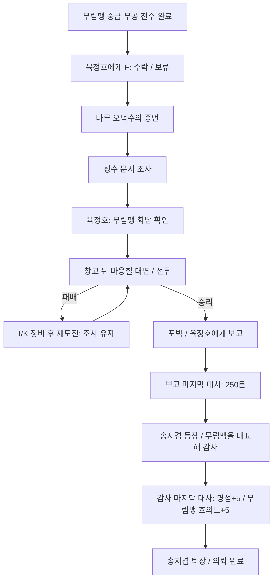

# 빌려 쓴 무림맹 이름 — 전수 후 의뢰

**현재 패배 규칙(2026-10-28):** 사용자 변경으로 이 전투는 패배 시 사망 화면을 표시한 뒤 확인하면 타이틀로 돌아간다. 아래의 과거 후퇴/재도전·비살상 설명과 검사는 이 변경으로 대체된다. 이전 저장 파일은 삭제하거나 덮어쓰지 않는다.

## 활성화 조건과 현재 범위

**무림맹 방문의 전수 완료 상태(`training_complete` 또는 퇴장 후 `closed`)이고, 무림맹 교관 전용 중급 무공5종 중 하나 이상을 실제 습득한 뒤** 육정호에게 노란 !가 나타난다. 그전에는 일반 대화만 가능하며 Q 수락 가능 목록·의뢰 목표·사칭범도 노출하지 않는다. 일반 교관의 하급 무공이나 명성만으로는 열리지 않는다.

의뢰·감사 사건·호의도 저장과 선행인 [무림맹 메인 이야기](../story/alliance-main-story.md)를 모두 연결했다. 산적 토벌 후 장사의 송지겸에게 초대받고, 무창 정문 보증→허문규 면담→곽진석의 중급 무공 전수를 마치면 일반 플레이에서도 이 의뢰가 활성화된다. 기존 단독 검사/캡처의 전수 상태 구성은 검증 도구에서만 사용한다.

## 진행과 지급 순서

추가 오성·능력치·아이템 보상은 없다. 관의 보수와 무림맹의 감사를 분리해 각 단계에서 한 번만 지급한다. 송지겸을 찾아 별도 이동할 필요 없이 육정호의 보고 직후 대화가 자동으로 이어진다. 감사 대화에는 도원·송지겸·육정호를 함께 표시하며 서로 다른 초상화를 쓴다.

- 육정호: 기존 관아 앞 위치 유지.
- 오덕수: 기존 하역장 위치 유지. 다른 의뢰를 진행 중이어도 별도 상태를 덮어쓰지 않는다. 이번 증언을 들은 뒤에는 다른 의뢰의 대화도 이어서 진행할 수 있다.
- 문서: 증언 뒤 이어지는 조사 대사로 확인한다. 새 소지품 아이템으로 만들지는 않는다. 마지막 조사 대사 전에는 단계가 바뀌지 않는다.
- 마응칠(30대 후반의 떠돌이 칼잡이): 공식 회답 대화 완료 후에만 나루 창고 뒤에 등장한다. 기본 `male_middle` 그림과 기존 도 장착 전투 그림을 재사용한다. 희망 좌표는 지도 원본 기준(390,1180)이며 공통 전신/충돌 검사가 안전 위치로 조정한다.
- 송지겸: 보수 수령 후 관아 앞에서만 잠시 등장한다. [송지겸 전용 그림](../characters/song-jigyeom.md)을 사용하며 완료 후 상시 주민으로 남기지 않는다. 기존 무당 속가제자/무림맹 외무 무사 설정을 유지한다. 앞선 초대와 보증 진행까지 구현한 것으로 간주하지 않는다.

## 전투와 편의

마응칠은 체력350, 근력18·기민14·근골18·내공12·오성10, 후배도, 기존 「거친 도질」「내려찍기」를 사용한다. 구칠(체력320)보다 오래 버티는 상대다. 공통 내기·방어·공세/수세 예고를 사용한다. 전투는 기존 배경을 재사용한다.

패배해도 금전을 잃지 않고 조사 완료 상태를 유지한다. 재도전은 매 전투의 공통 규칙대로 체력300·시작 내기=내공이다. Q 일지·목표 안내·보고 ?/완료 후 표식 제거·단계별 저장을 연결했다. 대화/거래/전투 중 새 저장은 금지한다. 진행 의뢰와 호의도는 구버전 기본값을 제공한다.

## 실제 화면

[수락](../../godot/screenshots/impostor-quest-offer.png) · [창고 뒤 사칭범](../../godot/screenshots/impostor-quest-suspect.png) · [전투](../../godot/screenshots/impostor-quest-battle.png) · [송지겸의 감사](../../godot/screenshots/impostor-quest-thanks.png) · [호의도 표시](../../godot/screenshots/impostor-quest-favor.png)

## 대사 원고

### intro

- 육정호: 소협, 나루에서 무림맹 이름으로 돈을 걷는다는 말을 들었소?
- 도원: 무림맹에서 직접 나선 것입니까?
- 육정호: 그것부터 알아보려는 참이오. 수로를 지켜 준다며 돈을 걷는데, 관에는 말 한마디 없었소.
- 도원: 직접 가서 물으시면 되지 않습니까?
- 육정호: 포졸이 보이면 걷던 것을 멈춘다더군. 피해를 본 이들도 배에 짐을 못 싣게 될까 두려워 입을 다물고 있소.
- 도원: 제가 나루에서 사정을 들어보겠습니다.
- 육정호: 오덕수부터 만나 보시오. 다만 먼저 칼부터 뽑지는 마시오. 누구 이름을 빌렸든, 죄는 한 일을 보고 물어야 하니.

### accept

- 육정호: 오덕수는 하역장에 있소. 증언과 돈을 거둔 문서를 확인해 주시오.

### decline

- 육정호: 알겠소. 소협의 사정도 있을 테니. 나는 관에서 더 알아보리다.

### witness

- 오덕수: 경비 분담금? 받으러 올 때마다 이름이 달라지더군. 어제는 선박 보호비라더니.
- 도원: 돈을 내셨습니까?
- 오덕수: 안 내면 짐을 못 싣게 하겠다는데 어쩌겠소. 배가 늦으면 일꾼들 품삯부터 날아가오.
- 도원: 무림맹 사람이라는 증거는 보셨습니까?
- 오덕수: 나무패를 보이기는 했소. 내가 진짜인지 어찌 알겠소? 대신 돈 받은 종이는 써 달라고 했지.
- 도원: 그 종이를 볼 수 있겠습니까?
- 오덕수: 여기 있소. 돈을 낸 사람은 적혔는데, 받은 놈 이름은 없더군. 그때부터 영 꺼림칙했지.

### inspect

- 도원: 돈을 낸 날짜와 액수뿐이군. 징수한 자의 이름도, 맡은 부서도 없고.
- 도원: 수상하기는 하지만 이것만으로 사칭이라 단정할 수는 없겠어. 육 포두에게 확인을 부탁해야겠군.

### verify

- 육정호: 마침 무림맹 쪽에도 회답을 받았소. 그런 명목으로 돈을 걷도록 시킨 일이 없다더군.
- 도원: 오덕수가 낸 돈과 문서도 확인했습니다.
- 육정호: 이제 당사자를 불러 따질 수 있겠군. 놈은 나루 창고 뒤에서 짐꾼들을 기다린다 하오.
- 도원: 제가 먼저 말을 걸겠습니다.
- 육정호: 나는 포졸들과 나루 쪽 길목을 지키겠소. 달아나려거든 막아 주시오. 목숨까지 거둘 필요는 없소.

### confront

- 마응칠: 짐을 실으러 왔소? 경비 분담금부터 내시오.
- 도원: 어느 당의 누구에게 내는 돈이오? 받은 사람 이름도 적어 주시오.
- 마응칠: 무림맹에서 하는 일에 물음이 많군.
- 도원: 그 무림맹에서는 시킨 일이 없다더군. 육 포두와 함께 이야기하시겠소?
- 마응칠: ……포졸 끄나풀이었나. 비켜라.
- 도원: 남의 이름으로 걷은 돈부터 내려놓으시오.

### victory

- 마응칠: 그만! 돈은 돌려주면 될 것 아니냐!
- 육정호: 누구에게 얼마를 받았는지부터 말해라. 돌려줄 돈과 네 죄는 따로 따질 것이다.
- 도원: 빌린 이름이 꽤 든든했던 모양이군.
- 육정호: 이름이 두려워 입을 다문 이들이 많았겠지. 이제는 관에서 들을 차례요.

### defeat

- 육정호: 소협, 물러서시오! 길목은 우리가 지키겠소.
- 도원: ……성급했군요. 숨을 고른 뒤 다시 나서겠습니다.
- 육정호: 놈은 아직 창고 뒤에 숨어 있소. 조사한 일은 헛되지 않았으니, 우선 병장기와 초식부터 추스르시오.

### report

- 육정호: 오덕수가 다른 피해자들을 모으고 있소. 확인되는 대로 돈을 돌려줄 것이오.
- 도원: 다음에는 같은 수법에 당하지 않겠지요.
- 육정호: 그러면 좋겠지만, 간판만 바꾸는 놈들도 있소. 관에서 귀를 열어 둬야겠지.
- 육정호: 수고했소. 이백오십문, 관에서 내는 보수요. 소협 덕에 피해가 더 커지기 전에 막았소.

### thanks

- 송지겸: 도원 소협! 마침 여기 계셨군요. 나루의 일은 육 포두께 전해 들었습니다.
- 도원: 송 소협. 무림맹에서도 알고 있었습니까?
- 송지겸: 예. 맹의 이름을 앞세워 백성의 주머니를 털었다니, 부끄럽고 분한 일입니다.
- 육정호: 조사에도 협조해 주었으니 무림맹의 잘못으로 돌릴 일은 아니오. 범인은 관에서 다스리겠소.
- 송지겸: 소협께서는 돈을 빼앗긴 이들을 돕고, 맹의 이름에 씌워질 오명도 걷어 주셨습니다. 무림맹을 대표해 감사드립니다.
- 도원: 나루 사람들의 사정을 듣고 그냥 지나칠 수 없었을 뿐입니다.
- 송지겸: 그래서 더욱 감사한 것이지요. 소협의 협행은 맹에도 빠짐없이 전하겠습니다.

### progress_witness

- 육정호: 하역장의 오덕수에게 사정을 듣고, 돈을 거둔 문서를 살펴보시오.

### progress_confront

- 육정호: 놈은 나루 창고 뒤에 있소. 달아나려거든 막아 주시오.

### post

- 육정호: 요즘 오덕수는 돈을 내기 전에 받는 놈 이름부터 묻는다더군. 덕분에 나루 관리들도 장부를 반듯하게 쓰게 생겼소.

## 검증

`tests/impostor_quest.gd`는 전수 전 잠금/5종 중 어느 전수든 해제·명성만으로 우회 불가·F 접근·조사 전 사칭범 숨김·승패/재도전·금전→감사→명성/호의도 순서·중복 지급 차단·사건 송지겸 제거·기존4종 의뢰 동시 진행/공유 오덕수 대화·저장/구버전 호환·R 호의도 표시를 검사한다.

하급10종과 중급5종을 각각 최소 학습 조건+절정 합계, 균형20에서 공통 전투 계산으로 비교한다(30건). 내기가 부족하면 기본공격으로 축적하고 해당 무공을 사용하는 전략이다. 균형20·삼재검법만으로 실제 전투 승리 경로도 검사한다. 이는 모든 무작위 행동 조합의 승리를 보장하지 않는다.

`tests/capture_impostor_quest.gd`는 선행 전수 완료를 캡처 전용 상태로 구성한다. 화면 전환 촬영의 마지막 일격에만 적 체력을1로 줄이며 전투 밸런스 판단에는 이 값을 쓰지 않는다. 별도 데모 내보내기는 하지 않는다.
