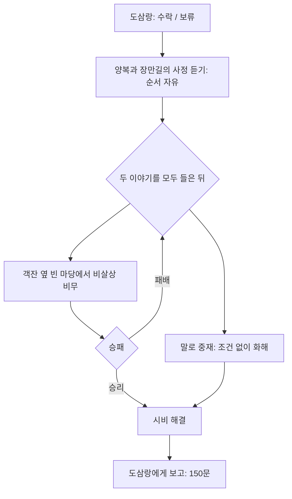

# 밥값보다 큰 소리 — 구현

**현재 패배 규칙(2026-10-28):** 사용자 변경으로 이 전투는 패배 시 사망 화면을 표시한 뒤 확인하면 타이틀로 돌아간다. 아래의 과거 후퇴/재도전·비살상 설명과 검사는 이 변경으로 대체된다. 이전 저장 파일은 삭제하거나 덮어쓰지 않는다.

무창 객잔의 도삼랑에게 F로 말을 걸어 수락한다. 선행 조건 없이 다른 일반 의뢰와 동시에 진행할 수 있다. 기존 지도와 기본18장 초상화를 재사용하며 객잔 실내는 새로 추가하지 않았다.

## 진행과 보상

- 양복(28세): 하역 일꾼. 국물을 엎지른 잘못은 인정하지만 생업을 낮춰 말한 데 분이 났다. 기본 `male_common_a` 그림을 쓴다.
- 장만길(32세): 체면을 내세우는 떠돌이 무인. 옷보다 남들 앞에서 조롱당한 일이 분하다. 기본 `male_common_b` 그림을 쓴다.
- 두 인물은 수락 후에만 객잔 앞에 나타나고, 완료 보고 후 사라진다. 건물 전신 영역/발밑 충돌을 피하고 대로 중앙에는 서지 않는다.
- 각자의 마지막 대사를 마쳐야 이야기를 들은 것으로 처리한다. 두 사람 이야기를 모두 듣기 전에는 중재/비무를 시작할 수 없다.
- 선택창은 ESC로 닫고 I/K에서 준비할 수 있다. 비무 패배 후에도 들은 이야기는 유지하며 금전 차감 없이 중재 또는 재도전을 고른다. 재도전은 체력300·시작 내기=내공으로 새 전투를 시작한다.
- 두 경로 모두 보고 대화 마지막에 **150문만 한 번** 지급한다. 능력치·오성·명성·아이템 추가 보상은 없다.
- 의뢰인 표식은 수락 전 노란 !, 보고 대기 ?, 완료 후 제거한다. Q 일지/현재 단계 추적/지역 이동 안내를 연결했다.
- 수락/청취/선택 대기/해결/완료 상태를 저장한다. 대화·선택 메뉴·전투 중 새 저장은 공통 제한을 따른다. 구버전 저장에는 미수락 기본값을 적용한다.

## 비무 상대

| 항목 | 장만길 |
| --- | --- |
| 체력 | 240 |
| 근력 / 기민 / 근골 / 내공 / 오성 | 14 / 12 / 14 / 10 / 10 |
| 장비 | 후배도 |
| 초식 | 거친 도질·내려찍기 (`bandit_chop`, `bandit_heavy_chop`) |
| 내기 | 시작10·매 턴10 회복·공통 상한500 |

유소강보다 강하고 구칠보다 약한 일반 상대다. 플레이어와 같은 내기/무공/방어 계산을 쓰며 예고는 공격/수세만 알린다. 기존 전투 배경·도 장착 전투 그림을 재사용한다.

## 실제 화면

[수락 선택](../../godot/screenshots/inn-quest-offer.png) · [객잔 앞 손님](../../godot/screenshots/inn-quest-guests.png) · [해결 방식](../../godot/screenshots/inn-quest-choice.png) · [네 사람 중재 대화](../../godot/screenshots/inn-quest-mediation.png) · [완료 보고](../../godot/screenshots/inn-quest-report.png)

## 대사 원고

실제 원본은 `godot/data/wuchang_inn_quest.json`이다.

### 의뢰 제안

- 도삼랑: 도원 소협, 잠깐만요. 저 두 사람 사이에 좀 서 주겠어요?
- 도원: 무슨 일입니까?
- 도삼랑: 국물 한 그릇 엎지른 게 시작인데, 이제는 서로 사람 됨됨이까지 따지고 있어요. 이러다 상까지 엎겠네요.
- 도원: 포졸을 부르는 편이 낫지 않겠습니까?
- 도삼랑: 손이 먼저 나가면 그래야겠지요. 아직은 말다툼이니 한번 풀어 보고 싶어요. 저 일꾼도 오래 온 손님이고요.
- 도원: 어느 쪽을 도와드리면 됩니까?
- 도삼랑: 둘 다 조용히 밥 먹게 해주세요. 단골이라고 무조건 편들 생각은 없어요.

### 수락

- 도삼랑: 객잔 앞 평상에 있어요. 한 사람 말만 듣고 판단하지는 말아주세요.

### 보류

- 도삼랑: 알겠어요. 저도 한번 더 말려 볼게요. 그릇만은 무사해야 할 텐데.

### 진행 중

- 도삼랑: 객잔 앞의 두 손님에게 사정을 들어주세요. 누가 먼저 목청을 높였는지만 따지면 끝이 없을 거예요.

### 양복의 사정

- 양복: 제가 국물을 흘린 건 맞습니다. 그래서 바로 사과하려 했어요.
- 도원: 그런데 어째서 언성이 높아졌나?
- 양복: 입도 열기 전에 짐 나르는 놈들은 손도 제대로 못 쓰느냐더군요. 하루 종일 그 손으로 일하고 왔는데 말입니다.
- 도원: 자네도 거친 말을 했나?
- 양복: ……하늘을 난다던 무사님이 국물은 못 피하느냐고 했습니다.
- 도원: 그 말은 사과로 들리기 어렵겠군.
- 양복: 압니다. 그래도 옷값을 물어내라는 말보다 그 말이 더 분했습니다.

### 장만길의 사정

- 장만길: 소협도 보셨소? 남의 옷을 더럽혀 놓고 비웃기까지 하더군.
- 도원: 옷을 더럽힌 일은 사과받으셔야겠지요. 다만 일꾼의 생업까지 낮춰 말할 필요가 있었습니까?
- 장만길: 나도 욱해서 한 말이오. 그런데 저자가 먼저 고개를 숙였으면 끝날 일이었소.
- 도원: 그 사과를 듣기도 전에 다툼이 커진 게로군요.
- 장만길: ……사람들 앞에서 그런 소리를 듣고 가만있으란 말이오? 강호에서 체면이란 게 있지 않소.

### 양복 재대화

- 양복: 제 사정은 말씀드렸습니다. 저분 생각도 들어보시겠습니까?

### 장만길 재대화

- 장만길: 옷도 옷이지만 사람들 앞에서 비웃은 일이 분한 것이오. 저 일꾼에게도 물어보시오.

### 말로 중재

- 도원: 양복, 옷을 더럽히고 비웃은 일부터 사과하게. 실수 뒤에 덧붙인 말까지 실수가 되는 것은 아니네.
- 양복: ……옷을 더럽혀 죄송합니다. 피하지 못했다고 비웃은 것도 지나쳤습니다.
- 도원: 장 소협도 말씀하시지요.
- 장만길: 옷은 빨면 될 일이오. 나도 자네 하는 일을 낮춰 말한 건 잘못했네.
- 양복: 세탁비는 제가 내겠습니다.
- 장만길: 됐네. 내 입도 먼저 험했으니 그 정도는 내가 감당하지.
- 도삼랑: 좋아요. 옷은 제가 물에 담가 둘 테니 두 분은 식사부터 마쳐요. 대신 식은 국을 다시 데우는 동안 또 싸우지는 마세요.

### 비무 제안

- 도원: 양복은 무공을 모르는 사람이오. 그래도 분이 풀리지 않는다면 나와 손을 맞추시겠소?
- 장만길: 소협이 대신 나서겠다는 거요?
- 도원: 잠깐 겨루고 돌아와 식사를 마칩시다. 다만 이기고 지는 것으로 두 사람의 잘못을 정하지는 맙시다.
- 도삼랑: 하실 거면 옆 빈 마당에서요. 다치도록 겨루지는 말고, 제 그릇도 들고 나가지 마세요.

### 비무 승리

- 장만길: 됐소, 됐어. 숨이 차니 성낼 기운도 없군.
- 도원: 이제 옷 이야기부터 마저 하시겠소?
- 장만길: 내 입이 험했소. 저 일꾼에게도 그렇게 전하리다.
- 양복: 저도 사과하겠습니다. 옷을 더럽힌 건 제 잘못이니까요.

### 비무 패배

- 도삼랑: 그만해요! 분을 풀자고 나갔다가 더 다치겠어요.
- 장만길: 소협의 뜻은 알겠소. 우선 숨부터 고릅시다.
- 도원: ……괜찮습니다. 양쪽 이야기는 들었으니, 말로 다시 풀어볼 수도 있겠군요.

### 해결 후 손님

- 양복: 국물은 다시 시켰습니다. 이번에는 조심해서 들겠습니다.
- 장만길: 나도 말부터 가려 하겠소. 도 주인께도 수고를 끼쳤군.

### 완료 보고

- 도삼랑: 이제야 그릇 부딪치는 소리가 들리네요. 두 사람 목소리에 묻혀 있었거든요.
- 도원: 늘 이런 일이 있습니까?
- 도삼랑: 배고프고 지친 사람은 말끝이 날카로워져요. 무사님이라고 다르지는 않더군요.
- 도원: 그렇다고 매번 봐주실 수는 없겠지요.
- 도삼랑: 그래서 부탁드린 거예요. 밥을 파는 사람도 손님 앞에서 할 말은 해야 하니까요.
- 도삼랑: 받아요. 소협 덕에 오늘 장사를 마저 하겠네요.

### 완료 후 잡담

- 도삼랑: 그 두 사람, 다음에 만나서는 서로 빈자리부터 내주더군요. 사이가 좋아진 건지, 또 소협을 부를까 봐 그러는 건지.

## 검증

`tests/inn_quest.gd`는 실제 F 접근·수락/보류·양쪽 청취 순서·중재·비무 승패와 재도전·마지막 대사 보상·중복 지급 차단·기본 그림 중복 방지·건물/도로 배치·네 의뢰 동시 진행·단계별 저장/구버전 호환을 검사한다. 도시 교관 하급 무공10종을 최소 학습 조건+절정 합계와 균형20에서 비교하는20개 전투도 공통 계산으로 검사한다.

`tests/capture_inn_quest.gd`는 그래픽 환경에서 재현 가능한 화면을 저장한다. 별도 데모 내보내기는 하지 않는다.
