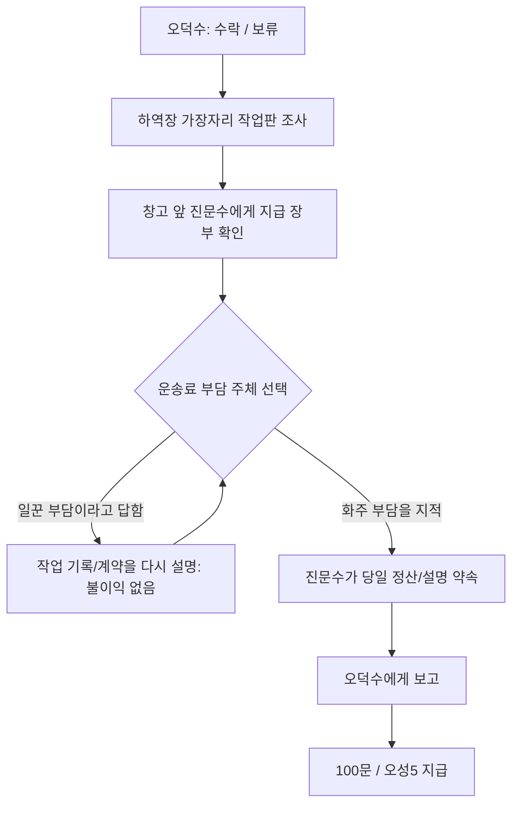

# 품삯에서 빠진 세 줄 — 구현

나루의 오덕수가 일꾼들의 사흘 품삯에서 공제된 운송료를 확인해 달라고 부탁하는 비전투 일반 의뢰다. 선행 조건 없이 다른 일반 의뢰와 동시에 받을 수 있다.

## 진행

- 작업판의 마지막 조사 대사를 마치기 전에는 장부 확인으로 넘어가지 않는다. 진문수를 먼저 찾아가면 작업판부터 확인하라고 말한다.
- 지급 장부의 마지막 대사 뒤에 선택창을 연다. 오답에는 금전·능력치 차감이나 실패 분기가 없고, 설명을 들은 뒤 다시 선택할 수 있다. ESC로 닫아도 진문수에게 F로 다시 말을 걸면 이어진다.
- 정산 약속 대화가 끝나면 오덕수에게 ?가 나타난다. 누락 품삯을 돌려준 것은 보고 대사에서 확인한다. 플레이어가 일꾼들의 돈을 받거나 대신 지불하지 않는다.
- **보고 대화 마지막에100문과 오성5를 한 번만 지급한다.** 오성 상한100을 적용하며 알림에는 실제 증가량을 표시한다. 명성·호의도·다른 능력치·아이템 추가 보상은 없다. 장사 밖 의뢰에 오성을 기본으로 부여하지 않는 원칙의 사용자 지정 예외다.

## 배치와 조작

진문수42세는 새 상시 주민으로 창고 앞 정산 자리(희망370,1020)에 배치했다. 기본 성인 남성 그림 `male_common_b`와 기존 서기형 도트를 재사용한다. 의뢰 전에도 대화할 수 있고 완료 후에도 남아 잡담한다. 기본 이미지 풀18장은 늘리지 않았다.

작업판은 오덕수 부근 하역장 가장자리(희망390,1090)에 있다. 공통 전신/도로/건물 배치 검사로 안전한 위치를 고른다. 나무 판자와 사흘 기록을 표시하며 발밑 충돌·Y정렬을 적용해 플레이어가 그대로 통과하지 못한다. F로 조사한다. 지도 전체를 다시 굽거나 새 소지품 아이템을 만들지 않았다.

Q 일지/목표 추적/미니맵 안내를 연결했다. 타 지역에서는 무창 방면 출구로 안내한다. 의뢰인은 수락 전 !, 보고 대기 ?, 완료 후 표식을 제거한다.

오덕수에게 품삯 의뢰 외의 진행 용건이 있으면 먼저 용건을 고른다. 「장인의 이름값」의 반입 기록과 「빌려 쓴 무림맹 이름」의 피해 증언을 별도로 선택해 진행할 수 있다. 품삯 의뢰를 완료해도 완료 잡담이 다른 진행 의뢰를 가로막지 않는다.

## 저장

`wages_quest.phase`는 `available / inspect / ledger / decide / ready / completed`다. 단계별 안정된 탐험 시점에서 저장/복원하며 새 필드가 없는 구버전은 미수락 상태로 읽는다. NPC·작업판·충돌·목표 표식은 불러올 때 중복 없이 재구성한다. 대화/거래/전투와 선택 메뉴 중 새 저장 금지는 공통 제한을 유지한다.

## 실제 화면

[진문수 배치](../../godot/screenshots/wages-quest-clerk.png) · [의뢰 수락](../../godot/screenshots/wages-quest-offer.png) · [작업판](../../godot/screenshots/wages-quest-work-board.png) · [작업 기록 조사](../../godot/screenshots/wages-quest-inspection.png)

[지급 장부](../../godot/screenshots/wages-quest-ledger.png) · [부담 주체 선택](../../godot/screenshots/wages-quest-correction.png) · [보고](../../godot/screenshots/wages-quest-report.png) · [완료 일지](../../godot/screenshots/wages-quest-completed.png)

## 대사 원고

### intro

- 오덕수: 소협, 글씨 좀 볼 줄 아시오? 검보다 가벼운 종이가 사람 속은 더 무겁게 만드는군.
- 도원: 무슨 일이십니까?
- 오덕수: 사흘 동안 짐을 내린 놈들 품삯이 죄다 모자라오. 하루도 빠짐없이 일했는데 운송료를 떼었다는 거요.
- 도원: 일을 덜 했다고 적힌 것은 아닙니까?
- 오덕수: 그랬으면 내가 먼저 따졌지. 짐짝 수와 사람 수는 날마다 여기 작업판에 적어 두오.
- 도원: 창고에는 물어보셨습니까?
- 오덕수: 장부대로 줬다는 말만 하더군. 나도 목청부터 높여서 이야기가 틀어졌소. 소협이 양쪽 기록을 한번 봐주겠소?
- 도원: 잘못된 부분이 있는지 확인해 보겠습니다.
- 오덕수: 고맙소. 배는 하루 늦어도 뜨지만, 저놈들 집에서는 오늘도 밥을 먹어야 하니.

### accept

- 오덕수: 내 옆 하역장 가장자리의 작업판부터 봐주시오. 사흘 기록을 확인한 뒤 창고 앞 진문수에게 물으면 되오.

### decline

- 오덕수: 알겠소. 다른 사람 일에 나서 달라는 부탁이니 재촉할 수야 없지.

### inspect

- 도원: 사흘 모두 하역 인원과 짐짝 수가 적혀 있군. 작업을 마쳤다는 확인도 있고.
- 도원: 일꾼들이 맡은 것은 배에서 창고까지 짐을 옮기는 일이다. 배를 부리거나 다른 나루로 운송한 기록은 없어.
- 도원: 품삯에서 뺀 운송료가 무엇인지 진문수에게 물어봐야겠군.

### ledger

- 진문수: 오 반장께서 보내셨습니까? 지급한 돈은 장부와 맞습니다.
- 도원: 장부에 적힌 공제 항목을 확인하고 싶습니다.
- 진문수: 여기 보십시오. 사흘 모두 운송료를 공제했습니다. 빠뜨린 날도, 두 번 뺀 날도 없습니다.
- 도원: 그 운송료를 누가 부담하기로 했습니까?
- 진문수: 그야…… 잠깐만 기다리십시오. 앞장을 보겠습니다.
- 도원: 작업판에는 하역을 마쳤다고 적혀 있었습니다. 일꾼들이 운송까지 맡은 것은 아니더군요.
- 진문수: 여기에는 ‘화주 정산’이라고…… 새 양식으로 옮기면서 칸을 잘못 잡았군요.
- 도원: 계산은 맞아도, 돈을 뺄 곳이 틀렸군요.

### wrong

- 진문수: 계약에는 운송료를 화주에게 청구하도록 되어 있습니다.
- 도원: 작업판에도 일꾼들이 맡은 것은 하역뿐이라고 적혀 있었지요. 그렇다면 누가 낼 돈인지 다시 짚어봅시다.

### resolve

- 진문수: 차액은 다음 정산에 얹어 드리겠습니다.
- 도원: 다음 정산까지 기다리는 것은 일꾼들이지요. 잘못 적은 사람은 아닙니다.
- 진문수: ……그렇군요. 오늘 지급할 수 있도록 창고 책임자에게 바로 올리겠습니다.
- 도원: 오 반장에게도 직접 설명해 주십시오. 다음에도 같은 일이 생길까 걱정하고 있습니다.
- 진문수: 제가 찾아가겠습니다. 장부를 다시 쓰는 것보다 그 말이 더 어렵겠지만, 해야겠지요.

### report

- 오덕수: 진 서기가 다녀갔소. 빠진 돈도 전부 돌려줬고.
- 도원: 장부를 옮기면서 공제할 곳을 잘못 적었더군요.
- 오덕수: 직접 와서 설명하기에 나도 고함친 건 사과했소. 그렇다고 처음부터 장부만 믿고 돌아가라 한 말까지 옳았던 건 아니지만.
- 도원: 다음부터는 서로 기록을 함께 확인하면 되겠지요.
- 오덕수: 그러기로 했소. 이건 내 주머니에서 내는 백문의 수고비요. 일꾼들 품삯을 덜어 준 건 아니니 받아 두시오.
- 도원: 그럼 감사히 받겠습니다.
- 오덕수: 허허. 오늘은 저놈들도 객잔에서 국에 고기 한 점은 더 얹겠구먼.

### progress_inspect

- 오덕수: 내 옆 작업판에 사흘 기록이 있소. 먼저 누가 무슨 일을 했는지 확인해 보시오.

### progress_ledger

- 오덕수: 창고 앞 진문수에게 지급 장부를 보여 달라 해보시오. 목청보다 기록을 앞세우는 게 낫겠소.

### progress_decide

- 오덕수: 작업판과 지급 장부를 다 보셨소? 진 서기와 누가 그 돈을 내야 하는지 마저 정리해 주시오.

### jin_idle

- 진문수: 지급 장부는 제가 맡고 있습니다. 하역 일거리는 오덕수 반장께 물으십시오.

### jin_before

- 진문수: 오 반장의 부탁이라면 나루 작업판부터 보시지요. 어느 날의 무슨 일을 따지는지 알아야 장부도 찾을 수 있습니다.

### jin_ready

- 진문수: 오 반장께 차액과 설명을 전했습니다. 기다리게 한 일은 제가 사과드렸습니다.

### jin_post

- 진문수: 요즘은 장부를 덮기 전에 오 반장을 부릅니다. 옮겨 적은 숫자가 맞아도, 누구 몫인지까지 봐야겠더군요.

### post

- 오덕수: 요즘 진 서기가 장부를 덮기 전에 꼭 나를 부르오. 나도 목청 높이기 전에 종이부터 보게 됐고. 서로 귀찮아졌지만, 그게 낫지.

### board_idle

- 도원: 날마다 하역 인원과 짐짝 수를 적어 두는 나루 작업판이군.

## 구현과 검증

`wages_quest.gd` / `wuchang_wages_quest.json`이 의뢰와 대사를, `work_board.gd`가 발밑 충돌이 있는 작업판을 담당한다. 진문수의 상시 배치/설정은 `wuchang_residents.json`이다.

`tests/wages_quest.gd`에서 실제 F 수락·보류·선행 조사 방지·작업판 물리 충돌/전신 배치·오답/재선택·중간 저장·보고 전 보상 없음/한 번 지급·오성98→100 상한·6개 일반 의뢰 동시 진행·공유 오덕수의 다른 용건·상시 NPC 유지·구버전/잘못된 단계 검증을 확인한다. 관련 기존 주민/기본18장/장인·사칭·대련·객잔·약초꾼/저장/목표 안내 검사도 실행한다.

`capture_wages_quest.gd`로 실제 화면을 재현한다. 별도 데모 내보내기는 하지 않는다.
