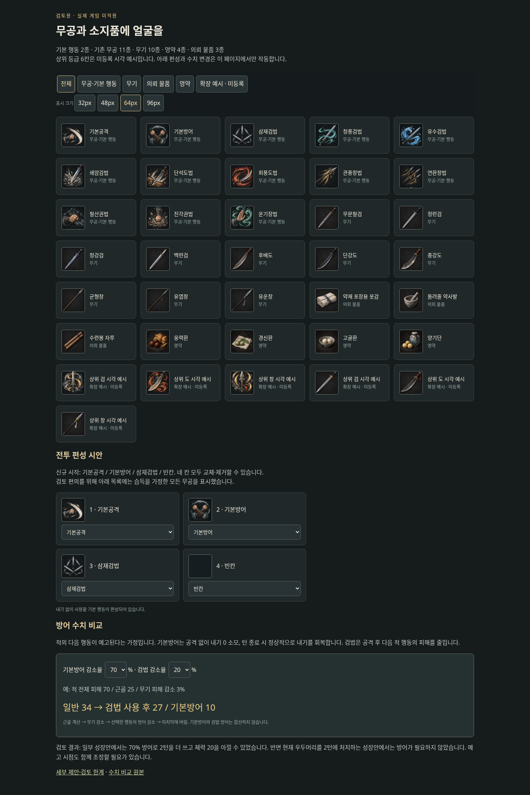

# 무공·아이템 아이콘 및 방어 전투 검토안

**검토용이며 실제 게임에는 적용하지 않았습니다.** 게임 코드·등록 데이터·저장 형식은 변경하지 않았습니다. `index.html`을 브라우저에서 열면 크기별 아이콘, 자유로운 4칸 편성, 방어율 비교를 확인할 수 있습니다. 이 폴더와 `assets`를 함께 내려받으세요.

## 생성 범위와 미술 기준

- 기본공격·기본방어 2종, 현재 등록된 무공 11종(삼재검법 포함).
- 시작 검을 포함한 무기 10종, 영약 4종, 입문 의뢰 물품 3종.
- 상위 검·도·창의 무공/장비 시각 예시 6종. **실제 신규 무공·아이템은 아닙니다.**
- 무공은 무기 실루엣과 기운의 궤적으로 구분하며, 기본방어는 교차한 팔로 표현했습니다. 무기는 재질·손잡이·날 형태로 차이를 줍니다. 영약은 색뿐 아니라 포장과 그릇도 구분합니다.
- 현재 무공은 같은 시각 등급으로 취급합니다. 상위 등급은 향후 테두리와 장식으로 확장하되 기존 아이콘을 작은 칸에 다시 압축하지 않고 새 이미지 페이지를 추가합니다. 색만으로 등급이나 종류를 구분하지 않습니다.
- 원본 PNG 3장과 칸별 이름·위치를 지정한 `manifest.json`을 보존했습니다. 검토 화면은 원본을 CSS로 표시하며 원본 이미지를 변형하지 않습니다.

## 추천 전투안 — 미확정

| 행동 | 내기 | 효과 |
|---|---:|---|
| 기본공격 | 0 | 기존 피해 공식 유지 |
| 기본방어 | 0 | 공격하지 않고 다음 적 행동의 피해 **70% 감소** |
| 현재 검법 4종 | 기존 비용 | 공격 후 다음 적 행동의 피해 **20% 감소** |

검법 4종은 삼재·청풍·유수·쇄암입니다. 방어해도 턴 종료 시 내공만큼 정상 회복하며 추가 회복은 없습니다. 각 방어 효과는 다음 적 행동 종료 시 해제합니다. 적이 축기만 해도 해제하고, 다단 공격은 그 적 행동 전체에 적용합니다. 전투 간에 유지하지 않습니다.

계산은 `floor(max(0,D-G) × 100/(100+G) × (1-무기감소율) × (1-선택행동감소율))`입니다. 기본방어와 검법 방어를 더하지 않습니다. 무기·내기가 유효하여 기술을 실제 사용했을 때만 효과를 얻습니다.

적의 전체 피해 70, 근골 25, 정련검 피해 감소 3%일 때:

| 방어 상황 | 받는 피해 |
|---|---:|
| 방어 없음 | 34 |
| 검법 20% | 27 |
| 기본방어 50% / 60% / 70% | 17 / 13 / 10 |

## 시뮬레이션 점검

`python docs/reviews/combat-icons/simulate.py`로 재현합니다. 현재 무공·무기 데이터를 읽고, 검토 규칙으로 5개 상황을 비교했습니다. 무작위 회피·치명타는 없으며, 최적 행동 탐색은 **12턴 이내**로 제한했습니다. 모든 전투는 체력 300으로 시작합니다.

- 기존 튜토리얼은 삼재검법 4회로 끝나며 검법 방어를 추가하면 남는 체력이 219→237로 증가합니다.
- 성장안에 따라 현재 우두머리는 2턴에 쓰러집니다. 이런 경우 방어할 이유가 없으므로 방어율만으로 전투의 선택이 풍부해지지는 않습니다.
- 미구현 일반 의뢰 보상까지 연결한 성장안과 **가상의 예고 패턴(견제 55 → 강공 125 → 축기)**에서는 공격 위주가 5턴/체력 164입니다. 강공마다 70% 방어하면 7턴/체력 184로, 시간과 생존을 교환하는 선택이 생깁니다. 50%는 7턴/146, 60%는 7턴/164라 효율이 부족했습니다.
- 체력 420의 별도 스트레스 적도 비교했습니다. 이것은 실제 적 능력치 변경 제안이 아니라 긴 전투에서의 방어 효용 점검입니다.

따라서 **70%를 첫 검토값**으로 추천합니다. 실제 적용 시 강공 예고의 시점과 빈도까지 함께 테스트해야 하며 현재 적에게 새 패턴을 적용하지 않았습니다. 상세 행동 순서와 비교 수치는 `simulation.json`에 있습니다.

## 편성·저장 처리 시 유의점

신규 시작 편성은 `기본공격 / 기본방어 / 삼재검법 / 빈칸`이며 **네 칸 모두 자유롭게 교체·제거**하는 안입니다. 기본방어를 새 무공 습득 수에 포함하여 메인스토리가 발동하지 않게 해야 합니다.

기존 저장은 고정 기본공격과 기존 3개 무공을 보존하고, 기본방어를 선택 목록에 추가하는 방식이 적절합니다. 기존 무공을 몰래 빼고 방어를 넣지 않습니다. 현재 저장은 변경하지 않았습니다.

기본공격·기본방어를 모두 빼면 내기 부족이나 무기 불일치로 행동 불능이 될 수 있습니다. 적용 전 **조건부 대기(내기 회복)**와, 무기 불일치뿐인 편성의 **준비 화면 복귀**를 마련해야 합니다. 자유 편성은 유지하되 이 상황을 막는 처리는 필수입니다.

## 검토 화면 확인

브라우저 점검에서 전체 36칸, 분류 필터, 32/48/64/96px 전환, 네 칸 모두 제거·교체, 중복 무공 이동, 방어율 계산과 자바스크립트 오류 여부를 확인했습니다. 무기는 32px에서 세부 장식이 비슷해 보이므로 **48~64px와 이름·단계 표시를 함께 쓰는 것**을 추천합니다. PNG는 원본 시안이고 게임용 리소스 최적화와 연결은 적용 결정 이후 진행합니다.
