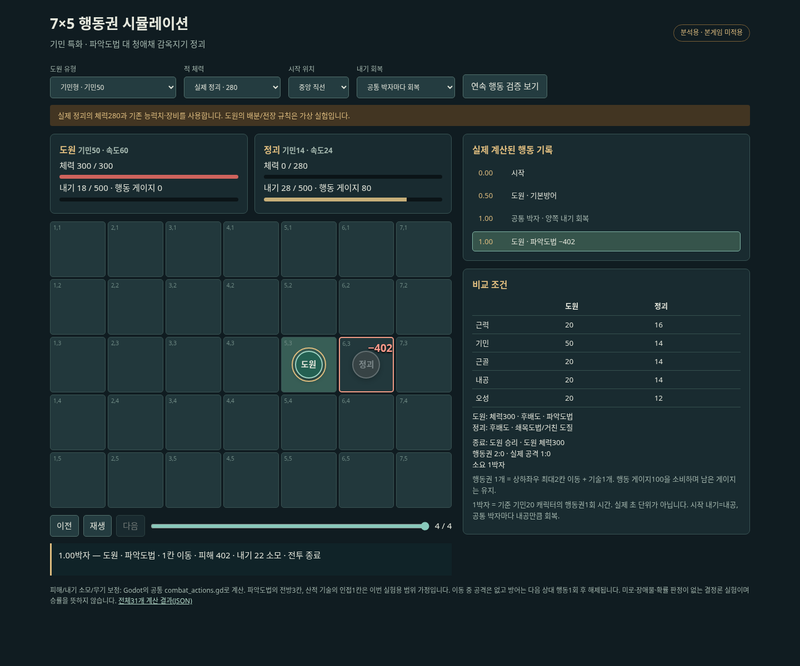
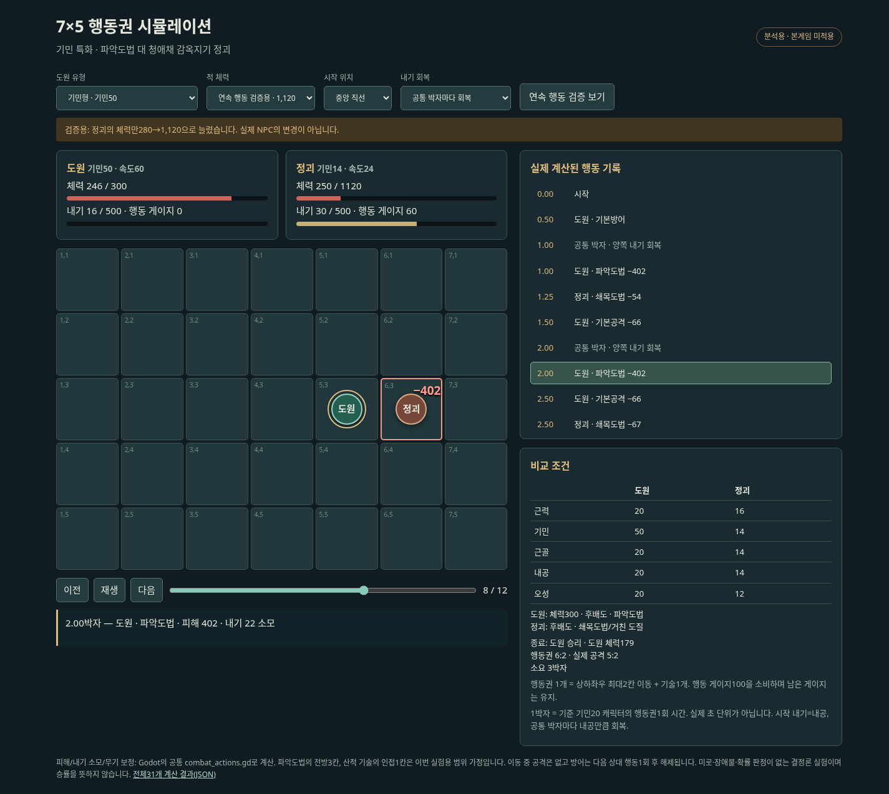

# 기민 특화 중급 도법 대 청애채 산적 — 7×5 행동권 실험

상태: 분석용 시뮬레이션. 본게임의 전투 코드·NPC·무공 수치는 변경하지 않았다. **행동권1개=상하좌우 최대2칸 이동+기술1개**인 제안을 실험했다. 무공 재설계/게이지/내기 회복의 가정은 최종 확정이 아니다.

## 실행 가능한 리플레이

후속 업데이트로 [양쪽 캐릭터를 편집하는 전투 실험실](../../prototypes/grid-initiative-simulation/README.md)이 되었다. 아래 표와 초기 캡처는 당시31개 고정 조건의 결과이며, 현재 도구에서 설정을 바꾸면 새로 계산한다. 기존 조건도 다시 불러올 수 있다.

[독립 HTML](../../prototypes/grid-initiative-simulation/index.html)을 다운로드해서 브라우저로 열면 이전/다음·재생·시점 막대, 캐릭터 유형/시작 위치/적 체력/내기 회복 방식을 비교할 수 있다. HTML에 계산 데이터를 포함했으므로 설치나 서버가 필요 없다. GitHub 코드 화면에서는 HTML이 실행되지 않으므로 파일 우측 위 Download raw file 버튼으로 저장한다.





## 입력과 가정

| 항목 | 기민형 도원 | 같은 총합의 근력형 도원 | 정괴 |
| --- | ---: | ---: | ---: |
| 근력 |20|50|16|
| 기민 |50|20|14|
| 근골 |20|20|14|
| 내공 |20|20|14|
| 오성 |20|20|12|
| 총합 |130|130|70|
| 체력 |300|300|280|
| 장비 |후배도|후배도|후배도|
| 기술 |파악도법·기본공격·기본방어|동일|쇄목도법·거친 도질·기본공격·기본방어|
| 행동 속도(기민+10) |60|30|24|

도원 배분은 가상 실험값이며 시작 캐릭터나 새 확정 스탯이 아니다. 사용자가 말한 기민 특화 캐릭터를 기존 중급 도법 **파악도법**으로 시험했다. 새 기민 전용 도법을 만든 것은 아니다. 정괴는 `data/qingya_quest.json`의 현행 감옥지기이며 마운표가 아니다.

- 게이지0에서 시작, 속도만큼 연속 충전하고100마다 행동한다. 잔여 게이지는 유지한다. 동시 도달은 기민 높은 쪽 우선. 선택을 기다리는 실제 시간이 아닌 가상 전투 시간이다.
- 1박자는 기준 기민20/속도30 인물이 게이지100을 채우는 시간이다. **공통1박자마다 양쪽이 내공만큼 내기를 회복**한다고 가정했다. 시작 내기는 내공, 최대500. 회복과 행동이 동시에 도착하면 회복부터 적용한다. 이 회복 주기는 실험값이다.
- 중앙 시작 위치: 도원(2,3), 정괴(6,3). 장애물이 없는7×5다. 최대2칸의 최단 경로로 접근하며, 사거리에 못 닿으면 이동 후 기본방어한다.
- 아직 중급 도법의 격자 범위가 확정되지 않았으므로, 이번 실험에서만 파악도법은 전방3칸/추가 이동 없음, 정괴 공격은 상하좌우 인접1칸으로 가정했다. 현재 공격 피해/내기 소모/후배도10% 보정은 `combat_actions.gd`를 그대로 호출한다.
- 도원은 닿고 내기가 충분하면 파악도법, 부족하면 기본공격을 선택한다. 기본공격은 무기 보너스를 받지 않는 기존 계산이다.
- 정괴는 기존 `enemy_plan`으로 가능한 강한 공격을 고르고 자기 행동3회째마다 방어한다. 다음 행동으로 닿지 않으면 접근 후 방어한다. 미래 플레이어 선택을 읽지 않는다. 실제 UI의 예고 잠금/조준 타이밍을 구현한 것은 아니다.
- 방어20%는 다음 상대 행동1회 동안 유지되고 중첩되지 않는 것으로 가정했다. 자신의 연속 출수만으로 기존 방어가 사라지지는 않는다. 회피·명중 난수·밀치기·추가 타격·행동 지연 효과는 없다.

## 실제 정괴: 체력280

| 유형 | 종료 박자 | 도원 행동권 | 정괴 행동권 | 도원 공격 | 정괴 공격 | 도원 남은 체력 |
| --- | ---: | ---: | ---: | ---: | ---: | ---: |
|기민형|1|2|0|1|0|300|
|근력형|2|2|1|1|1|246|
|기민형·속도만 적과 같게 고정|2.5|2|1|1|1|246|

기민형의 진행:

| 박자 | 행동자 | 이동 | 행동 | 피해 | 정괴 체력 | 도원 내기 |
| ---: | --- | --- | --- | ---: | ---: | ---: |
|0.5|도원|(3,3) → (4,3)|기본방어|0|280|20|
|1|도원|(5,3)|파악도법|402|0|18|

공통1박자에서 도원 내기20→40 회복 후 파악도법22를 소비한다. 파악도법의 기본 항은 근력×7+기민×5+근골×2이며, 기민형의 원 피해430에 후배도10%를 적용하면473이다. 정괴 근골14를 적용한 실제 피해는402다. 따라서 **현재 정괴는 한 번의 중급 도법에 쓰러진다.** 두 행동권을 얻었지만 첫 번째는 이동/방어이며 두 번 공격한 것이 아니다.

근력형의 파악도법 피해는460으로 더 강하지만 접근 중 정괴에게 한 번 맞는다. 기민형의 이점은 첫 유효타 전에 접근 행동권을 추가로 얻는 점이다.

동일 기민형의 행동 속도만24로 고정한 대조군도 넣었다. 피해 계수/스탯/내공/무기는 같은 상태에서 게이지 가속만 없애면 중앙 전투의 남은 체력이300→246으로 달라진다. 이 대조군의 속도 고정은 분석용이며 실제 스탯 공식이 아니다.

## 연속 행동 검증: 체력만4배인 대체 표적

실제 정괴의 수치나 퀘스트 난이도를 바꾸지 않고, **체력만280→1,120**으로 늘린 별도 검증이다. 나머지 능력치/기술/장비는 같다.

| 유형 | 종료 박자 | 도원 행동권 | 정괴 행동권 | 도원 공격 | 정괴 공격 | 도원 남은 체력 |
| --- | ---: | ---: | ---: | ---: | ---: | ---: |
|기민형|3|6|2|5|2|179|
|근력형|4|4|3|3|2|179|
|기민형·속도만 적과 같게 고정|5|4|3|3|2|179|

기민형의 진행:

| 박자 | 행동자 | 이동 | 행동 | 피해 | 정괴 체력 | 도원 내기 |
| ---: | --- | --- | --- | ---: | ---: | ---: |
|0.5|도원|(3,3) → (4,3)|기본방어|0|1120|20|
|1|도원|(5,3)|파악도법|402|718|18|
|1.25|정괴|제자리|쇄목도법|54|718|18|
|1.5|도원|제자리|기본공격|66|652|18|
|2|도원|제자리|파악도법|402|250|16|
|2.5|도원|제자리|기본공격|66|184|16|
|2.5|정괴|제자리|쇄목도법|67|184|16|
|3|도원|제자리|파악도법|402|0|14|

기민형은 파악도법3회+기본공격2회+접근/방어1회를 사용한다. 기민형의1.5→2박자,2.5→3박자에도 연속 행동이 나타난다.2.5박자에서는 두 인물이 동시에 준비되어 기민형이 먼저 행동하고 곧 정괴가 행동한다.

행동 속도60:24의 장기 기회 비율은2.5:1이지만, 전투가3박자에 끝나는 유한 구간에서는6:2가 나온다. 모든 짧은 전투의 행동 횟수가 정확히 속도 비율과 같아야 하는 것은 아니다.

## 내기 회복 방식의 영향

같은 체력1,120/중앙/기민형에서 공통 회복 대신 **행동할 때마다 내공만큼 회복**하면, 도원4행동/정괴1행동·2박자 종료·도원 체력246이 나온다. 공통 회복에서는6행동/2행동·3박자·체력179다.

기민으로 행동을 늘리는 동시에 행동마다 내기까지 회복시키면 강한 무공의 사용 빈도도 함께 크게 높아진다. 행동 게이지와 내기 회복을 분리할지 결정해야 하는 이유다. 회복 규칙은 이번 시뮬레이션에서 실험한 것이며 본게임에 적용하지 않았다.

## 시작 위치와 한계

중앙/인접/대각/모서리/진영 반전5종×도원3종(기민/근력/속도 고정 대조)×체력2종=30경우와 행동별 회복1경우, 총31개의 결정론적 전투를 계산했다. 무작위 표본이나 승률 통계가 아니다.

- 인접 시작에서는 기민형과 근력형 모두1박자에 끝낸다. 근력형은 파악도법1회, 기민형은 초기 내기가22보다 적어 기본공격 후 파악도법을 사용한다. 행동권이 많아도 반드시 더 빨리 끝나는 것은 아니다.
- 체력4배/반대 모서리에서는 기민형3박자·체력246, 근력형5박자·체력300이다. 접근 시점·내기 비축·방어 때문에 빠른 종료와 적은 피격이 언제나 같은 결과는 아니다.
- 도원은 총합130/중급 무공, 실제 정괴는 총합70/하급 무공이므로 전력 차이가 있다. 이 상대 하나로 전체 기민 밸런스를 판단할 수 없다. 장애물·다수전·동급 적·경공/밀치기까지는 검증하지 않았다.

## 재현/검증

```sh
XDG_DATA_HOME=/tmp/grid-initiative-data XDG_CONFIG_HOME=/tmp/grid-initiative-cfg XDG_CACHE_HOME=/tmp/grid-initiative-cache godot --headless --audio-driver Dummy --path godot --script res://tests/simulate_grid_initiative.gd
python scripts/build_grid_initiative_replay.py
```

Godot 검사에서31개 종료/내기0~500/35칸 경계/인물 중첩 금지/이동2칸 제한을 확인했다. Chromium에서31개 선택 조합과 각 시작/끝 시점,35개 칸·인물2명 표시를 검사했다. 원본 수치 변경 없이 공통 계산기를 사용했다. [전체 데이터](../../prototypes/grid-initiative-simulation/data.json)와 실행 스크립트를 함께 보관한다. 브라우저 캡처 스크립트는 로컬HTTP8765/작업용 Chromium9223을 사용한다.
