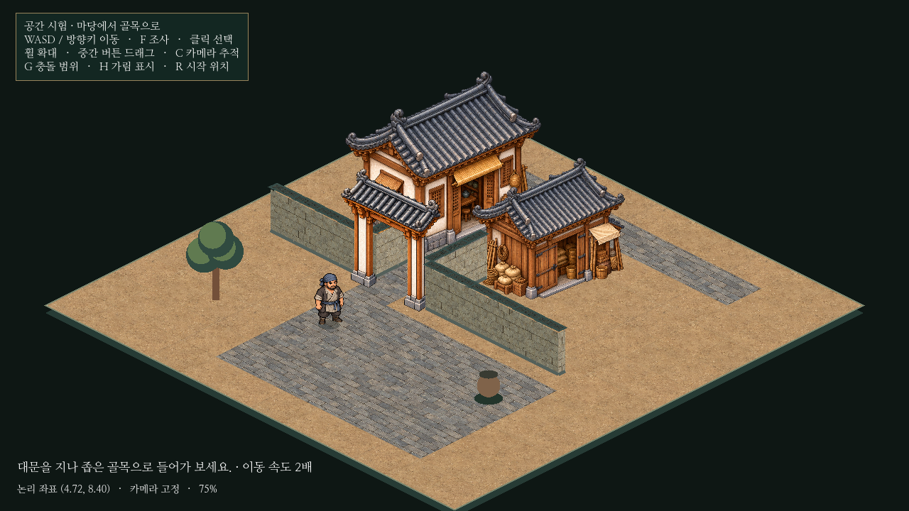

# 아이소메트릭 골목 · 독립 시험 결과

이 문서는2단계 골목 기록이다. 최신 보행·자동 NPC2명·인물 충돌·여러 가림 이름표는 [3단계 보고서](isometric-walkers.md)를 따른다.

사용자 승인 범위인 작은 골목만 구현했다. 기존 민가/창고와 시험용 짐꾼을 활용하고, 담장과 열린 대문을 추가했다. 본게임 시작 씬·도시·대화·의뢰·저장·전투와 앞서 중단한 농지/부두 변경은 이번 작업에서 수정하거나 커밋하지 않는다.

## 구성과 실행

`godot/prototypes/isometric/main.tscn`을 열고 **F6**으로 실행한다. F5는 기존 본게임이다. Windows 기본 복제 위치에서는 `C:\Users\PC\murim-rpg\godot\prototypes\isometric\main.tscn`이다. 프로젝트 가져오기 대상은 그대로 `godot/project.godot`이며 시험 씬을 별도 프로젝트로 가져오지 않는다.

12×12논리 바닥에 넓은 돌 마당→열린 대문→민가/창고 사이 좁은 골목→뒤쪽 길을 연결했다. 민가 부지는 유지하고 창고를 골목 옆으로 옮겼다. 담장은4줄을15개 짧은 구간으로 나눈다. 이동 속도는2.4→4.8논리 타일/초로 정확히2배다. 다른 조작은 [실행 안내](../../godot/prototypes/isometric/README.md)에 정리했다.

## 충돌과 앞뒤 가림

기존 `(u,v)→((u-v)×64,(u+v)×32)` 투영을 유지한다. 건물/담장은 **지면에 닿는 논리 바닥 점유 범위**를 물리 다각형으로 사용한다. 지붕이나 전체 이미지 사각형을 벽으로 쓰지 않는다.

대문은 양쪽0.35×0.4타일 기둥만 충돌체로 만들었다. 중앙1.15타일은 통행 가능하며, NPC의 논리 발밑 지름은0.30타일이다. 민가/창고 사이 골목 폭은1.45타일이다. G로 실제 충돌 구역을 표시하면 중앙 통로에는 막힌 다각형이 없다.

정렬은 논리 점유 사각형의 앞뒤 관계를 우선하는 위상 정렬이다. 짧게 나눈 담장 구간도 각각 정렬한다. NPC가 대문 바닥 안에 있을 때는 NPC 다음에 대문을 그려 기둥/지붕이 자연스럽게 앞에 오고, 실제 개구부는 투명하게 남긴다. 통과 후 앞쪽으로 나오면 NPC가 대문 앞에 그려진다. NPC 물리 이동 후 정렬/카메라를 갱신하며, 정지 중에는 정렬을 재계산하지 않는다.

[대문 앞](../../godot/prototypes/isometric/screenshots/alley-gate-front.png) · [대문 아래](../../godot/prototypes/isometric/screenshots/alley-gate-under.png) · [대문 뒤](../../godot/prototypes/isometric/screenshots/alley-gate-back.png) · [충돌 표시](../../godot/prototypes/isometric/screenshots/alley-collision.png)

## 가려진 인물 위치를 찾는 제안

실제로 인물보다 나중에 그려지는 오브젝트가 몸통의 표본점을 가릴 때만 금색 발밑 고리/점선/이름표를 표시한다. **H로 켜고 끄며 비교**할 수 있게 시험 적용했다. 물리·깊이·선택 판정은 바꾸지 않는다. 숨은 인물을 지붕 너머 클릭할 수 있게 만들지 않는다.

[표시 켬](../../godot/prototypes/isometric/screenshots/alley-hidden.png) · [표시 끔](../../godot/prototypes/isometric/screenshots/alley-hidden-no-hint.png)

현재는 작은 씬에 적합한12개 지점 표본 판정이다. 복잡한 실루엣과 다수 NPC에는 샘플 기준/표시 겹침을 추가 검증해야 한다. 건물 전체를 반투명하게 바꾸는 방식은 이번에 구현하지 않았다.

## 크기와 시점 검토

NPC는96화면 단위 높이를 유지한다. 건물·대문은 비율을 보존한 등축 전용 그림이며, 바닥 앞쪽 모서리를 기준점으로 등록한다. 담장 높이는 구간 길이에 관계없이78로 고정한다. 첫 대문 그림은 통과 높이가 낮아 보여, 같은 통로 폭에서 기둥을 높인 새 원본으로 교체했다. 최종 실제 화면에서는 NPC가 개구부에 온전히 들어가며 건물/대문/인물의 상대 크기와 시점이 대체로 어울린다. 이는 화면 검토이며 실제 건축 치수 검증은 아니다.

민가/창고는 기존 그림을 재사용했다. 새 대문 PNG도 생성 원본 그대로 보관하고 그림의 알파/기준점과 충돌 기둥을 별도 등록했다. 담장은 기존 시장 재질을 입힌 기하 면이므로 생성 건물보다 단순하다. 나무/항아리도 여전히 도형 시험 자산이다. 완성 미술과 혼동하지 않는다.

## 검증 결과

Godot4.6.3, 실제 저장과 분리한 XDG 폴더에서 검사했다. 캡처는1280×720 및2560×1440의 실제 씬 렌더이며 이미지 시안이 아니다. Linux 소프트웨어 OpenGL 환경이다.

| 검사 | 결과와 확인 범위 |
| --- | --- |
| `tests/isometric_prototype.gd` | **PASS**. 좌표 왕복529개, 두 건물 앞/뒤/옆 정렬, 실제 입력 충돌, 선택/투명 영역/카메라3배율, 발밑 고정, 입력 정리, 본게임 시작 씬 유지. 변경한 배치와 최종 대문 그림으로 재실행했다. |
| `tests/isometric_alley.gd` | **PASS**. 2배 속도와 실제 이동량, 골목/대문 왕복, 양 기둥 실제 충돌 접촉/관통 방지, 좌우 담장 차단, 디지털 W+D 통과, 대문 안/앞 정렬, 가림 표시 켬/끔, 지붕 뒤 클릭 차단. 검사 경로의 정렬 순환0. |
| `tests/capture_isometric_alley.gd` | **PASS**. 전체·대문 앞/아래/뒤·가림 켬/끔·충돌·추적 카메라·1440p의9장 생성 후 확인. |

기둥에 비스듬히 부딪히면 Godot 슬라이드 이동으로 옆을 돌아갈 수 있다. 이를 관통으로 오판하지 않도록, 검사에서는 끝 위치만 비교하지 않고 실제 충돌 접촉과 매 프레임 기둥 바닥까지의 거리를 확인한다.

[기본 추적 카메라](../../godot/prototypes/isometric/screenshots/alley-play.png) · [1440p](../../godot/prototypes/isometric/screenshots/alley-1440p.png)

## 남은 문제와 다음 검증

- NPC는 대기 호흡/이동 흔들림만 있다. 방향별 발 교차 보행 프레임은 아직 없다.
- 담장/장식 미술은 시험용 수준이다. 대문 개폐·실내·문턱 높낮이·자율 보행은 구현하지 않았다.
- 이 작은 배치에서는 가림/충돌이 통과했다. 다층 건물, 교차하는 큰 지붕, 수십 명의 NPC, 도시 규모의 정렬/가림 성능과 Windows GPU 결과는 미확인이다.
- 충돌은 사각 논리 바닥의 투영이다. 향후 비정형 건물/계단/굴곡진 기단은 다각형 바닥과 그림 기준점을 추가로 맞춰야 한다.
- 2:1 투영에서 화면 수직 이동이 수평보다 짧게 보이는 기존 특성은 유지했다. 이번에는 속도만2배로 바꿨으며 최종 조작감은 사용자의 플레이 검토가 필요하다.

이번 결과만으로 전체 게임을 전환하지 않는다. 후속 승인 시에는 보행 프레임과 담장 미술을 맞추고, 건물 여러 동/다수 NPC가 겹치는 작은 확장 구역을 먼저 검증하는 순서가 적절하다.
