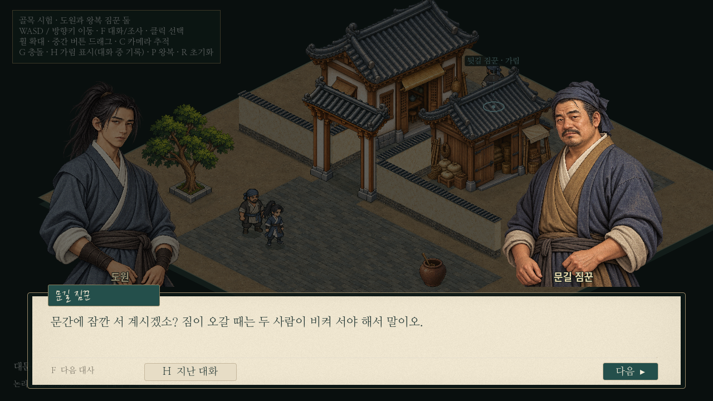

# 아이소메트릭 NPC 상호작용·기존 대화 연결

후속 [보행·진입 동선 보충](isometric-gait-access.md)에서 보행과 창고 앞 담장/마당을 변경했다. 아래는 대화 연결 단계의 기록이다.

독립 골목의 자동 NPC2명에게 F 대화와 각5줄의 일상 대화를 추가했다. 기존 본게임을 실행하거나 변경하지 않고 공용 대화 컴포넌트를 직접 사용했다. 도원/짐꾼 미술,96높이,속도4.8,건물/통로/충돌/왕복 경로와 카메라 설정은 유지한다.



[대상 표시](../../godot/prototypes/isometric/screenshots/dialogue-target.png) · [도원 화자](../../godot/prototypes/isometric/screenshots/dialogue-hero.png) · [대화 기록](../../godot/prototypes/isometric/screenshots/dialogue-history.png) · [다른 NPC](../../godot/prototypes/isometric/screenshots/dialogue-second-npc.png) · [1440p](../../godot/prototypes/isometric/screenshots/dialogue-1440p.png) · [실제 영상10.7초](../../godot/prototypes/isometric/screenshots/dialogue-play.mp4)

## 기존 구조와 재사용 범위

| 기존 코드 | 이번 사용 |
| --- | --- |
| `scripts/paper_dialogue_panel.gd` | 실제 대화/기록 패널을 그대로 인스턴스화. |
| `scripts/paper_menu_base.gd`, `ui.gd` | 기존 종이 재질/색/폰트/버튼으로 짧은 대화의 배치를 구성. |
| `scripts/dialogue_portraits.gd` | 실제 초상화 선택/얼굴 크기 보정/좌우 배치/서로 바라보기/비화자 어둡게 처리를 그대로 사용. |
| `scripts/dialogue_history.gd` | 현재 대화의 이미 표시한 줄만 읽는 실제 기록 창을 그대로 사용. H/ESC 닫기와 원래 일시정지 동작 유지. |
| `scripts/main.gd`의 `say/advance_dialogue` | 탐험·의뢰·음악·진행/완료 콜백에 연결되어 있으므로 직접 호출하지 않는다. 시험용 진행/입력/이동 정지·복원을 작은 어댑터에서 처리한다. |

`iso_dialogue.gd`가 기록 창에서 필요한 `dialogue_lines/index/panel`과 인물 이름표, 설정 창 열림 여부(false)를 제공한다. 인물 이름과 초상화 참조는 시험 데이터 안에서만 관리하며 공용 정적 인물 목록에 시험 NPC를 등록하지 않는다. 본게임 인스턴스·저장·의뢰·보상·호의도 시스템을 만들지 않는다.

도원은 기존 `portraits/player/hero.png`, 문길 짐꾼은 기본 풀의 `extras/male_common_a.png`, 뒷길 짐꾼은 기본 풀의 `wuchang/wu_deshu.png`를 재사용했다. 별도 그림은 없다. 도원은 왼쪽, 상대는 오른쪽에 고정하고 화자만 밝게 표시한다. 배경은 기존과 같은 농도로 어둡게 한다.

## 대상 선택과 이동 복원

`iso_interaction.gd`는1.25논리 타일 안에서 실제 발밑 경로의 세 줄을 물리 검사하고, 오브젝트에 완전히 가려지지 않은 NPC를 고른다. 벽/기둥/건물 모서리와 다른 인물이 경로를 막으면 제외한다. 같은 거리에서는 고정 우선순위를 사용해 항상 한 명만 선택한다. 이름/F 대화와 금색 발밑 표시를 주며 가림 이름표와 중복하지 않는다. 마우스는 기존 시험용 선택만 유지하고 이동/대화 진입을 실행하지 않는다.

첫 F는 첫 줄을 열기만 하며, 반복 입력은 건너뛰지 않는다. 이후 F 또는 다음 버튼으로 한 줄씩 진행한다. 대화 중 도원과 상대만 물리 이동을 정지하고 대상의 경유점·양보 상태를 보관한다. 다른 짐꾼은 계속 왕복한다. 종료하면 상대는 그 지점에서 기존 경로를 이어가고, 도원은 이동 키가 중립으로 돌아온 뒤 새 입력으로 움직인다. F를 계속 누른 상태에서는 재진입하지 않는다.

H 기록 창은 공용 구현의 원래 동작대로 **열린 동안 SceneTree 전체를 잠시 정지**한다. 기록을 닫으면 이전 정지 상태로 복원하고 대화는 같은 줄에서 이어진다. 기록 창을 연 채 시험 씬을 제거해도 일시정지가 남지 않는지 검사했다. 대화 중 H는 기록이며 탐험 중 H는 기존 가림 표시다.

## W+D 정지 방향 수정

이전 입력 처리에서는 두 키 중 하나를 먼저 떼면 남은 키의 방향으로 화상이 바뀔 수 있었다. 마지막 표시 방향/좌우 반전 상태를 따로 유지하고, 대각선에서 키를 떼며 생기는90ms 미만의 단일 축 입력은 방향 변경에서만 잠깐 보류한다. 이동 자체는 즉시 반응한다. 단일 방향으로 계속 걸으면 새 방향으로 바뀌며, 멈춘 다음 새 방향 키를 누르면 즉시 반영한다. NPC의 자동 이동 속도/보행 방향에는 이 보류를 적용하지 않는다.

[W+D 이동](../../godot/prototypes/isometric/screenshots/dialogue-facing-moving.png) · [정지 후 같은 방향](../../godot/prototypes/isometric/screenshots/dialogue-facing-idle.png). 실제 입력 촬영의 방향값도 `dialogue-capture.json`에서 같음을 확인했다.

## 검증 결과

Godot4.6.3/Linux와 분리된 XDG 사용자 폴더를 사용했다. 실제 화면은 소프트웨어 OpenGL이며 Windows 실기기 결과는 미확인이다.

| 검사 | 결과 |
| --- | --- |
| `isometric_dialogue.gd` | PASS. 거리/가까운 한 명/동률/벽/건물 모서리/열린 대문, 이름 중복 방지, 클릭 선택만 유지, 실제 F 진입/반복 방지/다음 버튼, 공용 UI·기존 초상화·화자 밝기·배경, 이미 읽은 줄만 기록, 참여자 정지/다른 NPC 이동/경로 재개/종료 입력 중립, 두 NPC 모두 대화, 씬 제거 시 pause/입력 정리. |
| 같은 검사 안의 방향 사례 | PASS. W+D에서 W 먼저/D 먼저 해제, 단일 축 계속 이동, 멈춘 뒤 새 방향 입력. |
| 기존 `isometric_prototype/alley/walkers/harmony.gd` | 모두 PASS. 투영/선택/문기둥/왕복/충돌/가림/미술과 기존 속도 유지. 왕복 검사3,640프레임, 최소 인물 간 거리 약0.2998, 정렬 순환0. |
| 기존 `isometric_walk_render.gd` | PASS. 네 방향 상체/허리띠 검사 영역 차이0, 반대 발 접지 차이565~595픽셀. |
| `capture_isometric_dialogue.gd` | PASS. 실제 화면9장과10.7초 영상, W+D 이동/정지 방향과 NPC 속도 기록. 대화 진입·진행·기록은 실제 키 입력으로 촬영한다. 마지막 방향/두 번째 대화 확인은 비교용 배치다. |

키 입력 검사는 실제 `InputEventKey`를 주입하고 버퍼를 비운 뒤 처리 프레임을 기다린다. 첫 검사에서는 입력을 처리하기 전에 상태를 읽는 문제를 발견해 검사 도구의 대기를 보정했다. F 입력 처리를 우회해서 성공한 것으로 판정하지 않는다.

본게임 공용 대화/진행/저장 소스, `layout.json`, 중단해 둔 도시 작업의 파일 해시는 작업 시작과 같다. 본게임 전체 실행 회귀는 이번 범위에서 수행하지 않았다.

## 남은 문제

- 대화 UI는 공용이지만 본게임의 이야기 진행/콜백/음악/저장과 연결한 결과는 아니다. 그 부분을 붙일 때는 별도 설계가 필요하다.
- 어댑터는 이번5줄의 짧은 대화에 맞춘 기본 배치다. 본게임의 설정/글자 크기 변경·아주 긴 대사 자동 높이 조절·선택지는 연결하지 않았다.
- 공용 기록 창의 전체 일시정지를 유지했다. 기록을 읽는 동안에도 다른 NPC를 움직이게 하려면 공용 계약을 따로 검토해야 한다.
- 초상화 컴포넌트는 생성할 때 기존 인물 등록 자료도 읽는다. 전용 경량 대화 모듈로 완전히 분리한 것은 아니다.
- 직선 접근 검사이며 돌아가는 경로의 길찾기나 군중 속 복잡한 상호작용은 검증하지 않았다. 도시 규모 확대는 아직 하지 않는다.

## 업데이트와 실행

```powershell
cd C:\Users\PC\murim-rpg
git pull --ff-only
```

Godot에서 `C:\Users\PC\murim-rpg\godot\prototypes\isometric\main.tscn`을 열고 **F6**. 프로젝트 안 경로는 `res://prototypes/isometric/main.tscn`이다. F5는 기존 본게임이다. WASD/방향키로 NPC에게 접근→F 대화→F/다음 버튼→H 지난 대화→H/ESC 복귀→마지막 줄 뒤 탐험 복귀.
