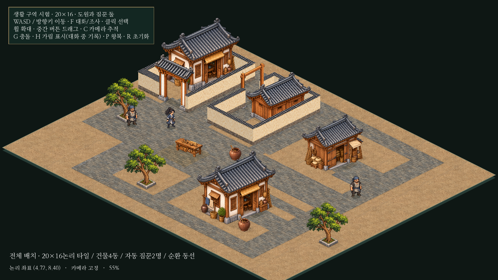
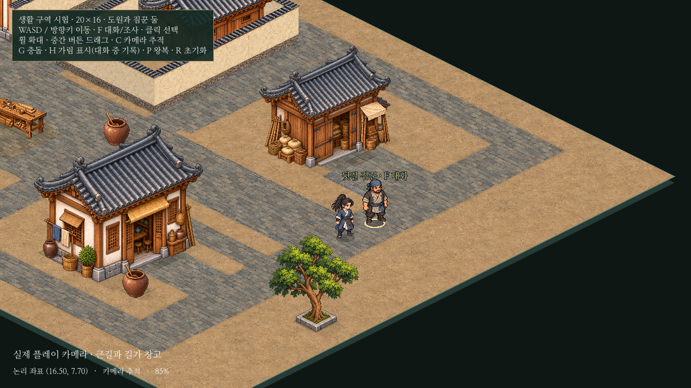

# 아이소메트릭20×16 생활 구역·카메라 시험

기존12×12 씬을 비교용으로 유지하고, 같은 코드/그림을 사용하는 **별도20×16 씬**을 추가했다. 건물4동, 도원1명과 기존 짐꾼2명, 두 대문과 담장 마당, 담장 없는 민가/창고의 앞자리와 목공 작업 공간을 연결한다. 새 그림·NPC·대화 시스템·본게임 기능은 추가하지 않았다.



[전체 배치/실제 플레이 확인 페이지](../../godot/prototypes/isometric/screenshots/district-preview.html) · [약10초 실제 탐험 영상](../../godot/prototypes/isometric/screenshots/district-play.mp4) · [충돌/접근 경로](../../godot/prototypes/isometric/screenshots/district-footprints.png) · [출발 화면](../../godot/prototypes/isometric/screenshots/district-spawn.png)

## 배치와 탐험 동선

20×16은320개 논리 바닥 칸이며 기존12×12는144칸이다. 기존 연속 논리 좌표와128×64 투영을 사용하고 TileMap이나 새 렌더링 체계로 바꾸지 않았다.

| 공간 | 구성 |
| --- | --- |
| 기존 담장 구역 | 민가/창고와 현재 두 대문 디자인을 같은 위치/축척으로 재사용 |
| 열린 물자 창고 | 기존 정면 창고 그림을 재사용하고 오른쪽 큰길을 향하는 문/빈 앞자리 연결 |
| 열린 민가 | 같은 민가 그림을 재사용하되 담장 없이 길과 연결, 뒤쪽 좁은 골목 확보 |
| 목공 작업 공간 | 서쪽 공용 마당으로 옮겨 새 민가의 지붕에 가리지 않도록 조정 |
| 주변 길 | 큰길→오른쪽 길→남쪽 골목→서쪽 길을 순환, 창고/민가 뒤쪽 길도 연결 |

두 새 건물은 일정 간격의 줄 배치로 늘리지 않았다. 기존 대문/건물/인물 그림과96높이·속도4.8논리 타일/초는 유지한다. 첫 NPC는 기존 민가 마당 안팎을 왕복하고, 두 번째만 새 길가 창고의 앞/옆/뒤 경로로 조정했다. 이름·초상화·각5줄 대화는 동일하다.

순환 경로는 약37.16타일이다. 실제60Hz 입력 검사에서 약7.73초를 이동했으며 출발점 오차0.11타일 이내로 돌아왔다. 대화나 우회/대기가 없는 시험 경로의 측정값이며 모든 플레이가 같은 시간에 끝난다는 의미는 아니다.



[민가 대문](../../godot/prototypes/isometric/screenshots/district-gate.png) · [열린 작업대](../../godot/prototypes/isometric/screenshots/district-workshop.png) · [민가 정면](../../godot/prototypes/isometric/screenshots/district-house_front.png) · [뒤 골목과 가림 표식](../../godot/prototypes/isometric/screenshots/district-back_lane.png) · [길 끝 카메라](../../godot/prototypes/isometric/screenshots/district-edge.png) · [확장 구역 F 대화](../../godot/prototypes/isometric/screenshots/district-dialogue.png)

## 최소 코드 변경

- `iso_world.gd`: 기본값이 기존 배치인 `layout_path`를 노출하고 바닥 반복·외부 충돌 경계를 데이터의 크기로 계산한다. 새 `district.tscn`만 다른 JSON을 지정한다.
- `iso_patrol.gd`: 양보 후보가 벗어나지 않아야 할 범위를 기존11.6고정값 대신 해당 맵 크기로 계산한다. 정해진 경로/양보 알고리즘은 같다.
- 카메라: 투영한 바닥 영역에 기존 지붕/가장자리 여백을 더해 한계를 계산한다.12×12의 기존 카메라 영역은 동일하다. 화면이 맵보다 넓은 축은 가운데에 고정하며, 수동 드래그/휠도 같은 제한을 따른다.
- 인물 보행/충돌 본체·대화·초상화·기록·선택·가림 시스템은 기존 코드를 그대로 사용한다. 본게임 시작 씬과 실제 저장에는 연결하지 않았다.

새 `district-layout.json`, `district.tscn`, 검사/촬영 코드와 보고서 외에 공유 시험 코드2개만 변경했다. 기존 `main.tscn`, `layout.json`, 에셋 목록/그림·본게임 소스와 중단한 농지/부두 파일은 변경 전 해시로 동일함을 확인했다.

## 검증

Godot4.6.3, 실제 저장과 분리한 XDG 폴더에서 **기존8검사+확장1검사 모두 PASS**했다.

| 검사 | 확인한 내용 |
| --- | --- |
| 기존8종 | 투영/선택·문/기둥 통행·3,640프레임 왕복/충돌·미술/보행·실제 렌더·F/기록/종료 입력·문 앞 접근·열린 공간/대문 |
| `isometric_district.gd` | 20×16/건물4동·기존 NPC2명, 실제 순환 이동·4동의 문턱 접근, 새 영역에서도 옛12경계가 없으며 네 맵 끝은 실제 충돌 |
| 확장 카메라 | 65/85/125%에서 네 모서리/길 끝의 도원이 화면에 남음, C 추적 정지/재개, 실제 휠 확대·중간 버튼 이동/제한·버튼 해제 |
| 확장 인물 | 옛12경계 밖에서 양보·왕복 재개,1,490프레임 추가 이동 간격 검사와 깊이 순환 없음 |
| 확장 대화 | 새 영역에서 실제 F 진입·H 기록·복귀/종료 후 이동 정지 해제, 원본 대화/UI 재사용 |
| 비교 씬 | 같은 검사에서 확장 씬을 닫고 기존12×12 씬을 다시 열어 크기/2동/접근/입력 정리를 확인 |

전체 배치 캡처는1600×900/촬영용55%다. 실제 플레이 캡처는1280×720/기본85%이며 플레이 중 허용 확대 범위는65~125%다. 영상 초반의 배치/지점 확인과 마지막 대화는 시험 위치를 바꿔 촬영했지만, 가운데의 순환 구간은 위치 이동이나 카메라 컷 없이 실제 키보드 입력으로 한 바퀴 걷는다.

## 남은 사항

- 마름모 바닥의 바깥은 여전히 시험용 단색 배경이다. 가장자리에서 도원을 화면에 유지하지만, 자연지형을 이어 외곽 빈 배경을 숨기는 작업은 하지 않았다.
- 건물 뒤에서는 지붕이 인물을 가린다. 기존 위치 표식을 유지하며 자동 지붕 투명화/실내는 추가하지 않았다.
- 네 동에 두 종류의 건물 원화를 재사용했다. 기술/동선 검증용이며 실제 도시의 건물 다양성이나 완성 미술을 확정한 결과는 아니다.
- 녹화는 소프트웨어 렌더링 환경에서 수행했다. 대규모 도시·많은 NPC·실제 Windows 하드웨어의 프레임 성능은 별도 검증이 필요하다. 범용 길찾기/도시 편집 도구도 만들지 않았다.

## 실행과 업데이트

```powershell
cd C:\Users\PC\murim-rpg
git pull --ff-only
Start-Process .\godot\prototypes\isometric\screenshots\district-preview.html
```

기존 `godot/project.godot` 프로젝트에서 아래 중 하나를 열고 **F6**을 누른다. F5는 본게임이다.

| 씬 | Godot 경로 | Windows 파일 |
| --- | --- | --- |
| 기존12×12 | `res://prototypes/isometric/main.tscn` | `C:\Users\PC\murim-rpg\godot\prototypes\isometric\main.tscn` |
| 새20×16 | `res://prototypes/isometric/district.tscn` | `C:\Users\PC\murim-rpg\godot\prototypes\isometric\district.tscn` |

WASD/방향키 이동, F 대화, H 가림/대화 중 기록, G 충돌, C 추적 전환, 휠 확대·중간 버튼 드래그, P 왕복 정지/재개, R 시작 위치 복원이다.

```sh
godot --headless --fixed-fps 60 --path godot --script res://tests/isometric_district.gd
godot --path godot --audio-driver Dummy --fixed-fps 30 --write-movie /tmp/iso-district.avi --script res://tests/capture_isometric_district.gd
```
