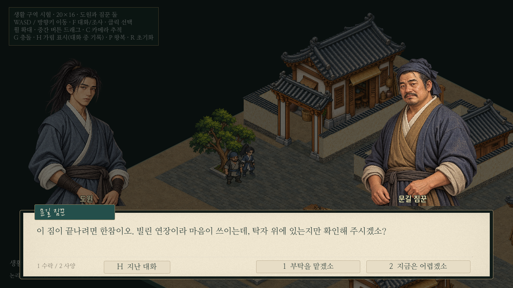
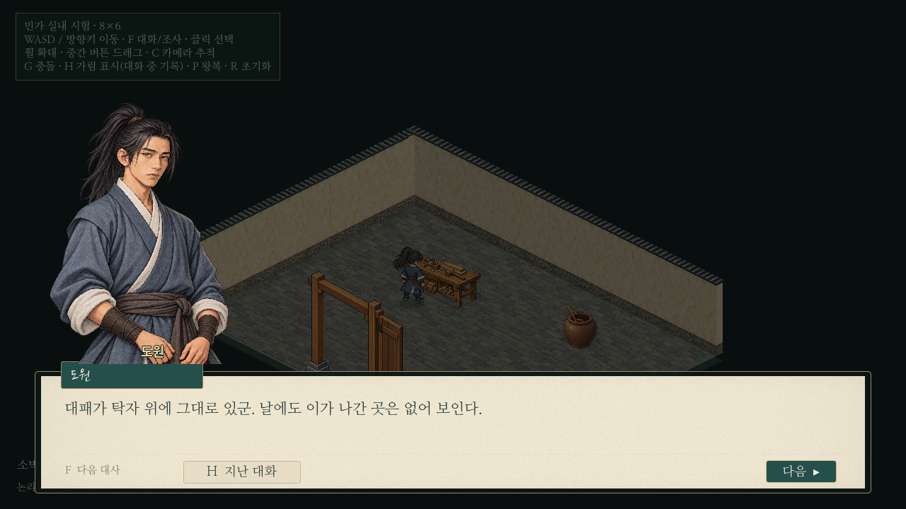

# 아이소메트릭 탐험·대화·출입·시험 의뢰 연결

첫 줄의 이동속도 롤백을 우선 적용했다.20×16 생활 구역과8×6 실내의 도원은 **4.8타일/초로 복원**하고 NPC는4.8을 유지한다. 본문에 남은 도원9.6은 이전 프롬프트 수치로 해석했다. 기존12×12 비교 씬과 공유 이동 코드는 그대로여서 해당 비교 씬의 기존9.6 속도는 바뀌지 않는다.

기존 문길 짐꾼의 「민가에 두고 온 연장」 한 의뢰만 연결했다. 탁자 위에 놓고 온 **대패가 있는지 확인하고 그대로 둔 채 보고**하는 부탁이다. 새 NPC/전투/아이템/보상/저장은 없다. 상태는 시험 씬의 메모리에만 존재한다.



[전체 플레이/화면 확인 페이지](../../godot/prototypes/isometric/screenshots/errand-preview.html) · [수락→이동→조사→보고 실제 영상](../../godot/prototypes/isometric/screenshots/errand-play.mp4) · [Q 의뢰 일지](../../godot/prototypes/isometric/screenshots/errand-journal-active.png)

## 기존 구조와 재사용 범위

| 조사한 기존 코드 | 이번 사용 |
| --- | --- |
| `scripts/levy_quest.gd` 등 지역 의뢰 | available/active/ready/completed, 마지막 대화에서 완료, !/? 표시 규약을 따름. 실제 의뢰 객체와 보상 로직은 생성하지 않음 |
| `scripts/quest_navigation.gd` | 시험 하위 클래스에서 정의1개만 공급하고 원래 track/clear/추적 변경 신호/상태를 재사용 |
| `scripts/adventure_ui.gd` | 실제 지역 의뢰·장비·설정·소리·저장/게임 관리자에 연결돼 전체 인스턴스화하지 않음. Q키와 추적/해제 방식, 공용 종이 UI 컴포넌트를 재사용한 작은 시험 일지 제공 |
| `scripts/exploration_hud.gd` | 기존 NPC 목록/좌표/메타데이터 의존으로 전체 사용하지 않음. 같은 노란 !/? 규약을 시험 씬의 투영 좌표로 표시 |
| 기존 시험 `iso_dialogue.gd`와 공용 대화 컴포넌트 | 하위 클래스에서 선택지/의뢰 단계만 연결. 원래 종이 패널·초상화·비화자 어둡게·배경 어둡게·H 기록과 F 해제 보호를 그대로 사용 |
| 기존 `iso_passage.gd` | 실내/외부 보존 방식을 유지하고 Q 일지가 열렸을 때 출입을 차단하는 연결만 추가 |

본게임 Q 일지의 전체 필터/모든 지역 의뢰 목록, 본게임 좌표용 get_goal의 지역 분기는 재사용하지 않았다. 목표 추적은 시험 의뢰의 단계 안내이며 새 미니맵/지도 경로 안내를 만든 것은 아니다. 본게임 소스·의뢰 정의·보상·저장 데이터는 수정하지 않았다.

## 상태와 대화

| 상태 | 대화/진행 | 표시 |
| --- | --- | --- |
| 수락 가능 | 짐꾼이 바쁜 짐 나르기 때문에 민가의 빌린 대패 확인을 부탁.1수락/2사양 선택 | 노란 ! |
| 사양 | 손이 비면 다시 들러 달라는 한마디 후 수락 가능 유지 | ! 유지 |
| 진행 중 | 민가 안내/연장을 가져오지 말라는 당부. 재대화는 진행 안내 | Q/HUD 현재 목표 |
| 조사 중 | 도원 단독 초상화로 탁자 위 대패와 상태 확인. 마지막 줄 후 보고 가능 | 가까운 앞자리에서 F 조사 |
| 보고 가능 | 방을 나와 문길 짐꾼에게 결과 전달. 실내 재입장해도 조사 상태 유지 | 노란 ? |
| 완료 | 짐꾼이 안심하며 감사. 이후에는 연장을 돌려주겠다는 잡담 | !/? 제거, Q 완료 기록 |

수락/거절은 마지막 질문 뒤 숫자1/2 또는 선택 버튼으로 정한다. F를 계속 눌러서는 선택되지 않는다. 수락 확인/조사/보고는 각각 마지막 대화를 마쳐야 단계가 바뀐다. 어떤 단계에서도 금전·능력치·아이템을 지급하지 않는다.

Q 일지에서 현재 상태와 목표를 확인하고 추적/해제할 수 있다. 추적을 해제해도 진행은 유지한다. 가까운 NPC 대화를 출입보다 우선하고, 조사와 출입은 공간·접근 조건으로 한 번에 하나만 안내한다. 일지/대화 중에는 배경 상호작용을 차단한다. 메뉴/대화의 기존 버튼 조작은 유지하지만 클릭 이동·클릭 대화 진입·클릭 조사는 추가하지 않았다.



[수락 가능 표시](../../godot/prototypes/isometric/screenshots/errand-available.png) · [조사 대상 앞](../../godot/prototypes/isometric/screenshots/errand-investigate-target.png) · [기존 대화 기록](../../godot/prototypes/isometric/screenshots/errand-history.png) · [보고 물음표](../../godot/prototypes/isometric/screenshots/errand-report-marker.png) · [보고 대화](../../godot/prototypes/isometric/screenshots/errand-report-dialogue.png) · [완료 일지](../../godot/prototypes/isometric/screenshots/errand-journal-completed.png)

## 검증

Godot4.6.3과 별도 XDG 폴더에서 이번 변경과 직접 관련된3개 검사를 실행해 모두 PASS했다.

- `isometric_errand.gd`: 실제 F/1/2/Q/H 입력으로 사양→재수락→진행 재대화→조사→재입장→보고→완료 잡담. F 유지/자동 반복으로 선택/단계를 넘기지 않음. 조사 전 조건, 탁자 너머 접근 불가, 원본 가구/충돌 보존, 추적과 진행의 독립성, 완료1회, 새 실행에서 상태 초기화, 일지 중 씬 제거 시 정지 해제 확인.
- `isometric_passage.gd`: 기존 반복 출입/입력 보호·NPC 상태·카메라 복원·가구 충돌 검사 통과. NPC 대화 회귀는 새 의뢰를 담당하지 않는 기존 뒷길 짐꾼으로 확인했다.
- `isometric_district.gd`:4.8 도원/4.8 NPC 실제 이동, 순환 이동/경계·양보·카메라/대화 검사 통과. 순환 입력 시간은 약7.7초다.

기존12×12 파일과 공유 보행/대화·본게임 코드는 Git 변경 목록에 없음을 확인했다. 보류 농지/부두 파일은 이번 커밋에서 제외한다. 전체 공통 검사 묶음을 다시 실행한 것은 아니며, 이번 변경의 회귀3개를 실행했다. 이번 작업은 앞서 지적한 프레임 성능 원인을 프로파일링하거나 최적화한 작업은 아니다.

녹화는1280×720/85%의 실제 입력/렌더 기록이다. 시연 시작 때 짐꾼을 배치하고 왕복을 잠깐 정지해 수락/보고 장면을 보여 준다. 그 이후 도원의 민가 왕복은 실제 이동 입력이며, 평상시 플레이의 NPC 왕복 코드/경로는 유지한다.

## 범위와 남은 사항

도원/짐꾼의 그림·보행, 맵/대문과 원본 초상화는 유지한다. 탁자 조사는 도구나 가구를 제거하지 않는다. 외부 NPC/카메라 보존과 가림 표식도 유지한다. 시험은1의뢰/1지역 연결용이며 본게임의 다중 의뢰·경제·보상·저장에는 연결하지 않는다. Q 일지는 단일 의뢰용이라 본게임의 전체 필터/시설 추적 기능이 없다.

새 실행 시 의뢰는 초기화된다. R은 기존대로 인물 위치를 초기화하며 의뢰 단계는 초기화하지 않는다. 다시 시험하려면 F8로 종료 후 district 씬을 F6으로 실행한다. 실내 단독 실행에는 의뢰를 주는 외부 씬이 없으므로 district에서 시작해야 한다.

## 실행

```powershell
cd C:\Users\PC\murim-rpg
git pull --ff-only
Start-Process .\godot\prototypes\isometric\screenshots\errand-preview.html
```

Godot에서 `C:\Users\PC\murim-rpg\godot\prototypes\isometric\district.tscn` / `res://prototypes/isometric/district.tscn`을 열고 **F6**. 노란 !가 있는 문길 짐꾼에게 F. 민가 문 앞은 약(14.61,11.56), 실내 탁자 앞 조사 지점은 약(2.7,2.8)이다. Q 일지, H 대화 기록, WASD/방향키 이동, F 대화/출입/조사,1/2 수락/사양이다. F5는 본게임이다.

```sh
godot --headless --fixed-fps 60 --path godot --script res://tests/isometric_errand.gd
godot --path godot --audio-driver Dummy --fixed-fps 30 --write-movie /tmp/iso-errand.avi --script res://tests/capture_isometric_errand.gd
```
