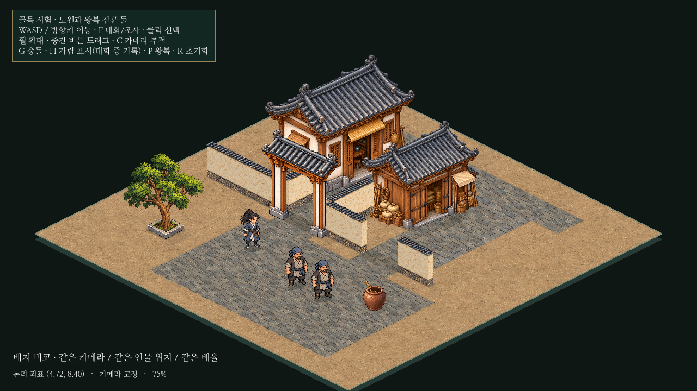

# 아이소메트릭 보행과 건물 진입 동선 보충

후속 [건물 방향·마당 경계 정정](isometric-orientation.md)이 최신이다. 사용자는 뒤 우회 통로 대신 건물 방향을 바꾸고 소속 마당을 담장으로 구분하도록 정정했다. 아래 창고 하역 출입구 배치는 이전 단계 기록이다. 보행 구현은 유지한다.

독립 골목 시험에서 보행과 창고 앞 공간을 보충했다. 도원/두 짐꾼의 속도4.8논리 타일/초,96표시 높이, 원본 그림, 기존 건물 좌표, 중앙 대문/골목 폭과 NPC 왕복 경로는 유지한다. 본게임·도시·진행·저장·공용 대화 코드는 변경하지 않았다. 중단한 농지/부두 변경도 보존했다.



[전후/보행 확인 페이지](../../godot/prototypes/isometric/screenshots/gait-access-preview.html) · [실제11.8초 영상](../../godot/prototypes/isometric/screenshots/gait-access-play.mp4) · [변경 전](../../godot/prototypes/isometric/screenshots/gait-access-before-overview.png) · [문 앞 이동](../../godot/prototypes/isometric/screenshots/gait-access-warehouse-door.png) · [G키 접근 경로](../../godot/prototypes/isometric/screenshots/gait-access-routes.png)

## 보행

기존 앞/뒤 PNG와 좌우 반전을 재사용한다. 새로운8장짜리 원화를 그린 방식은 아니다. 원본 그림에 골반/무릎/발과 어깨/팔꿈치/손의 기준점을 등록하고, 관절 계산과 메시 변형으로 연속 보행을 만든다. 확인 페이지의8장은 한 주기의 대표 자세를 실제 렌더링한 비교 화면이다.

- 지지하는 발은 바닥 이동 궤적을 유지하고 반대 발을 들어 무릎을 굽힌다. 골반과 상체도 함께 오르내린다.
- 팔은 같은 쪽 다리와 반대 위상으로 흔든다. 머리는 몸통과 함께 평행 이동하며 배율을 바꾸지 않는다.
- 앞/뒤와 좌우 반전의4방향, 정지 방향 유지, 발밑 물리 기준점과 크기96을 유지한다.
- 과한 들썩임을 줄이기 위해 최종 보폭을 표시 높이의4%, 발 들기를4.5%, 팔 진폭을0.28라디안으로 조정했다. 논리 이동 속도와 주기 산출 방식은 바꾸지 않았다.
- 이전 검사의 ‘상체 픽셀이 전혀 변하지 않음’은 이번 요구와 충돌하므로 ‘머리/사지 길이와 배율은 고정하되 상하 이동함’으로 수정했다.

## 문과 길의 관계

창고 문은 중앙의 좁은 골목 반대편 면을 향하고 있었다. 원화를 억지로 회전하지 않고 **현재 보이는 문 쪽에 하역 마당을 만들고 앞 담장에 별도 출입구를 열어 공용 마당과 연결**했다. 기존 건물/중앙 대문을 옮기지 않았으며 실내나 입장 기능도 추가하지 않았다.

민가와 창고 모두 실제 문 그림의 기준점, 바닥 문턱, 문을 향한 접근 지점, 앞마당, 공용 길부터 이어지는 경로를 데이터로 등록했다. 새 하역 출입구는 논리 폭1.4다. 녹색 경로와 문 앞 공간은 G키로 확인한다.

앞으로 모든 새/변경 건물 배치는 [건물 배치·진입 규칙](../cities/building-placement.md)을 따른다. 실내가 없는 건물에도 동일하게 적용한다. 이 작업에서 기존 본게임 도시 전체를 재배치하거나 검사한 것은 아니다.

## 검증

Godot4.6.3에서 사용자 저장과 분리한 XDG 폴더로 실행했다.

| 검사 | 결과 |
| --- | --- |
| `isometric_prototype.gd` | PASS: 투영/기본 배치·선택·깊이/카메라 |
| `isometric_alley.gd` | PASS: 중앙 문·골목 통행, 기둥/건물 차단, 가림 |
| `isometric_walkers.gd` | PASS:4방향8단계, 접촉/양보/왕복,3,640프레임 간격 검사; 최소 인물 간격0.29978타일 |
| `isometric_harmony.gd` | PASS: 기존 그림/크기·속도·접지/그림자·본게임 입구 유지 |
| `isometric_walk_render.gd` | PASS: 실제 앞/뒤/반전 렌더에서 몸통·무릎/발·팔의 변화와 배율 고정 |
| `isometric_dialogue.gd` | PASS: 접근 가능한 한 명 선택, F 진입/종료, 참여자 정지/재개, 기록, 중복 입력 방지·W+D 정지 방향 |
| `isometric_gait_access.gd` | PASS: 실제 입력으로 두 문턱까지 이동; 관절/지지 발·팔 반대 위상·8자세·고정 속도, 문 정보 누락/방향 반대/기준점 불일치/출입구 봉쇄를 실패로 검출 |

몸통 상하 이동 범위는96표시 높이에서 도원 앞3.55/뒤3.11픽셀, 짐꾼 앞4.24/뒤4.19픽셀이다. 무릎 굽힘과 팔 반대 위상을 수치 검사했고, 실제 단계2/6 및 앞/뒤 화면에서 교차 자세와 원본 복식 유지도 확인했다.

전후 전체 화면은1280×720, 카메라(0,290), 배율75%, 같은 인물 위치다. 보행 비교는125% 카메라에서 세 인물을 같은 바닥 깊이에 놓고 촬영했다. 영상 앞부분은 실제 입력으로 출입구를 통과하며, 뒤쪽은 움직임을 살펴보기 위한 느린 제자리 자세 재생이다. 실제 이동 속도를 낮춘 영상으로 오해하지 않도록 화면에 구분했다.

## 남은 한계

- 원본 한 장의 관절 변형이므로 다리 앞뒤에 가려져 원래 보이지 않던 옷감/팔 부분을 새로 그려 주지는 못한다. 큰 팔동작·달리기나 확대 시 옷자락의 변형은 추가 원화가 더 적합하다. 현재 주기에서 크기/시점이 어울리는지는 사용자 플레이 판단도 필요하다.
- 정지할 때는 원래 대기 그림으로 즉시 복귀한다. 출발/정지 전용 연결 원화나 머리카락/옷감 물리 시뮬레이션은 없다.
- 접근 검사는 작은 시험의 단층 건물과 포장 데이터용이다. 다층 건물·계단·대도시 수십 명 성능과 범용 길찾기는 아직 검증하지 않았다.
- 창고 문 그림 앞의 여유 공간과 실제 바닥 충돌은 연결했지만 실내 입장은 제공하지 않는다.

## 실행/재현

PowerShell:

```powershell
cd C:\Users\PC\murim-rpg
git pull --ff-only
Start-Process .\godot\prototypes\isometric\screenshots\gait-access-preview.html
```

Godot에서 `C:\Users\PC\murim-rpg\godot\prototypes\isometric\main.tscn` / `res://prototypes/isometric/main.tscn`을 열고 **F6**. F5는 본게임이다. WASD/방향키 이동, F 대화, G 충돌/접근 동선, P 자동 왕복 정지/재개다.

```sh
godot --headless --fixed-fps 60 --path godot --script res://tests/isometric_gait_access.gd
godot --path godot --audio-driver Dummy --script res://tests/isometric_walk_render.gd
godot --path godot --audio-driver Dummy --fixed-fps 30 --write-movie /tmp/gait-access.avi --script res://tests/capture_gait_access.gd
```

전후 중 ‘변경 전’은 작업 시작 시 원래 배치로 별도 촬영해 보존했다. 현재 촬영 스크립트는 변경 후 화면/자세만 갱신하며 이전 화면을 덮어쓰지 않는다.
