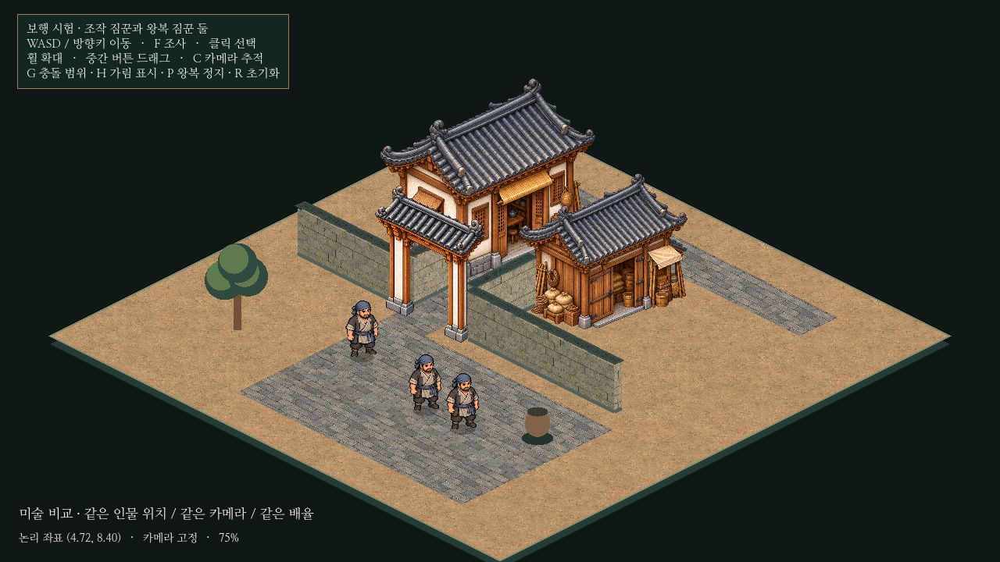
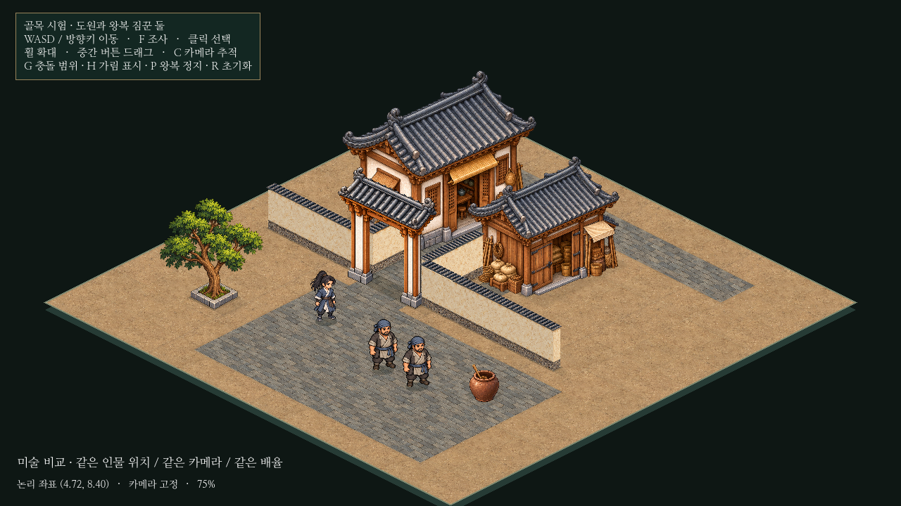
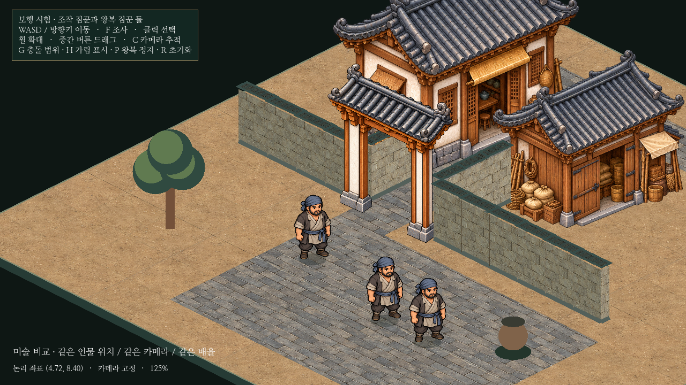
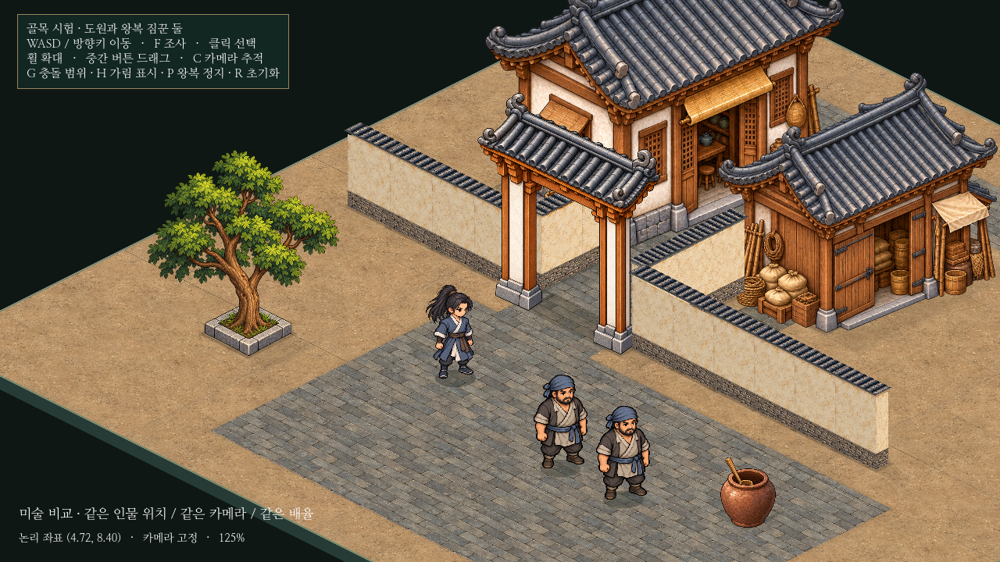
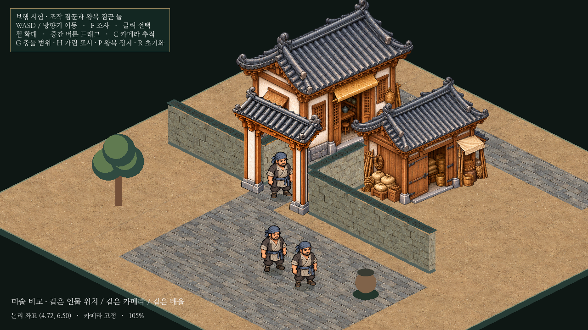
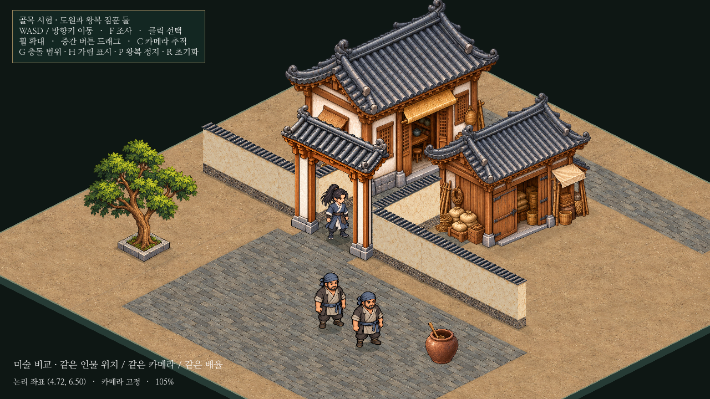

# 아이소메트릭 도원·배경 미술 조화 검증

이 문서는4단계 미술 기록이다. 최신 F 상호작용/공용 대화 연결과 정지 방향 보정은 [5단계 보고서](isometric-dialogue.md)를 따른다. 미술·배치·속도는 유지했다.

기존 독립 골목에서 조작 인물만 도원으로 바꾸고 담장/나무/항아리와 바닥 접지를 정리했다. **본게임·건물 배치·통로 폭·충돌·자동 NPC2명의 경로와 속도는 유지한다.** 전체 도시로 확대하지 않았다.

[나란히 비교하는 로컬 페이지](../../godot/prototypes/isometric/screenshots/harmony-comparison.html) · [실제 Godot 보행 영상13.6초](../../godot/prototypes/isometric/screenshots/harmony-walk.mp4)

| 같은 실제 카메라 | 변경 전 | 변경 후 |
| --- | --- | --- |
| 전체75% |  |  |
| 근접125% |  |  |
| 대문105% |  |  |

## 도원과 보행

현재 [초상화](../../godot/assets/portraits/player/hero.png), [탐험 원본](../../godot/assets/animation/hero_walk_unarmed.png), [전투 원본](../../godot/assets/battle/premium/hero-jade-poses.png)과 [실제 전투 표시](../../godot/screenshots/player-appearance-battle.png)를 확인했다. 전투 원본의 녹색/붉은 띠는 런타임 색 보정 전 자료이므로 그대로 전용하지 않았다.

삿갓 없는 검은 포니테일·회청색 무복·흰 깃/소매·갈색 천 허리띠·어두운 손목 보호구의 새 앞/뒤 대각선 그림을 시험 폴더에 추가했다. 같은 짐꾼 원본을 화풍/비율 기준으로 참조했고 현실적인 초상화는 외형 정보로만 사용했다. 이름/선택/가림 표시는 도원이다.

기존96화면 단위 높이와4.8논리 타일/초를 유지했다. NPC2명은 원본 그림, 기본 다리 변형 설정과4.8속도를 그대로 사용한다. 도원은 같은 보행 메시를 사용하되 다리 변형 시작점을 그림 높이의80%로 낮춰 허리띠/상부 옷자락을 보호하고 발 이동 폭도 조금 줄였다. 앞/뒤/좌우 반전의 전체 스케일과 발밑 기준점은 고정한다.

## 담장·장식·접지

민가/창고/대문 PNG와 위치를 유지했다. 담장은 같은78높이/기존15개 충돌 구간 위에 새 회벽·회색 기단·청회색 기와 재질을 투영한다. 실제 등축 면이므로 그림을 사선으로 회전하거나 한 축만 늘리지 않는다. 내부 구간의 끝면과 불필요한 이음선을 줄였다.

도형 나무/항아리를 원본 그림으로 교체했다. 나무의 낮은 사각 석제 테두리는 기존0.7×0.7타일 점유 범위에 맞추고, 항아리도 기존0.45×0.45부지에 기준점과 배율을 등록했다. 잎이나 항아리 전체 이미지 사각형을 새로운 충돌로 쓰지 않는다. 새 원본은 픽셀 수정 없이 복사하고 영역/발밑/해시/참조를 manifest에 기록했다.

바닥은 기존 재질을 유지하면서 지정한 포장 사각형을 연속으로 그려 골목의 실제 폭과 맞췄다. 문턱과 기단 주변에 낮은 포장/접촉선을 추가했고, 모든 정적 오브젝트의 그림자는 같은 화면 방향(1,0.65)으로 투영한다. 그림자/접촉은 전용 바닥 노드에만 그리며 **모든 인물/건물 정렬층보다 먼저** 렌더한다. 새 충돌은 없다.

[실제 충돌 표시](../../godot/prototypes/isometric/screenshots/harmony-after-collision.png) · [1440p](../../godot/prototypes/isometric/screenshots/harmony-after-1440p.png) · [보행 접지1](../../godot/prototypes/isometric/screenshots/harmony-after-step-1.png) · [반대 접지3](../../godot/prototypes/isometric/screenshots/harmony-after-step-3.png)

## 검증과 비교 조건

Godot4.6.3/Linux, 분리된 XDG 사용자 폴더를 사용했다. 실제 렌더는 소프트웨어 OpenGL이며 Windows/GPU 성능은 미확인이다.

| 검사 | 결과 |
| --- | --- |
| `isometric_prototype.gd` | PASS. 기존 투영·건물 앞뒤/옆·물리 충돌·카메라·선택·시작 씬 유지. |
| `isometric_alley.gd` | PASS. 기존 속도·대문 왕복·기둥 접촉/관통 방지·가림. |
| `isometric_walkers.gd` | PASS. 자동 NPC 왕복/양보/재개·인물 물리 충돌·여러 이름표/정렬. 3,640프레임, 최소 인물 간 거리 약0.2998타일, 정렬 순환0. |
| `isometric_walk_render.gd` | PASS. 실제4방향의 정지/보행 상체 및 허리띠·상부 옷자락 검사 영역 픽셀 차이0개, 양발 반대 접지의 발 주변 픽셀 차이565~595개. |
| `isometric_harmony.gd` | PASS. 도원/이름표/전용 그림·96높이, NPC 원본/속도/보행 유지, 장식 기준점/충돌, 바닥 그림자 순서와 의상 보호. |
| `capture_isometric_harmony.gd` | PASS. 변경 전3장/변경 후12장, 보행 영상13.6초와 카메라 기록 생성. |

변경 전은 이번 작업 시작 상태인 `58b86bc`에서 **실제 촬영한 화면**이다. 사진을 편집해 만든 이전 모습이 아니다. 같은 캡처 절차로 인물 물리를 정지시키고 위치/카메라를 고정했다. `harmony-before-camera.json`과 `harmony-after-camera.json`의3개 비교 화면은 카메라·배율·화면 크기·세 인물 좌표·속도 배열이 완전히 같다. `layout.json` 해시도 작업 전과 일치한다. 기존 중단 작업의 파일 해시도 그대로다.

최신 코드에서 `--before`로 실행하면 역사 자료를 덮어쓰지 않고 거부한다. 과거 화면을 다시 만들려면 별도 체크아웃의 기준 커밋에 이 전용 캡처만 복사해야 한다. 기본 실행은 최신 변경 후 자료만 갱신한다.

영상은 실제 Godot 렌더 기록이다. 초반3개 비교 구도/후반 보행 단계는 정지 배치, 중간 이동/왕복은 입력과 물리 처리로 진행한다. 영상의30fps는 기록 속도이며 실기기 성능 보장은 아니다.

## 화면 평가와 남은 문제

실제75%/125% 카메라에서 도원은 짐꾼과 비슷한 키지만 더 가는 체형이며, 청색 복장으로 구분된다. 초상화의 현실적인 비율을 그대로 옮긴 느낌은 없고 민가/창고/대문과 같은 화면에 놓을 수 있는 수준으로 판단한다. 현재 비율을 후속 검증 기준으로 삼을 만하다. 이 평가는 미술 검토이며 최종 선호는 사용자의 화면 확인이 필요하다.

- 보행은 기존 그림의 다리 변형이다. 방향별 손그림 보행이나 머리카락/소매의 독립 애니메이션은 없고 크게 확대하면 신발 변형이 보일 수 있다.
- 그림자는 바닥 점유 형태 기반의 정적 근사다. 나뭇잎/지붕 실루엣을 정확히 투사하거나 광원이 변하는 시스템은 아니다.
- 원본 건물 이미지와 사각 바닥의 옆면/처마 대응은 기존 수준이다. 비정형 건물·계단·층고·실내는 추가 검증이 필요하다.
- NPC3명과 작은 골목의 검증 결과다. 도시 규모의 길찾기·군중 병목·성능은 확인하지 않았다.

## 업데이트와 실행

```powershell
cd C:\Users\PC\murim-rpg
git pull --ff-only
```

변경 전후와 영상을 한 화면에서 보려면:

```powershell
Start-Process .\godot\prototypes\isometric\screenshots\harmony-comparison.html
```

Godot의 기존 `godot/project.godot` 프로젝트에서 `res://prototypes/isometric/main.tscn`을 열고 **F6**. 실제 파일은 `C:\Users\PC\murim-rpg\godot\prototypes\isometric\main.tscn`이다. P는 자동 NPC 정지/재개, H는 가림 표시, G는 충돌 표시, R은 초기화다. 본게임 시작 F5는 유지한다.
