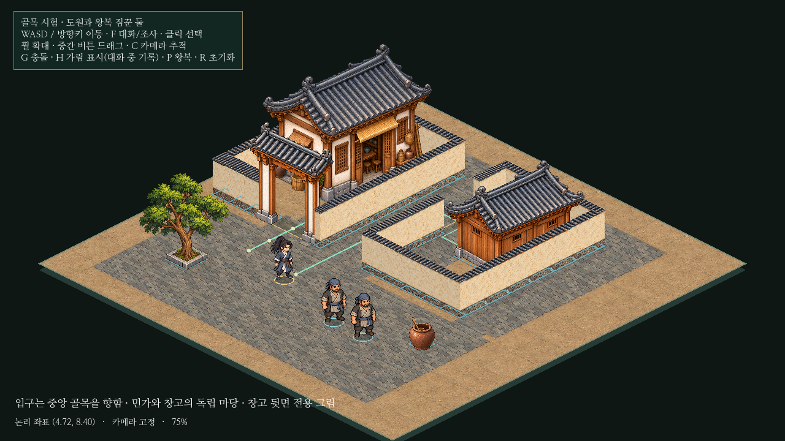

# 아이소메트릭 건물 방향·마당 경계 정정

이전 창고 뒤 우회 통로 방식은 사용자의 의도와 달랐다. 이번에는 **창고 입구 자체를 중앙 골목 쪽으로 돌리고**, 그 방향에서 카메라에 보이는 창고 뒷면을 새로 그려 적용했다. 담장도 각 건물의 독립 마당 경계로 다시 구성했다.


[전후·이동 확인 페이지](../../godot/prototypes/isometric/screenshots/orientation-preview.html) · [변경 전](../../godot/prototypes/isometric/screenshots/orientation-before.png) · [마당 경계](../../godot/prototypes/isometric/screenshots/orientation-boundaries.png) · [실제 이동 영상7.5초](../../godot/prototypes/isometric/screenshots/orientation-play.mp4)

## 변경한 배치

- 창고: `warehouse-back.png`는 기존 창고를 참조해 제작한 별도 후면 그림이다. 단순 좌우 반전이나 원본 평면 회전이 아니다. 문은 중앙 골목을 향하는 `-u`면에 있고 카메라에서는 건물에 가려진다. 보이는 후면에는 출입문을 복제하지 않았다. 숨은 정면 문 위치는 바닥 데이터로 등록했다.
- 민가: 중앙 골목을 향하는 기존 정면을 유지하며 왼쪽으로 옮겼다. 대문도 해당 마당 남쪽으로 옮겨 건물과 외부를 구분했다.
- 담장: 민가와 창고에 각각 마당 영역과 소유 ID를 지정했다. 경계를 연결하고 민가 남쪽 대문과 창고 서쪽 골목 출입구만 열었다. 이전 창고 뒤쪽 우회 출입구와 무소속 담장을 없앴다.
- 공용 공간: 두 마당 사이의 중앙 골목과 바깥 앞마당/뒷길은 공공 보행 공간으로 남겼다. 중앙 골목 폭1.4, 민가 대문1.15, 창고 마당 출입구1.2논리 타일이다.
- 인물: 도원/짐꾼의 그림·크기·보행·속도4.8은 변경하지 않았다. 두 자동 NPC의 왕복 경로만 새 마당/외곽 경계에 맞춰 수정했다. NPC 수/짧은 대화/입력 방식은 같다.



G키에서 황토색 마당 외곽, 실제 담장/기둥 충돌과 녹색 문 앞 동선을 본다. 숨은 창고 문까지 다가가면 기존 가림 이름표가 도원의 위치를 알려 준다. 실내나 문 열기/입장 기능은 추가하지 않았다.

## 이후의 배치 규칙

[건물 방향과 마당 경계 규칙](../cities/building-placement.md)을 수정하고 `godot/AGENTS.md`에 기록했다. **길을 향하는 건물 정면을 먼저 정하며, 담장은 소속 마당의 외곽을 구분하고 출입을 막지 않는다.** 실내가 없는 건물도 예외가 아니다. 기존 본게임 도시를 소급 재배치한 것은 아니다.

`layout.json`은 건물의 실제 정면/향하는 도로/문턱, 마당 영역/출입구와 건물·담장·대문의 소속을 등록한다. 검사기는 기존 접근성 검사에 다음을 추가했다.

1. 에셋 정면과 입구 방향이 일치하고 문이 도로를 향하는지.
2. 가려진 정면에는 후면 에셋이 쓰이며 문턱이 건물의 실제 정면 쪽에 있는지.
3. 담장에 소속 마당이 있고 해당 마당의 외곽 경계를 이루는지.
4. 건물/문 앞 공간이 소속 마당 안에 있고, 선언된 출입구 외에 경계 끊김이 없는지.

## 검증과 한계

Godot4.6.3, 별도 XDG 사용자 폴더에서 기존7검사를 다시 실행했다. `isometric_prototype`, `isometric_alley`, `isometric_walkers`, `isometric_harmony`, `isometric_walk_render`, `isometric_dialogue`, `isometric_gait_access` 모두 PASS다. 배치가 달라진 검사의 실제 문/기둥/대화/가림 위치를 새 좌표에 맞췄다.

실제 키보드 입력으로 중앙 골목→창고 마당→가려진 정면 문, 외부 앞마당→민가 대문→민가 문턱까지 이동했다.3,640프레임의 인물/건물 간격 검사에서 최소 인물 간격0.29978타일을 유지했고 왕복/양보·깊이 정렬·F 대화도 확인했다. 잘못된 방향/문 위치/막힌 입구/담장 소속 누락/경계 끊김을 실패로 검출했다.

전후 전체 화면은1280×720, 카메라(0,290), 배율75%, 동일 인물 배치다. 이후 문 앞 캡처는 실제 이동 도착 상태다. 기존 본게임 소스와 중단한 농지/부두 변경은 해시로 그대로임을 확인했다.

후면 그림에 가려지는 창고 정면 문을 카메라에서 직접 볼 수는 없다. 이번 범위에서는 G 경로와 기존 인물 가림 표식으로 위치를 확인한다. 실내·자동 지붕 투명화·비정형 마당·다층 구조·대규모 도시 성능은 검증 범위 밖이다.

## 실행

```powershell
cd C:\Users\PC\murim-rpg
git pull --ff-only
Start-Process .\godot\prototypes\isometric\screenshots\orientation-preview.html
```

Godot에서 `res://prototypes/isometric/main.tscn`을 열고 **F6**. 실제 파일은 `C:\Users\PC\murim-rpg\godot\prototypes\isometric\main.tscn`이다. F5는 기존 본게임이다.

```sh
godot --headless --fixed-fps 60 --path godot --script res://tests/isometric_gait_access.gd
godot --path godot --audio-driver Dummy --fixed-fps 30 --write-movie /tmp/iso-orientation.avi --script res://tests/capture_isometric_orientation.gd
```
