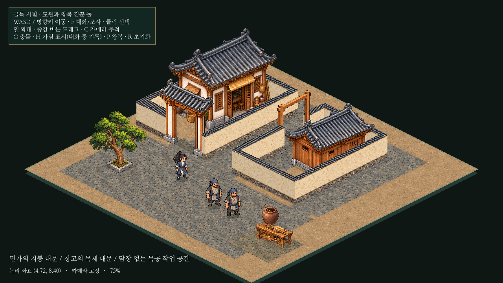
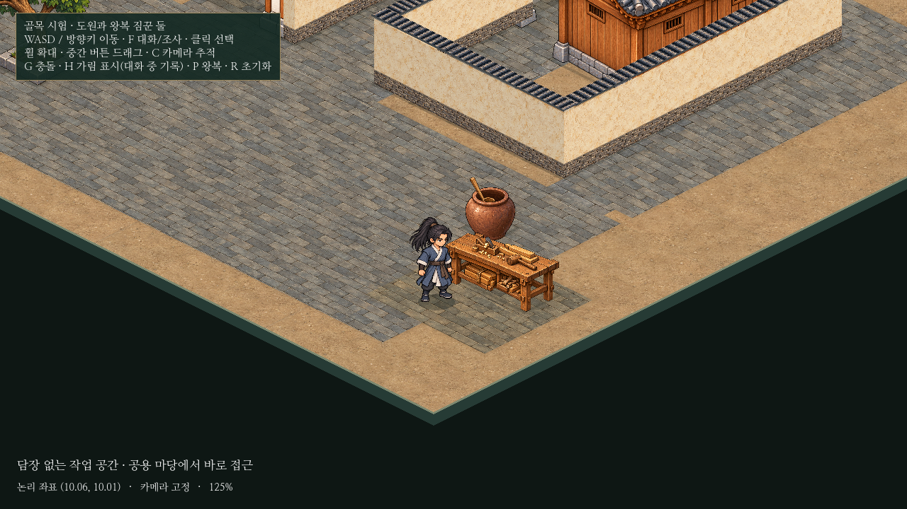

# 아이소메트릭 외부 공간·담장·대문 시험

독립 골목에서 민가의 지붕 대문, 창고의 소박한 목제 문틀 대문, 담장 없는 목공 작업 공간을 비교한다. **모든 건물에 마당/담장을 요구하지 않도록 규칙과 검사도 정정했다.** 기존12×12 바닥과 건물/인물 배치, 도원/짐꾼 그림·크기·보행·속도4.8, 자동 경로와 F 대화는 유지한다.



[전후·영상 확인 페이지](../../godot/prototypes/isometric/screenshots/spaces-preview.html) · [변경 전](../../godot/prototypes/isometric/screenshots/spaces-before.png) · [대문 통과5.2초 영상](../../godot/prototypes/isometric/screenshots/spaces-play.mp4) · [마당/충돌 경계](../../godot/prototypes/isometric/screenshots/spaces-boundaries.png)

## 미술과 배치

- 민가의 기존 지붕 대문은 유지한다. 창고 출입구에는 해당 방향으로 새로 그린 `warehouse-gate.png`를 추가했다. 두 목제 기둥과 석재 주초, 윗보가 열린 통로를 명확하게 표시하며 지붕/문짝은 없는 문틀형이다.
- 창고 문틀은 실제 기둥 발밑 두 곳과 원본 그림의 대응 좌표를 맞춰 균일 배율로 배치한다. 정면 대문 그림의 평면 회전/비균등 확대는 사용하지 않았다. 수작업풍 그림의 작은 차이는 두 기준점 사이에 나누며 오차4월드 픽셀 이내를 검사한다.
- 기존 창고 담장의 출입구 폭1.2와 민가 대문 폭1.15는 유지한다. 새 기둥의 발밑 충돌은 출입구 양 끝의 기존 담장과 맞물리고 가운데는 열린다. 윗보는 문 아래 인물보다 앞에 그려진다.
- 새 `open-workbench.png`는 대패/망치/각재가 있는 작은 작업대다. 앞마당 오른쪽의 빈 공간에만 추가했고 새 건물이나 담장은 만들지 않았다. 옅은 작업 바닥과 빈 앞자리로 공용 길과 작업 범위를 구분한다.
- 문 열기/닫기 애니메이션과 실내 입장은 이번 범위에 없다. 문짝이 없는 대문이므로 닫힌 문을 통과시키는 구현도 없다.



## 코드와 규칙

`layout.json`에 창고 대문/기둥 충돌/열린 통로, 작업대/담장 없는 외부 공간을 추가했다. `iso_prop.gd`는 새 대문의 두 기둥 원본 기준점을 대응시키고, `iso_grounding.gd`는 열린 작업 구역을 바닥층에 표현한다.

`iso_access_rules.gd`는 건물의 마당 소속을 선택 사항으로 바꿨다. 담장 마당을 명시한 경우에만 소유/경계를 검사한다. 담장 출입구마다 실제 대문 그림과 기둥 충돌을 요구하고, 빈 통로의 통행 및 열린 작업 공간의 접근도 검사한다. 규칙은 [공통 배치 문서](../cities/building-placement.md)와 `godot/AGENTS.md`에 반영했다.

본게임·실제 저장·이야기·의뢰·전투와 기존 인물 소스/원본/경로는 변경하지 않았다. 이전에 중단한 농지/부두 변경도 별도로 보존했다.

## 검증

Godot4.6.3, 별도 XDG 사용자 폴더에서 기존7검사와 새 `isometric_outdoor_spaces.gd`를 실행해 **8개 모두 PASS**했다.

- 실제 키보드 입력으로 두 대문을 양방향 통과하고 기둥 쪽으로 이동했을 때 충돌/비관통을 확인했다. 문틀 아래와 문 앞의 실제 깊이 순서도 검사했다.
- 출입구의 대문 오브젝트를 제외하면 ‘문 미술 없음’을 검출한다. 담장 없는 건물 데이터는 마당 없이 통과하며, 담장을 명시하고 소유 마당이 없으면 실패한다.
- 공용 앞마당에서 작업대의 빈 앞자리까지 직접 걸어갔다. 작업 공간의 주변에 담장을 요구하지 않는다.
- 기존 왕복/양보 검사의3,640프레임 동안 최소 인물 간격0.29978타일을 유지했다. 충돌/깊이 정렬·가림 표식·선택·F 대화·기록·종료 입력 보호도 통과했다.
- 보행/인물 속도와 원본·경로 및 본게임 소스/중단한 작업 파일은 변경 전 해시/데이터와 비교해 동일함을 확인했다.

전후 전체 화면은1280×720, 카메라(0,290), 배율75%, 같은 인물 위치다. 대문 통과/작업대 근접 화면은125%로 별도 촬영했다. 영상은 시험 위치에 인물을 배치한 뒤 실제 입력으로 움직이며, 구역별 시험 사이에는 위치/카메라를 바꾼다. 바뀐 배치를 하나의 이동 경로처럼 꾸민 영상이 아니다.

남은 사항: 창고 정면 문은 계속 건물에 가려지므로 기존 가림 표시를 사용한다. 자동 문 개폐/실내·작업대 제작/거래·큰 도시 성능/비정형 대지는 미구현 또는 미검증이다. 이번 열린 공간은 작업대 사례이며 실제 점포 건물의 다양한 형태는 추가 검증 대상이다.

## 실행과 업데이트

```powershell
cd C:\Users\PC\murim-rpg
git pull --ff-only
Start-Process .\godot\prototypes\isometric\screenshots\spaces-preview.html
```

Godot에서 `res://prototypes/isometric/main.tscn`을 열고 **F6**. 실제 파일은 `C:\Users\PC\murim-rpg\godot\prototypes\isometric\main.tscn`이다. F5는 본게임이다. G키로 충돌/마당 경계/열린 작업 구역, F로 NPC 대화, P로 자동 왕복 정지/재개를 확인한다.
