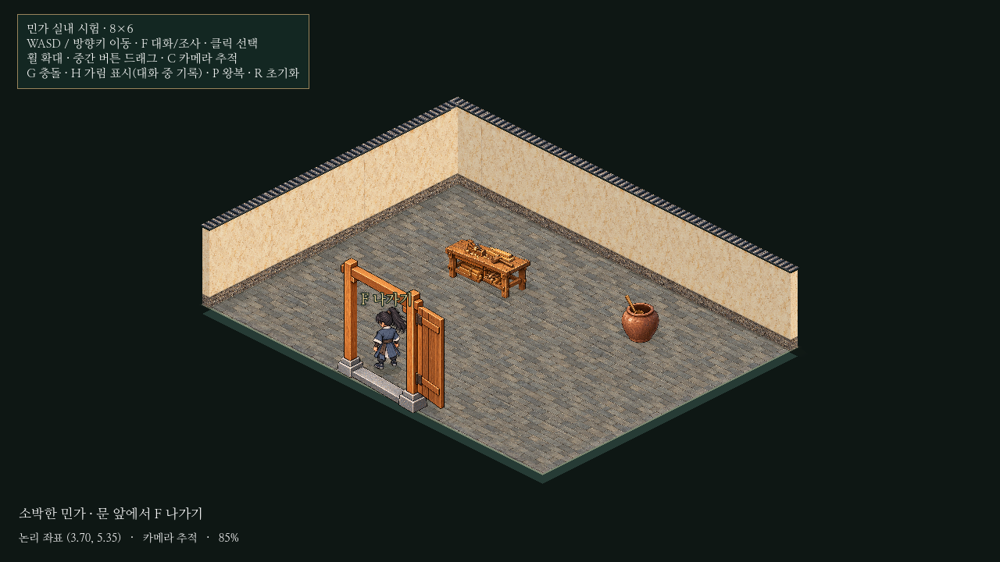

# 아이소메트릭 민가 출입·8×6 실내 시험

20×16 생활 구역의 **담장 없는 민가 `lane_house` 한 동만** F로 출입 가능하게 연결했다. 별도8×6 실내 씬을 추가했고 기존12×12 씬/배치·공유 보행/대화 코드·본게임·실제 저장은 변경하지 않았다. 도원9.6타일/초, 외부 NPC2명4.8타일/초와 기존 대문 디자인을 유지한다.



[화면·영상 확인 페이지](../../godot/prototypes/isometric/screenshots/passage-preview.html) · [약4.8초 실제 출입/복귀 영상](../../godot/prototypes/isometric/screenshots/passage-play.mp4) · [외부 문 앞](../../godot/prototypes/isometric/screenshots/passage-outside.png) · [복귀](../../godot/prototypes/isometric/screenshots/passage-returned.png)

## 구현과 재사용

- `district.tscn`만 얇은 `iso_district_world.gd` 하위 스크립트로 연결한다. 기존 `iso_world.gd`를 그대로 실행한 뒤 시험용 출입 제어를 붙인다. `district-layout.json`에서는 해당 민가의 `entrance.interior`만 실내 씬으로 연결한다.
- `iso_passage.gd`가 앞쪽/거리/옆 범위/세 발밑 광선으로 출입 접근을 확인한다. 접근 가능한 NPC가 있으면 기존 대화를 우선해 F 대상 하나만 표시한다. 클릭은 기존 선택 용도이며 출입을 시작하지 않는다.
- 외부 씬을 삭제하지 않는다. 실내 체류 동안 외부 처리/충돌/표시를 비활성화하고 별도 형제 실내 씬을 활성화한다. 외부 NPC 위치·보행 위상·왕복 인덱스/방향·대기/양보 상태가 그대로 남는다. 실내에서 외부 충돌도 제거되는지 실제 외부 담장 좌표를 대조해 검사했다.
- 각 전환은0.16초 암전→전환→0.16초 밝아짐이다. 전환 중 입력과 이동을 차단하고, F 해제/재입력을 요구하며 이동 키도 중립 입력 후 새 입력을 받는다.
- 복귀 시 같은 외부 인스턴스의 민가 접근 지점에 도원을 배치하고 문 바깥을 보게 한다. 외부 카메라의 배율/수동 위치/추적 설정과 원래 NPC 왕복 활성 상태를 복원한다.
- `room.tscn`/`room-layout.json`은48논리 칸이다. 기존 바닥·회벽/기단 재질, 작업 탁자와 수납 항아리를 재사용했다. 실내 출입문만 기존 목제 미술을 참조해 새로 제작하고 별도 `room-art.json`으로 등록했다. 바깥 두 대문의 미술/에셋 목록은 그대로다.
- 실내 뒤쪽 회벽은 높이를 가진 분할 오브젝트이고 앞쪽 벽은 시야를 위해 생략했다. 문기둥과 열린 문짝 쪽, 가구에 발밑 충돌을 두고 중앙 문 통로는 비웠다. 깊이 정렬/인물 크기/보행/가림 표식/카메라는 기존 구현을 재사용한다.

[탁자 뒤](../../godot/prototypes/isometric/screenshots/passage-behind-table.png) · [탁자 앞](../../godot/prototypes/isometric/screenshots/passage-front-table.png) · [실내 출구](../../godot/prototypes/isometric/screenshots/passage-exit.png) · [재입장](../../godot/prototypes/isometric/screenshots/passage-second-entry.png)

## 검증

Godot4.6.3과 분리한 XDG 사용자 폴더에서 **기존9검사+새 출입1검사 모두 PASS**했다. 기존 검사: 투영/선택, 골목/대문, 보행/양보, 미술 조화, 렌더 자세, 대화/기록, 문 앞 접근, 열린 공간,20×16/카메라다.

새 `isometric_passage.gd`는 다음을 확인한다.

- 뒤/옆/먼 곳에서 진입 불가, 앞 접근 시 F 안내, NPC와 겹칠 때 대화만 진입.
-3회 연속 왕복, F 누름 유지/반복 입력으로 재출입하지 않음, W를 누른 채로 전환해도 인물이 이동하지 않음.
- 매 출입의 외부 NPC 인스턴스·위치·보행 위상과 모든 왕복/대기/양보 값 보존, 복귀 후 실제 왕복 재개.
- 외부 처리/충돌의 분리, 복귀 지점 안전성과 방향, 수동 카메라/배율/추적 상태 복원.
- 실제 입력 이동이 탁자에 막힘, 탁자 앞뒤 정렬, 출입문에 가려질 때 기존 위치 표식 표시.
- 실내에 있는 채 외부 시험 씬을 제거해도 실내/입력 설정이 남지 않음.

위치 비교의 약0.000001타일 차이는 투영/역투영의 부동소수점 오차였다. 검사 허용치는0.001타일이며 실제 이동 키 누출은 확인되지 않았다. 영상은1280×720/기본85%의 실제 렌더와 입력 기록이다. 출입문까지 접근한 뒤 두 번 왕복하며 별도 시안 합성은 없다.

## 조작감 평가와 남은 사항

녹화/수치 기준으로 도원 속도9.6이면 방의6타일 한 변을 약0.63초,8타일을 약0.83초에 지난다. 가구 주변의 짧은 이동은 빠르게 느껴질 수 있다. 카메라는 작은 맵의 가로축을 가운데에 두고 세로로 소폭 추적하므로 큰 패닝은 적지만, 정밀 조작의 편안함은 실제 플레이 평가가 필요하다. **속도/배율은 바꾸지 않았다.** 후속으로 정밀 이동 키 같은 선택지를 검토할 수 있다.

실내는 소박한 기술 시험 공간으로 가구2종과 문만 있다. 침상/생활 장식·문 개폐·소리·다른 건물의 실내·비정형/다층 공간·저장/의뢰 연결은 추가하지 않았다. 실내에는 NPC가 없다. 외부는 시간에 따라 시뮬레이션하지 않고 실내 체류 동안 정지한다. 전체 도시 확대나 본게임 출입 체계 교체는 수행하지 않았다.

## 실행과 업데이트

```powershell
cd C:\Users\PC\murim-rpg
git pull --ff-only
Start-Process .\godot\prototypes\isometric\screenshots\passage-preview.html
```

기존 `godot/project.godot` 프로젝트에서 `res://prototypes/isometric/district.tscn`을 열고 **F6**. 전체 배치도 아래쪽의 담장 없는 민가 문 앞에서 **F 들어가기**를 누른다. 실내 문 앞에서는 **F 나가기**다. 해당 민가 접근 좌표는 약(14.61,11.56)이며 다른 건물은 출입되지 않는다.

| 용도 | Godot 경로 | Windows 파일 |
| --- | --- | --- |
| 실제 출입/복귀 | `res://prototypes/isometric/district.tscn` | `C:\Users\PC\murim-rpg\godot\prototypes\isometric\district.tscn` |
| 실내 단독 관찰 | `res://prototypes/isometric/room.tscn` | `C:\Users\PC\murim-rpg\godot\prototypes\isometric\room.tscn` |
| 기존 비교 씬 | `res://prototypes/isometric/main.tscn` | `C:\Users\PC\murim-rpg\godot\prototypes\isometric\main.tscn` |

실내를 단독 F6 실행하면 돌아갈 외부 인스턴스가 없으므로 출입/복귀는 `district.tscn`에서 검증한다. F5는 기존 본게임이다.

```sh
godot --headless --fixed-fps 60 --path godot --script res://tests/isometric_passage.gd
godot --path godot --audio-driver Dummy --fixed-fps 30 --write-movie /tmp/iso-passage.avi --script res://tests/capture_isometric_passage.gd
```
