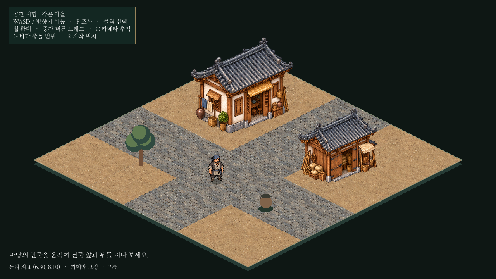

# 아이소메트릭 독립 시험 · 구현 결과

사용자 승인 범위: 기존 게임을 바꾸지 않고 작은 시험 씬을 구현·검증한다. [실행과 조작 방법](../../godot/prototypes/isometric/README.md).

## 구현 범위

12×12 바닥, 민가/창고2종, 짐꾼1종, 나무/항아리 도형 장식, 이동/발밑 충돌/카메라/클릭 선택/간단한 조사 문구를 만들었다. 새 건물은 정면 그림을 변형하지 않고 아이소메트릭 전용으로 제작했다. 인물은 공용 짐꾼 외형을 참조한 앞·뒤 대각선 시안이며 원본/영역/기준점/해시는 시험 폴더 manifest에 보관한다.

새 코드는 `godot/prototypes/isometric/`와 전용 검사/캡처에 한정한다. 기존 `project.godot`, `main.tscn`, 플레이어·탐험·도시·저장·의뢰·UI 구현은 수정하지 않았다. 기존 농지/부두 작업의 미커밋 변경은 보존하며 이번 커밋에 포함하지 않는다.

## 기술 선택

논리(u,v)를 화면((u-v)×64,(u+v)×32)로 변환한다. 연속 논리 좌표로 이동하며 기존 미술 좌표를 읽는 단위 변환 어댑터만 제공한다. 실제 도시 데이터를 이 씬에 연결하거나 저장을 이행한 것은 아니다.

물리 충돌은 화면 공간에서 실행한다. 건물의 논리 바닥을 투영한 다각형과 배우 발밑의 투영 타원을 사용한다. 충돌 후 실제 화면 위치를 역변환해 논리 위치를 유지한다. 보이는 지붕 사각형을 충돌 영역으로 쓰지 않는다.

정렬은 작은 씬의 논리 점유 사각형 사이에서 명확한 앞뒤 관계를 먼저 정하고, 나머지는 화면Y/안정적인 이름 순서로 결정한다. 순환 관계는 별도 계수로 감지하며 이 배치와 검사 위치에서는0이었다. 캐릭터가 건물 옆에 있을 때 단순Y 정렬이 잘못 가리는 경우를 피하기 위한 시험 구현이다.

선택은 카메라 변환을 역으로 적용하고 그리기 순서의 위쪽부터 검사한다. 건물/NPC는 투명 픽셀을 제외한다. 클릭은 이동이나 기존 대화를 실행하지 않는다. 원본 건물·인물의 비율을 유지하며 원본 발밑 위치를 manifest로 등록한다.

## 검증

Godot4.6.3 / 분리된 XDG 사용자 폴더에서 실행했다. 소프트웨어 OpenGL로 캡처했으며 Windows GPU 성능은 미측정이다.

`tests/isometric_prototype.gd` 결과: **ISOMETRIC_PROTOTYPE: PASS**.

- 529개 연속 좌표의 변환/역변환과 기존 좌표 단위 어댑터.
- 두 건물 각각 네 방향의 실제 그리기 순서.
- 입력 액션으로 이동하는 CharacterBody2D의 건물/맵 경계 충돌.
- 화면 방향 이동·일정한 인물 너비·발밑 고정.
- 확대/축소3단계의 실제 마우스 선택과 선택 시 이동하지 않음, 건물 선택/투명 부분 제외/지붕 뒤 NPC 선택 차단.
- 시험 입력 정리와 기존 시작 씬 유지.

`tests/capture_isometric.gd` 결과: **ISOMETRIC_CAPTURE: PASS**. 실제 씬의 전체·앞/뒤/옆·점유 범위·추적 카메라·1440p 화면을 생성하고 확인했다.

기존 `keyboard_exploration.gd`를 별도 실행하니 인벤토리 탭 검사1개가 실패했다. 원인은 테스트의 `tabs[1]` 기대값이 영약인 반면, 현재 UI의 두 번째 탭은 무기인 점이다. HEAD의 원본에서도 같은 불일치를 확인했다. 본게임/원본 검사는 수정하지 않고 `/tmp` 복사본에서 영약 탭 번호만2로 보정해 실행하여, 여섯 맵의 클릭 이동 금지·인벤토리 클릭·구매 검사를 확인했다. 이 결과를 원본 검사 통과로 표현하지 않는다.

## 남아 있는 제약과 확장 판단

- 기술적 최소 검증으로는 다음 작은 구역을 실험할 수 있다. 게임 전체 전환을 승인하거나 보장한 결과는 아니다.
- 건물 원본은 전용 시점이지만 문/기와/측면 바닥 기준점의 세밀한 정합은 후속 미술 검토가 필요하다. 나무·항아리는 도형이다.
- NPC 전체 보행 프레임/8방향/무기별 동작은 미구현이다. 현재는 대기 호흡·이동 흔들림이며 완성된 보행으로 간주하지 않는다.
- 높이 차·계단·문 통과·다리 위아래·지붕 분할·연결 성곽은 검증하지 않았다.
- 정렬은5개 대상의 전체 관계를 매 프레임 검사하는 소규모 구현이다. 큰 도시에서는 공간 분할·관련 대상만 재정렬·복합 건물 분할이 필요하다. 현재 알고리즘을 그대로 도시 전체에 적용하지 않는다.
- 144개 바닥 폴리곤은 기술 시험이다. 도시용 TileMapLayer/청크/전용 타일 atlas 선택은 추후 검증한다.
- 메뉴·의뢰·저장·미니맵 연결, 기존 도시 전체 변환, 실제 Windows 성능은 미확인이다.

다음 승인 후보는 건물2~3동이 연결된 짧은 골목 하나다. 그 단계에서 문·담장 가림과 좁은 길을 확인하고, 그다음 실제 상호작용1개, 도시 일부/지도·저장, 대규모 타일·정렬 순서로 확장한다.
