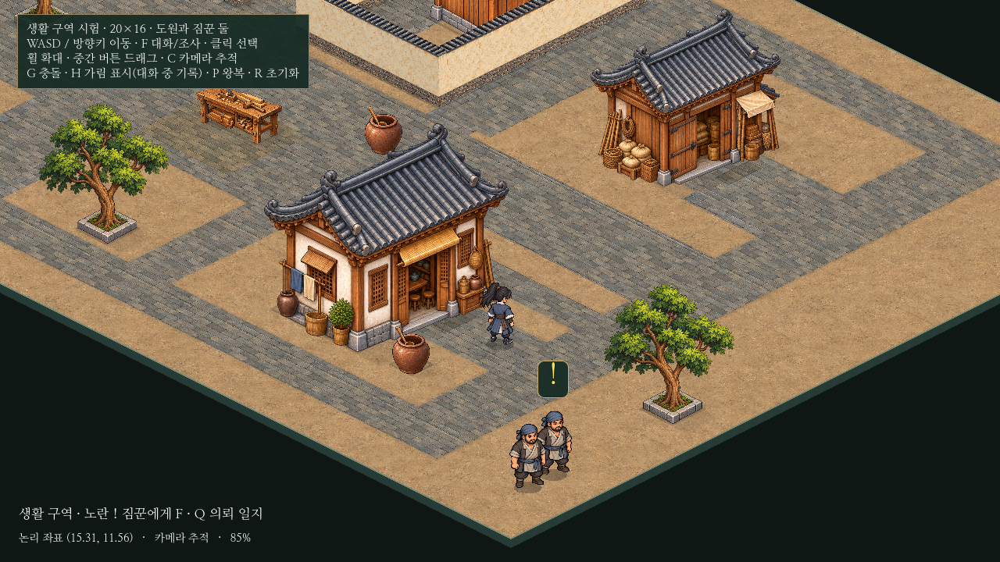

# 아이소메트릭 성능·이동 안정화

20×16 생활 구역과8×6 민가 실내만 검증했다. 도원·NPC는 모두4.8타일/초, 인물 표시 높이96·기본 카메라85%·기존 그림과 메시 밀도는 유지한다. 새 맵/인물/의뢰/보상/저장/영상은 만들지 않았다.12×12 비교 씬은 기존 배치·기능·도원9.6속도를 유지한다. 공유 시험 코드의 계산은 최적화했지만 본게임 소스와 프로젝트 설정은 바꾸지 않았다.

## 측정 환경과 해석

- Godot4.6.3, Linux/Xorg dummy1280×720, Compatibility/OpenGL, Mesa llvmpipe(LLVM19.1.7) **소프트웨어 렌더링**. CPU 한도4코어, LP_NUM_THREADS=2를 전후 동일하게 사용했다.
- 실제 렌더 창에서 수직동기화를 해제하고, 각 일반 상황은25프레임 준비 후90프레임의 `process_frame` 사이 실제 시간을 측정했다. 이 프레임 시간 측정에는 `--fixed-fps`나 녹화를 사용하지 않았다. 물리 갱신은60Hz다.
- 이전 코드는52fc7e4의 시험 소스를 `/tmp`의 분리된 프로젝트에서 실행했다. 에셋·해상도·배율·속도·왕복 입력 규칙·표본 수와 렌더링 환경은 같게 했다. 최종 변경 후 같은 검사 파일로 재측정했다. 출입은 같은3왕복이며 프레임 수는 소요 시간에 따라 다르다.
- 아래 값은 렌더링·물리 계산·스케줄링이 합쳐진 서버 결과다. GPU를 쓰는 사용자 Windows PC의 FPS로 환산할 수 없고, 한 번의 짧은 표본에서 나온 최장값을 안정적인 보장치로 보지 않는다. 자동 NPC의 경로 위상과 물리 갱신 횟수는 실제 경과 시간에 따라 다를 수 있다.
- 보행/정렬/가림/선택/카메라의 세부 비용은 같은 배치에서 함수를40회 호출해 별도로 측정했다. 전체 프레임 시간과 더해서 계산하는 값은 아니다. 엔진 process/physics 모니터도 원자료에 보관하지만 초 단위 갱신 값을 반복 표본하므로 주 표로 쓰지 않는다.

[변경 전 원자료](isometric-stability-data/before.json) · [최종 변경 후 원자료](isometric-stability-data/after.json)

## 같은 조건의 프레임 시간

| 상황 | 평균 전→후(ms) | P95 전→후(ms) | 최장 전→후(ms) |
| --- | ---: | ---: | ---: |
| 도원·NPC 모두 정지 | 73.32 → 72.80 | 88.57 → 85.79 | 110.19 → 94.84 |
| 도원만 가로 이동 | 184.96 → 103.07 | 204.03 → 136.68 | 359.03 → 152.53 |
| 도원만 대각선 이동 | 159.23 → 93.27 | 193.10 → 109.81 | 290.85 → 164.74 |
| NPC 둘만 이동 | 168.07 → 116.36 | 207.49 → 143.30 | 290.69 → 151.62 |
| 함께 이동 · 카메라 추적 | 211.76 → 119.49 | 259.42 → 155.88 | 362.48 → 184.28 |
| 함께 이동 · 카메라 고정 | 223.07 → 100.36 | 274.30 → 122.88 | 352.91 → 157.37 |
| 실내 출입 3왕복 · 암전 포함 | 65.91 → 88.94 | 185.61 → 179.83 | 247.10 → 309.81 |
| 대화·H 기록 열기/닫기 | 108.40 → 92.92 | 146.32 → 108.33 | 395.75 → 327.42 |
| Q 일지 열기/닫기 | 81.83 → 88.18 | 91.55 → 122.20 | 204.41 → 185.17 |
| 실내 이동 | 33.86 → 21.05 | 46.58 → 26.76 | 55.81 → 30.09 |

## 계산 비용과 변경 근거

| 계산 1회 | 이전 평균(ms) | 이후 평균(ms) | 평균 감소 |
| --- | ---: | ---: | ---: |
| 인물 1명 보행 메시 자세 | 3.3778 | 0.7060 | 79.1% |
| 움직임이 있는 깊이 정렬 | 4.3980 | 1.0366 | 76.4% |
| 인물 3명 정밀 가림 검사 | 1.8019 | 1.1656 | 35.3% |
| 대화 대상 선택 | 0.2704 | 0.3394 | -25.5% |
| 카메라 배치 | 0.0055 | 0.0029 | 47.5% |

1. 보행 메시의825개 정점/1,536개 삼각형은 유지했다. 원래는 매 자세마다 모든 삼각형의 선택 판정용 행 색인을 다시 만들었다. 이제 자세가 바뀌었다고 표시하고, 실제 몸통 정밀 판정이 필요한 첫 호출에서만 만든다. 멀리 빗나간 검사와 변형되지 않는 머리 검사는 만들지 않으며, 같은 자세에서는 재사용한다. 메시 변형과 실제 알파 판정은 유지한다.
2. 고정 건물·담장끼리의 정렬 그래프를 재사용한다. 움직이는 인물에 연결된 간선만 새로 계산하고, 매 단계 전체 후보를 다시 정렬하던 대신 순서가 유지되는 준비 목록을 쓴다. 기존 발밑 점유 관계/대문 아래 예외/동률 이름 순서는 같다. 소품 목록·ID·점유 사각형이 바뀌면 캐시를 폐기한다.
3. 가림 검사는 보수적인 화면 사각형으로 겹칠 수 있는 대상만 추린 뒤, 기존12개 표본과 원래의 알파/메시/담장 다각형 판정을 적용한다. 충돌 형태나 표본 수를 줄이지 않는다. 정렬·가림 결과는 이전 전체 계산과260개 배치 상태에서 직접 대조했다.
4. 선택 판정과 카메라의 표 수치는 별도 전후 측정값이다. 선택 거리·가림 조건을 완화해 속도를 얻은 것은 아니며, 작은 차이는 측정 변동을 포함한다. 카메라 배치의 절대 비용은 매우 작다.

## 대각선 떨림과 보간

프레임 계산이 느려지는 현상 외에 **물리 갱신 사이의 화면 반복**도 재현했다. 별도 검사에서60Hz 물리/120Hz 표시를 고정하고, 도원에 붙인 임시 표식과 고정된 배경 표식의 렌더 위치를 읽었다. 표식은 검사 동안 메모리에만 존재하며 게임 미술이나 영상으로 저장하지 않는다. 이 검사의 `--fixed-fps120`은 갱신 주기 검증용이며 실측 FPS 결과가 아니다.

| 대각선 이동, 19번의 화면 간격 | 보간 전 | 보간 후 |
| --- | ---: | ---: |
| 카메라 고정: 움직이는 인물 위치가 반복된 간격 | 10/19 | 0/19 |
| 카메라 고정: 이동 간격의 표준편차 | 1.94px | 0.37px |
| 카메라 추적: 배경 위치가 반복된 간격 | 10/19 | 0/19 |
| 카메라 추적: 배경 이동 간격의 표준편차 | 1.97px | 0.42px |

생활 구역과 실내가 실행되는 동안만 Godot의 물리 보간을 사용한다. 작은 범위 관리 코드가 두 씬의 수명을 세고 마지막 씬 종료 때 원래 SceneTree 설정을 복원한다. project.godot은 바꾸지 않는다. 카메라도 같은 물리 주기를 쓰며, 발밑 안내/대화 대상 안내/의뢰 표식은 화면 보간 위치를 따른다. 물리 충돌과 대화 거리·정렬 판정은 원래 논리 위치를 쓴다.

위치 초기화와 실내 복귀 때 인물/카메라의 보간 이력을 지워 예전 위치에서 따라오는 한 프레임을 방지한다. 회귀 검사에서 발견한 맵 모서리 초기화 문제도 수정 후 통과했다. 보간은 최대 한 물리 틱(약16.7ms)의 표시 지연을 더할 수 있으며, 낮은 실제 FPS 자체를 복구하는 기능은 아니다. 보행 자세는 기존60Hz·거리 기반 방식이고, 픽셀 단위 래스터 차이는 남는다.

[보간 검사 원자료](isometric-stability-data/cadence.json)

## 실내 별도 재확인

카메라 초기화 보완 전 예비 측정에서 실내가33.86→42.46ms로 늘어, 다른 상황을 제외한 동일 실내·같은 입력을3회씩 추가 측정했다. 최종 전체 측정과 이 반복 결과를 함께 보관한다.3회 평균은 이전29.39ms/이후24.67ms지만, 세 번째 반복은28.50→29.35ms로 조금 늘어 모든 시행에서 개선됐다고 판정하지 않는다.

| 같은 실내 반복 | 이전 평균(ms) | 이후 평균(ms) |
| --- | ---: | ---: |
| 1 | 32.52 | 21.81 |
| 2 | 27.15 | 22.85 |
| 3 | 28.50 | 29.35 |

[실내 이전3회](isometric-stability-data/room-before.json) · [실내 이후3회](isometric-stability-data/room-after.json)

실내는 평균 개선 경향이 있으나 편차가 있다. 반복 출입과 Q 일지는 최종 전체 표에서도 평균이 늘었고, 이 구간의 프레임 개선은 확인하지 못했다. 추가 원인을 분리해 확인하지 않은 상태이므로 보간이나 특정 코드가 원인이라고 단정하지 않는다. 이번 환경의 렌더링/스케줄링 편차와 실제 Windows GPU 환경의 차이를 분리할 자료는 없다. 실내를 포함한60fps 보장 또는 사용자 PC의 끊김 완전 해소는 확인하지 못했다. 화질·속도·인물 크기·배율을 낮추는 조정은 하지 않았다.

## 민가 입장 범위

외부 입장 허용 반경0.9→1.4타일, 문 정면에서 허용하는 좌우 폭±0.45→±0.75타일로 넓혔다. 문 정면 조건·3줄의 통행 확인·NPC 대화 우선순위·F 해제 보호는 유지한다. 뒤/벽/과도한 옆 위치와1.4타일 밖은 허용하지 않으며 실내 퇴장 범위는 기존0.9타일을 유지한다.

같은1280×720/85% 카메라에서 문 정면1.25타일 위치다. 이전에는 F 입장 안내가 없고, 변경 후에는 보인다. 이 정지 화면은 화풍/범위를 확인하는 자료이며 프레임 성능의 증거는 아니다.

| 이전 | 이후 |
| --- | --- |
|  |  |

## 검증 결과

- 기존 검사10개: isometric_prototype/alley/walkers/harmony/dialogue/gait_access/outdoor_spaces/district/passage/errand. 순환 이동, 좁은 통로/대문, NPC 충돌·양보·왕복, 가림·이름표·선택, F 대화/출입/조사와 Q/추적·H 기록, 거절→수락→조사→복귀→보고, NPC/카메라 복원, F 유지·전환 입력 보호를 포함한다.
- 새 isometric_stability: 이전 정렬/가림 알고리즘과260개 상태 비교, 정적 캐시 무효화, 지연 색인 정확성/재사용, 넓어진 정면·측면 접근과 뒤/벽/범위 차단, 보간 범위 해제 검사.
- 렌더 검사2개: isometric_walk_render의4방향 무릎/발/팔/상체 변화·크기 유지, isometric_motion_cadence의 인물/카메라 보간.
- 기존 본게임 소스·project.godot·에셋·12×12/20×16/8×6 배치 데이터의 변경 전후 해시가 같음을 확인했다. 앞서 보류된 농지/부두 변경은 이번 커밋에 넣지 않는다. 실제 플레이 저장 폴더와 분리한 XDG 폴더에서 검사한다.

[범위 보존 해시 검사](isometric-stability-data/protected.json) · [기능 검사 기록](isometric-stability-data/functional.json) · [렌더·캡처 기록](isometric-stability-data/render-checks.json)

## PC에서 짧게 확인

1. F8로 기존 실행을 종료하고 업데이트 후 아래 district.tscn을 F6으로 실행한다.
2. P로 NPC를 멈춘 뒤 넓은 길에서 W+D, W+A를 각각 눌렀다 놓는다. C로 카메라 추적을 끄고 켜서 인물과 배경의 떨림을 비교한다.
3. P로 NPC 왕복을 재개하고 대문/좁은 골목을 지난다. 인물 크기·이동속도와 발밑 표시가 유지되는지 본다.
4. 민가 정면에서 전보다 한 걸음 멀리서 F 입장을 시도한다. 뒤쪽에서는 입장할 수 없어야 한다. F를 누른 채로 기다려도 재출입하지 않아야 한다.
5. 실내를 걷고 외부로3회 복귀한다. NPC 위치/경로·카메라 배율을 확인한다. Q를 열고 닫고, 짐꾼의 부탁→조사→보고 및 H 기록을 확인한다.

이때도 끊김이 남으면 화면 해상도/모니터 주사율, 추적 on/off, 실내/외부 중 어디서 생기는지와 Godot 디버거의 프레임 그래프를 비교하면 다음 원인을 좁힐 수 있다. Windows에서의 실제 체감과 GPU 프레임 시간은 이번 서버에서 확인하지 못한 항목이다.

## 실행과 업데이트

```powershell
cd C:\Users\PC\murim-rpg
git pull --ff-only
```

기존 프로젝트 `C:\Users\PC\murim-rpg\godot\project.godot`을 열고 아래 씬을 열어 **F6**으로 실행한다. F5는 본게임이다.

- 생활 구역/의뢰/실내 출입: `C:\Users\PC\murim-rpg\godot\prototypes\isometric\district.tscn` (`res://prototypes/isometric/district.tscn`)
- 실내 단독 비교: `C:\Users\PC\murim-rpg\godot\prototypes\isometric\room.tscn` (`res://prototypes/isometric/room.tscn`). 외부 복귀/의뢰 검사는 district에서 시작한다.
- 기존 비교: `C:\Users\PC\murim-rpg\godot\prototypes\isometric\main.tscn` (`res://prototypes/isometric/main.tscn`)

재현(저장소 루트, 실제 렌더 창 필요; 경로는 원하는 쓰기 가능한 경로로 지정):

```sh
godot --path godot --disable-vsync --audio-driver Dummy --script res://tests/isometric_performance.gd -- --out=/tmp/isometric-performance.json
godot --path godot --disable-vsync --audio-driver Dummy --script res://tests/isometric_performance.gd -- --only=room_walk --out=/tmp/isometric-room.json
godot --path godot --audio-driver Dummy --fixed-fps 120 --script res://tests/isometric_motion_cadence.gd -- --out=/tmp/isometric-cadence.json
godot --headless --path godot --fixed-fps 60 --script res://tests/isometric_stability.gd
```

Linux 원측정의 공통 환경 변수는 `DISPLAY=:98 LIBGL_ALWAYS_SOFTWARE=1 LP_NUM_THREADS=2` 및 분리된 XDG 폴더다. 사용자 PC에서는 자신의 하드웨어/렌더러를 그대로 사용하며 동일한 llvmpipe 결과가 나오리라 기대하지 않는다. 이 작업으로 전체 도시로 확대하지 않는다.
