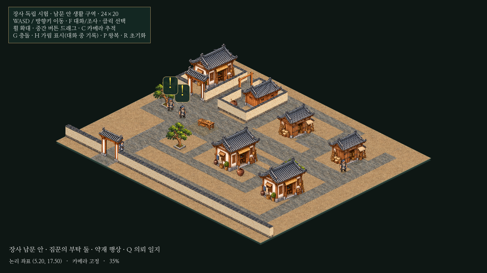
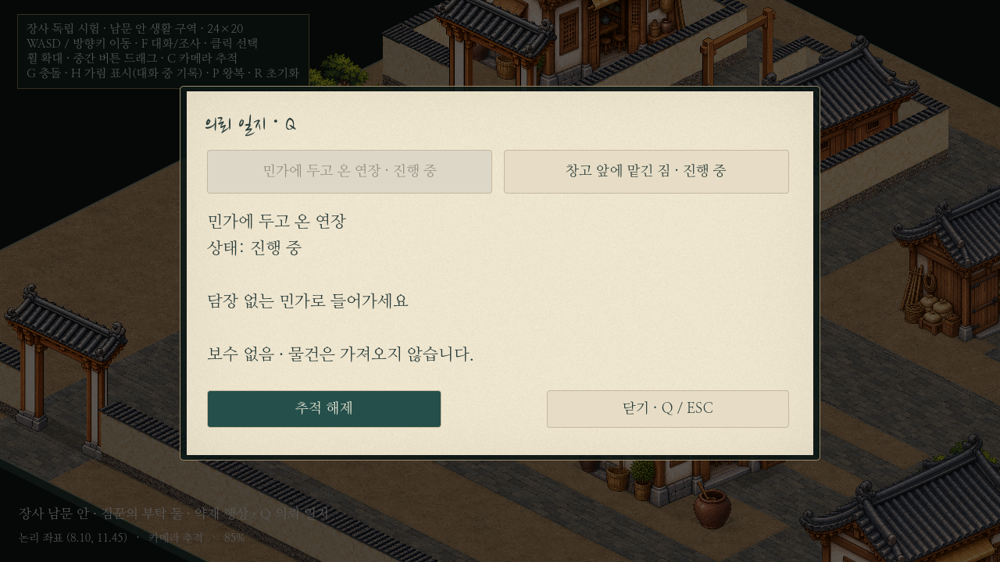
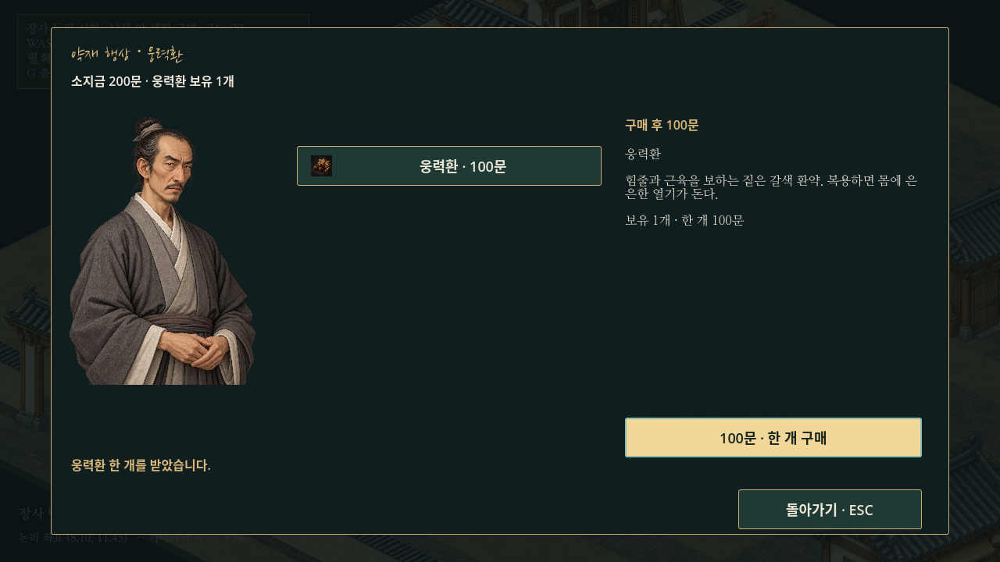

# 장사 아이소메트릭 구역 · 복수 의뢰·최소 거래 시험

24×20 논리 타일의 별도 장사 씬에 건물6동, 기존 자동 짐꾼2명, 공용 외형의 정지 상인1명을 배치했다. 기존12×12·20×16·8×6 씬과 공유 시험 코드, 본게임·저장·경제 데이터는 수정하지 않았다. 도원·NPC의 속도4.8타일/초, 표시 높이96, 보행·물리 보간·기본85% 배율을 유지했다. **새 영상은 만들지 않았다.**



전체 배치 캡처만35% 축소다. 실제 플레이의 기본85%는 그대로이며 아래 구간 화면은85%다. 남문 안쪽 통행문과 낮은 경계는 기존 대문/담장을 재사용한 시험 표현이고, 대형 성문 전용 원화를 새로 제작한 것은 아니다. 다른 지역으로 연결되는 출구도 없다.

## 배치와 실제 이동

| 구성 | 논리 좌표/설명 |
| --- | --- |
| 시작/남문 안 진입로 | (5.2,17.5), 통행문은(5.2,18.7) 부근 |
| 담장 민가 | (0.8,2)부터2×3 점유, 대문과 사유 마당 |
| 곡물 창고 | (6.8,2.2)부터1.5×2.5 점유, 실제 뒷면 그림과 목제 대문 |
| 길가 물자 창고 | (12,3.4)부터1.5×2.5 점유, 열린 앞자리 |
| 출입 가능한 민가 | (11.8,10.4)부터2×3 점유, 문 앞 약(14.61,11.56)에서 F |
| 약재 점포 | (18.2,3.5)부터1.5×2.5 점유, 행상은(20.5,6.8) |
| 공방/민가와 열린 작업 공간 | 민가형 건물(18.2,11.3), 기존 목공 작업대(6.3,9.1) 재사용 |
| 봉인 항아리 | (6.1,5.25)부터0.45×0.45 점유, 조사 앞자리 약(6.33,6.05) |

남측 진입로→서측 큰길→중앙 상점가 길→동측 공방/주거 골목→남측 길→출발점으로 도는 약53타일의 순환 동선을 만들었다. 실제 키보드 입력 검사에서 순환 구간은659물리 프레임, 약10.98초의 모의 시간이었다. 별도로 남측 통행문, 민가 대문, 창고 목제 대문과 좁은 길을 실제 이동으로 통과했다. 배치 규칙 검사는6동 모두 통과했다.

기존 민가/창고의3가지 방향·유형 그림을 재사용했으며 새 건물 그림은 제작하지 않았다. 필요한 앞/뒷면 원본을 사용하고 그림의 평면 회전이나 비균일 확대는 하지 않는다. 공용 길/문 앞 공간은 판석, 사유 공간은 연결된 담장으로 구분한다. 공용 도로 목록에는 사유 마당을 넣지 않는다.

[진입로](../../godot/prototypes/isometric/screenshots/town-entry.png) · [마당/골목](../../godot/prototypes/isometric/screenshots/town-courtyard.png) · [상점가](../../godot/prototypes/isometric/screenshots/town-market.png) · [실내](../../godot/prototypes/isometric/screenshots/town-room.png)

## 의뢰2개와 동시 진행

| 의뢰 | 제공자 | 진행 |
| --- | --- | --- |
| 민가에 두고 온 연장 | 문길 짐꾼 | 수락/사양→8×6 민가 탁자 위 대패 확인→같은 짐꾼에게 보고 |
| 창고 앞에 맡긴 짐 | 창고 짐꾼 | 수락/사양→창고 앞 기름 항아리의 마개/봉인 확인→같은 짐꾼에게 보고 |

두 의뢰는 독립된 available/active/ready/completed 상태다. 수락/사양·수행 중·보고·완료 후 잡담과 실제 조사를 구분하고, 확인 대화의 마지막 줄에서만 진행한다. 물건을 가져가거나 없애지 않으며 의뢰 보상은 없다.

Q 일지는 기존 종이 UI에 두 의뢰의 선택 행을 추가했다. 하나만 추적하며, 다른 의뢰를 수락해도 기존 추적을 뺏지 않는다. 추적하지 않는 의뢰도 조사/보고할 수 있다. 완료하면 그 의뢰의 추적만 비우고 다른 의뢰를 자동 선택하지 않는다.



실제 F/1/2/Q/H와 마우스 버튼으로 다음을 확인했다. [실제 상태 전환 기록](isometric-town-data/quest-trace.json)

| 검사 시점 | 대패 | 항아리 | 추적/돈·물품 |
| --- | --- | --- | --- |
| 두 의뢰 수락 | 수행 중 | 수행 중 | 먼저 수락한 대패 추적 유지 |
| 추적하지 않는 항아리 조사 | 수행 중 | 보고 가능 | 대패 추적 유지 |
| 민가 조사 후 복귀 | 보고 가능 | 보고 가능 | 양쪽 상태 유지 |
| 대패 보고 | 완료 | 보고 가능 | 추적 해제,300문 유지 |
| 상인에게1개 구매 | 완료 | 보고 가능 | 200문/웅력환1개 |
| 세 번 구매 후 잔액 부족 시도 | 완료 | 보고 가능 | 0문/3개, 추가 구매 거절 |
| 거래/실내 재출입 후 항아리 보고 | 완료 | 완료 | 0문/3개, 보상 없음 |
| 새 실행 | 수락 가능 | 수락 가능 | 300문/0개로 초기화 |
| 반대 순서로 조사/보고 | 완료 | 완료 | 각 완료1회,300문/0개 유지 |

## 최소 거래와 재사용 범위

시험 상인은 공용 짐꾼 도트 외형과 기존 `male_common_b` 초상화를 쓴다. 추가한 전용 초상화/도트는 없다. 웅력환1종만 판매하며 본게임의100문 가격·설명·아이콘을 그대로 읽는다. 시작 자금은300문이다. 구매량은 화면에서 확인하고, 판매/복용/장비 장착 기능은 노출하지 않는다.



[구매 전 거래 화면](../../godot/prototypes/isometric/screenshots/town-shop.png)

| 재사용한 코드/데이터 | 연결 범위 |
| --- | --- |
| iso_world/actor/space/patrol/grounding/visibility_hint | 바닥·배치·발밑 충돌·정렬·가림·보행·카메라·왕복/양보를 상속/재사용. 원본 수정 없음 |
| iso_passage와room.tscn | 민가 하나의 출입·암전·외부 상태/카메라 복원·입력 보호 그대로 재사용 |
| iso_dialogue·공용 초상화/종이 패널/기록 | 상속한 시험 대화에서 의뢰ID와 선택/마지막 줄의 처리만 연결 |
| iso_errand·quest_navigation | 기존 일지 생성/열기/닫기와 track/clear를 재사용. 시험 하위 클래스만2개 상태/선택 행을 관리 |
| city_service | 실제 상점 화면 생성·버튼·설명·초상화 틀·닫기를 상속. 본게임 관리자를 요구하는 재고/탭/상세/거래 진입 부분만 하위 클래스에서 대체 |
| player_progress.issue/purchase | 별도 PlayerProgress 인스턴스와 시험 지갑으로 실제 구매 검증/금액 차감/수량 증가 사용 |
| low_grade_elixirs/catalog_icons | 기존 상품 데이터·100문 가격·웅력환 그림 재사용 |

본게임의 상점 전체 호스트는 진행·전투·탐험 지역·장비·알림 관리자와 결합되어 있어 생성하지 않는다. 시각 구성과 구매 검증을 재사용하고, 시험 호스트가 필요한 소지금/상품1개만 제공한다. 주인공/짐꾼/상인 초상화·비화자 어둡게·배경 어둡게·H 기록도 기존 컴포넌트다. Q 일지의 본게임 지역 필터/지도와 무관한 목표get_goal 분기는 사용하지 않는다.

## 상호작용·입력·회귀 검사

- F 대상은 접근 가능한 NPC→출입문→수행 중 조사 물건 순이다. 같은 종류의 NPC는 가장 가까운 대상을 선택하되, 기존 대상과0.18타일 이내의 근소한 거리 차이에서는 대상을 유지한다. 벽·거리·가림 조건이 깨지면 즉시 해제한다.
- NPC·출입문과 NPC·항아리의 범위를 일부러 겹쳐 F 안내가 하나만 보이고 실제 동작도 일치하는지 확인했다. 대상 없는 F로 기존 시험의 일반 소품 조사 문구가 뜨지 않도록 새 시험 안에서만 차단한다. 클릭은 기존 선택 기능이며 이동/대화/조사 진입이 아니다.
- F 유지/자동 반복으로 선택을 확정하지 못하고, 수락·거절 후 단계가 건너뛰지 않는다. 보고/거래 반복에도 완료나 구매가 중복되지 않는다. 같은 화면 프레임의 중복 구매 요청은1회만 처리한다. 서로 다른 실제 구매 클릭은 정상적으로 각각 구매한다.
- 거래 중에는 트리를 정지해 이동과 배경 상호작용을 막고, 닫은 뒤 이동 중립/F 해제 보호를 사용한다. 대화 때는 도원과 상대만 멈추며, 실내에서는 외부 인스턴스를 유지해 NPC 경로·카메라·의뢰·지갑/소지품을 보존한다.
- 두 NPC 경로에서 충돌/정렬을 관측했다. 문길 짐꾼18회·창고 짐꾼12회 지점 도달, 창고 짐꾼은 도원에게2회 양보 후 왕복을 이어갔다. 검사 중 NPC가 건물/문기둥/다른 인물을 관통하지 않았다.
- 새 `isometric_town.gd`와 기존 `isometric_prototype/alley/district/passage/errand.gd` 총6검사 PASS. 기존12×12와20×16 배치/속도/기능을 유지한다. [검사 기록](isometric-town-data/checks.json)
- 본게임 소스/데이터/에셋/프로젝트 설정과 기존 시험 소스를 포함한1,057개 추적 파일의 해시가 전부 같았다. 보류 중인 농지/부두 작업은 커밋에서 제외했다. [범위 검사](isometric-town-data/protected.json)

## 성능 비교

Godot4.6.3·1280×720·85%·60Hz 물리, 동일 Xorg/Mesa llvmpipe 소프트웨어 렌더링, LP_NUM_THREADS=2에서 기존/새 씬을 연속 측정했다. 실제 렌더 창에서 준비25프레임 뒤90프레임의 실제 경과 시간을 기록했다. 성능 측정에 고정 FPS나 영상 쓰기는 사용하지 않았다. 기능 검사의 fixed-fps60은 별도다.

기존20×16은 건물4동/인물3명/정렬 소품55개, 새24×20은 건물6동/인물4명/소품88개다. 새 행상은 정지하며 자동 왕복은 양쪽 모두2명이다. 도원의 입력 패턴과 시작 지점은 같지만 맵·NPC 경로와 실제 물리 갱신 횟수는 다르다.

| 상황 | 기존 평균/P95/최장(ms) | 새 장사 평균/P95/최장(ms) |
| --- | ---: | ---: |
| 모두 정지 | 131.75 / 213.61 / 369.67 | 84.34 / 127.21 / 135.80 |
| 도원 대각선 이동 · NPC 정지 | 155.75 / 244.26 / 336.51 | 148.88 / 239.93 / 323.08 |
| 도원과 자동 NPC 둘 이동 · 카메라 추적 | 133.79 / 185.39 / 255.67 | 179.81 / 282.93 / 363.16 |

[측정 원자료](isometric-town-data/performance.json)

정지와 도원 단독 이동이 일부 빠르게 나왔다고 새 맵이 더 가볍다고 결론내리지 않는다. 소프트웨어 렌더링·초기 자원/스케줄링 편차를 포함한 단기 표본이다. 동시 이동은 평균133.79→179.81ms로 늘었다. 이 수치를 Windows GPU 성능으로 환산하거나, 건물/NPC 증가 중 어느 하나가 유일한 원인이라고 단정하지 않는다. 보행 품질·그림·속도·배율을 낮추는 조정은 하지 않았다.

## 평가와 남은 문제

탐험→두 의뢰 동시 수락→서로 다른 현장 확인→실내 왕복→선택 보고→거래까지 연결되므로 작은 실제 도시 구역으로 확장할 가치는 확인했다. 다만 **장사 전체 규모의 성능 검증을 통과한 것은 아니다.** 다음 확대 전에는 NPC 밀도와 교차 동선, 오래 플레이할 때의 프레임 시간을 사용자 PC에서도 확인하는 것이 좋다.

건물6동은 기존3유형의 앞/뒷면 그림을 재사용한 시험 배치다. 점포·공방별 전용 외관, 대형 성곽 미술, 지역 특화 장식과 UI 세부 디자인을 확정하지 않았다. 성문 바깥/다른 도시·실내 추가·본게임 의뢰/경제/전투/저장 연결도 없다. 새 실행에서는 의뢰·돈·물품이 초기화된다. R은 위치만 초기화하며 의뢰/지갑을 초기화하지 않는다.

실제 사용자의 Windows GPU·모니터 주사율·장시간 플레이와 다수 NPC의 혼잡은 미확인이다. 기능 검사는 정해진 동선과 두 NPC/상품1종 범위이며 도시 전체의 모든 경우를 증명하지 않는다. 성능 비교는 기존 씬을 변경하지 않은 별도 실험이고, 이전 안정화의 보간/캐시는 그대로다.

## 실행·업데이트

```powershell
cd C:\Users\PC\murim-rpg
git pull --ff-only
```

Godot에서 기존 `C:\Users\PC\murim-rpg\godot\project.godot`을 열고,
**`C:\Users\PC\murim-rpg\godot\prototypes\isometric\changsha.tscn`**
(`res://prototypes/isometric/changsha.tscn`)을 열어 **F6**으로 실행한다. F5는 본게임이며 이번 시험이 아니다.

- WASD/방향키 이동, F 대화·출입·조사,1/2 수락·사양, Q 일지/의뢰 선택·추적, H 대화 기록.
- 약재 행상에게 F로 대화한 뒤 거래 화면이 열린다. 구매 버튼과 ESC/돌아가기만 사용한다.
- 대패는 담장 없는 민가(문 앞 약14.61,11.56), 항아리는 목제 대문 안 창고 마당(앞자리 약6.33,6.05)이다.
- 기존 `district.tscn`(20×16), `main.tscn`(12×12), `room.tscn`(8×6)은 비교용으로 유지한다. 새 시험은 반드시 changsha에서 시작한다.

재현 명령(저장소 루트, 별도 XDG 사용자 폴더 권장):

```sh
mkdir -p /tmp/iso-town
godot --headless --fixed-fps 60 --path godot --script res://tests/isometric_town.gd -- --out=/tmp/iso-town/quest-trace.json
godot --path godot --disable-vsync --audio-driver Dummy --script res://tests/isometric_town_performance.gd -- --out=/tmp/iso-town/performance.json
godot --path godot --audio-driver Dummy --fixed-fps 60 --script res://tests/capture_isometric_town.gd
```

마지막 명령은 정지 PNG8장만 만든다. 플레이 영상 녹화·인코딩은 하지 않는다.
