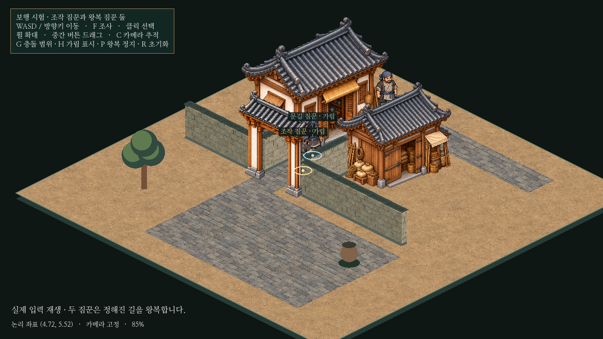

# 아이소메트릭 보행·여러 NPC 시험

기존 독립 골목에서 조작 인물의4방향 보행, 자동 NPC2명, 인물 충돌/양보/가림 이름표를 구현했다. **본게임과 건물/담장/대문 배치는 그대로다.** 이전에 중단한 농지·부두 미커밋 변경도 건드리거나 이번 커밋에 포함하지 않는다.



[실제 Godot 영상16.7초/720p·30fps](../../godot/prototypes/isometric/screenshots/walkers-play.mp4) · [마당](../../godot/prototypes/isometric/screenshots/walkers-courtyard.png) · [건물 뒤](../../godot/prototypes/isometric/screenshots/walkers-behind.png) · [복귀](../../godot/prototypes/isometric/screenshots/walkers-return.png)

## 변경 범위와 표현

`godot/prototypes/isometric/`의 인물/왕복/깊이/가림 코드와 시험 전용 경로, 전용 검사/캡처, 관련 문서만 수정했다. 논리 좌표·128×64투영·대문 충돌 기둥·건물 부지·기존 그림 원본은 유지한다. 모든 인물의 속도도 이전의4.8논리 타일/초다.

조작 짐꾼/문길 짐꾼/뒷길 짐꾼은 같은 공용 외형을 쓴다. 원본의 상체는 움직이거나 늘리지 않고, 텍스처 메시의 양 다리에 반대 위상의 움직임과 작은 발 들기를 적용한다. 앞/뒤 그림과 좌우 반전으로4방향을 표현하고 실제 이동 거리로 보행 주기를 진행한다. 정지/충돌 시에는 원본 대기 자세로 돌아간다. 전체 몸을 흔들거나 높이를 바꾸는 이전 대체 동작은 제거했다.

별도 생성 시트2개를 검토했으나 발 동작이 반복되어 채택하지 않았다. 최종 게임은 **승인된 기존 원본 그대로**를 쓰는 런타임 다리 변형 방식이다. 따라서 발/무릎의 새로운 방향별 손그림까지 완성한 결과는 아니다.

첫 실제 렌더에서는 `Polygon2D`가 아틀라스 전체를 샘플링하는 문제를 발견했다. 등록된 원본 영역을 런타임 텍스처로 한 번 올리고, 메시 UV/알파 선택을 같은 영역에 맞춰 수정했다. 최종 영상/캡처는 수정 후 다시 촬영했다.

[보행0](../../godot/prototypes/isometric/screenshots/walkers-step-0.png) · [접지1](../../godot/prototypes/isometric/screenshots/walkers-step-1.png) · [보행2](../../godot/prototypes/isometric/screenshots/walkers-step-2.png) · [반대 접지3](../../godot/prototypes/isometric/screenshots/walkers-step-3.png)

## 두 자동 NPC와 충돌

| 인물 | 정해진 논리 경로 |
| --- | --- |
| 문길 짐꾼 | (4.72,9.7)→(4.72,7.3)→(4.72,5.3)→(4.72,3.35), 역순 복귀 |
| 뒷길 짐꾼 | (7.55,5.35)→(7.55,1.5)→(4.72,1.5)→(1.4,1.5), 역순 복귀 |

자동 NPC는 조작 인물보다 낮은 우선순위이며, NPC끼리는 고정 순위로 양보한다. 충돌이 예상되면 옆으로0.46타일 움직일 공간이 있는지 **실제 발밑 충돌체의 이동 검사**로 먼저 확인한다. 공간이 없거나 계속 막히면 짧게 대기하고 앞선 경유점 방향으로 걸어 물러선다. 순간이동/충돌 해제/벽 통과로 해결하지 않는다. 플레이어가 통로를 점유하는 동안 통과를 강제하지 않으며, 비우면 왕복을 재개한다.

인물끼리도 같은 물리 레이어로 충돌한다. 대문 양쪽 기둥과 중앙 통로는 기존 분리를 유지한다. 범용 길찾기나 지도 검색은 추가하지 않았다. P는 자동 이동만 정지하며 충돌은 남긴다. R은 세 인물을 모두 초기화한다.

## 깊이와 위치 표시

세 인물 중 어느 쪽이 움직여도 깊이를 갱신한다. 인물끼리는 발밑 화면Y를 쓰고 동률은 고정 순위로 정한다. 건물/담장과의 논리 점유 관계 및 대문 아래 가림 처리를 세 인물 모두에 적용했다. 정지 중에는 동일 순서를 유지한다.

각 인물의 실제 가림을 별도로 판정한다. 표시 색은 조작 인물 금색/자동 NPC 청색이다. 이름표가 겹치면 빈 자리로 옮기고 해당 발밑과 연결한다. H로 전체 표시를 끌 수 있다. 인물 선택도 현재 보이는 변형 메시의 삼각형/알파를 검사하므로 투명한 발 주변이나 지붕 너머를 클릭하지 않는다.

[세 이름표 겹침 검사 화면](../../godot/prototypes/isometric/screenshots/walkers-labels.png) · [1440p](../../godot/prototypes/isometric/screenshots/walkers-1440p.png)

## 검증 결과

Godot4.6.3/Linux, 분리된 XDG 사용자 폴더에서 실행했다. 실제 렌더 검사는 소프트웨어 OpenGL이다. Windows/GPU 성능을 검증한 것은 아니다.

| 검사 | 결과 |
| --- | --- |
| `tests/isometric_prototype.gd` | PASS. 기존 투영/건물 앞뒤/경계·건물 충돌/선택·카메라/입력 정리/본게임 시작 씬 검사 유지. |
| `tests/isometric_alley.gd` | PASS. 기존2배 속도/대문 왕복/양 기둥 실제 접촉과 관통 방지/가림 검사 유지. |
| `tests/isometric_walkers.gd` | PASS. 4방향 보행과 고정 크기·발밑, 실제 NPC 몸 충돌, 자동 왕복, 대문 점유 후 재개, 조작 인물과 마주 오는 NPC, 두 NPC의 맞은편 왕복,3배율의 세 이름표와 안정된 정렬. 충돌 검사3,640프레임에서 최소 인물 간 거리 약0.2998타일(발밑 지름0.30), 정렬 순환0. |
| `tests/isometric_walk_render.gd` | PASS. 실제 렌더4방향에서 정지/보행의 상체 검사 영역 픽셀 차이0개, 양발 반대 접지의 발 주변 픽셀 변화1,322~1,361개. 수학적인 메시 변형만 검사한 결과와 구분한다. |
| `tests/capture_isometric_walkers.gd` | PASS. 최신10장과16.7초 실제 렌더 영상 기록. 영상 초반은 입력 기반 이동/자동 왕복이며, 마지막 보행4단계와 세 이름표는 명시적인 비교 배치다. |

이전 단일 인물 검사2개는 자동 NPC를 정지시켜 다른 위치에 두고 원래 검사 범위를 유지한다. 자동 NPC를 실제로 움직이며 확인하는 검사는 별도로 실행했다. 영상의30fps는 기록 속도이며 실기기의 플레이 성능 수치가 아니다.

## 남은 문제

- 보행은 기존 그림의 관절 변형 방식이다. 크게 확대하면 신발/무릎 변형이 보일 수 있고, 별도 원화 프레임의 세밀한 발 회전은 없다.
- 양보는 정해진 경로와 국소 회피에 한정한다. 여러 장애물에 둘러싸인 복잡한 길, 많은 인물의 병목과 길찾기는 미검증이다.
- 이름표 분산과 가림 표본 판정은3명을 대상으로 검증했다. 대규모 인원에서는 화면 공간/성능을 추가 점검해야 한다.
- 담장/나무/항아리의 시험용 미술과 대문 개폐·실내 미구현 상태는 이전과 같다.

## 업데이트와 실행

PowerShell:

```powershell
cd C:\Users\PC\murim-rpg
git pull --ff-only
```

기존 `godot/project.godot` 프로젝트에서 `res://prototypes/isometric/main.tscn`을 열고 **F6**으로 실행한다. 디스크 경로는 `C:\Users\PC\murim-rpg\godot\prototypes\isometric\main.tscn`이다. F5는 기존 본게임이다. 조작·재현 명령은 [시험 씬 안내](../../godot/prototypes/isometric/README.md)를 따른다.
