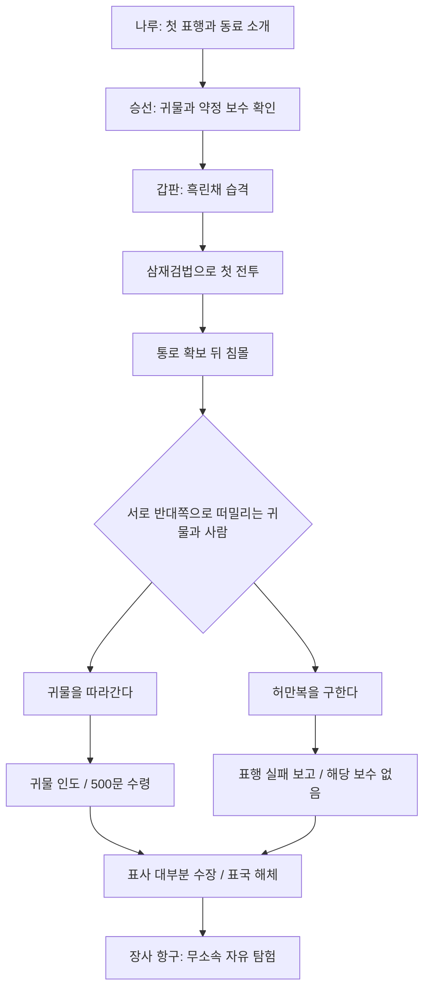

# 0장 「가라앉은 약속」 — 출항부터 장사 입성까지

## 원고 범위와 확정 사항

이번 문서는 0장의 전체 대화·연출 원고다. 기존의 출항 전 인사·승선·갑판 보고·흑린채 첫 전투 뒤에 침몰과 선택, 수령인 보고, 표국 해체 확인, 장사 도착을 연결한다. **현재 Godot 게임에 전체 대사와 분기를 연결했다.** 최신 사용자 요청에 따라 수령인의 인도/실패 보고와 마지막 대화는 장사 항구에서 진행한다. 아래 동문 입성 초안보다 항구에서 자유 탐험을 시작하는 최신 연결이 우선한다.

- 출항 전 준비는 몰입을 위한 공통 진행이다. 대화 횟수나 준비 성과로 구조·보상을 바꾸지 않는다.
- 전투는 기존 흑린채 수적과의 첫 교전 한 번을 튜토리얼로 사용한다. 더 강한 적과의 필패 전투를 추가하지 않는다.
- 선택은 귀물 보전 / 인명 구조 두 가지다. 어느 쪽도 모든 것을 지키지 못하며 숨겨진 양립 정답을 두지 않는다.
- 귀물 보전: 귀물 인도 후 **보수 500문**을 받는다. 구조: 귀물 인도 불가로 표행 실패 사실만 보고하고 해당 보수는 받지 않는다.
- 표사 대부분이 배에서 수장되어 표국은 자연스럽게 해체된다. 별도의 본거지 습격이나 전원 사망 설정을 추가하지 않는다.
- 어느 경로든 장사 항구에서 무소속 자유 탐험으로 이어진다. 강제 배상·대체 임무·선택별 능력치 보상을 추가하지 않는다.
- 표국 고유명, 귀물의 정체, 수령인의 고유명과 소속은 계속 미정이다. 아래에서는 ‘표국’, ‘귀물함’, ‘수령인’으로 표기한다.
- 기존 인물 서문길·진소옥·허만복·육승을 사용한다. **이번 구현의 구조 대상은 허만복**이다. 다른 인물의 개별 생사는 추후 조정할 수 있다. 표두 서문길은 실종 처리하고 사망 확인 장면을 단정하지 않는다.

## 화폐 표기

배경은 명 초기 1390년경이다. 기본 금전 단위는 **문(文)**으로 하고 보수를 **동전 오백 문(500문)**으로 표기한다. 홍무통보 같은 동전의 시대 분위기를 따른다. 이번 보수는 인물의 대사에서도 **오백 문**으로 통일한다.

이 게임에서 동전 1문의 잔액 단위를 1로 사용하고, 1,000문을 1관으로 묶어 읽는다. 이는 게임의 일관된 명목 표기이며 당시 실제 유통 동전 수·할인 관행·지역별 교환가치를 복원한 규칙이 아니다. 명 초기에는 대명보초 같은 지폐도 사용되었으나 그 환율과 별도 화폐 시스템은 이번에 도입하지 않는다. 현대 화폐의 구매력을 환산한 금액이 아니라, 후속 사용자 지정 보상500에 시대에 맞는 단위를 붙인 것이다.

| 선택 | 0장 귀물 인도 보수 | 장사 시작 시 차이 |
|---|---:|---|
| 귀물을 지킨다 | +500문 | 받은 돈을 가지고 자유 탐험 시작 |
| 사람을 구한다 | +0문 | 귀물 인도 보수 없이 자유 탐험 시작 |

다른 초기 소지금은 아직 미정이다. 구조 경로의 ‘보수 없음’을 전체 잔액 강제 0으로 해석하지 않는다. 두 경로 모두 기존 재산을 몰수하거나 배상금을 청구하지 않는다.

## 장면 흐름

## 1. 나루 — 아직은 동료가 있는 아침

*배에 짐을 싣는 소리. 서문길은 밧줄을 확인하고, 허만복은 젖은 널빤지를 닦는다. 주인공은 단정하지만 눈에 띄지 않는 여행 차림이다.*

**도원:** 오늘부터는 짐을 따라 걷는 게 아니라, 맡아서 지키는 거군.

**도원:** 먼저 표두님을 찾아뵙자.

### 서문길 — 필수 대화

**서문길:** 왔느냐. 밤잠은 좀 잤고?

**도원:** 예. 늦지는 않았습니다.

**서문길:** 늦는 것만 걱정했구나. 첫 표행엔 별생각이 다 들지. 밥부터 챙겨 먹어라. 빈속에는 배가 더 흔들린다.

**도원:** 제가 맡을 자리는 어디입니까?

**서문길:** 처음엔 내 눈에 보이는 곳에 있어라. 모르는 일이 생기면 묻고. 혼자 해결하려다 남의 발까지 묶지 말고.

**도원:** 폐는 끼치지 않겠습니다.

**서문길:** 폐를 안 끼치는 사람이 어딨느냐. 서로 끼치고, 서로 건져 주면서 가는 거지.

*그가 주인공의 어깨에 걸린 짐끈을 고쳐 준다.*

**서문길:** 준비됐으면 널빤지를 건너라. 갑판에서 다시 보자.

### 허만복 — 선택 방문, 이후 생존 분기를 열거나 닫지 않음

**허만복:** 발끝만 보고 걷지 말게. 배에서는 바닥도 움직여.

**도원:** 익숙해지는 데 오래 걸립니까?

**허만복:** 난 십 년이 넘었는데도 가끔 술 취한 사람처럼 걷는다네. 그러니 첫날부터 잘하려고 애쓰지 말고.

**도원:** 그 헝겊은 뭡니까?

**허만복:** 딸애가 싸 준 떡. ‘아버지는 물 위에선 밥도 못 먹느냐’고 묻더군.

**도원:** 틀린 말은 아니군요.

**허만복:** 이 사람, 대답이 빠르네. 도착하면 하나 주지. 지금 먹으면 부스러기까지 내가 치워야 하니까.

### 진소옥 — 선택 방문

**진소옥:** 약재 상자는 이쪽이에요. 밑으로 물만 안 스며들게 해 주세요.

**도원:** 한 번 더 덮겠습니다.

**진소옥:** 고마워요. 첫 표행이라 들었는데, 벌써 손이 바쁘네요.

**도원:** 가만히 서 있는 것보다는 낫습니다.

**진소옥:** 다들 처음에는 그러더라고요. 그래도 쉬라는 말이 들리면 좀 쉬어요. 부탁할 일은 아직 많으니까.

### 육승 — 선택 방문. 보수 핵심 정보는 승선 때도 반드시 제시

**육승:** 수량은 맞습니다. 봉함한 귀물은 표두님께서 따로 살피셨고요.

**도원:** 인도할 때도 봉함을 확인합니까?

**육승:** 예. 겉이 멀쩡하다고 끝이 아닙니다. 인수한 사람이 확인하고 서명을 해야 표행이 끝납니다.

**도원:** 아직 출발도 안 했는데 돌아갈 일부터 듣는군요.

**육승:** 끝낼 일을 알아야 돌아올 수 있으니까요.

## 2. 승선 — 맡긴 물건의 무게

*주인공이 승선 지점에서 F키로 상호작용한다. 선택지 없이 공통 진행한다.*

**육승:** 잠깐만요. 봉함은 여기 있습니다. 배 안에서는 표두님의 지시 없이 옮기지 마세요.

**서문길:** 수령인이 직접 확인할 물건이다. 열어 보지 말고, 봉한 채로 넘긴다.

**도원:** 약정한 보수는 얼마입니까?

**육승:** 오백 문입니다. 인도가 끝난 뒤 지급합니다. 아직 받은 돈은 없습니다.

**서문길:** 큰돈이지. 우리 몫도, 돌아가서 지급할 품삯도 거기서 나간다.

**도원:** 반드시 전하겠습니다.

**서문길:** 반드시라는 말은 아껴라. 끝내고 나서 해도 늦지 않으니.

*허만복이 마지막 밧줄을 푼다. 짧은 이동 연출 뒤 갑판 탐험으로 전환한다.*

## 3. 갑판 — 첫 번째 교전

### 출항 보고

**도원:** 표두님. 짐도 사람도 모두 올랐습니다.

**서문길:** 좋다. 저 굽이를 넘으면 물살이 좀 잦아들 게다.

**허만복:** 잦아들기 전에 멀미부터 하는 사람도 있지요. 이 친구는 아직 얼굴빛이 괜찮습니다.

**도원:** 아직은요.

**허만복:** 그래. 아직은. 그런 식으로 하루씩 버티는 거라네.

*배 옆면에서 둔탁한 소리가 난다. 작은 배들이 좁은 수로 양쪽에서 접근한다.*

**허만복:** 배가 붙습니다! 저 깃발…… 흑린채입니다!

**서문길:** 화물에서 떨어져라! 배 안쪽으로 모여!

**흑린채 수적:** 길 비켜! 상자만 내놓으면 된다!

**서문길:** 넌 이 통로를 지켜라. 내가 다른 쪽을 막겠다. 물러나는 놈은 쫓지 말고!

**도원:** 알겠습니다.

**주인공, 속말:** 배운 건 삼재검법뿐이다. 그래도 여기서 물러나면 뒤가 뚫린다.

*기존 1인 턴제 튜토리얼 전투로 전환한다. 별도 수적 고유명·초상화·전투 스탯을 새로 정하지 않는다. 무공 선택과 사용 안내는 전투 UI로 제시하며 긴 설명을 대사로 반복하지 않는다.*

### 승리 직후

*수적이 난간을 넘어 자기 배로 달아난다. 승리 화면에서 프롤로그를 종료하지 않고 갑판 장면으로 돌아온다.*

**도원:** 이쪽 통로는 막았습니다!

**서문길:** 잘했다. 이리 붙어라. 다친 사람부터—

*선체 아래에서 긴 파열음이 난다. 기습을 피해 틀었던 배가 수로의 얕은 곳에 걸리며, 이미 손상된 옆판으로 물이 밀려든다. 한 차례 전투 승리만으로 배 전체가 안전해진 상황은 아니다.*

**허만복:** 물이 찹니다! 밑창이 벌어졌어요!

**서문길:** 뜨는 널빤지부터 내려! 짐을 버려도 좋으니 사람부터 물 밖에 붙들어 놔라!

**육승:** 표두님, 저쪽 난간이—!

*갑판이 기울며 사람들이 갈라진다. 귀물함을 묶었던 고정대도 부서진다. 서문길은 반대편 사람들에게 다가가다가 가려져 시야에서 사라진다.*

## 4. 침몰 — 한쪽으로만 뻗을 수 있는 손

*주인공은 부서진 널빤지를 붙들고 물 위로 나온다. 한쪽에는 봉함한 귀물함이 떠밀려 간다. 반대편에는 부러진 난간과 밧줄에 얽힌 허만복이 있다. 그는 널빤지에 매달려 있지만, 물살에 끌리는 잔해가 함께 가라앉고 있다.*

**허만복:** 여기…… 여기 있네! 발이, 밧줄에 걸렸어!

**도원:** 손 놓지 마십시오! 지금 갑니다!

*그가 헤엄치려다가 귀물함을 본다. 봉함의 붉은 끈이 잠깐 물 밖으로 드러난다.*

**주인공, 속말:** 저건 표국이 맡은 물건이다. 놓치면 오백 문도, 돌아가서 치를 품삯도 없다.

**허만복:** 한 번만…… 잡아 주게!

**주인공, 속말:** 함은 저쪽 물살을 타고 있다. 저 사람에게 갔다 돌아올 수는 없다.

**주인공, 속말:** 함부터 잡으면…… 저 손이 그때까지 버틸까.

*물소리가 낮아지고, 나루에서의 짧은 말이 겹친다. 선택 방문을 하지 않았어도 이 회상을 위해 새로 대화했다고 처리하지 않는다. 아래 두 회상은 각각 필수 승선/표두 대사에서만 가져온다.*

**육승, 회상:** 오백 문입니다. 인도가 끝난 뒤 지급합니다.

**서문길, 회상:** 서로 끼치고, 서로 건져 주면서 가는 거지.

**주인공, 속말:** 둘 다 할 수 있다고 생각하고 싶다.

**주인공, 속말:** 하지만 지금도…… 둘 다 멀어지고 있다.

### 핵심 선택 UI

| 플레이어에게 표시할 선택 | 함께 보여 줄 짧은 결과 설명 |
|---|---|
| **귀물함을 향해 헤엄친다.** | 인도하면 약정 보수 500문을 받을 수 있다. 허만복에게 돌아갈 시간은 없다. |
| **허만복에게 손을 뻗는다.** | 눈앞의 사람을 구한다. 귀물은 물살 너머로 사라지고 약정 보수를 받을 수 없다. |

‘탐욕 / 선행’, 선악 색상, 추천 표시, 능력치 보상은 붙이지 않는다. 돈의 결과를 감춘 채 감정만으로 선택하게 하지 않는다. 물살과 떨어진 두 대상의 위치를 화면으로 분명히 보여 주어, 함을 들고 구조하거나 먼저 구한 뒤 함을 회수하는 동선이 성립하지 않음을 전달한다. **선택창에서는 진행을 멈춘다.** 읽는 시간이 길었다는 이유로 죽거나 강제 선택되지 않는다. 선택 뒤 다시 도달할 수 있는 수집물로 귀물함을 남기지 않는다.

## 5A. 귀물을 지킨다 — 대답 없는 이름

*주인공이 귀물함을 따라간다. 함을 붙든 뒤 돌아보지만, 기울어진 난간이 물속으로 넘어간다. 허만복의 손은 보이지 않는다. 죽음을 길게 전시하거나 비난하는 마지막 절규를 넣지 않는다.*

**도원:** 허만복 어르신!

*대답이 없다.*

**도원:** 조금만…… 조금만 더 버텼다면.

*그는 함을 끌어안고 겨우 얕은 기슭에 닿는다. 봉함은 남아 있다.*

**주인공, 속말:** 내가 늦은 게 아니다.

**주인공, 속말:** 다른 쪽으로 간 거다.

### 밤, 임시 피난처

*먼저 떠내려온 생존자들이 젖은 옷을 짠다. 육승이 살아남은 사람의 이름을 확인한다.*

**육승:** 표두님은 아직 못 찾았습니다. 허 선원은…… 함께 못 오셨습니까?

**도원:** 물에서 봤습니다.

**육승:** 그랬군요.

**도원:** 손을 뻗으면 닿았을지도 모릅니다.

*육승이 붓을 내려놓는다. 당장 위로나 판결을 말하지 않는다.*

**도원:** 함이 떠내려가고 있었습니다. 그걸 놓치면 아무것도 남지 않을 것 같아서.

**육승:** 함은…… 지키셨군요.

**도원:** 예.

*잠깐의 침묵. 육승은 허만복의 이름 옆에 생존 표시를 하지 않는다.*

**주인공, 속말:** 그 대답만큼은 어렵지 않았다. 지켰느냐고 물었으니까.

## 5B. 사람을 구한다 — 살아남은 사람의 무게

*주인공은 허만복에게 헤엄쳐 가 밧줄을 푼다. 두 사람이 부서진 널빤지를 함께 붙든다. 귀물함은 반대편 물살 너머로 사라진다.*

**허만복:** 뒤에…… 상자가…….

**도원:** 지금 고개 돌리지 마십시오. 널빤지부터 잡으세요.

**허만복:** 내가 무거워서…….

**도원:** 손 놓지 마세요. 나루에서 발끝만 보지 말라 하셨잖습니까.

*두 사람은 겨우 기슭에 닿는다. 허만복이 물을 토하고 한동안 숨을 고른다.*

**허만복:** 자네가 아니었으면, 나는…….

**도원:** 말은 나중에 하십시오.

*주인공은 허만복의 호흡을 확인한 뒤 비어 있는 수면을 돌아본다.*

**주인공, 속말:** 살아 있다. 그걸로 됐다고 생각했는데.

**주인공, 속말:** 함이 떠내려간 쪽을 자꾸 보게 된다.

### 밤, 임시 피난처

**육승:** 귀물은 찾지 못하셨습니까?

**도원:** 놓쳤습니다. 허 선원을 꺼내느라…….

**육승:** 예. 인도할 물건이 없으니 보수는 청구할 수 없겠습니다.

**도원:** 그 돈을 기다리던 사람들도 있겠지요.

**육승:** 있었지요. 그래도 지금 그 빚까지 당신에게 넘기지는 않겠습니다.

*허만복이 기침을 하며 몸을 일으킨다.*

**허만복:** 내 탓이네. 내가 물에 빠지지만 않았어도—

**도원:** 어르신 탓이 아닙니다.

**허만복:** 하지만 자네 몫까지 잃었잖나.

**도원:** ……살아 돌아가셔야지요. 기다리는 분도 있으실 테니.

*허만복이 고개를 숙인다. 주인공은 조금 늦게 덧붙인다.*

**도원:** 제가 구한 걸 미안해하지는 마십시오.

**주인공, 속말:** 저 사람에게는 그렇게 말할 수 있었다.

**주인공, 속말:** 나한테도 같은 말을 해 줄 수 있을지는 모르겠다.

*사람을 구했는데도 돈과 잃은 기회를 떠올리는 자신에 대한 불편함을 남긴다. 살아난 사람이 훗날 큰 보물을 주겠다고 약속해 선택의 손해를 상쇄하지 않는다.*

## 6. 표국 해체 — 돌아갈 곳이 사라지다

*두 경로 공통. 며칠 동안 구조와 수습을 기다린 뒤의 대화다. 잠깐의 자막과 장면 전환으로 시간 경과를 전달한다. 육승은 손상된 운송 서류를 말린다. 배에 타지 않았던 사람까지 모두 죽었다고 하지 않는다.*

**도원:** 더 찾은 사람이 있습니까?

**육승:** 오늘은 없습니다. 배에 올랐던 표사 대부분이 돌아오지 못했습니다.

**도원:** 표두님도요?

**육승:** 아직 소식이 없습니다.

*육승이 명단을 접는다.*

**육승:** 이 인원으로는 다음 표행을 받을 수 없습니다. 남은 사람들도 각자 돌아갈 곳을 정했습니다.

**도원:** 그럼 표국은…….

**육승:** 이름을 걸고 일을 맡을 사람이 남지 않았습니다. 지금은 여기까지인 것 같습니다.

**도원:** 제 첫 표행도 끝나지 않았는데요.

**육승:** 끝을 확인하는 일은 남았습니다. 수령인에게 무슨 일이 있었는지는 알려야 합니다.

### A 추가 대화

**육승:** 귀물과 남은 인도 서류를 가지고 가 주세요. 받아 갈 사람이 봉함을 확인할 겁니다.

**도원:** 보수는 누가 받아야 합니까?

**육승:** 원래는 표국이 받습니다. 하지만 이제 그 이름으로 인도할 사람도, 일을 이어 갈 곳도 없습니다.

**육승:** 당신이 마지막으로 물건을 지켰습니다. 남은 사람들이 함께 적은 확인서입니다. 대신 인도하고 보수를 받으세요.

**도원:** 제가 전부 받아도 되는 겁니까?

**육승:** 남은 사람들이 동의했습니다. 대신 받아 갈 몫을 따로 맡긴 것도 아닙니다.

*아직 전하지 못한 품삯을 주인공이 법적으로 모두 갚아야 한다는 설정을 추가하지 않는다. 인도 대가를 받는 경위를 분명히 하고, 그 돈을 받는 것이 구조하지 못한 책임을 지워 주지는 않게 한다.*

### B 추가 대화

**육승:** 물건을 대신 구해 오실 필요는 없습니다. 표행에 실패했다는 사실만 전해 주세요.

**도원:** 그걸로 되는 겁니까?

**육승:** 그걸로 사라지는 일은 없겠지요. 그래도 없어진 물건을 있다고 말할 수는 없으니까요.

**도원:** 알겠습니다. 제가 가겠습니다.

*강제 배상·새 심부름·귀물 수색 퀘스트를 부과하지 않는다.*

## 7A. 수령인 — 오백 문의 무게

*장사 항구의 수령인이 봉함과 서류를 확인한다. 이 항구에서 물건을 수령한다는 것 외에 그의 본거지나 소속 세력은 정하지 않는다.*

**수령인:** 봉함은 그대로군. 인도 서류도 맞고.

**도원:** 표행 중 흑린채의 습격을 받았습니다. 배가 가라앉았고, 표사 대부분이 돌아오지 못했습니다.

**수령인:** ……표두도?

**도원:** 아직 찾지 못했습니다. 표국은 더 이어 가지 못하게 됐습니다.

*수령인이 확인서를 읽고, 돈꾸러미를 탁자 위로 민다.*

**수령인:** 남은 사람들이 당신에게 인도를 맡겼군. 약정한 보수 오백 문이오.

**도원:** 이 돈이…… 전부입니까?

**수령인:** 약정은 그렇소. 물건을 인도받았으니 지급하는 거요.

**도원:** 예. 확인했습니다.

*보수 **500문**을 한 번 지급한다. 손에 닿는 돈 소리와 물속에서 끊겼던 소리를 짧게 겹친다. 수령인을 일부러 잔혹하게 웃거나 죽음을 조롱하는 인물로 만들지 않는다.*

**수령인:** 돌아갈 곳은 있소?

**도원:** 이제 정해야 합니다.

**수령인:** 그렇군. ……가는 길 조심하시오.

*밖으로 나온 주인공이 돈꾸러미의 매듭을 고친다.*

**주인공, 속말:** 이 정도면 당장 지낼 곳도, 다음 길도 구할 수 있다.

**주인공, 속말:** 그 사람은 집에 돌아갈 수 있었을 텐데.

**주인공, 속말:** 돈을 받았다고 내가 한 일이 달라지는 건 아니다.

**주인공, 속말:** 그런데 돈을 놓고 나오지도 못했다.

## 7B. 수령인 — 받을 수 없는 돈

**수령인:** 인도 서류를 가져왔소?

**도원:** 물건을 전하러 온 게 아닙니다. 표행이 실패했다는 사실을 알리러 왔습니다.

**수령인:** 귀물은?

**도원:** 배가 가라앉았습니다. 되찾지 못했습니다.

*수령인은 한동안 대답하지 않는다.*

**수령인:** 습격이 있었던 건 들었소. 표국에는 더 맡길 수 없는 건가?

**도원:** 배에 올랐던 표사 대부분이 돌아오지 못했습니다. 남은 사람들도 흩어졌습니다.

**수령인:** ……알겠소. 실패 보고는 받았소. 물건을 인도받지 못했으니 약정한 보수는 지급할 수 없소.

**도원:** 예. 알고 왔습니다.

**수령인:** 그 밖에 전할 말이 있소?

**도원:** 없습니다.

*배상금이나 다른 임무를 요구하지 않는다. 구조한 일을 수령인에게 증명해 동정금이나 다른 보상을 얻는 분기를 만들지 않는다.*

*밖으로 나온 주인공이 잠시 멈춰 선다.*

**주인공, 속말:** 사람을 구하러 갔다고 말할 뻔했다.

**주인공, 속말:** 그 말을 하면, 조금은 덜 실패한 사람이 될 것 같아서.

**주인공, 속말:** 오백 문이면…….

*그는 그 뒤를 끝까지 계산하지 않는다.*

**주인공, 속말:** 돌아가도 같은 쪽으로 손을 뻗을 것 같다.

**주인공, 속말:** 그렇다고 아깝지 않은 건 아니다.

## 8. 각자의 길 — 장사로

### A 경로의 마지막 밤

*주인공은 마른 옷과 봉함 서류를 정리한다. 귀물함은 이제 없다. 침상 옆 돈꾸러미가 남았다.*

**주인공, 속말:** 물건은 전했다. 받을 것도 받았다.

**주인공, 속말:** 끝낸 일인데, 자꾸 그 물가로 돌아가는군.

### B 경로의 마지막 밤

*허만복은 육로로 귀가할 채비를 한다. 젖었다 말린 떡 보자기를 풀었다가 다시 접는다.*

**허만복:** 떡을 하나 주겠다고 했는데. 이젠 먹을 꼴이 아니네.

**도원:** 다음에 주십시오.

**허만복:** 그래. 다음에. ……다음이 있다는 게, 참 이상하군.

**도원:** 집에 가시면 늦었다고 한 소리 들으실 겁니다.

**허만복:** 들으면 듣지. 이번엔 끝까지 듣고 있어야겠네.

*헤어진 뒤 주인공이 자신의 가벼운 짐을 내려다본다.*

**주인공, 속말:** 저 사람이 돌아갈 집이 남았다.

**주인공, 속말:** 나는 내일 어디서 자야 할지부터 정해야 한다.

### 공통 — 장사 항구

*장사 항구. 부두와 시내에서 짐수레와 상인의 목소리가 들린다. 표국의 표식은 더 달고 있지 않다. 장비 수치나 전투 컨디션에 불이익을 부여하는 연출은 아니다.*

**도원:** 이제 누가 다음 행선지를 정해 주지는 않겠군.

#### A 전용 속말

**주인공, 속말:** 오백 문이 있다. 덕분에 당장은 버틸 수 있다.

**주인공, 속말:** 덕분이라는 말이…… 누구한테 하는 말인지 모르겠다.

#### B 전용 속말

**주인공, 속말:** 맡은 일은 끝내지 못했다. 누군가는 돌아갔다.

**주인공, 속말:** 어느 쪽도 없던 일로 할 수는 없겠지.

### 공통 — 조작 재개

**도원:** 장사 항구인가. 우선 시내로 들어가 보자. 맡을 만한 일거리라도 있겠지.

*여기서 0장 종료. 무소속 자유 탐험으로 조작을 넘긴다. 이후 성안 첫 상점 어귀에 접근하면 기존 [장사 도입 대화](../quests/changsha-dialogues.md)의 포목상이 먼저 말을 건다. 0장 종료와 장사 입구의 동일한 혼잣말을 두 번 재생하지 않는다. 옷감 배달 → 식기 회수 → 농기구 전달만 자동 도입 연계이고 나머지 여섯 의뢰는 독립 일반 퀘스트다.*

## 구현 시 지켜야 할 분기·연출 기준

- 한 번의 선택을 저장해 해당 경로의 구조 결과·인도 대화·보수·장사 입구 대사만 바꾼다. 선택 뒤 다시 보고하면 500문이 반복 지급되는 일이 없어야 한다.
- 귀물 인도 보수의 지급 시점은 ‘귀물을 선택했을 때’가 아니라 ‘수령인이 실제 인도를 확인했을 때’다. 구조 경로에는 지급 이벤트를 호출하지 않는다.
- 장사 입구 진입과 0장 완료는 두 경로에 공통이다. 돈이 없어 진입하지 못하는 조건을 추가하지 않는다.
- 사람을 구한 쪽은 생존자의 고마움이 있고, 귀물을 지킨 쪽은 실제 경제적 이점이 있다. 어느 쪽도 결말 직후 보상·비난으로 다른 쪽의 의미를 지우지 않는다.
- 후회는 ‘다른 선택이 정답이었다’는 판결이 아니다. 귀물 쪽은 구조하지 않은 사람에 대한 책임, 구조 쪽은 잃은 품삯·앞날과 손해를 계산하는 자신에 대한 불편함을 남긴다.
- 대화 참여자를 함께 표시하고 발언자만 밝게 처리한다. 속말은 주인공 이름에 ‘속말’을 표시하며, 회상은 이름 옆에 ‘회상’을 표기해 현재 대화로 혼동하지 않게 한다. 수적·수령인은 공용 중년 남성 초상화 후보로 두고 전용 인물 외모나 전투 수치를 새로 정하지 않는다.
- 상호작용과 다음 대사는 F키다. 핵심 두 선택은 마우스 또는 키보드로 명시 선택하도록 하며, 첫 선택에 초점을 주더라도 F 연타로 즉시 확정되지 않도록 입력을 분리한다. UI 상세 구현은 후속 작업이다.

현재 구현·실행 방법과 저장 범위는 [0장 구현 안내](chapter-00-implementation.md)를 따른다.
