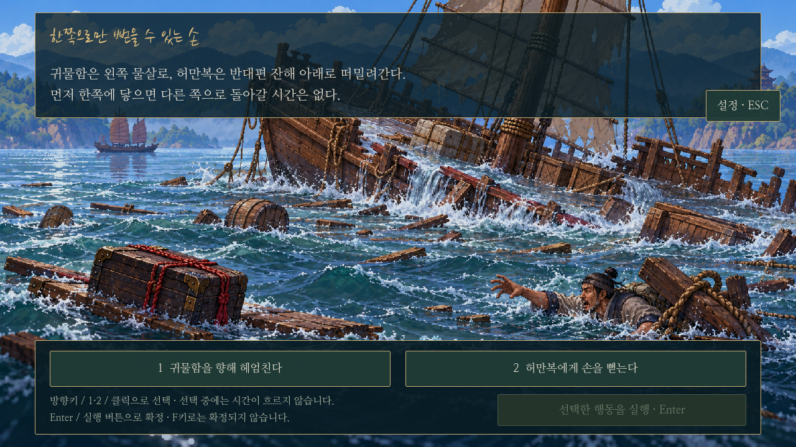
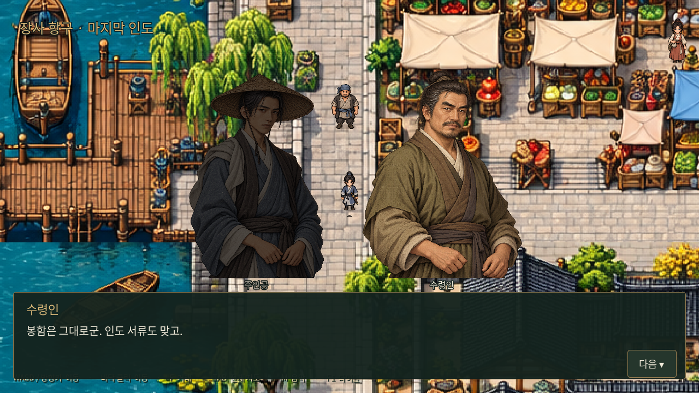
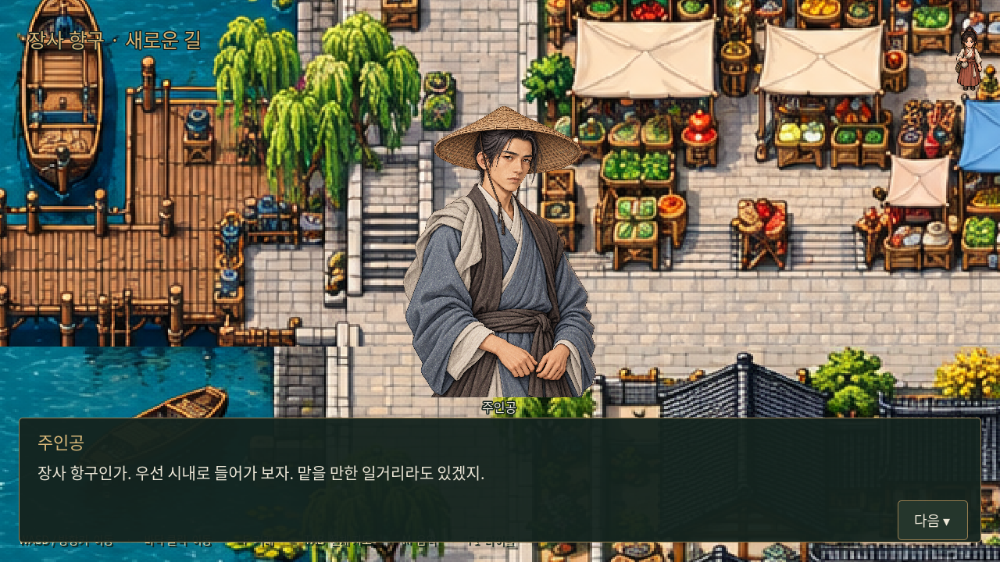
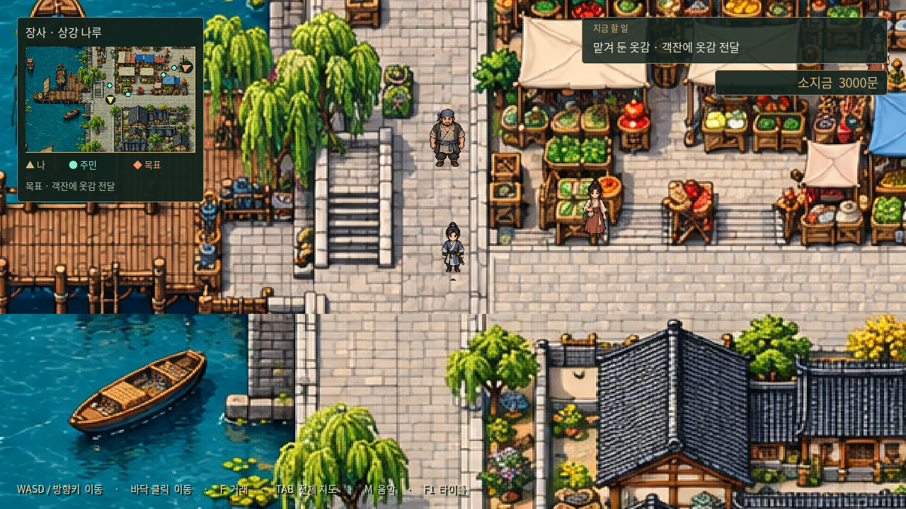

# 0장 전체 진행 구현

Godot의 **표행 시작**으로 나루 인사 → 승선 → 갑판 보고 → 흑린채 튜토리얼 전투 → 침몰 → 귀물/구조 선택 → 표국 해체 → 장사 항구의 인도/실패 보고 → 마지막 독백 → 1장 포목상 도입 대화 → 첫 의뢰 수락 → ‘1장’ 표시 → 이동 재개까지 진행한다. 기존 ‘전투만 체험’은 첫 전투가 끝나면 체험 결과 화면을 보여 주고, ‘장사 자유 탐방’은 스토리와 별개의 탐방 진입점이다.

## 조작과 분기

- 이동은 WASD/방향키만 지원한다. 가까운 인물과 대화·다음 대사·승선은 F키다. 화면의 다음 버튼으로도 대사를 넘길 수 있다.
- 나루에서 표두 서문길과 먼저 대화한 뒤 승선한다. 다른 인물 방문은 필수가 아니며 보상·구조 가능 여부를 바꾸지 않는다.
- 전투 승리 후 대사를 계속 읽으면 두 선택이 나타난다. 방향키/1·2 또는 버튼 클릭으로 고른 뒤 Enter 또는 별도 실행 버튼으로 확정한다. F는 확정하지 않는다. 기본 선택·시간 제한은 없다.
- 귀물을 지키면 허만복에게 돌아가지 못한다. 봉함과 인도 서류를 수령인이 확인한 후 **3,000문**을 한 번 지급한다. 구조하면 허만복이 살아남지만 귀물을 잃고 해당 보수를 받지 않는다. 금전적 이점과 두 종류의 후회는 원고대로 남긴다.
- 이번 실행에서는 별도 초기 재산이 아직 설정되지 않아 새 표행의 소지금을 0문으로 초기화한다. 0장 보수 차이는 3,000문/0문이다. 다른 초기 재산의 기획을 영구적으로 확정한 것은 아니다.
- 상호작용을 반복하거나 저장을 불러와도 보수를 다시 지급하지 않는다. F1은 현재 진행을 취소하고 타이틀로 돌아간다.

## 장사 항구 연결

최신 사용자 요청에 따라 수령인과의 정산/실패 보고도 장사 항구에서 진행하고, 두 경로의 마지막 독백 이후 같은 항구에서 조작을 넘긴다. 시작 좌표는 원본 맵 기준 `[280, 500]`이다. 동문 입성 초안에서 위치를 변경했으며 혼잣말을 중복 재생하지 않는다. 대화 중 이동·전체 지도 열기는 막고, 종료 뒤 미니맵·소지금·TAB 지도와 시설 NPC 상호작용을 사용할 수 있다.

표국은 표사 대부분의 수장으로 해체되고 주인공은 무소속이 된다. 강제 배상·추가 인도 임무·새 무공이나 능력치 보상은 없다. 장사의 9개 퀘스트 수락/완료 시스템은 여전히 별도 작업이며 이번 0장 연결에 임의로 추가하지 않았다.

## 저장

0장 마지막 대화 종료 시 Godot 사용자 데이터 경로 `user://chapter_00.json`에 완료 여부·선택·보수 수령 여부·소지금을 저장한다. 타이틀의 **0장 이후 이어하기**로 분기 결과와 소지금을 복원하고 항구에서 재개한다. 이는 **0장 완료 시점의 체크포인트**이며 중간 대사·전투·도시의 임의 위치·퀘스트 진행을 저장하는 일반 저장 시스템은 아니다. F1이나 새 표행 시작은 완료 체크포인트를 삭제하지 않고, 다른 경로로 다시 0장을 완료하면 최신 결과로 갱신한다. 저장 파일은 저장소에 커밋하지 않는다.

## 구성과 연출

- 원고: `docs/story/chapter-00-dialogues.md`.
- `python scripts/export_prologue_dialogue.py`: 원고의 대사 156줄을 25개 장면 JSON으로 내보낸다. 게임은 Markdown을 직접 해석하지 않는다. 해당 스크립트는 개발용이며 Windows 사용자가 실행할 필요는 없다.
- `godot/data/prologue_dialogues.json`: 실행 대사·속말/회상 표시·장면 제목.
- `godot/scripts/prologue.gd`: 분기·장면 순서·일회 보수·항구 연결·완료 체크포인트.
- `godot/scripts/story_visual.gd`: 기존 나루/갑판 그림의 색조와 Godot의 수면·잔해·귀물함 도형을 사용한 컷신. 새 고해상도 침몰 일러스트나 별도 애니메이션 영화는 제작하지 않았다.
- 대화에는 공용 초상화를 사용하고 발언자만 밝게 표시한다. 수적·수령인은 별도 정체나 전투 스탯을 부여하지 않는다.

## 검증과 실제 화면

```sh
godot --headless --audio-driver Dummy --path godot --script res://tests/prologue.gd
godot --headless --audio-driver Dummy --path godot --script res://tests/smoke.gd
# 그래픽 디스플레이가 있는 환경
godot --audio-driver Dummy --path godot --script res://tests/capture_prologue.gd
```

분기 검사는 F 입력, E 비활성, 무기본 선택, 명시 확정, 양쪽 결말, 보수 차이와 중복 방지, 항구 대화 위치, 이동 복귀, 체크포인트 재개와 중간 초기화를 검증한다. 캡처 스크립트는 실제 튜토리얼 전투를 네 번의 공격으로 마친 뒤 두 경로를 끝까지 진행한다. 테스트 시에는 실제 플레이 저장 파일을 덮어쓰지 않도록 별도의 Godot 사용자 데이터 환경을 사용한다.







## 1장 도입으로 직접 연결 — 최신 변경

0장의 마지막 독백 뒤 이동을 잠시도 넘기지 않고 [1장 도입](chapter-01-intro.md)으로 이어진다. 포목상 대화로 첫 의뢰를 받은 뒤 제목 없는 ‘1장’을 한 번 표시한다. 저장 버전 2는 수락 상태와 표시 여부를 포함하며 버전 1 저장도 지원한다. 위의 ‘독백 뒤 즉시 자유 탐험’과 ‘퀘스트 수락 미구현’ 설명보다 이 최신 변경이 우선한다. 첫 의뢰 수락·목표 안내까지만 구현했고, 배달/완료와 나머지 의뢰는 별도 작업이다.

## 키보드 이동과 F 상호작용

맵의 클릭 이동과 인물 클릭 자동 접근을 제거했다. WASD/방향키로 인물에게 다가가 F로 대화·승선을 실행한다. 거리와 벽 너머 상호작용 차단은 그대로다. 대화의 다음 버튼과 전투/선택지 등 UI는 마우스로 조작할 수 있다.

`tests/prologue_f_input.gd`는 키보드 이동 입력과 실제 F 키 이벤트로 도입 대사·나루4인·승선·갑판2인·튜토리얼 진입을 확인한다. 한글 논리키가 실린 물리 F와 E 비활성도 확인한다. `tests/keyboard_exploration.gd`는 맵6곳에서 클릭이 이동·대화·지역 이동을 만들지 않는지, 인벤토리·거래 UI 클릭은 작동하는지 검사한다.
